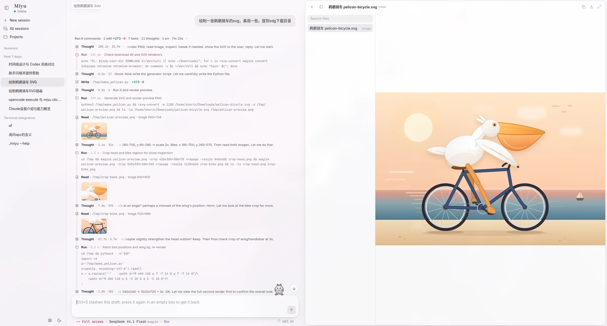
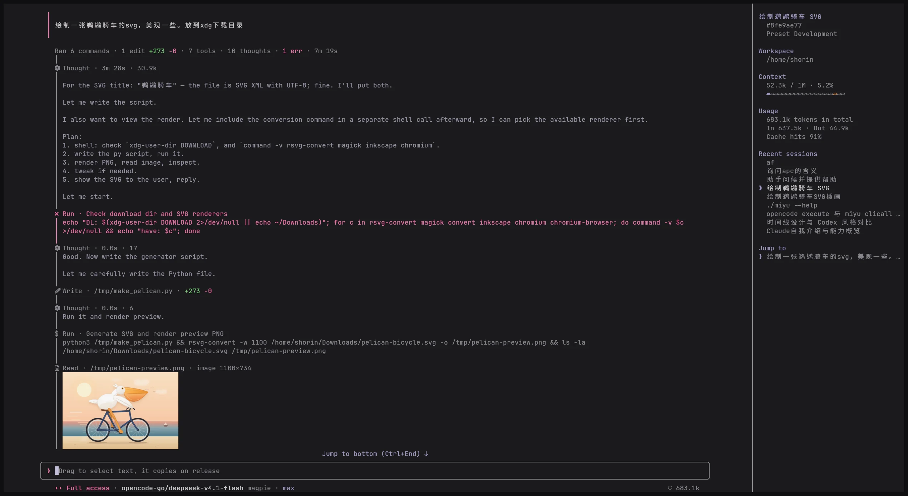
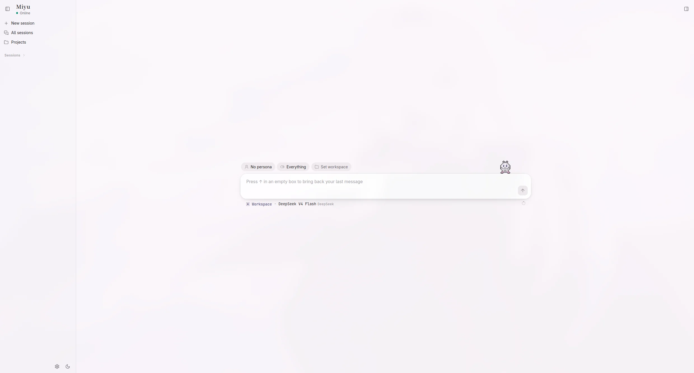
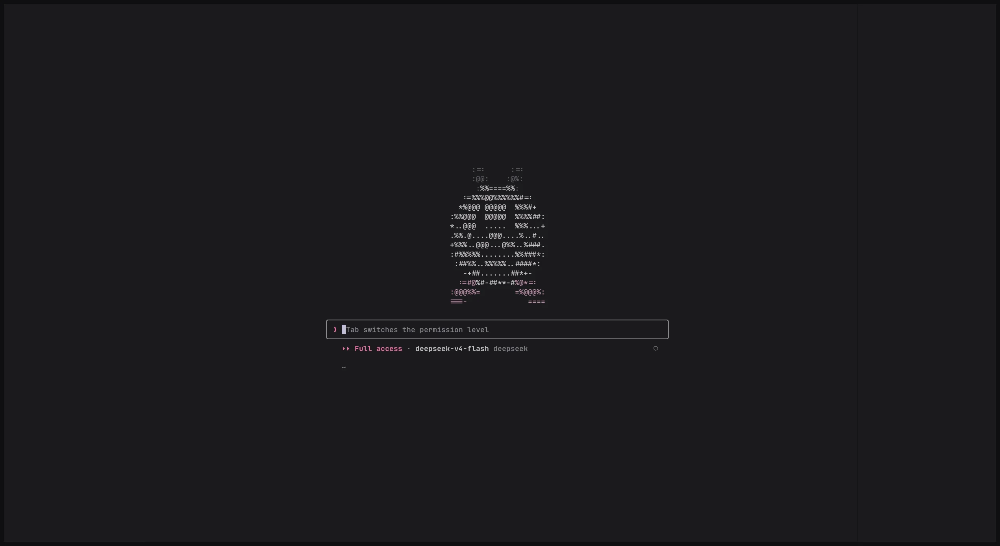
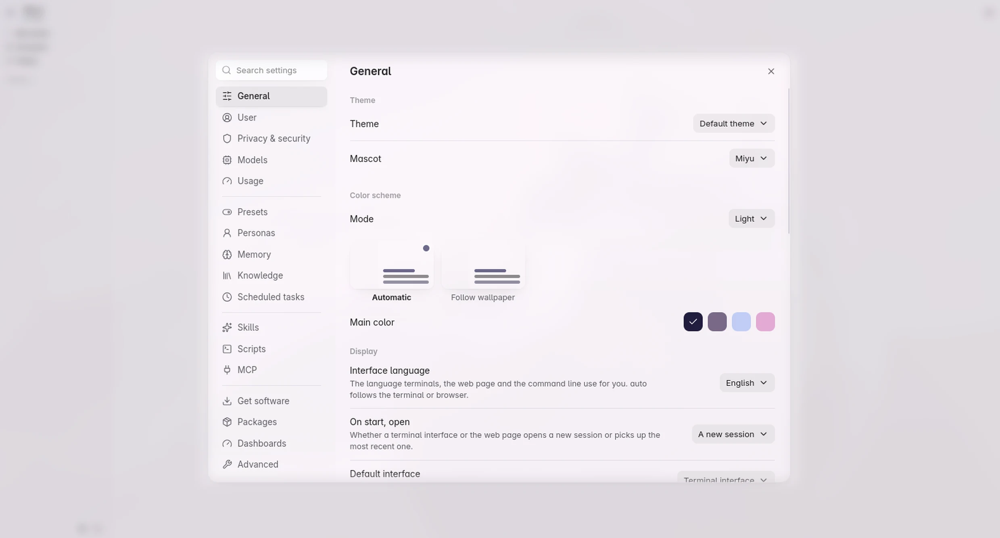

🚧 Under construction

  

  
  
  
  

  English | <a href="README.zh-CN.md">简体中文</a>

# Miyu

Miyu is an Agent Harness that is simple and easy to pick up, clean and good-looking, extremely lightweight, fast, and extensible and customizable. It is designed the Linux way, and all of its code is written by the world's frontier AI. Memory, knowledge bases, subagents, cross-session messaging, Loop, Skills, MCP and other basic features work out of the box, and you can install extra packages for all kinds of abilities, such as connecting chat platforms, voice input, a voice assistant and more.

## Preview

**Web · in a conversation**

**Terminal · in a conversation**

More screenshots (new session, settings)

 

**Web · new session**

**Terminal · new session**

**Web · settings**

## Extreme performance

Miyu beats mainstream harnesses in interaction speed, CPU usage, memory usage, disk overhead and more. `litemiyu`, distilled from it, takes lightness to the extreme without giving up any of the experience.

Lightweight does not mean low quality: in benchmarks, Miyu's pass rate and token consumption match or beat mainstream harnesses.

## Quick start

Read the following articles for a quick look at how to install Miyu and the basics of using it.

- [Quick start](docs/en/guide/quickstart.md)
- [Full documentation](docs/en/README.md)

## License

AGPL-3.0-or-later, see `LICENSE`.

The list of third-party data kept in the repository and their licenses is in "资源里的第三方数据" in `docs/blueprint/licenses.md`; the fonts, ONNX Runtime and the like shipped in release packages keep their own licenses, with the original text included in the package.

The names and logos of providers and models are trademarks of their respective owners. Miyu only fetches them from models.dev and lobe-icons at run time and caches them on your machine; they are not shipped in the package, and using them does not mean those owners endorse or sponsor Miyu.

The old Miyu (the `legacy-0.7` branch, and the `v0.7.x` and earlier tags and releases) stays under the MIT license, see `LICENSE` on that branch; the fonts bundled with the old version keep their own licenses (OFL-1.1).

## Star history

<a href="https://star-history.com/#miyu-agent/miyu&Date">

  <picture>
    <source media="(prefers-color-scheme: dark)" srcset="https://api.star-history.com/svg?repos=miyu-agent/miyu&type=Date&theme=dark">
    
  </picture>
</a>
