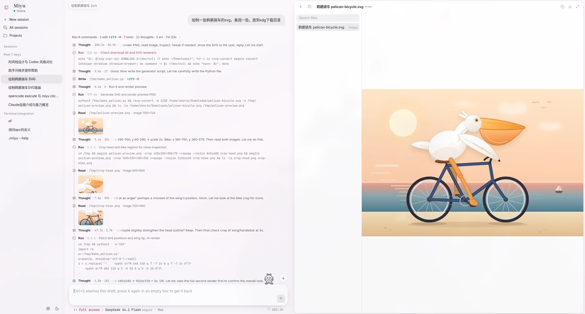
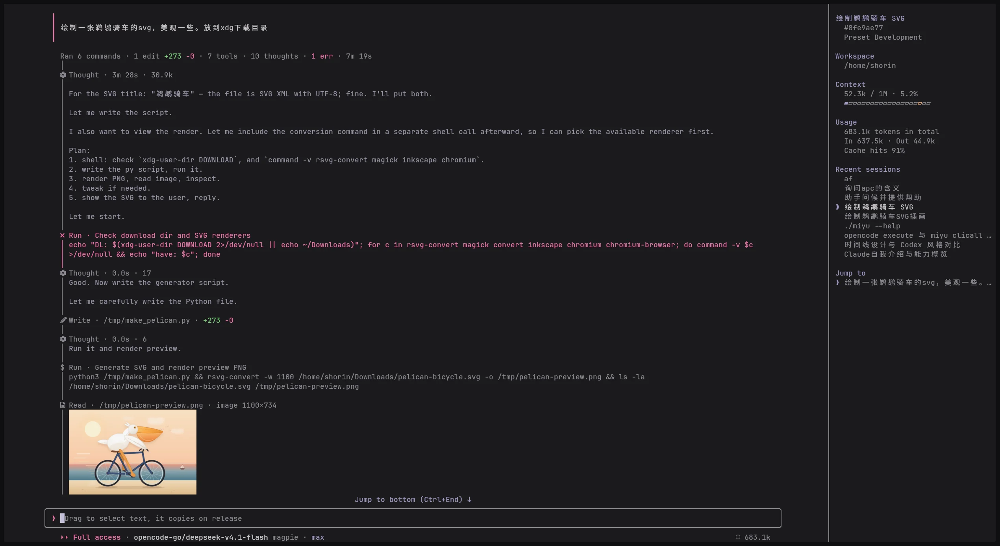
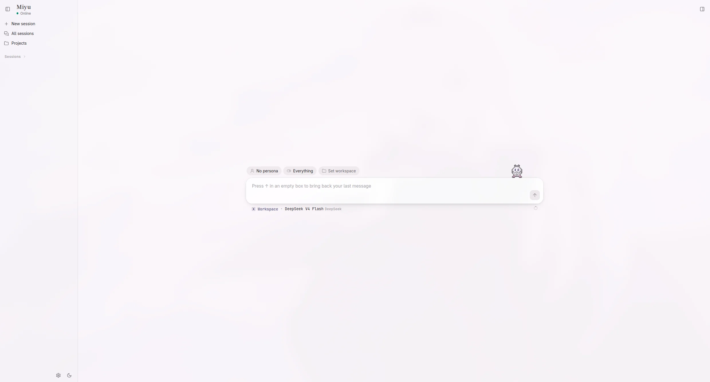
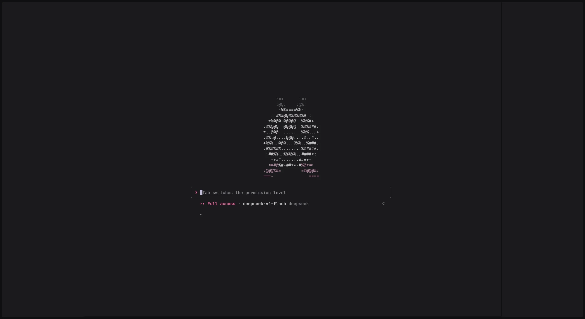
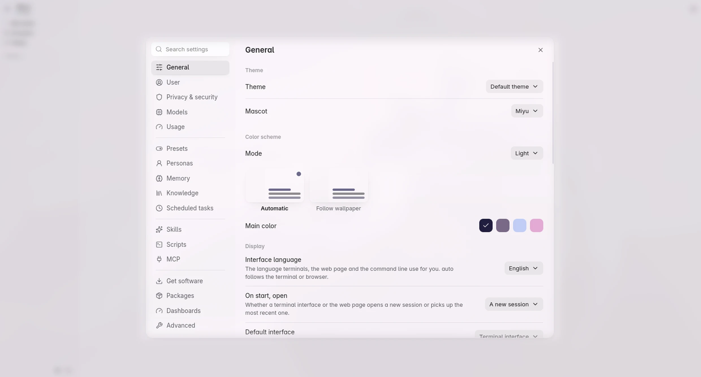

🚧 施工中

  

  
  
  
  

  <a href="README.md">English</a> | 简体中文

# Miyu

Miyu 是一个简单易上手，界面简洁美观，极致轻量，性能表现优秀，可扩展可自定义的 Agent Harness（智能体框架）。使用仿 Linux 的设计方式，所有代码由世界前沿 AI 编写。记忆、知识库、子代理、跨会话通讯、Loop、Skills、MCP 等基本功能开箱即用，还可以安装额外的软件包获得各种能力，例如接入通讯平台、语音输入、语音助手等等。

## 预览图片

**网页 · 对话中**

**终端 · 对话中**

更多截图（新会话、设置）

 

**网页 · 新会话**

**终端 · 新会话**

**网页 · 设置**

## 极致性能

Miyu 在交互速度、CPU 占用、内存占用、硬盘开销等方面均优于主流 Harness。在此基础上提炼的 `litemiyu` 则在轻量化这方面做到了极致，并且完全没有牺牲使用体验。

轻量并不意味着低质量，Miyu 在基准测试中的通过率、Token消耗数据均媲美甚至优于主流 Harness。

## 快速上手

请阅读以下文章快速了解安装方法和基本的使用方法。

- [快速上手](docs/zh/guide/quickstart.md)
- [完整文档](docs/zh/README.md)

## 许可证

AGPL-3.0-or-later，见 `LICENSE`。

仓库里收的第三方数据清单和各自的许可证见 `internal/blueprint/licenses.md`中的`资源里的第三方数据`；发行包里带的字体、ONNX Runtime 这些照各自的许可证，随包附上原文。

供应商、模型的名称和图标是各自所有者的商标，归各自所有者。Miyu 只在运行时从 models.dev、lobe-icons 取来缓存在本机，不随包发；用到它们不表示这些所有者认可或赞助 Miyu。

旧版 Miyu（`legacy-0.7` 分支，`v0.7.x` 及更早的标签和发布）沿用 MIT 许可证，见那个分支里的 `LICENSE`；随旧版附带的字体照各自的许可证（OFL-1.1）。

## Star 趋势

<a href="https://star-history.com/#miyu-agent/miyu&Date">

  <picture>
    <source media="(prefers-color-scheme: dark)" srcset="https://api.star-history.com/svg?repos=miyu-agent/miyu&type=Date&theme=dark">
    
  </picture>
</a>
