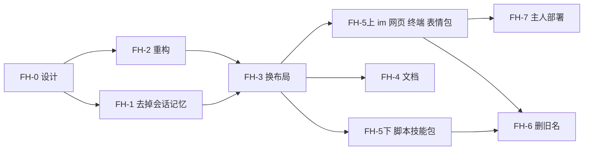

# FH：数据根仿 FHS

设计 `55-数据根仿FHS.md`（2026-11-02 项目主人定）。底稿：`FH-盘点-核心.md`（核心仓库 83 处）、`FH-盘点-别的仓库.md`（各头、各包）。同一天经一轮独立审查（24 条）改过：标记换名、施工先后、缓存清扫、写文件的临时文件、删人格带记忆、保留名字、blob 临时文件、`MIYU_TMP_DIR`、主人部署的真实路径。

整条线跨好几个仓库：核心换布局、换环境变量；三个头换钉；改了读法的软件包发新版；主人那一份部署新开数据根。不做旧版兼容（还没发版），代码直接改成新布局；施工期间只有环境变量新旧两套一起给，等各包发完新版再删旧名。

## 一、几步、谁做、先后

| 步 | 做什么 | 哪个仓库 | 依赖 |
|---|---|---|---|
| FH-0 | 设计 55、这份施工单、两份盘点 | 核心 | — |
| FH-1 | 去掉「跟随会话」的记忆范围 | 核心；头里有选范围的一并改 | —（最好在 FH-3 前） |
| FH-2 | 路径全走 `DataRoot`，拆开只收一个目录的接口，程序目录一处给（纯重构，布局不变） | 核心 | — |
| FH-3 | 换布局 layout 3，新环境变量（旧名过渡） | 核心 | FH-2 |
| FH-5上 | 主人部署里在跑的：im（含 sponsor）、网页、终端、表情包改读法、换钉 | 各仓库 | 在 FH-3 的分支上开工，FH-3 合了就合、发版 |
| FH-7 | 主人那一份部署新开数据根，拷配置类文件，装新版，起来验 | 本机 | FH-3、FH-5上 |
| FH-4 | 文档跟上 | 核心 | FH-3 |
| FH-5下 | 13 个脚本、技能包换环境变量名，发版；软件源 `miyu-rev`、收录拒保留名字 | miyu-scripts、packages、核心的 `miyu-source` | FH-3（旧名过渡期间不坏，不挡 FH-7） |
| FH-6 | 核心删旧环境变量名 | 核心 | FH-5上、FH-5下都发版 |

**FH-3 合进 main 到 FH-7 做完之间**：main 上的核心认不出主人现在的数据根（layout 2）。这段时间主人的部署、8770 的网页栈、桌面端、拷主人家目录起的测试桥都留在 FH-3 以前的核心（各用自己钉的 `core-<sha>`），别换。FH-5上的几个仓库在 FH-3 的分支上提前做好，FH-3 一合就合、发版，FH-7 紧跟，把这段压到最短。

## 二、FH-1：去掉「跟随会话」的记忆范围

状态：核心这一半做完（2026-11-02，sub1）；头里选范围那一项等 core1 转给各头的会话。

### 目的

记忆只剩两种范围：跟随人格、关掉（设计 55 第六节第 3 条，`17-记忆.md` L2 改）。「清掉这个会话记下的」照留。

### 待办

- [x] `17-记忆.md`：第二节表格去掉「跟随会话」那一行；L2 改成「已定：只有跟随人格（2026-11-02 项目主人定：记忆就是为了跨会话）」，原来「项目主人提出」那句的归属更正；L3「开会话时定」照留（定的是开不开）。
- [x] `miyu-policy/src/memory.rs`：`MemoryScope` 去掉 `Session`；快照里读到 `session` 的照现在「认不出的照 `off`」。
- [x] 人格的 `[memory]` 表：只剩一个值，整张表去掉（人格不再管范围）。人格清单解析严格，不认识的表报 `unknown_table`（`miyu-policy/src/persona.rs:213,252`）：写了 `[memory]` 的人格文件读不进来，照「不做旧版兼容」报错，提示删掉那一张表（主人的 `persona-1` 没写这张表，不受影响）。`personas.md` 跟上。
- [x] `persona.set` 的 `memory.scope` 键（`protocol.md:736`）去掉。
- [x] `session.create` 的 `memory`：只收 `persona`、`off`；`protocol.md` 跟上。
- [x] `miyu-store/src/recall/room.rs`：`Room::Session` 和 `sessions/<会话>/memory/` 去掉；`recall/indexes.rs`、`memory.rs` 跟上。
- [x] `miyu memory clear session` 照留，确认它清的是「这个会话往人格记忆里写的」。
- [ ] 头里有选范围的（网页、终端的新建会话、人格编辑页）去掉「跟随会话」那一项（各头的会话，和 FH-5上一起换钉也行）。
- [x] 测试：范围是 `session` 的那几组删掉或改成 `off`；`memory.md` 的测试表跟上。

### 验收

- `session.create {"memory": "session"}` 回 `bad_params`；写了 `[memory]` 的人格文件报 `persona_invalid`，`data.problem` 指那一张表。
- 新建、跑过的会话目录里不出现 `memory/`。
- 门禁全绿；手写变异：把 `session` 放回范围、清掉会话记的清成全部，各抓得住。

## 三、FH-2：路径全走 `DataRoot`（纯重构，布局不变）

### 目的

FH-3 换布局时只改 `DataRoot` 的方法体（和程序目录那一处），不用满仓库找字符串、不用这时才拆接口。这一步数据根里的东西一个都不挪，文件、环境变量一个字节不变。

### 待办

- [ ] `miyu-store/src/root.rs`：按设计 55 的分块给方法：`etc()`、`private()`、`removed()`、`opt()`、`user()`（你的家，现在指数据根本身；不叫 `home()`，协议里「你那一层」也叫 `home`）、`var_lib()`、`var_cache()`、`var_log()`、`var_tmp()`、`tmp()`、`run()`，再往下的各一个方法（`journal()`、`schedules()`、`script_state(场所, 来处, 工具)`、`script_cache(…)`、`package_state(编号)`、`package_cache(编号)`……）。这一步各方法照旧返回现在的位置。
- [ ] 删掉 `state()`、`cache()` 这种「一个目录、调用的人自己往下拼」的方法，不换义：头换钉以后用到它们的（tui `build.rs:42`、web `main.rs:125`、im `status_file.rs:37-40`、`logs.rs:37`、`program.rs:220`）编译就失败，不会悄悄写错地方。`path()` 收成只给核心自己的几个 crate 用（可见性由做的人定）。
- [ ] 换掉直接拼的（核心盘点第二节末尾的清单）：`schedules.rs:199`、`scripts.rs:44,127`、`memory.rs:129`、`recall/room.rs:95`、`knowledge/place.rs:115,190`、`skills.rs:74`、`slash.rs:37`、`presets.rs:81`、`personas.rs:117`、`miyu-sandbox/src/install/files.rs:43-45`、`record.rs:96`、`report.rs:59`、`miyu-endpoint/src/config.rs:74`（`#:schema` 那一行照方法算相对路径）、`miyu-policy/src/hazard/paths.rs:93-94`、`miyu-fs/src/boundary.rs:255`、`miyu-cli/src/packages/offered.rs:17-26`、`miyu-basesystem/src/shell/script/sweep.rs:22`（`root.join(CACHE)`），以及盘点里「写」「读」两列提到的别处。
- [ ] 拆开只收一个父目录、自己往下拼的接口（新布局里这些子项分在不同块，签名这一步就要拆）：模型目录（`miyu-core/src/lib.rs:129,359,370`：`learned`、`pools`、`renamed` 和 `providers`、`catalog` 分开给）；`packages(core).state_root()`（`.unpack`、`.sync`、`.sources`、`.cache`、`.local`、`.leftovers`、各包状态，分成五处给）；`sandbox::probe(Some(&root.state()))`（`lib.rs:373`）；`settings.rs:280`；`extensions/stderr.rs:24`；`Blobs::new` 照旧收 `blobs/`（临时文件留在里面，设计 55 第三节第 5 条）。
- [ ] 缓存清扫只扫脚本的缓存：`miyu-store/src/cache.rs` 的 `prune` 把缓存目录下每个顶层文件夹当 `<来处>`，FH-3 以后 `var/cache/` 下还有 `index/`、`models/`、`packages/` 这些核心的东西，会被当成 30 天没碰的删掉。改成只对脚本缓存那一层（`script_cache` 的根），两处调用（`miyu-core/src/cache.rs:41`、`sweep.rs:22`）都照它。
- [ ] 写文件的临时文件：`config_file.rs` 的 `temp_dir` 只在「上一层是数据根」时用 `run/`，改成照数据根找（`DataRoot` 交进来，或往上找标记），新布局里 `etc/private/` 的密钥临时文件才会在 `run/`；`leftovers::tidy` 照旧清 `run/`。
- [ ] 程序目录一处给：新 `ProgramDirs`（名字由做的人定），照程序种类（包、脚本、MCP 服务）算出设计 55 第四节表里的每一格，扩展（`extensions/supervise.rs`）、包的命令（`miyu-cli/src/packages.rs`）、脚本（`miyu-basesystem/src/shell/script.rs`、`script/home.rs`）、MCP（`mcp/launch.rs`）都从它拿；这一步只给旧名字、旧位置。
- [ ] 测试夹具改用方法拼路径（核心盘点 3.6：`packages` 339 次、`scripts` 182、`skills` 161……）：先给 testkit 一组照 `DataRoot` 拼的小函数，再机械替换；能分几次提交。
- [ ] 防回退：靠类型挡（上面删掉 `state()`、`cache()`，收紧 `path()`），不照字符串查：`packages`、`personas`、`skills`、`tools`、`config` 这些名字资源目录、协议里也在用，照字符串查会大量误报。

### 验收

- 在一份主人数据根的拷贝上起新核心（拷完先删 `run/socket`、`run/token`、`run/core.lock`，不然连到主人正在跑的核心上），会话、记忆、包、脚本都照旧；拷贝里的文件树起之前、起之后对一遍，除了运行时的几样一个不多。
- 一个扩展、一个脚本拿到的环境变量和 FH-2 以前一样（测试断言）。
- 门禁全绿。

## 四、FH-3：换布局 layout 3

### 目的

数据根照设计 55 第二节，环境变量照第四节，Windows 沙盒照第五节。FH-2 以后这一步主要是改 `DataRoot` 的方法体、骨架、标记和期望值；量大的话 core1 可以再拆上下。

### 待办

- [ ] 标记：新文件名 `.miyu-layout`，写 `This directory is a Miyu data root (layout 3).`；读的时候核对版本。用到标记的四处一起换：`durable.rs` 的 `create_inside`、`config_file.rs:248`、`miyu-session/src/sandbox.rs:251`、`miyu-sandbox/src/install/files.rs:26`。有旧标记 `.miyu-root`、没有新标记的：不动、报设计 55 第六节第 1 条那句、退出码非零。
- [ ] `DataRoot` 各方法改成新位置；骨架：`prepare` 建 `etc/`、`etc/private/`（0700）、`run/`、`tmp/`；核心起来建设计 55 第五节第 2 条那张表。核心起来清 `tmp/unpack/`；`tmp/<编号>/` 在拉起这个包的扩展之前清；`var/tmp/` 照时限清（初值 7 天）。
- [ ] 凭据进 `etc/private/`：`secrets.rs`、`access.rs`、`logins.rs`；沙盒安装程序两条路（`etc/private/sandbox-windows.json`、`var/log/sandbox/windows-error.json`）都逐层查不是链接。
- [ ] `opt/`：装包、暂存 `.<编号>.new|.old`、`install::recover`、`real_packages()`、`Confines`（`unsandboxed.rs:62-71`、`links.rs:44-50`）。
- [ ] `etc/removed/<编号>` 换掉 `packages/<编号>.removed`。
- [ ] `var/lib/packages/<编号>/` 换掉 `state/packages/.local/`；`leftovers.json` 进 `var/lib/packages/`；软件源缓存进 `var/cache/packages/sync|sources|downloads`；解包进 `tmp/unpack/`。
- [ ] `root/`：人格、预设、提示词、工具覆盖、技能、脚本、命令、头像、会话、记忆、知识库、blob（临时文件照旧在 `blobs/tmp/`）、回收处、项目、定时、`state/`（脚本状态、`terminal.json`）、工作区、四个 XDG 目录。
- [ ] 删人格带记忆，照设计 55 第三节第 6 条：只在三层里都没有这个编号时挪；恢复时撞了的留在回收处、说一句；清回收处一起删；记忆的登记关掉那一份（`trash/personas.rs`、`personas/delete.rs`）。
- [ ] `var/lib/`：`journal.jsonl`、`log-salt`、`models/` 里 `learned.json`、`pools.json`、`renamed.json`，`mcp/<服务>/`，包的数据 `<编号>/`。
- [ ] `var/cache/`：`index/`、`usage.db`、`rates.db`、`config/`、`models/`（`providers/`、`catalog.json`）、`packages/`、`mcp/<服务>.json`、`provide/<包>.json`（原 `state/providers/`）、`scripts/`、`personas/pictures.json`、`mermaid/`、`sandbox-probe.json`、`perf/`。
- [ ] `var/log/`：`core.log`、`memory.jsonl`、`mcp/<服务>.stderr`、`sandbox/`、`<编号>/stderr`（和 `stderr.old`，原 `state/logs/<扩展实例>.stderr`，`extensions/stderr.rs`）。
- [ ] `run/<编号>/`：给包的运行时目录；核心自己的照旧在 `run/` 这一层。
- [ ] 保留名字：设计 55 第三节第 3 条那一串，由测试照各层的常量推出来、和设计对；装包时拒、`miyu check` 报。
- [ ] 卸包清的，照设计 55 第三节第 4 条那张清单（包带的脚本的状态和缓存、MCP 服务的三处、`provide/`、`index/kb/packages/` 都在里面）。
- [ ] 环境变量：`ProgramDirs` 照设计 55 第四节给新名字；旧名字（`MIYU_PACKAGE_STATE`、`MIYU_PACKAGE_DIR`、`MIYU_SCRIPT_STATE_DIR`、`MIYU_SCRIPT_CACHE_DIR`、`MIYU_SCRIPT_IMAGES_DIR`）同时给、指到新位置，代码里标「FH-6 删」；拉起前建好每一个给出去的目录。
- [ ] `config.toml` 新建时第一行 `#:schema ../var/cache/config/config.schema.json`（照方法算）。
- [ ] Windows 沙盒：`carve` 照新的几层排；`keep_places`（`miyu-session/src/sandbox.rs:250-268`）补的目录换新位置；`windows-run.md` 里「第一次新建的那一下」那条改成已解决（凭据在整条禁的 `etc/private/`）。
- [ ] Linux、macOS 沙盒：`hidden` 照旧整个数据根；`write`、`reveal` 的那几处换新位置（工作区、技能文件夹、本会话附件、脚本的状态和缓存、四个 XDG 目录）。
- [ ] 边界表：`knowledge()` 写死的 `kb/<库>/` 换成 `root/kb/<库>/`；`own`、`shelves` 换新位置。
- [ ] 出厂私密清单、只禁写名单里的 `~/.miyu` 照旧（数据根默认位置没变）。
- [ ] 测试：FH-2 以后夹具都照方法拼，这一步主要是改期望值；Windows 沙盒的几组在虚拟机上量。

### 验收

- 空目录起核心：顶层只有 `.miyu-layout etc/ opt/ root/ var/ tmp/ run/`；设计 55 第五节第 2 条那张表里的目录都在；`etc/private/` 是 0700。
- 旧布局（有 `.miyu-root`）的数据根：新核心不动它、报那句话、退出码非零；拿 FH-3 以前编的核心对新数据根：认不出、不建任何东西。
- 装一个包、开一个扩展：它拿到的 `MIYU_*_DIR` 每一个都指到设计 55 第四节那一格、都已经存在；旧名字也在、指到新位置。
- 跑一个脚本：`MIYU_STATE_DIR` 在 `root/state/scripts/…`，`MIYU_CACHE_DIR` 在 `var/cache/scripts/…`，`MIYU_IMAGES_DIR` 能交图；没设 `MIYU_TMP_DIR`。
- 缓存清扫：在 `var/cache/index/`、`var/cache/models/` 里放 31 天前的东西，清扫后还在；`var/cache/scripts/` 下 31 天没碰的工具目录被清掉。
- 写一次密钥：`etc/`、`etc/private/` 里不出现临时文件，临时文件在 `run/`。
- 停核心、删 `var/cache/` 整个、再起：会话列表、用量、回忆都照日志补回来；删掉的会话里记的记忆不回来。
- 删一个盖在出厂人格上的你的人格：记忆还在、人格回到出厂的那份；删一个只有你那一层的人格：记忆进回收处，恢复一起回来。
- Windows（虚拟机）：沙盒命令跑着时第一次 `secret.set`，命令读不到 `etc/private/secrets.toml`。
- 门禁全绿；手写变异挑七八个：标记版本不查、凭据临时文件建在旁边、`tmp/unpack` 不清、给包的目录不事先建、删人格不分层就带记忆、保留名字不拒、清扫扫到 `index/`，各抓得住。

## 五、FH-4：文档

- [ ] `docs/blueprint/store.md`「数据根里有什么」整棵树换成设计 55 第二节，方法表跟上。
- [ ] `07-存储.md` 第二节「目录布局」：改成指向设计 55，留两条归属规则和「数据里存相对路径」（附件、工作区的例外写进去，设计 55 第六节第 4 条）。
- [ ] 各蓝图、参考文档里写着旧路径的（`config.md`、`packages.md`、`knowledge.md`、`memory.md`、`personas.md`、`log.md`、`ipc.md`、`sandbox/*.md`、`cli/*.md`、`reference/*`），照 `git grep` 旧名字逐个改。
- [ ] 给包作者的文档（`docs/authors/`，中英两份）：环境变量那一节换成设计 55 第四节那张表；写明「不拿 `MIYU_HOME` 拼路径」，`var/log/<编号>/` 下的 `stderr`、`stderr.old` 是核心的。
- [ ] 施工记录（`docs/construction/README.md`）各步一行；施工图跟上。

### 验收

- `git grep` 文档里旧路径（`state/packages`、`state/logs`、`state/scripts`、`modules/memory`、`.miyu-root`、`MIYU_PACKAGE_STATE`、`MIYU_SCRIPT_`）只剩施工单、设计 55、盘点里讲历史的那几处。

## 六、FH-5：头和包

### FH-5上：主人部署里在跑的（在 FH-3 的分支上开工，FH-3 合了就合、发版）

| 仓库 | 改什么 | 量 |
|---|---|---|
| miyu-im（含 miyu-im-sponsor） | 状态目录改读 `MIYU_STATE_DIR`（`status_file.rs:39`、`rules/cards/store.rs:23`、`site/home_cards.rs:22` 三处自己拼的）；日志改 `MIYU_LOG_DIR`（`program.rs:220`、`logs.rs:37`、`site/methods.rs:75`）；读核心记的 stderr 改成 `MIYU_LOG_DIR/stderr`；`venues.d/`（`rules.rs:259`）、`moderation.txt`（`rules.rs:287`）进 `MIYU_CONFIG_DIR`；`MIYU_PACKAGE_DIR` 改 `MIYU_APP_DIR`；sponsor 的 `sponsors.json` 改读 `MIYU_STATE_DIR`，不靠工作目录；测试 53 个文件约 126 行；`docs/authors/README.md:115` 那句；换钉 | 最大 |
| miyu-web | `run/web.lock`、`run/web`、`run/open/`（`serve.rs:135,212,418,440`、`open.rs:214,290`）改 `MIYU_RUNTIME_DIR`；`web.log`（`main.rs:125`）改 `MIYU_LOG_DIR`；文档里过时的 `home/<账号>/`、`system/`；换钉 | 中 |
| miyu-tui | 删 `build.rs:42` 输入历史的搬家兜底；文档 `tui.md:1344`；测试约 50 行；换钉 | 小 |
| miyu-memes | `library.db` 改读 `MIYU_STATE_DIR` | 小 |

- [ ] 三个头（tui、web、im）钉同一版核心（FH-3 合进去的那一个），一起发。
- [ ] 每个改了的仓库：改、测、发新版（打 tag，打包模板传 Release），等软件源收录到。

#### 验收（每个仓库在 layout 3 的数据根上实测）

- im：收发一条 QQ 消息；`miyu im logs` 读得到核心记的 `stderr`；规则文件放进 `etc/miyu-im/` 生效；sponsor 的账本条数和拷之前一样。
- 网页：`miyu web` 起来，`run/miyu-webui/` 下有锁和地址，`miyu web open` 照它打开；日志在 `var/log/miyu-webui/`。
- 终端：连得上、会话列表照常、输入历史照协议给的位置存。
- 表情包：导入一张图，`var/lib/miyu-memes/library.db` 里有。

### FH-5下：脚本、技能包和软件源（旧名过渡期间不坏，不挡 FH-7）

| 仓库 | 改什么 |
|---|---|
| miyu-scripts 里 13 个包 | `MIYU_SCRIPT_STATE_DIR`、`MIYU_SCRIPT_CACHE_DIR`、`MIYU_SCRIPT_IMAGES_DIR` 改成 `MIYU_STATE_DIR`、`MIYU_CACHE_DIR`、`MIYU_IMAGES_DIR`：ai-draw、bangumi、douyin-dl、exchange-rate、game-compat、goofish、juya-daily、reddit-search、weather、web-image、skills-aur-pkgbuild-review、skills-bilibili-live-stream、skills-travel-planner（技能包里写在 SKILL.md 给她看的那几处也改） |
| 核心的 `miyu-source`、packages（软件源） | `miyu-index` 收录时拒保留名字；`miyu-rev` 升到 FH-3 以后的核心；packages 的 PR 交 core1 审 |
| 不用改的 | miyu-desktop、miyu-render、miyu-embed、miyu-sdk、miyu-memes-shorin-collection、miyu-scripts 里另外 11 个（archwiki-query、calculator、codec、deepseek-status、dice、fortune、moegirl-query、online-man、tarot、zhouyi、skills-office）：不读这几个环境变量、不拼数据根路径（FH-0 盘过；开工前各仓库再 `grep` 一遍旧名字确认） |

- [ ] 包的格式、清单写法这次不变：没改代码的包不用重新打包。

#### 验收

- 每个改了的包在 layout 3 上跑一次它的工具：状态、缓存写到新位置；第二次跑读得回第一次的状态。
- `miyu-index` 收一个编号叫 `token` 的包：跳过并记一笔。

## 七、FH-6：删旧环境变量名

- [ ] FH-5上、FH-5下每个包的新版都进了官方软件源以后，核心删掉旧名字那五个，代码里「FH-6 删」的都清掉。
- [ ] `git grep` 各仓库确认没人再读旧名字。

### 验收

- 核心测试断言：给扩展、脚本、MCP 服务的环境里没有那五个旧名字。

## 八、FH-7：主人那一份部署

数据根是 `/home/shorin/.cache/miyu-tui-home`（包装脚本 `~/.local/bin/miyu-remake` 里 `MIYU_HOME` 写死）；`~/.miyu` 是旧版 Miyu 的活数据，不碰。新数据根放在同一个路径（旧的整个改名留着），套接字的指纹、终端记的样子、恢复命令都不变。只拷几样，别的不要（设计 55 第六节第 2 条）。真跑由主人自己用 `!` 执行，sub1 写一次性脚本、在拷贝上演练过再交。

**赞助账本一条都不能丢**（2026-11-02 项目主人再三说）：`miyu-im-sponsor` 的 `sponsors.json`（11-02 是 66 条，`version`、`next`、`entries` 三格）连同旁边的 `.bak-*` 一起拷；拷之前先另存一份到数据根以外（脚本做，路径写进输出），拷完逐字节比 SHA-256，条数、`next` 对得上才算搬完；`.before-fh` 和这份另存的都留到主人说可以删。脚本演练时也照这一条验。

- [ ] 停 im、停核心（`run/core.lock` 放开）。
- [ ] `/home/shorin/.cache/miyu-tui-home` 整个改名成 `miyu-tui-home.before-fh`；包装脚本的 `D=` 换成装 FH-3 以后核心的新部署目录。
- [ ] 新核心对空的 `/home/shorin/.cache/miyu-tui-home` 起一次建好骨架后停下。
- [ ] 拷（都从 `.before-fh` 拷）：
  - `config.toml` → `etc/config.toml`（首行 `#:schema` 换新的）；
  - `secrets.toml`、`access.json`、`logins.json` → `etc/private/`（0600）；
  - `extensions.json` → `etc/extensions.json`（im 批过的能力，不拷的话要重新批）；
  - `state/packages/miyu-im-sponsor/sponsors.json` 和同目录的 `sponsors.json.bak-*` → `var/lib/miyu-im-sponsor/`（照上面那条：先另存、拷完比 SHA-256 和条数）；
  - `personas/persona-1/` → `root/personas/persona-1/`；`presets/dev.toml`、`minimal.toml` → `root/presets/`。
- [ ] 装新版的核心、三个头、im、sponsor、表情包（FH-5上的发版），起来。
- [ ] 验：网页、终端连得上；QQ 里 im 收发正常；赞助账本和拷之前逐字节一样，im 的赞助页、`miyu im` 列得出同样的条数；人格列表里有 Miyu；顶层只有 `.miyu-layout etc/ opt/ root/ var/ tmp/ run/`。
- [ ] `.before-fh` 留着，主人说可以了再删。

## 九、给施工的会话的话

- 布局、名字都照设计 55，设计里没写到的位置先问 sub1（FH 线的设计归 sub1），别自己起新目录。
- 别的线在数据根里新加目录、文件的，FH 线期间先告诉 core1，排进设计 55。
- FH-3 合进 main 到 FH-7 做完之间，别给主人的部署、8770、桌面端换 FH-3 以后的核心（第一节末尾）。
- 每步照核心的老规矩：自己的工作树、先红后修、手写变异、门禁（双机派发）、两种 diff 只有自己的文件、交 core1。
