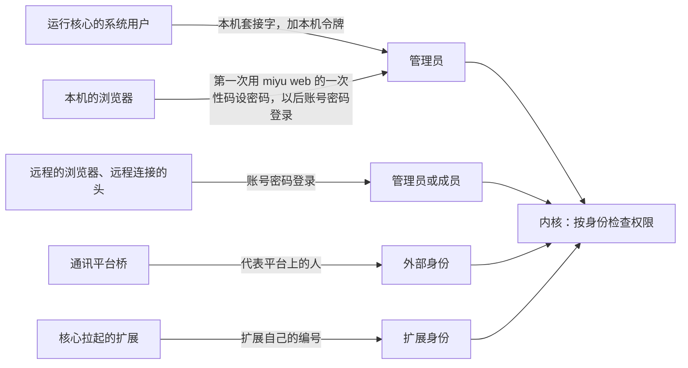
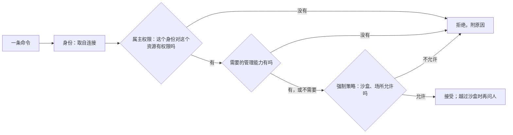
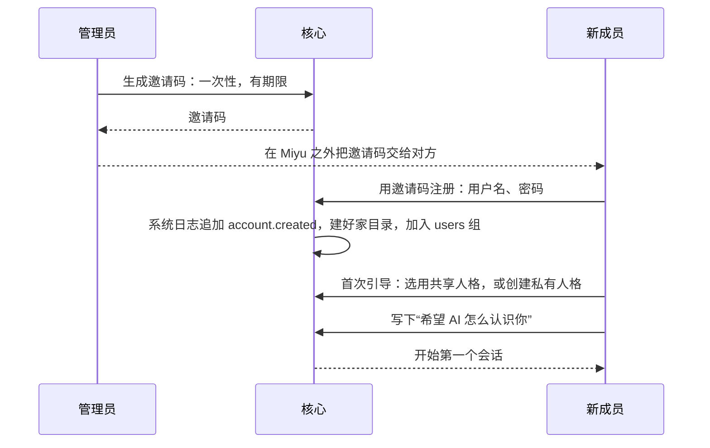

## 多用户与身份（草案）

状态：U1 到 U12 已定（2026-09-25），U13 已定（2026-09-27），U14 已定、U8 改（2026-10-07）。2026-10-22 项目主人定：用户系统排在最前、第一版往完善做；U15 到 U24、第八补、第八再补、第八又补三节同一天定；第八又补（第三版）是第一版的口径，和前两节不一样的地方以它为准（项目主人定了功能和多人共用的场景，U16 到 U18、U20 交主会话自己审定）；U5、U7 同一天照多人共用的场景改。

### 一、产品前提

2026-09-25 确认了两种用法：

- Miyu 是开源软件。别人会在自己的电脑上装一份，各用各的。
- 别人也会登录到某一个 Miyu 上，和它的主人共用，每人一个账号。
- 一台服务器上部署一个 Miyu，几十个人从自己的电脑、手机连进来共用（2026-10-22 项目主人补，U19）：这些人不一定互相信任，模型的 key 大家共用。**这个场景地基按它做、功能以后再加**：同一天项目主人想清楚了，这类 AI 助手即使在多人的地方也是一人一份，Miyu 最有价值的人格、记忆、在你的电脑上动手都是个人的；第一版个人为主，加上一家人、几个朋友凭邀请码共用。

几种用法用同一套设计。**没有“单人模式”**：一个人自己用，就是只有一个账号的多用户（U1）。这样只有一条代码路径，一个人用的时候，也不会遇到“切到多人模式后行为变了”的问题。

**权限模型仿照 Linux**（2026-09-25 确认，U9）：用户、组、资源的属主与权限、拆开的管理能力、强制策略。一个人自己用的时候，这些全都看不见：没有组，所有东西都只属于你，默认值就是对的。

### 二、用户与组

| 词 | 对应 Linux 的 | 定义 |
|---|---|---|
| 账号 | 用户 | 在这个 Miyu 上注册过的人，有自己的家目录 |
| 管理员 | 持有管理能力的用户，但不是 root | 安装并维护这个 Miyu 的账号，对应运行核心的那个系统用户。账号固定叫 `admin`，家目录 `home/admin/`（U13） |
| 系统账号 | `postgres`、`www-data` 这类系统用户 | 给一个服务用的账号，由软件包装的时候建、彻底卸载时删。没有密码，不能登录；它的东西管理员能看能管。例如通讯平台的 `onebot`：群会话、它们的工作区、用量都在它名下（U14、`18-通讯平台.md` 第三节） |
| 成员 | 普通用户 | 由管理员邀请加入的账号 |
| 组 | 组 | 一组账号，用来按组共享资源。所有账号默认都在 `users` 组里 |
| 场所组 | 组 | 每个接入的群自动是一个组，组员就是在这个群里说话的人，由通讯平台桥担保 |
| 外部身份 | `nobody` | 通讯平台上说话的人。没有账号、没有家目录，只通过场所组拿到最少的权限。写在主人对应表里的平台账号：私聊里是对应的本机账号本人；群里仍是外部身份，但能用场所里的管理命令（U8、`18-通讯平台.md` 第三节、第十二节） |
| 身份 | 进程的身份 | 发出一条命令的“谁”：账号、外部身份、扩展，或内核自己 |

- 管理员在本机的头（终端界面、命令行）上不需要密码：能连上本人的套接字，操作系统已经担保了身份；本机令牌由头自动读取，不需要人操作（`11-权限与沙盒.md` 第五节）。浏览器读不到本机令牌，要密码：第一次、忘了密码时用 `miyu web` 从本机终端要来的一次性码进来，给管理员设登录用的用户名和密码，以后用它们登录（`21-网页.md` X6，2026-10-04 项目主人定）。用户名只用来登录，账号编号照旧是 `admin`（U13）。
- 同一台机器上的别的系统用户（比如家里人自己的登录）和别的机器上的人是一回事：用管理员发的成员账号登录；远程访问关着时，本机的网页也能用成员账号登录。不做「认出连过来的系统用户、免密码」：本机套接字照旧只有管理员本人连得上（2026-10-01 项目主人定）。
- 成员登录后使用 Miyu。任何能登录的头都可以用：网页、远程连接的 TUI。
- 停用一个账号，立刻作废它的全部登录令牌、断开它的连接，数据留着。每个登录令牌都能单独撤销，界面上列出登录过的设备。第一版不限同时在线的会话数（2026-09-25 补）。
- 外部身份只能经通讯平台桥进入会话，信任级别是“外部”（`04-核心协议.md` 第四节）。

### 三、资源的属主与权限

**每个资源都有一个属主、一个属组，以及分别给属主、属组、其他账号的三种权限：读、改、用**（U9）。这对应 Linux 文件的 rwx，“用”对应执行位。

三种权限对不同资源的含义：

| 资源 | 读 | 改 | 用 |
|---|---|---|---|
| 会话 | 看对话 | 在里面说话、发起操作 | 不适用 |
| 人格 | 看她的设定与提示词 | 修改设定 | 选她来对话 |
| 预设 | 看它开了哪些功能 | 修改 | 在自己的会话里用它 |
| 模型 | 看配置 | 改配置 | 用它来对话 |
| 扩展 | 看配置 | 改配置 | 在自己的会话里启用它 |
| 工作区 | 读里面的文件 | 写里面的文件 | 在里面执行命令 |
| 知识库 | 看里面的文档 | 增删文档 | 让自己的会话从中检索 |
| 产物 | 看 | 改 | 不适用 |

**默认权限**（相当于 Linux 的 umask）：

| 资源 | 属主 | 属组 | 默认权限 |
|---|---|---|---|
| 会话 | 创建它的人 | 无 | 只有属主能读、改 |
| 私有人格、私有预设、工作区、知识库、产物 | 创建它的人 | 无 | 只有属主 |
| 共享人格、共享预设 | 管理员 | `users` | 组员能用；能不能读人格的提示词，由管理员决定 |
| 模型、扩展 | 管理员 | `users` | 组员能用 |
| 群的会话 | 接这个平台的系统账号，例如 `onebot`（U14）；主人的私聊属于主人对应的本机账号 | 这个群的场所组 | 组员能读、能说话 |

- **管理员决定成员能用哪些模型、哪些扩展**，就是改这些资源的属组和“用”权限，不再是写死的规则。
- **外部身份只通过场所组获得权限。** “其他账号”这一类不包括外部身份。
- **界面说人话。** 权限位不直接给人看，界面上只有“只有我、指定的组、指定的人、所有成员”和“能不能改”这样的选项。

**分享（U12）**：资源的属主可以自己把资源分享出去，相当于 chmod、chgrp，以及给指定的人单独授权的 ACL。

- 人格、预设、工作区、知识库、产物可以分享给组，也可以分享给指定的人。
- 会话默认只有属主能看，可以分享给指定的人或组**只读**，例如把一段对话给朋友看。

> 局域网文件共享（旧版的 `share_file`：把本机的文件经网页递给局域网里的人）调研过用什么形式做，记在 `docs/reviews/2026-09-30-局域网文件共享调研.md`。推荐的形式：核心的 HTTP 模块当路由载体，文件共享做成编进核心的可选软件包挂在上面；分享记录是这一节的资源，照属主、权限和 U12 分享。它要先有账号和登录（U4），打算等用户系统做完再做，到时从那里的三道题拍板起，再写进设计（2026-09-30 项目主人让记一笔）。

### 四、管理能力：没有 root

Linux 的 root 什么都能看，但这里要保证“管理员看不到成员的会话”（U2）。所以 **Miyu 没有 root**。唯一不受权限检查的是内核自己，而它不是人。

管理员的权力拆成一项项能力，相当于 Linux 的 capabilities（U10）：

| 管理能力 | 允许做什么 |
|---|---|
| 管账号 | 邀请成员、停用账号、管理组 |
| 装软件 | 系统级地安装、卸载软件包，批准它们申请的能力 |
| 配模型 | 配置模型供应商与密钥 |
| 接平台 | 接入通讯平台、管理群 |
| 看总用量 | 查看所有人的用量 |
| 定上限 | 设定成员越过沙盒的上限，例如管理员放行的网站 |

- 每个账号都可以往自己的家目录里装软件，只对自己生效，不需要“装软件”能力，相当于 Linux 用户装到 `~/.local`（`12-进程形态与分发.md` 第四节）。
- 同理，每个账号都可以配只给自己用的模型，用自己的密钥，不需要“配模型”能力（`15-模型与供应商.md` M6）。
- 管理员持有全部能力。能力可以授予某个组，例如让一个组来管理 QQ 群，相当于把用户加进 Linux 的 wheel 这类组。默认不授予任何人。
- **有一件事不是能力，不能授予：不进沙盒执行命令。** 不进沙盒，就是以管理员的系统账号执行，所以只属于管理员本人（`11-权限与沙盒.md` 第三节）。
- 任何能力都不能越过属主权限。所以管理员看不到成员的会话，这一点在结构上成立，不需要额外的规则。

需要说清楚的是，这是 Miyu 层面的承诺。管理员拥有这台机器，技术上能直接读磁盘上的文件。要防住管理员只能靠加密，第一版不做。

### 五、一次操作最终能不能做

**能不能做 = 属主给的权限 ∩ 管理能力 ∩ 强制策略 ∩ 越界时人的确认**

- **强制策略**相当于 Linux 的 AppArmor、SELinux：会话的属主自己也改不了。例如外部身份永远碰不到主机（主人的私聊按本人对待，`18-通讯平台.md` Q7），成员的命令永远在沙盒里（U5）。
- **模型是替人做事的代理人。** 权限按“这一步是谁要求的”来判，不按“会话属于谁”来判。群友在管理员的群会话里让 Miyu 去读管理员的文件：会话属于管理员，属主权限这一关能过；但群友所在的外部场所有强制策略拦着，所以做不到。这和 `08-上下文投影.md` 的“工具面按会话定，权限按调用者判”是同一个原则。
- 权限检查分两道，都由内核做，扩展绕不过去：
  - **命令进入**：这条命令能不能发。看的是对资源的属主权限和管理能力，是「命令进入」链上内置的第一个实现（`02-内核.md` 第八节）。
  - **工具执行前**：这一步工具调用能不能做。看的是这一步是谁要求的、在哪个场所、权限级别和放行规则（`05-内核接口.md` 第五节、`11-权限与沙盒.md` 第二节）。
- 会话列表、视图流、事件流都按权限过滤。看不到的资源，连它是否存在都不会透露。
- 组、权限和能力的每一次变化，都记在系统日志里（`07-存储.md` 第二节）。当前的权限表是它的投影，相当于 Linux 的 `/etc/group` 加上 auth.log。

### 六、邀请与注册

- 邀请码只能用一次，并且有期限。期限是策略数据，初值 7 天。
- 首次引导只有两步：选用共享人格或创建私有人格；写下“希望 AI 怎么认识你”。
- 注册时如实告诉新成员：管理员拥有这台机器，技术上读得到磁盘上的文件；Miyu 保证的是在它里面看不到（第四节）。
- 这份自述属于这个人，不属于人格，换人格时它还在。它只在这个人自己的会话里使用。群聊面对的是一群人，不使用它，用了就等于把它公开给了这群人；主人的私聊就是主人自己的会话，照常使用（`18-通讯平台.md` Q7）。

### 七、人格与记忆

- 人格和预设都是资源（`16-人格与预设.md`），遵守第三节的属主与权限。
- **记忆跟着用户走，用户和用户的记忆不串**（2026-10-22 项目主人定，U21）。人格的设定（名字、性格、提示词、头像）可以是系统的、可以分享；记忆不跟着设定走，谁用就记在谁那里：两个人用同一个系统人格，各有各的一份记忆。
- 一个账号里，一个人格还是一个大脑、一份记忆，不照场所、不照听众挑（R-29，2026-10-21 项目主人定：「记忆只有一份，AI的记忆是一个整体。就像人类一样」）；她在群里、私聊里认识的外部的人都在这一份里，说不说由她自己判断。U21 管的是账号和账号之间不串。
- 删除账号时，他的记忆随之删除。
- 未选：一个人格一份记忆、所有用户一起召回（一个大脑给大家干活）。一起召回，她和 B 说话时会带上 A 私下说的事，可能说出来；管理员的记忆后台也就看得到成员的私事，U2 不成立。

### 八、用量

- 用量不单独记账，它是 `model.called` 事件的投影（`03-事件模型.md`）。每个人的用量从他自己的会话里推出来，持有“看总用量”能力的人看到的总表，再把各人的汇总起来。
- 第一版不做按人的额度限制（U7）；限制按账号、按组挂得上去，多人共用一台服务器时再做（U19）。管理员可以停用账号作为兜底。

### 八补、第二版：扩展、脚本、子系统也用这套（2026-10-22）

2026-10-22 项目主人定了四条：用户系统排在所有新功能前面；注册页谁都能打开，但要邀请码（邀请制）；管理员看不到成员的会话，只看得到用量这类统计（U2、第八节不变）；第一版往完善做，不先做半套。项目主人同时点出：用户系统不只是给人用的，扩展、脚本、子系统都该用同一套用户、组、权限，这正是仿 Linux 的本意。

| Linux | Miyu |
|---|---|
| 用户 | 账号（人），凭邀请码注册 |
| 守护进程的系统用户（`postgres`、`www-data`） | 系统账号：每个带进程的软件包一个（U14 推广到所有带进程的包，U16） |
| 组（`wheel`、`docker`、`audio`） | 组；管理能力、扩展能力都是组（U16） |
| 文件的属主、属组、`rwx` | 资源的属主、属组、读改用（第三节） |
| 用户跑一个程序，程序以这个用户的身份跑 | 扩展的工具、脚本、命令以「这一步替谁做」的那个身份跑，再和这个包的组取交集（U17） |
| `/etc/group` + auth.log | 系统日志里的组、权限、能力变化，当前的表是它的投影（第五节） |
| `sudo` | 越过沙盒、越过权限时问人（确认） |

**1. 包有自己的账号**：带进程的软件包装上时建一个系统账号，包的进程用它连核心；彻底卸载时连账号带数据一起删。包的数据目录不挪，照旧是 `state/packages/<编号>/`（`MIYU_PACKAGE_STATE`，施工 F-15），归这个系统账号：同 Linux 守护进程的数据放在 `/var/lib/<包>`、不放家目录。只带技能、脚本的包没有进程，不建账号，它们以调用的人的身份跑（第 3 条）。

**2. 能力就是组**：
- 管理能力（第四节的管账号、装软件、配模型、接平台、看总用量、定上限）各是一个组，管理员在全部这些组里。
- 扩展能力（现在清单里的 `capabilities`：读会话、开会话、替外部身份说话、写记忆、读文件……，`connection/rights.rs`）也各是一个组。
- 装包时批准它申请的能力，就是把它的系统账号加进那几个组；以后在「组」那一页就能看到、能撤，和撤一个人的权限一样。
- 人和包用同一张表：给某个成员开「接平台」，就是把他加进那个组。

**3. 替谁干活就是谁**（U17）：
- 包的工具在某个会话里被调：照这一步是谁要求的（第五节「模型是替人做事的代理人」），能碰的 = 这个人的权限 ∩ 这个包的组。成员调一个能写记忆的包，写进的是这个成员自己的记忆，碰不到别人的。
- 包自己的后台活（比如接入通讯平台的桥收消息）以包的系统账号的身份做。
- 脚本、命令以「这一步替谁做」的那个账号跑：工作区、状态目录（施工 X-44 已经按账号分开）、沙盒的边界都照它。
- 按账号各起一份包的进程（U3）照旧：成员用到某个包时，替他起的那一份只碰得到他的东西。

**4. 子系统只问一个地方**：会话、人格、预设、知识库、记忆、技能、工作区、产物要不要给，都经内核同一道检查（「这个身份对这个资源有没有这种权限、需要的能力在不在」），子系统不各写各的规矩。

**5. 给局域网留的口子**（这一版不开网络，但先把「本机 = 可信」的假设拆掉）：
- 连接记下是本机连进来的还是远程的（本机套接字、本机网页是本机；以后经网络来的是远程）。
- 方法分两类：本机才能用的（`fs.*` 读核心那台机器的文件、握手回应里的 `host` 绝对路径、`blob.put` 传路径、`reveal` 打开本机文件夹、网页的选目录、终端会话 `session.terminal`）和远程也能用的。远程连进来的调前一类一律拒。
- 登录限流照来源算（U4 本来就写「同一来源」，现在照用户名，施工 5-20 那一版）。
- 登录过的设备列出来，能一个个撤；停用账号当场作废、断开（第二节本来就写了）。
- 真开局域网、手机访问（网页听局域网、TLS、手机上怎么登录）另起一张设计，排在用户系统之后。

### 八再补、第二版的施工拆分

编号起 Y 线（「用户」），连同几条别的线一起排。项目主人 2026-10-22 定第一版个人为主、地基按多人做（U19）：第一段、第三段是第一版，第二段做完一家人、几个朋友共用才顺手；排期和每一条的来由见主会话的排期表（`~/.cache/miyu-remake/地基排期-2026-10-22.md`，以施工 README 为准）。

**第一段：身份和边界**

1. **Y-1 账号**，拆三步：
   - 上：多账号的存法；邀请码（一次性、7 天、管理员发）；注册（谁都能来，凭邀请码）；停用；登录令牌落到具体账号、每个连接带着自己的账号。
   - 中：登录设备列表、逐个撤销；限流照来源；改密码、重设码（管理员发给成员本人）；删账号（连数据一起，删前可以导出）。
   - 下：连接分本机、第二个本机入口、远程；本机才能用的方法远程一律拒（第八补第 5 条，U18）。和上、中不相干，可以并着做。
2. **S-1 成员的命令**：默认没有；「能跑命令」的组里的人照「读也是白名单」在各自的隔离环境里跑（U5）。
3. **Y-2 统一的权限检查**：「这个身份对这个资源能不能读、改、用」一个接口；命令、事件、工具调用、脚本、扩展都带「替谁干活」的账号；会话按属主；会话列表、视图流、事件流照权限过滤，看不到的不露。
4. **L-1 日志隐私**：正文、参数、路径不进运行日志。
5. **Y-5 包的账号、能力即组**：带进程的包装上建系统账号；扩展能力改成组，装包批准 = 加组；改完冻结清单格式和协议版本；成员只能装不带进程的包。

**第二段：多人共用**

6. **Y-4 组和管理能力**：`users` 组、管理员建的组、场所组；管理能力、「能跑命令」都是组；系统日志记变化。
7. **Y-6 资源的属主和分享**：人格、预设、知识库、工作区、模型、扩展、产物、密钥有属主、属组、读改用、默认权限；分享（给组、给人；会话只读分享）。
8. **Y-7 记忆按账号分层**（和记忆的会话一起）。2026-10-23 合了（施工单 `Y-7-记忆按账号分层.md`）：成员的会话也有记忆、记在他自己那一间；记忆一律归会话的属主（平台桥的归机主）；`memory.*` 照替谁干活找那一间。删账号连记忆删等有了删账号再接；成员闸放开 `memory.*` 随 Y-2 下下。
9. **Y-8 账号分层**：设置、时区、语言、模型、密钥按账号，系统那一份当默认。
10. **Y-10 上限**（U7）：按账号、按组的 token 数和同时在跑的数。暂不做，留到多人共用一台服务器时（U19）。
11. **Y-9 离线收件箱**：到点的提醒、跑完的后台任务、别人的分享，等人回来看。
12. **Y-3 两个头的账号界面**：登录、注册、引导、邀请、成员和组、分享、上限、登录设备。核心协议出来一样就接一样。

**第三段：开出去**

13. **Z-1 进程形态**：核心常驻；systemd、launchd、XDG 自启动和别的 init 的样例。
14. **N 线 远程**：网页软件听局域网、TLS、手机上的登录（另起一张设计）。
15. **备份**：开着也能做的一致备份；旧版的 export、import 并进来。
16. **Z-2 升级流程**：有人在线时重启、头重连、版本对不上的处理。

### 八又补、第三版：每人一个独立的 Miyu，共用的只有系统（2026-10-22）

项目主人同一天说「多用户好复杂」，照 Linux 再收一步，第一版就是一句话：**每个人一个独立的 Miyu，共用的只有「系统」。**

| | 是谁的 | 谁能用 | 谁能改 |
|---|---|---|---|
| 会话、记忆、自己的人格和预设、知识库、设置、自己装的包、家目录里的文件 | 各人自己的 | 只有自己 | 只有自己（管理员也看不到别人的） |
| 系统装的软件包、系统的人格和预设、系统的知识库、模型和 key、全机的设置 | 系统（`admin`） | 所有人 | 管理员组的人进入管理员模式时 |

1. **`admin` 就是系统**（U22）：没有人用它登录。它存放系统级的东西，像 Linux 的 `/usr`、`/etc`。
2. **人人登录的都是自己的账号**（U22）：管理员是普通账号加进管理员组（像 `wheel`、`sudo`）。平时和别人一样；进入管理员模式时，改动落在系统那一层，日志记「谁以管理员身份做了什么」。进入管理员模式不用再输密码（项目主人定）。
3. **第一次设置**：自动建好系统 `admin` 和你自己的账号（名字你起，自动在管理员组里）；本机的终端默认就是你的账号。原来「本机令牌就是管理员本人」改成「本机令牌就是装 Miyu 的那个人自己的账号」。
4. **组第一版只管权限**：管理员组、能跑命令的人，加上软件包声明的能力（能力即组，U16）。按组分享资料、组的库以后再说；地基照能加组来做，不返工。
5. **软件包**（U23）：
   - 系统装（像 `/usr`）：管理员模式下装，所有人能用、在自己的预设里开关，只有管理员模式能改、卸、升级；
   - 自己装（像 `~/.local`）：每个人装进自己的家目录，只对自己生效；成员只能装不带进程的（技能、脚本、主题、人格、预设、表情包）；自己装的同名的盖过系统的；
   - 成员能加自己的软件源，只给自己装；
   - 系统装的脚本成员能用，不算「跑命令」：在沙盒里、照成员自己的身份跑；成员自己装的脚本要「能跑命令」才行；
   - 带进程的包：系统服务一类（接入通讯平台的桥）只有一份，用包的系统账号跑；替人干活的一类按账号各起一份（U3），数据目录按账号分；
   - 她自己装包，装进「这一步替谁干活」那个人自己那里；装成系统的要人进入管理员模式。
6. **知识库**：个人库 + 系统库（系统装的、管理员模式下建的，所有人能查）。组的库以后（设计 19 第五补节的表照这个收窄）。
7. **头**（U24）：所有人同一套界面。管理员组的人在软件包、人格和预设、设置、账号这几页多看到「系统」那一栏，锁着，进入管理员模式解锁；账号页多「账号管理」：发邀请码、停用、看每个人用了多少（看不到内容）。

这一版不做：组的库、分享、按组的权限、上限、每人强隔离、外部统一登录。

### 八再又补、两条总则（2026-10-22）

项目主人同一天定，第三版的一切都照这两条查：

1. **权限只来自账号和组，每一条路都过同一道检查。** 能动系统那一层的只有两种人：能碰到这台电脑的人（本机套接字加本机令牌，装 Miyu 的那个人）、管理员组的人（进入管理员模式，从哪连进来都行）。别的普通用户不管从哪条路都碰不到：头（本机、局域网、互联网）、她替他做事的工具、他让她跑的命令和脚本、扩展和软件包、往消息里塞的指令（她手里的权限就是这个人的，说什么都提不了权）。
2. **普通用户只看得到自己那一份 Miyu，看不到运行它的那台电脑。** 不是藏起来，是没有路到：
   - 读这台电脑文件的方法（`fs.*`）只给本机令牌的人和管理员组；
   - 握手回应不给成员电脑的路径；
   - 她替成员用文件工具只到他自己的地方，外面的直接拒、不问；
   - 她替成员跑命令只读得到程序要的系统目录（`/usr`、`/lib`、`/etc` 里证书和域名解析这几样）和他自己的地方；
   - 她替成员上网不许连本机、局域网的地址；
   - 带进程的包（扩展、MCP 服务）以管理员的系统身份跑，默认成员用不了，管理员在包上勾「成员也能用」才行；
   - 给成员的报错、列表不露电脑的绝对路径。

位置另算一道（U18）：读这台电脑的文件、交本机路径、打开本机文件夹这一类，远程连进来的人哪怕在管理员组里也做不了。

做完 Y-2、Y-12 以后，请「漏洞排查」会话照这两条做一轮提权测试：用普通用户从每一条路去试，必须全部被拒。

### 九、决定

**U1. 要不要单人模式**

- **已定：不要。单人使用就是只有一个账号的多用户。**
- 未选：单人、多人两套模式。两条代码路径，切换时行为会变。
- 重开条件：多用户的开销让单人使用明显变重。

**U2. 管理员能否查看成员的会话**

- **已定：不能，也没有开关。** Miyu 没有 root，任何能力都不能越过属主权限（第四节）。成员把私事说给的是她，不是管理员；一个多人共用的 AI 伙伴，只有在成员相信管理员看不到的时候才成立。
- 未选：给管理员一个查看开关。
- 重开条件：项目主人改变这个产品决定。

**U3. 外部扩展是否按账号分进程**

- **已定：是。** 每个账号用到某个扩展时，各自拉起一份，沙盒范围是这个扩展在那个账号下的数据目录（`05-内核接口.md` 第八节）。
- 未选：所有账号共用一个扩展进程。进程更少，但扩展有机会在账号之间串数据。
- 重开条件：实测多人同时在线时，进程数量成为负担。

**U4. 密码与登录**

- **已定：密码用 argon2id 哈希；登录令牌只存哈希，30 天有效；同一来源 60 秒内失败 5 次，就暂时拒绝登录。** 令牌期限和限流次数是策略数据，这里给的是初值。正在验的也先算一次失败、验对了再清零：同时进来的几次不会都看到「还没错满」、都去验（2026-10-22 漏洞排查查出，施工 5-20）。
- 未选：旧版自己实现的 PBKDF2。argon2id 是当前推荐的密码哈希算法，而且用现成的、经过审计的库，不自己实现。
- 重开条件：出现更好的公认推荐算法。

**U5. 成员的工具在哪里执行**

- **已定：一律在沙盒里，边界是成员自己的工作区 `home/<账号>/workspace/`。成员只能用只读和工作区这两个权限级别（`11-权限与沙盒.md`）。**
- **2026-10-22 项目主人补：成员默认不能跑命令**（`shell`、脚本、越过沙盒都没有），只用对话、文件工具、知识库、技能。「能跑命令」是一项能力，管理员给某个组开；开了的命令照「读也是白名单」（只读得到系统目录、自己的工作区和家目录），每个成员各一个隔离环境（不同的系统身份）留到多人共用一台服务器时再做（U19）。外部身份同样默认没有命令。
- 重开条件：无。这一条不因方便而放宽。

**U6. 记忆的可见性**

- 原来定的（2026-09-25）：每条记忆记录来源的人和场所，召回时只取当前对话者有权知道的，私下说的按听众过滤。**2026-10-21 项目主人改（R-29）：记忆是一个整体，不照场所、不照听众挑，说不说由她自己判断；2026-10-22 定账号和账号之间不串（U21）。** 所以按听众过滤这一条不再是机制。
- 重开条件：真出现她把私事说给了不该听的人、造成了实际影响的情况。

**U7. 按人的额度**

- 原来定的是第一版不做（第八节）。2026-10-22 一度改成第一版就有，同一天随 U19 改回：**第一版不做，但限制按账号、按组挂得上去，不写死成全机一份**；真到多人共用一台服务器时照下面做（Y-10）。
- 上限按账号和按组都能设，同一个人照最严的那一条算：
  - 一段时间的 token 数（每天、每月），照 `model.called` 的用量算（第八节）；不按钱算：算不准的钱不拿来挡人。
  - 同时在跑的回合数、同时在跑的后台命令数。
- 不设的是不限；到了上限，新的一轮当场拒，说清是哪一条、什么时候恢复；正在跑的照跑完。
- 管理员（「看总用量」能力）看得到每个人、每个组用了多少；成员看得到自己的。
- 重开条件：真有多人共用一台服务器的需求。

**U8. 通讯平台账号与 Miyu 账号是否绑定**

- **已定（2026-09-25 改；2026-10-07 项目主人定成对应表）：只绑定主人。** 系统配置里一张主人对应表，「平台上的身份 → 本机账号」，像 `authorized_keys`：只有能改这台机器配置的人写得了，写下它本身就是证明。一个本机账号可以对应几个平台账号。在私聊里，表里的账号就是对应的本机账号本人；在群里，它仍然是外部身份（`18-通讯平台.md` Q7）。是不是主人由核心查表，不信桥的一面之词。其余平台上的人一律是外部身份，成员的平台账号第一版不绑定（表里第一版只写 `admin`）。
- 原来的定论是谁都不绑定。项目主人确认：旧版里在 QQ 私聊里让她跑命令是天天在用的。
- 重开条件：成员也需要在平台上被认成本人。那时要先有一套验证「这个号属于这个人」的流程。

**U9. 权限模型**

- **已定：仿照 Linux（2026-09-25 确认）。每个资源有属主、属组，以及给属主、属组、其他账号的读、改、用三种权限；默认值相当于 umask；界面只给人话的选项。**
- 未选：按角色写死的权限表。每加一种资源、一种角色，都要改代码。
- 重开条件：出现读、改、用表达不了的资源。

**U10. 管理员的权力**

- **已定：没有 root。管理员的权力拆成能力，可以授予组；任何能力都不能越过属主权限；不进沙盒执行命令不是能力，只属于管理员本人。**
- 未选：管理员就是 root。那样管理员能看到所有成员的会话。
- 重开条件：无。

**U11. 组**

- **已定：有组（2026-09-25 确认）。管理员建的组，加上每个接入的群自动形成的场所组；所有账号默认在 `users` 组里。**
- 重开条件：无。

**U12. 分享**

- **已定：可以分享（2026-09-25 确认）。人格、预设、工作区、知识库、产物可以分享给组或指定的人；会话可以分享给指定的人或组只读。**
- 未选：会话也能分享“能说话”的权限。那就成了多人共用一个会话，第一版先不做。这里说的是把自己的会话分享出去；群的场所会话本来就是多人的，另说（第三节）。
- 重开条件：出现多人一起在同一个会话里对话的真实需求。

**U13. 管理员的账号叫什么**

- **已定：固定叫 `admin`，家目录 `home/admin/`（2026-09-27 项目主人定）。** 像 Linux 的 root 那样每台机器都一样：搬家、换机器路径不变，不跟着系统用户名走，Windows、macOS 上带空格、带中文的用户名也不用转。给人看的名字另起，可以用中文。
- 未选：叫 `root`。好记，但 Miyu 没有 root（U10），管理员看不到成员的会话，名字和权力对不上。
- 未选：用系统的登录名。路径跟着机器变；不合账号写法的用户名还得转，转不了的要退回一个固定名字。
- 重开条件：无。

**U14. 服务用的账号**

- **已定（2026-10-07 项目主人定，随 `18-通讯平台.md` Q19）：加一种系统账号。软件包装的时候建，彻底卸载时连数据一起删；没有密码，不能登录；它的东西管理员能看能管。一个软件包一个。第一个是通讯平台的 `onebot`。**
- 为什么：群会话的属主原来是管理员，群里的会话、工作区、用量都和管理员本人的混在一起，隔离全靠场所的强制策略一道。属主换成系统账号，群友就算骗过了强制策略，也碰不到管理员的默认工作区和会话。
- 管理员能看系统账号的东西，不违背 U2：U2 承诺的是管理员看不到成员（人）的会话，系统账号不是人。
- 管理员能看能管，指的是用量、工作区、数据这些；系统账号的场所会话不出现在本机的头的会话列表里（`18-通讯平台.md` 第十一节，2026-10-07 项目主人定），群里聊了什么经平台工具或 `miyu-onebot` 的 WebUI 看。
- 未选：系统账号和成员一样，管理员什么都看不到。那样它的用量、工作区也管不了。
- 重开条件：无。

**U15. 怎么注册**

- **已定（2026-10-22 项目主人定）：注册页谁都能打开，凭管理员发的邀请码注册，没有邀请码注册不了。** 和第六节一致：邀请码一次性、有期限（初值 7 天）。
- 未选：开放注册。一个人的 Miyu 不是公共服务。
- 重开条件：无。

**U16. 包的身份和能力**

- **已定（2026-10-22）：带进程的软件包各有一个系统账号（U14 推广）；管理能力、扩展能力都是组，装包时批准能力就是把包的账号加进组。人和包用同一张组表。**
- 未选：扩展能力另立一套（现在的做法，`connection/rights.rs` 的清单声明）。两套表，人和包的权限说不到一起，「组」那一页看不到包有什么权限。
- 重开条件：出现组表达不了的扩展能力。
- 落地（施工 Y-12 中下，2026-10-23 主会话定形状）：组表 `system/groups.json`，`{"version": 1, "groups": {"admin": ["alice"], "ext.tools": ["miyu-render"]}}`，组名到成员的账号编号，人和包同一张表；人的组不带点（现在只有 `admin`），扩展能力的组是 `ext.<能力>`（Y-5 下上）。机主恒是管理员，不写进表也算、表里删不掉他。`account.set_admin` 改 `admin` 组；这一步非机主的管理员只多拿到账号管理那几个方法，别的照名单在 Y-2 下下放。

**U17. 包的工具、脚本以谁的身份做**

- **已定（2026-10-22）：以「这一步替谁做」的那个身份，再和包的组取交集。包自己的后台活以包的系统账号做。**
- 未选：包一律以自己的系统账号做。那样成员调一个能写记忆的包，包就能写任何人的记忆。
- 重开条件：无。

**U18. 本机和远程**

- **已定（2026-10-22）：连接分本机、远程；读核心机器文件、交本机路径、打开本机文件夹这一类方法只给本机的连接。这一版不开网络，先把假设拆掉。**
- 未选：开网络时再改。到时候「本机 = 可信」散在十几处，容易漏。
- 重开条件：无。

**U19. 第一版的目标场景**

- **已定（2026-10-22 项目主人定）：个人为主，地基按多人做。** 第一版做：你自己从手机、别的电脑连回你的 Miyu（登录、本机和远程、TLS）；包、脚本、扩展的身份和权限（U16、U17）；统一的权限检查（第五节）；一家人、几个朋友凭邀请码共用（会话各自私密，U2）。暂不做、留好口子：按人按组的上限（U7）、每个成员一个强隔离环境、复杂的分享、外部统一登录（U20）。这些都是加在地基上面的，以后要做不返工。
- 为什么：这类 AI 助手即使在多人的地方也是一人一份（项目主人：「即使在企业里，他们也是个人用个人的」）；Miyu 最有价值的人格、记忆、在你的电脑上动手都是个人的，放到共享的服务器上，她动手的是服务器，不是你的电脑。
- 未选：第一版照「一台服务器上几十个人共用」全做（同一天一度这么定，又改回）。
- 重开条件：真有多人共用一台服务器的需求。

**U20. 外部认证源**

- **已定（2026-10-22 主会话定）：账号留一格「从哪认证」，现在只有本地（用户名、密码）；以后接外部的统一登录（LDAP、单点登录这类）时，加一种来源，不改账号的结构。** 第一版不接。
- 重开条件：真要接某一家统一登录。

**U21. 记忆归谁**

- **已定（2026-10-22 项目主人定）：记忆跟着用户走，用户和用户的记忆不串；人格的设定可以共用。** 见第七节。记在谁那里：一律照会话的属主（用别人分享的人格，记在用的人那里；施工 Y-7 起照这样做，原来照人格住在谁的家目录算）。账号里面照 R-29 是一整份。
- 未选：一个人格一份记忆、所有用户一起召回。

**U22. 管理员是谁**

- **已定（2026-10-22 项目主人定）：`admin` 是系统，不登录；管理员是加进管理员组的普通账号，进入管理员模式时改动落在系统那一层，像 `sudo`，不用再输密码。第一次设置自动建 `admin` 和你自己的账号。** 改掉 U13 里「管理员账号就是装 Miyu 的那个人」的意思（`admin` 这个名字、`home/admin/` 不变，现在放系统的东西）。
- 未选：只有一个人时 `admin` 就是你，加了第二个人再分开（以后分开时会话、记忆要搬家）。
- 重开条件：无。

**U23. 软件包和多用户**

- **已定（2026-10-22 项目主人定）：系统装（`/usr`）和自己装（`~/.local`）两处；成员只能自己装不带进程的、能加自己的软件源；系统装的脚本成员能用、不算跑命令。** 见第八又补第 5 条。
- 待定：系统包要的 key（联网搜索这类），成员用的时候用谁的。推荐：共用系统那一份但看不到，成员可以在个人设置里放自己的盖过去，管理员可以对某个包关掉共用。

**U24. 头**

- **已定（2026-10-22）：同一套界面，管理员组的人多「系统」那几栏，锁着，进入管理员模式解锁。** 见第八又补第 7 条。

**U25. 两条总则**

- **已定（2026-10-22 项目主人定）：权限只来自账号和组，每一条路都过同一道检查；普通用户只看得到自己那一份 Miyu，看不到运行它的那台电脑。** 见第八再又补节。
- 重开条件：无。

**U26. 命令行登录**

- **已定（2026-10-22 项目主人定）：`miyu login`、`miyu logout`、`miyu whoami`，照 `gh auth login`。** 读得到本机令牌的人不用登录；同一台机器上的别人、以后远程连的，登录一次，登录令牌存进这个系统用户自己的配置目录（0600）。施工 Y-13，排在第二个本机入口后面。

**后续再定**

- 记忆一般知识层的防污染：已定，见 `17-记忆.md` L5
- 沙盒的平台实现：已定，见 `11-权限与沙盒.md`
- 局域网文件共享：用户系统做完以后，从 `docs/reviews/2026-09-30-局域网文件共享调研.md` 第五节的三道题拍板起
