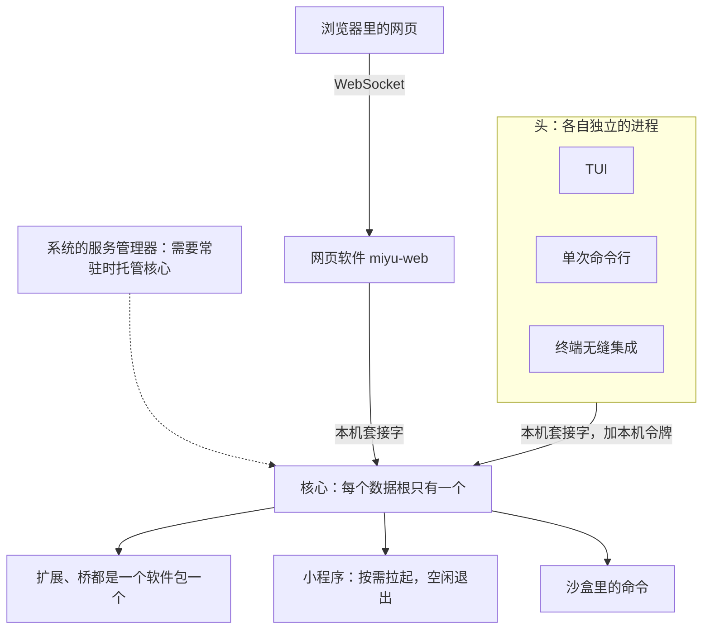
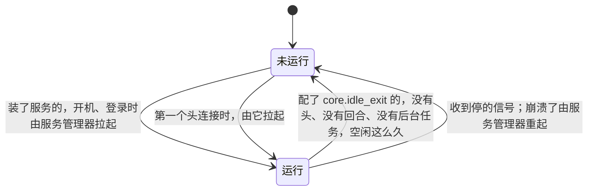
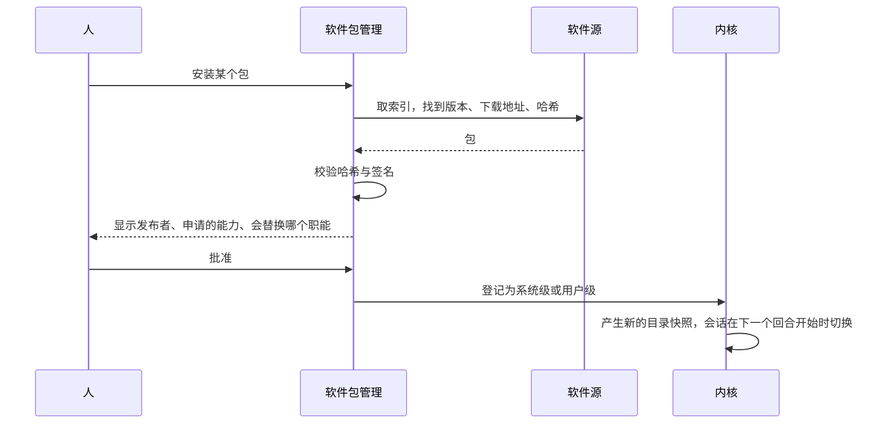

## 进程形态与分发（草案）

状态：R1 到 R14 已定（2026-09-25）。其余内容为草案。

### 一、有哪些进程

- **核心**：每个数据根只有一个（`07-存储.md` 第十节）。
- **头**：各自独立的进程，通过核心协议连接核心（`04-核心协议.md`）。网页头是单独的程序 `miyu-web`，自己开端口给页面，经本机套接字连核心（`04-核心协议.md` P5）。
- **核心的子进程**：扩展（一个软件包一份）、桥（一个软件包一个进程，接几个平台账号都在里面；`miyu onebot start` 打开开关才拉起，`18-通讯平台.md` 第三节）、小程序、沙盒里的命令。

**子进程随核心退出，按进程树管理，不按名字杀（R5）**：

| 平台 | 核心退出时，怎么保证子进程也退出 |
|---|---|
| Linux | 子进程设置“父进程死亡时收到信号”，并放进自己的进程组 |
| macOS | 没有同样的机制。子进程监听一条来自核心的管道，管道断开就自己退出 |
| Windows | 子进程放进一个作业对象，作业对象设置为“句柄关闭时结束全部进程” |

- 结束子进程时，只结束核心自己记录在案的那棵进程树。绝不按进程名去结束进程：同名的进程可能属于别人。旧版就出过“按名字结束进程，结果把自己也结束了”的事故。
- 子进程崩溃后按退避重启，连续失败就停下，并在界面上说明（`05-内核接口.md` 第九节）。

### 二、核心什么时候运行

- **一直开着，这是默认（R1，2026-10-22 项目主人改，施工 Z-1 上）**：核心起来了就不因为空闲退出，通讯平台的桥、定时任务、远程连进来的人不用等谁打开头。谁先来都行：装了服务的，开机、登录时由服务管理器拉起；没装的，第一个头连接时由它拉起（`01-架构.md` D2），所以不装服务也能用。空闲的核心占的内存靠 V 线量过的那一份兜着（`perf.md`）。
  - **要省的配 `core.idle_exit`**（分钟，`0` 是不退，默认 `0`；只在系统配置那一层）：配了的照原来的规矩退：没有连接、没有在跑的回合和后台命令，连续这么久（施工 3-9 上定的规矩，原来写死 10 分钟）。当场生效：每次看都读这一刻的配置。没配的每 30 秒看一次，不另起忙循环。`miyu core --idle-seconds` 盖过它，开发、测试用。收到停的信号（SIGTERM、Ctrl+C），先让在跑的会话有计划地停下：跑到一半的回合记成「重启了」，下次载入接着干。
- **拉起时的握手**（参考 jcode，2026-09-25 补）：头先拿一把拉起锁，免得几个头同时拉起好几个核心；清掉残留的旧套接字；把一根管道的写端交给核心。核心先 bind 好套接字、能接受连接了，就往管道里写一个字节，恢复会话、回收 blob 这类重活放到这之后。头等这个字节，不轮询。
  - **怎么写**（施工 3-9 上）：拉起锁是 `run/spawn.lock`；拿到以后再连一次，别的头可能刚拉起来。核心的标准输出就是那根管道，标准输入、标准错误接空，Unix 上自成一个进程组，Windows 上不带控制台窗口，终端里按 Ctrl+C 打不到它；工作目录是数据根，不占着头的当前目录（施工 3-9 上写了没做，3-9 下的真机验收查出来补上）。核心写的不是一个字节，是一行：`ready` 是好了；`running` 是已经有一个核心在跑，它自己走，头去连那一个；`error <原因>` 是起不来，头把原因照原样打出来。什么都没写就退了的，头报「核心没起来」，让人去看 `state/logs/core.log`。等这一行、等拉起锁，各最多 10 秒（2026-10-31 施工 CS-1 放宽到 60 秒：几个核心同时冷启动、硬盘忙时要等落盘，Terminal-Bench 里量到卡 24 秒，10 秒不够）。
  - **清旧套接字的是核心**：它拿着 `run/core.lock` 才清（`07-存储.md` 第二节），头不碰。
  - **先拿锁，再装日志**：已经有一个核心在跑的，新起来的这一个说一声 `running` 就走，不往同一份运行日志里写。
  - **两个头同时第一次用这个数据根**：建骨架时别处刚写下的标记也算，都建得成（施工 3-9 上查出、修了）。
- **交给服务管理器**（施工 Z-1 上，文件在仓库的 `packaging/`，怎么装见那里的 README）：开机、登录就起，崩了它重起。第一版的重点是个人机器上本人这一层：

  | 平台 | 登录时自动启动 | 开机后无人登录也运行 |
  |---|---|---|
  | Linux | systemd 用户服务 `packaging/systemd/user/miyu.service`；没有 systemd 用户会话的桌面用 XDG 自启动 `packaging/xdg/miyu.desktop` | systemd 用户服务，加上 `loginctl enable-linger` |
  | macOS | launchd 的用户代理 `packaging/macos/miyu.plist` | 第一版不支持 |
  | Windows | 登录时启动的任务计划 `packaging/windows/miyu.xml`，当前用户、不需要管理员权限（原来写的注册表 Run 键改成它，主会话 2026-10-22） | 第一版不支持 |

  - **服务器的**（样例，给自己有服务器的人用）：systemd 系统服务 `packaging/systemd/system/miyu.service`，用一个专门的系统用户 `miyu` 跑，数据根是 `/var/lib/miyu`，不挂在某个人的家目录下面（那个人的账号停了、搬了，核心跟着没了，所以不用用户服务加 linger）；网页软件另一份 `miyu-web.service`，从网页进（访问密码）。OpenRC、runit、dinit 各一份样例在 `packaging/init/`。沙盒要用户命名空间，systemd 的加固项不写 `RestrictNamespaces=`。在第二个本机入口（`run/public.sock`，施工 Y-1 下）做好以前，本机的命令行要以 `miyu` 这个用户跑才连得上。
  - **两个核心撞上**：头先拉起了一个的，服务管理器起的这一个照握手说 `running`、退出码 0 就走，不重起它；头拉起的那一个退了以后，服务管理器下一次起它才接手。
  - **替人装**：`miyu service enable|disable|status`（施工 Z-1 下）只管本人这一层，头的「设置」页以后调它；开启桥、定时任务这些功能时提议装上的就是它。

- **崩溃之后**：服务管理器托管的，由它自动重启；没托管的，下一个头连接时再拉起。全部状态从日志重建，未完成的回合标记为中断（`02-内核.md` 不变量 8）。

### 三、一个主程序

**`miyu` 是一个二进制，像 busybox 那样按子命令分发（R2）**。核心、TUI、单次命令行、终端无缝集成、管理命令、软件包管理都在里面。沙盒助手是一个单独的小程序（`miyu-sandbox`），好让 Ubuntu 上 AppArmor 的特许只给它（`11-权限与沙盒.md` 第六节）。知识库抽字的小程序（`miyu-extract`）也单独一个、随主程序放在它旁边：抽 PDF、网页的两个库编进核心，空闲时多 1.6 MB 上下的常驻、过了预算，放在小程序里一份文档拉起一次、用完就退（施工 K-5，蓝图 `knowledge.md`「怎么走」第二条）；打包时和 `miyu-sandbox` 一样带上。网页界面是单独的程序 `miyu-web`，随网页软件的包装在 `miyu` 旁边，`miyu web` 找到它、把参数交给它（2026-10-01 项目主人定，施工 W-9，蓝图 `web-ui.md`）。代码上各自是独立的库，分发上合成一个文件（`01-架构.md` 第二节）。

| 命令 | 做什么 |
|---|---|
| `miyu` | 打开 TUI |
| `miyu ask "…"` | 单次对话：打印回复后退出 |
| `miyu status` | 核心的运行状态，相当于 Linux 的 `/proc` |
| `miyu doctor` | 检查这台机器上各项能力是否可用，并说明怎么修（第七节） |
| `miyu pkg …` | 软件包：搜索、安装、停用、卸载、管理软件源 |
| `miyu service enable`、`disable`、`status` | 把核心登记为开机、登录就起的服务，撤销登记，看装没装（施工 Z-1 下，`docs/blueprint/cli/service.md`） |
| `miyu sandbox setup`、`miyu sandbox remove` | 完成或撤销需要管理员权限的沙盒安装 |
| `miyu upgrade` | 升级 Miyu 本身，或者告诉人该用哪个包管理器升级 |
| `miyu shellhook install` | 装终端无缝集成的脚本：终端界面的包加的命令（`22-命令行.md` 第七节，2026-10-20 改） |

- 这里只列最常用的几条，全表见 `22-命令行.md` 第五节。
- **对话必须显式（R4）**：只有 `miyu ask` 会把文字发给模型。不认识的子命令直接报错，绝不当成对话发出去。旧版出过这样的事：一条打错的子命令被当成对话，发给了正在运行的核心。
- **单独分发的三类程序**：
  - 桌面端：网页的薄封装（2026-10-29 项目主人定，`21-网页.md` X9），单独的仓库 `miyu-agent/miyu-desktop`；安装包把核心、网页软件和外壳 `miyu-desktop` 打在一起，资源目录照下面「怎么找」。
  - 小程序，例如语音、内置语义模型：依赖大，作为二进制软件包按需下载。不用的人不下载，符合“谁用谁付”。
  - 网页界面：单独的程序 `miyu-web`，加页面文件，装了才有，带自己的资源目录（`04-核心协议.md` P5）。
- **资源文件不编进二进制（R3）**：出厂的人格与预设、提示词、字体都放在资源目录里，随安装包一起分发。网页界面的页面文件是 `miyu-web` 自己的资源，不在这份资源目录里（`21-网页.md` X5）。开发时用环境变量把资源目录指向源码树，改提示词不用重新编译。

资源目录的位置：

| 安装方式 | 程序 | 资源 |
|---|---|---|
| deb、rpm | `/usr/bin/miyu` | `/usr/share/miyu/` |
| AUR | `/usr/bin/miyu` | `/usr/share/miyu/` |
| Homebrew | Homebrew 前缀下的 `bin/miyu` | 同一前缀下的 `share/miyu/` |
| 安装脚本（Linux、macOS） | `~/.local/lib/miyu/miyu`，并在 `~/.local/bin/` 放一个链接 | `~/.local/lib/miyu/resources/` |
| 安装脚本（Windows） | `%LOCALAPPDATA%\Programs\Miyu\miyu.exe` | 同目录下的 `resources\` |
| 桌面端（Windows） | 装在哪的 `miyu.exe` | 同目录下的 `resources\` |
| 桌面端（macOS） | `Miyu.app/Contents/MacOS/miyu` | `Miyu.app/Contents/Resources/miyu/`（施工 DT-4 上） |

用安装脚本安装时，程序和资源**不放**进数据根 `~/.miyu`（`07-存储.md` 第二节）。程序和用户数据混在一起，备份、搬家、卸载时都会出问题。

**怎么找**（2026-09-27 补，施工 3-6 上）：先看环境变量 `MIYU_RESOURCES`，开发时把它指到源码树的 `resources/`；没设的，看程序的真实位置（顺着链接找到本体），旁边有 `resources/` 就是它，上一级有 `share/miyu/` 就是它，上一级有 `Resources/miyu/` 就是它（macOS 桌面端的 `.app`，施工 DT-4 上）。都没有，说清找过哪几处、开发时设 `MIYU_RESOURCES`，不猜别的位置。

### 四、软件包

**软件包 = 一份清单 + 一组文件（R6）**。清单的写法见 `05-内核接口.md` 第二节、`docs/blueprint/packages.md`。种类照 `30-插件框架.md` 第二节（2026-10-09 回写，施工 T-4）：说的是它跑在哪，不说它带来什么。

| 种类（`kind`） | 跑在哪 | 例子 |
|---|---|---|
| 内置（`builtin`） | 代码编在核心里，有清单才启用 | 基础系统、人格记忆、联网 |
| 扩展（`process`） | 核心拉起的进程，说 Miyu 协议 | 天气、接入QQ |
| 小程序（`worker`） | 核心按需拉起、空闲退出的辅助进程，每个平台一个二进制 | 内置语义模型、语音 |
| 界面（`ui`） | 人敲 `miyu` 打开的那一头 | 终端界面、网页界面 |

技能、脚本、MCP 都是功能（设计 30 第三节），它们怎么打包、装上随第三方软件包那一段（设计 30 第八节）；人格包、预设包（`16-人格与预设.md`）随软件源那一段。

**软件源**：

- 一个软件源就是一份索引，列出包名、版本、各平台的下载地址和哈希。相当于 apt 的源、Homebrew 的 tap、AUR。
- 官方源的包带签名（ed25519），安装时校验。
- 添加第三方源要人明确表示信任，就像给 apt 加一个新源的密钥。
- 安装之前，界面显示发布者、这个包申请的能力、它会替换哪个职能，由人批准（`05-内核接口.md` I5）。

**系统级与用户级（R7）**：2026-10-28 起作废：只给一个人用，装上的包只有一层，施工 SU。

**职能与替换（R8）**，相当于 Debian 的虚拟包和 `update-alternatives`：

> 软件的快速装卸、即插即用（注册都能撤回、等依赖、按变了什么选扰动最小的做法、在跑的调用认开始时的提供者）调研过 dsh 的做法和论文，记在 `docs/reviews/2026-09-30-dsh-即插即用调研.md`；做装卸那一段时从那里的三道题拍板起，替换分「换后端」「换工具」两种也在那里（2026-09-30 项目主人让记一笔）。

- 包在清单里声明自己提供哪些职能，例如 `editor`：提供 `edit` 工具，并报出 `file.changed` 效果（`10-自带软件.md` 第五节）。
- 同名的工具在一个会话里只能有一个提供者。替换就是停用旧的、启用新的。
- 包可以依赖某个职能，而不是某个具体的包。「职能」这个词只用在这里，免得和角色扮演的「角色」混在一起。
- 停用或卸载某个职能的唯一提供者时，先告诉人哪些功能会变弱，例如“撤销将不可用”“压缩后无法重建工作集”。

**停用与卸载（R9）**：

- 编进核心的自带软件只能停用。停用后不构造，不占内存也不占 CPU。
- 其余的包可以卸载，分两种：保留它的数据；连同它的数据一起删除。相当于 apt 的 `remove` 和 `purge`。
- 无论哪种，日志里它产生过的事件都原样保留，投影时跳过（`03-事件模型.md` E6）。

**锁文件**：记下已装的包、版本和哈希。只有一份（`07-存储.md` 第二节）。拿到另一台机器上，可以装出一模一样的环境。

**扩展不自动升级**：新版本可能申请更多的能力，要人重新批准。有新版本时只提醒。

### 五、升级 Miyu 本身

- **谁装的谁升级（R10）**：通过 AUR、Homebrew、deb、rpm 安装的，由对应的包管理器升级，`miyu upgrade` 只告诉人该用哪条命令。通过安装脚本安装的，`miyu upgrade` 自己下载、校验、替换。
- **升级之后**：头发现核心比自己旧，就请求核心在空闲时重启（`04-核心协议.md` 第八节）。正在进行的回合不打断。
- **数据不需要迁移**（`07-存储.md` S7）。降级之后，旧版本也读得懂新版本写下的日志：不认识的字段和事件原样保留（`03-事件模型.md` 第八节）。

### 六、各平台的安装

平台与架构（R11，2026-09-25 确认）：

| 平台 | 架构 |
|---|---|
| Linux | x86_64、arm64。以 glibc 2.39 为基线，这是 Ubuntu 24.04 的版本，在它上面构建，更新的发行版都能运行 |
| macOS | arm64（Apple 芯片） |
| Windows | x64。高通芯片的 Windows 笔记本，靠系统自带的模拟运行 x64 版本 |

安装渠道（R12，2026-09-25 确认）：

| 平台 | 渠道 | 额外要做的事 | 开机常驻（施工 Z-1） |
|---|---|---|---|
| Arch | AUR | 依赖 bubblewrap：`depends=(bubblewrap)` | 用户服务装进 `/usr/lib/systemd/user/miyu.service`，不默认启用 |
| Debian、Ubuntu、Mint | deb，随 GitHub Releases 发布 | 依赖 bubblewrap：`Depends: bubblewrap`；Ubuntu 与 Mint 的包附带 AppArmor 配置，安装时自动生效（`11-权限与沙盒.md` A7） | 同上 |
| Fedora | rpm，随 GitHub Releases 发布 | 依赖 bubblewrap：`Requires: bubblewrap` | 同上 |
| macOS | Homebrew 的 tap | 无，Seatbelt 不需要设置 | 不装，人自己 `miyu service enable` |
| 全部平台 | 安装脚本，从 GitHub Releases 下载 | 见下 | 不装，人自己 `miyu service enable` |

- **开机常驻**：安装包只把文件放好，不替人启用：要不要开机就起是人自己定的，`systemctl --user enable --now miyu`，或者 `miyu service enable`（施工 Z-1 下）。系统服务的样例（`packaging/systemd/system/`）不进安装包，写进文档。

- **Linux 的安装包依赖 bubblewrap**（2026-10-22 项目主人定）：AUR、deb、rpm 照上表写依赖，装 Miyu 时包管理器一起装上，沙盒有 `bwrap` 就用它（施工 5-16，`sandbox/linux.md`）。macOS、Windows 不用。现在仓库里还没有打包脚本，写 PKGBUILD、deb、rpm 的那一步照这一条写。安装脚本装在当前用户的目录里、不装系统的包，没有 `bwrap` 的照旧只用 Landlock。
- **安装脚本**：Linux 与 macOS 用一行 `curl … | sh`，Windows 用一行 PowerShell。都装在当前用户的目录里，不需要管理员权限。
- **包文件的类型**（施工 G-14，`37-软件源.md` 第二节第 6 条）：Linux 上把仓库里的 `packaging/mime/miyu.xml` 装成 `share/mime/packages/miyu.xml`。deb、rpm、AUR 装进 `/usr/share/mime/packages/`，`update-mime-database` 不由我们的包自己跑：Debian 系的 shared-mime-info 带 dpkg 触发器、Fedora 的带 rpm 文件触发器、Arch 的带 pacman 钩子（`30-update-mime-database.hook`），这个目录里的文件一变它们自己跑，打包时不写 postinst 之类。安装脚本装进 `~/.local/share/mime/packages/`，装完、卸完各跑一次 `update-mime-database ~/.local/share/mime`，系统里没有这个命令的跳过、说一句，不算失败。macOS、Windows 不做：macOS 的类型要跟着一个 `.app` 声明，Windows 要写注册表，等有桌面程序再说。现在还没有打包的脚本，做打包的那一步照这一条装。
- **需要一次管理员权限的沙盒安装**，由 `miyu sandbox setup` 完成：
  - Windows：创建沙盒用户和防火墙规则（`11-权限与沙盒.md` A3）。安装脚本装完会问要不要现在就做。以后第一次需要沙盒时，如果还没做，也会再问一次。
  - Ubuntu 与 Mint 上用安装脚本安装的：安装 AppArmor 配置。deb 包已经自带，不需要这一步。
  - 不做这一步：Windows 上这台机器就没有沙盒，按 `11-权限与沙盒.md` 第二节降级；Ubuntu 与 Mint 上文件照样由 Landlock 隔离，只是沙盒里的网络全关，按 `11-权限与沙盒.md` A7。
- **卸载时清理**：Windows 上要执行 `miyu sandbox remove`，删除沙盒用户和防火墙规则，同样需要一次管理员权限。
- deb、rpm 只随 GitHub Releases 发布，不建 apt、dnf 软件仓库（2026-09-25 项目主人确认：没有必要）。

### 七、首次运行与自检

**开箱即用**：第一次打开时只问两件事：用哪个模型（填密钥，或者登录已有的订阅），选哪个人格（出厂的是 Miyu 和软件工程师）。其余全部用默认值。不管从哪个头第一次打开，都是这两件事。终端界面第一次启动时还会问一次看不看得到图标，那是这个头自己的显示设置（`13-终端界面.md` H10），不算在里面。

**`miyu doctor`（R13）**：逐项检查这台机器，每一项都说清楚“是什么、为什么、怎么修”：

- 沙盒能不能用：Landlock 的版本、能不能创建命名空间、AppArmor 配置装没装、Windows 的沙盒安装有没有完成
- 数据根的权限对不对
- 核心和头的版本是否一致
- 模型能不能连通

### 八、构建与发布

- **三个平台的持续集成，从第一个提交就开始**（`00-设计理念.md` 跨平台）。
- **发布前检查安装包（R14）**：资源文件是否齐全；运行包里的二进制，确认它报出的版本号正确。旧版就发布过漏了资源文件的包。
- 每次发布都附带校验和与签名。

### 九、决定

**R1. 核心什么时候运行**

- **已定：核心起来了就一直开着，空闲不退；要省的配 `core.idle_exit`。开机、登录就起的交给系统的服务管理器（2026-10-22 项目主人改，地基排期第 1 条；施工 Z-1）。**
- 原来定的（2026-09-25）：默认按需运行，空闲退出；开启需要常驻的功能时才登记成服务。改的原因：通讯平台的桥、定时任务、远程连进来的人都要核心在，空闲退出的核心让它们时有时无；空闲的核心占的内存 V 线量过、压得住。
- 未选：装好就替人启用开机自启。要不要开机就起是人自己定的，安装包只放文件。
- 重开条件：空闲的核心占的内存、唤醒次数，量出来让偶尔用的人吃不消。

**R2. 程序的形态**

- **已定：一个 `miyu` 主程序，按子命令分发；重型 worker 单独分发；沙盒助手是单独的小程序；网页界面是单独的程序 `miyu-web`，随网页软件装（2026-10-01）；桌面端的外壳是单独的程序 `miyu-desktop`，开 `miyu-web` 给的页面（2026-10-29，`21-网页.md` X9）。**
- 未选：每个组件一个二进制。安装、升级、版本对齐都更麻烦。
- 重开条件：主程序的体积明显违反“轻量”。

**R3. 资源文件放在哪里**

- **已定：不编进二进制，放在资源目录里随包分发；开发时可以指向源码树；用户级安装时，程序与资源不放进数据根。**
- 未选：编进二进制。每改一句提示词都要重新编译，旧版就是这样。
- 重开条件：无。

**R4. 命令行怎么对话**

- **已定：只有 `miyu ask` 发起对话；不认识的子命令直接报错。**
- 未选：`miyu "问题"` 这种隐式的写法。打错的子命令会被当成对话发出去。
- 重开条件：无。

**R5. 子进程怎么管理**

- **已定：子进程随核心退出；只按核心记录的进程树结束进程，绝不按名字。**
- 重开条件：无。

**R6. 软件包与软件源**

- **已定：软件包是清单加文件；软件源是一份索引；官方源签名，第三方源要人明确信任；安装前显示申请的能力。**
- 重开条件：无。

**R7. 谁能装软件**

- （2026-10-28 起作废：只给一个人用，施工 SU。）

**R8. 替换与依赖**

- **已定：按职能替换，同名工具只能有一个提供者；依赖职能而不是具体的包；卸载唯一提供者前说明哪些功能会变弱。**
- 重开条件：无。

**R9. 卸载**

- **已定：自带软件只能停用；其余的包卸载时，可以选保留数据或连数据一起删除；日志里的事件永远保留。**
- 重开条件：无。

**R10. 升级**

- **已定：谁装的谁升级；核心在空闲时重启；扩展不自动升级。**
- 重开条件：无。

**R11. 平台与架构**

- **已定：Linux x86_64 与 arm64（glibc 2.39 基线），macOS arm64，Windows x64（2026-09-25 确认）。**
- 重开条件：出现 Windows arm64 用户明显的需求。

**R12. 安装渠道**

- **已定：安装脚本加 GitHub Releases、AUR、Homebrew、deb、rpm（2026-09-25 确认）。Windows 用安装脚本安装。**
- 未选：自建 apt、dnf 软件仓库。项目主人（2026-09-25）：没有必要，GitHub 发 Release 就行。
- 重开条件：出现某个渠道的明显需求，例如 winget。

**R13. 自检**

- **已定：`miyu doctor` 逐项检查各项能力，每一项都说清怎么修。**
- 重开条件：无。

**R14. 发布前检查**

- **已定：检查资源文件是否齐全，运行包里的二进制确认版本号。**
- 重开条件：无。

**R15. 许可证**

- **已定（2026-10-26 项目主人改）：分层。核心和第一方的程序（终端、网页、接入通讯平台、渲染、本机语义模型）用 AGPL-3.0-or-later；给别人照着写东西用的（开发包 `miyu-sdk`、作者说明里的模板和例子、协议参考、教 AI 写软件包和技能的那两份技能）用 Apache-2.0。** Miyu 以后主要是在服务器上给人连着用（远程是主入口），GPL 管不到「改了只做成网上服务」，正是重开条件说的情形；分层是为了不吓着写扩展、写软件包、另写头的人：只经协议和 Miyu 说话的程序是独立的作品，用什么许可证都行，README 明写。`miyu-client` 跟核心一层（它带着核心的一大半，放宽了等于把核心放宽）；以后要让第三方的 Rust 头不受 AGPL 约束，另拆一个只有协议类型和连接的薄 crate 用 Apache-2.0。依赖的许可证照旧由门禁查：能和 GPL-3.0 合的宽松许可证也都能和 AGPL-3.0 合。
- 以前（2026-09-28 项目主人定）：GPL-3.0-or-later。 别人改了 Miyu 再分发，得照样公开源码。扩展、脚本、MCP 服务器是另外的进程，走协议说话，不受影响；以后给扩展用的开发包用 MIT，不挡闭源的扩展。第三方依赖都是宽松的许可证，其中有只用 Apache-2.0 的，和 GPLv2 合不到一起，所以是 v3。依赖的许可证由门禁查（蓝图 `licenses.md`）。以前按 MIT 公开的提交还是 MIT。
- 未选：MIT（原来用的）：谁都能拿去改成闭源的发。
- 未选：全部 AGPL（开发包、模板也是）：写扩展、软件包的人怕被传染。全部宽松（Apache-2.0 或 MIT）：谁都能拿核心改成闭源的服务。
- 代价：有些公司明文不用 AGPL 的软件；有人改了自己的 Miyu 挂在群里，也得给群友一个源码链接。
- 重开条件：分层的界线挡了第三方的头或扩展（例如要链接 `miyu-client`），再拆薄的协议 crate。

**后续再定**

- macOS 与 Windows 的代码签名：有需要时再定
- macOS、Windows 上开机后无人登录也运行：有需求时再做
