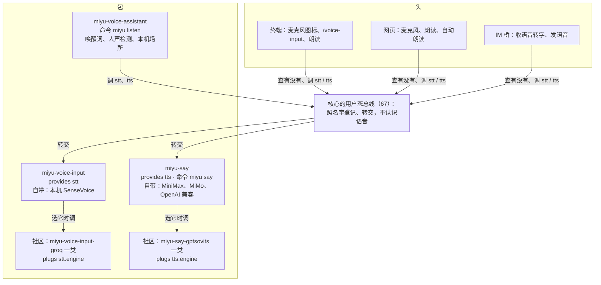

## 语音

语音全部是可选的软件包：没装就没有，任何界面上都看不到语音的东西。三个官方包：`miyu-voice-input` 把说的话转成字，`miyu-say` 把字念出来，`miyu-voice-assistant` 用前两个做一个像 Siri 那样常驻后台的语音助手。它们之间、它们和头之间，经 `67-总线.md` 照名字（`stt`、`tts`）找、照名字调，谁也不写死谁的包名；核心不认识「语音」。

状态：二稿，草案（2026-11-09）。一稿（2026-09-25，V1 到 V7）写在包分种（30、31）、扩展沙盒（62）、扩展提供模型驱动（66）、场所 `images=false`（施工 X-25）、「语音先不转文字」的占位（施工 O-33、O-35）之前，当时的样子是「核心里一个语音服务加一个语音小程序」；二稿照现在的架构重排，项目主人 2026-11-09 当面定了第一到第九节的形状和第十三节标了「已定」的各条。一稿里还成立的（唤醒规程、追问窗口、开口就打断、打断补事实、模型放系统缓存、旧版的教训）照搬，注明出自一稿。依赖 `67-总线.md`（2026-11-09 定稿，首个正式版之前做；语音同样发版前做，项目主人 2026-11-09 定）；总线定下来以前不施工。

### 一、做什么

照项目主人 2026-11-09 列的，加上市面上语音助手（ChatGPT 语音模式、Gemini Live、Siri、Alexa、Home Assistant Assist、微信和 Telegram 的语音消息）常见、对 Miyu 有用的几样：

| 功能 | 一句话 | 哪个包 |
|---|---|---|
| 语音输入 | 终端、网页的输入框右侧一个麦克风，说话代替打字，识别出的字进输入框 | `miyu-voice-input` |
| 音频附件转文字 | 拖进来的录音、语音备忘，发出去时转成字一起给她 | `miyu-voice-input` |
| IM 收语音 | 别人的语音转成字进上下文，叫她名字、关键词照常触发她 | `miyu-voice-input` |
| 朗读 | 她每一轮结尾一个「朗读」按钮；另有「自动朗读」开关 | `miyu-say` |
| 她开口 | 她决定要说出来：本机 `miyu say` 从音箱放；IM 里发一条语音消息 | `miyu-say` |
| 说出来的提醒 | 定时任务到点、后台长任务做完，她说一声 | `miyu-say` |
| 语音助手 | 常驻后台，叫她的名字或按热键就能说，回答从音箱出来 | `miyu-voice-assistant` |

**不做**（第一版）：
- 端到端的语音模型（「声音进、声音出」的 realtime 一类）：见 V10；
- 打电话、QQ 语音通话和语音房、Discord 语音频道：要一直收发音频流，和消息式的对话是两回事；
- 声纹认人：认人照旧靠平台编号（`42-认识的人.md`）；
- 出厂的本机合成：效果好的（GPT-SoVITS、CosyVoice、IndexTTS、Qwen3-TTS）要显卡、占几个 G，CPU 跑得动的（Kokoro、Piper、Supertonic）中文音质不够，旧版试过删了（一稿 V2）。留 `tts.engine` 插口给社区包（第六节）。

### 二、三个包和总线

| 包 | 装上以后多了什么 | 命令 | 要的能力 | 重不重 |
|---|---|---|---|---|
| `miyu-voice-input` | 终端、网页的麦克风和 `/voice-input`；IM 的语音转成字；音频附件转文字 | 无 | 麦克风（新能力，第十节） | 第一次用时下载约 160 MB 模型；加载以后多约 300 MB 内存，空闲卸掉 |
| `miyu-say` | 朗读按钮、自动朗读；她能说话、能发语音 | `miyu say` | 放声音（新能力，第十节）、联网 | 轻，只发 HTTP 请求 |
| `miyu-voice-assistant` | 常驻后台的语音助手、托盘一行 | `miyu listen` | 麦克风、放声音 | 待机约 80 MB、CPU 0.4%（旧版实测，一稿第七节） |

- **都是扩展包**（`[process]`），不是小程序（`[worker]`）：小程序每多一种，核心就要为它写一套专门的协议（现在只有 `miyu-embed`）；这三个要的东西（登记工具和方法、斜杠命令、托盘、造场所会话、配置页）扩展现成都有（`blueprint/extensions.md`）。
- **依赖**：assistant 依赖另外两个，装它一起带上；input 和 say 互不依赖。另设一个组 `voice`（`miyu pkg install voice` 装全套，照 `44-基础系统拆包.md` 的组）。
- **没装就看不见**（V13）：头只在总线上查到 `stt`、`tts` 有人提供时才画对应的入口；IM 桥查不到 `stt` 时语音照旧是占位（那是给她看的，人看不到）。人格页、供应商页都不多出语音的项：声音、引擎全在包自己的配置页里（第五、六节）。
- **一个名字只有一家**：`stt`、`tts` 是 `provides`，装第二个提供 `stt` 的包报冲突（`67-总线.md`）。想换引擎的不用换包：两个包各留一个 `plugs` 插口，社区包只接引擎，装上以后在包的配置页「引擎」里多一项（V12）。

### 三、总线上的名字

照 `67-总线.md` 的写法。方法的参数、回应写在蓝图里，这里只定形状：

| 名字 | 种类 | 方法 | 进 | 出 |
|---|---|---|---|---|
| `stt` | provides | `transcribe` | 音频 blob、语言（可选，默认照配置） | 文字、语言、时长 |
| `stt` | provides | `record` | 无（录本机麦克风，静下来就停，或者再调一次 `stop`） | 同 `transcribe` |
| `tts` | provides | `synthesize` | Markdown 文字、人格（可选，照它挑音色） | 音频 blob、格式、时长 |
| `tts` | provides | `play` | 音频 blob 或文字 | 放完或者被停 |
| `stt.engine` | plugs | `transcribe` | 同上 | 同上 |
| `tts.engine` | plugs | `synthesize` | 念得出来的纯文字、音色参数 | 音频 blob |

- **整句进、整句出，不做流式**：识别交一整句的音频；合成一次一句，调的一方（网页朗读、助手）自己按句切开、一句一句调，第一句好了就放。这样首音只等一句，总线也不用支持流式。实测首音慢再上流式（后续再定）。
- **音频走 blob**：调的一方先 `blob.put`（或分块的 `blob.open/write/close`），总线上只传 blob 的编号，扩展照它拿得到的读（`blueprint/protocol.md`）。
- 头和 IM 桥只调 `stt`、`tts`，不知道背后是哪个引擎。

### 四、可念的文字

`tts.synthesize` 收 Markdown，`miyu-say` 转成念得出来的话，网页、终端、助手、IM 念出来的一样（一处做，社区引擎收到的已经是纯文字）：
- 代码块念「一段代码」；行内代码照念；表格念「一张表」；链接念文字，裸网址念域名；图片念替代文字或者不念；
- 表情符号不念；列表照句子念；标题当一句；
- 去掉以后是空的、只有零宽字符的，不合成（旧版模型吐零宽空格，发出过空白的语音，一稿第六节）；
- 按句切：中文按句号、问号、叹号，英文按句末标点；太短的句子并进下一句。

转写规则是数据，放在包的资源文件里。

### 五、`miyu-voice-input`

- **引擎**：自带本机 CPU 识别 SenseVoice-Small（sherpa-onnx）。选它的理由（2026-11-09 查的资料加旧版实测）：
  - 旧版实测识别 3 到 5 秒的语音，热的时候约 150 毫秒，两个核和十六个核差不多；FunASR 自己的测试是 CPU 上约 17 倍实时；
  - 中文明显好过 Whisper；还认粤语、英语、日语、韩语；
  - 更准的 Qwen3-ASR、FireRedASR2、Fun-ASR-Nano 在 CPU 上慢几倍或者要显卡，以后实测了再加进可选列表。
- **模型文件**：第一次用时下载，放系统缓存目录、整台机器共用（一稿 V4）；路径照数据根的规矩问 `root.rs`，不自己拼（`55-数据根仿FHS.md`）。人声检测、唤醒词的模型归 assistant。
- **省着用**：识别模型用时才加载，空闲一会儿卸掉；不用时进程只占几 MB。群里语音多、模型一直热着也只多约 300 MB。
- **过滤**（旧版教训）：短于 0.5 秒的不识别；识别出的有效字少于 2 个的丢掉，回应里照实说「没听清」；语言默认 `zh`（`auto` 会把普通话判成日语）。
- **录音**：终端、命令行用的 `record` 录本机麦克风。网页不用它：浏览器自己录，交 `transcribe`。
- **配置页**（`53-软件包配置项的词汇.md`）：引擎、识别语言、用哪个麦克风、模型下没下好。
- **插口** `stt.engine`：社区包接云端识别（例如 Groq）或更重的本机模型；它依赖 `miyu-voice-input`，装上以后「引擎」里多一项。

### 六、`miyu-say`

- **引擎**：自带三个（V2，2026-11-09 项目主人定）：
  - **MiniMax**：音质第一梯队、能克隆音色，适合给人格做专属的声音；
  - **MiMo**：能用一句话描述声音（声音设计），也能克隆；旧版接过；
  - **OpenAI 兼容**：一个通用的接法，填地址和 key。OpenAI 自己、硅基流动上的 CosyVoice 和 Fish-Speech、自己在本机起的 GPT-SoVITS 或 Kokoro 服务（大多提供 `/audio/speech`）都走它，用不着另写扩展。
  - 豆包（火山引擎）、阿里百炼、ElevenLabs 这些有自己接口的，先不出厂；有人要再做成官方或社区的引擎包。
- **每个人格的声音**写在 `miyu-say` 的配置里：人格编号对哪个引擎的哪个音色、语速；没写的用引擎的默认音色。不进人格文件：没装 `miyu-say`，人格页上就没有「声音」。克隆真人的声音要本人同意，写进作者教程。
- **命令** `miyu say <文字>`：用当前人格的声音从本机音箱念出来；`-o <文件>` 存成文件不念；`--file <音频>` 放一个现成的音频。程序经核心找到正在跑的 `miyu-say` 进程，由它去合成、去放（调总线的 `tts.play`），所以她在沙盒里的 `shell` 跑 `miyu say` 也出得了声，沙盒照旧碰不到声卡。
- **她的工具**：一件，暂名 `say {text}`：合成一段语音、存进会话工作区的 `audio/`，交回路径，不放。发不发、去哪放由她接着决定：

  | 场合 | 她接着做什么 |
  |---|---|
  | IM | 调桥的 `send_voice {path}`，发一条语音消息（第八节） |
  | 本机、有 `shell` | 直接 `miyu say "编译完了"` 一步出声，不用调工具 |
  | 网页上想给你听 | 用 `show` 显示这个文件，网页的音频卡片能放 |
  | 语音助手的对话里 | 不调：每句回答本来就会念 |

  要一件工具、不只靠命令，是因为 IM 场所的会话一般不开 `shell`。工具名、说明照 `26-提示词.md` 实测登记，写蓝图时定。
- **配置页**：引擎、地址和 key（`secret` 字段，另存在密钥文件里）、每个人格的音色、语速、用哪个音箱。
- **插口** `tts.engine`：社区包（例如 `miyu-say-gptsovits`）只把纯文字变成音频；它依赖 `miyu-say`，装上以后「引擎」里多一项（V12）。

### 七、头

**终端界面**（`13-终端界面.md` 跟着补）
- 查到 `stt`：输入框右侧（现在空着的那一格）画一个麦克风图标，三种状态：不在听（暗）、在听（红）、在识别（转圈）。图标用占一格的字符，不用 emoji（宽度各终端不一，会把输入框撑歪）；字符、颜色画进版式图纸。
- 鼠标点图标，或者斜杠命令 `/voice-input`（模糊搜索 `/vi` 就出来），或者一个快捷键：开始听写，静下来或者再按一次就停，识别出的字插进输入框，不自动发。命令和图标都是终端自己的，查到 `stt` 才列；斜杠命令不由包登记，因为字要落进输入框，扩展的斜杠命令伸不进去。
- 终端收不到「松开按键」，所以不做按住说话。
- 查到 `tts`：她每一轮结尾能朗读；底栏一个「自动朗读」开关，只在这个终端里生效。声音从核心那台机器的音箱出。
- 经 ssh 连远端核心时，麦克风和音箱都是远端那台的，帮助里写明。
- 附件是音频、又查到 `stt` 的，发出去时转成字作为一块文本跟着附件进会话，原音频照旧是附件。

**网页**（`21-网页.md` 跟着补）
- 查到 `stt`：输入框一个麦克风，点一下开始、再点一下或静下来就停；按住说话也行。浏览器录音（`MediaRecorder`），分块上传成 blob，调 `stt.transcribe`，字插进输入框；设置里能改成「说完直接发」。手机上开网页，用的是手机的麦克风。
- 查到 `tts`：她每一轮结尾的按钮（现在有复制、重来）加「朗读」，一句一句合成、在浏览器里放，再点一下停；念过的照消息缓存，再听不再花钱。顶栏一个「自动朗读」开关，只在这个标签页里生效。
- 音频附件同终端。

**怎么分工**：`miyu-say` 做好以后，通知终端、网页的会话照这一节适配（项目主人 2026-11-09 定）；头的代码只认 `stt`、`tts` 两个名字。

### 八、IM

交 IM 的会话（onebot）做；平台的差别归驱动的 quirk 表（`18-通讯平台.md` 第十三节）。

**收语音**（查到 `stt` 时）
- 桥取回语音（QQ 是 NapCat 的 `get_record`，要 wav），存成 blob，调 `stt.transcribe`。群里、私聊的语音全转：本机识别一条几十毫秒，一个群一天 200 条也只花 CPU 半分钟。
- 渲染从现在的 `[voice] (not playable yet)` 改成 `[voice 0:12] 识别出的字`；识别失败写 `[voice 0:12] (not transcribed)`。`venue.media` 加时长一格（2026-10-11 定的「媒体不收时长」重开：现在有地方用了）。老会话快照里钉住的那一句不动，新消息用新写法（施工 O-33、O-35 的做法）。
- 识别出的字走进站链，和打字一样：叫她名字、关键词照常触发她，旁听照常进上下文。
- 查不到 `stt`：照旧是占位。

**发语音**
- 她先调 `say` 拿到音频文件，再调桥的平台工具 `send_voice {path}`（照 `qq_send_file` 写：只收会话工作区里的文件）。QQ 发 `record` 段，NapCat 把 wav 转 silk；以后 Telegram 的 `sendVoice` 要 OGG/Opus，由桥转。
- 历史里记成 `[语音] 原文`（原文从 `say` 的结果带过来）。
- 只发了语音时，后面不跟一条空正文（一稿第六节）。
- 回不回语音由她决定（项目主人 2026-11-09 定），不设场所规则。
- `send_voice` 也能把现成的音频文件当语音发。

### 九、`miyu-voice-assistant`

像 Siri：常驻后台，不开窗口。第三步再做（第十二节），这里先定形状。

- **一个本机场所**（一稿 V3）：它造一个场所会话，一直续下去，终端、网页里看得到；场所规则照常配人格和预设（`18-通讯平台.md` 第四节）。会话 `images=false`（施工 X-25）。
- **怎么叫她**：唤醒词（默认是人格的名字，Miyu 的是「未有未有」「密友密友」「miyumiyu」「みゆみゆ」，配置页能改），或者热键。Windows、macOS 上由托盘程序（miyu-applet）注册全局热键；Linux 的 Wayland 不让程序自己抢全局键，绑一条命令到窗口管理器的快捷键上。
- **命令** `miyu listen`：不带参数是切换（开着就关、关着就开），`miyu listen on`、`miyu listen off` 明确开关，切完印现在的状态、响一声（开、关两种声音）。热键绑的是「直接说一句」还是「开关唤醒」后续再定。
- **规程**（一稿第四节、V6，照旧）：
  1. 待机：只跑人声检测和唤醒词，静的时候能量门挡掉；
  2. 听到唤醒词：响一声提示音、弹一条通知，接着听这一句，唤醒词后面紧跟着说的也算；段前补回 0.5 秒（旧版加了这一条，「密友密友」从 0/5 到 5/5）；
  3. 静下来一小会儿：调 `stt.transcribe` 交给她；太短的、识别得没把握的不交（第五节的过滤）；
  4. 她回答：按句切，一句一句调 `tts.synthesize`、播，第一句好了就开始放；
  5. 追问窗口：播完以后 30 秒内接着说不用再叫，每回答一次重新计时，她想和说的时候不计时；
  6. 开口就打断：她说话时你持续约 0.3 秒的人声，她立刻停下，这一回合打断；会话里补一条事实，写明念到哪一句、后面的没念出来（一稿第四节第 6 条）；她还在想、没开口时你说话，按回合中途来的消息处理；
  7. 没有回声消除时半双工：她说话时不收麦（旧版做法）；戴耳机可开全双工。
- **告诉她这一轮是念出来的**：助手的会话里投影一条事实，客观写明回答会念给对方听、对方看不到文字。要不要写、写多少照规矩先实测、登记 token（`26-提示词.md` 第十节；只描述，不指使）；说短一点这类归人格。
- **没有屏幕**：越过沙盒的操作一律做不了，她说明并请你到终端或网页上做（`11-权限与沙盒.md` A11，一稿第四节）。语音不能批准操作：屋里别人、电视里的声音都能说「确认」。
- **没配合成**（`miyu-say` 没配 key）：只听不说，回答以文字出现在通知和各个头里（一稿 V7）。
- **配置页**：唤醒词、灵敏度、追问窗口、热键、用哪个麦克风和音箱。

**一个麦克风两个人用**：开麦前拿一把整台机器共用的锁，放在系统的运行时目录（一稿第八节）。你在终端点麦克风听写时，`stt.record` 要锁，助手看到就让出、暂停；听写完放锁，助手接着听。同一台机器开着两个 Miyu 也不会接错麦（旧版按名字接线，接到了另一个 Miyu 的麦克风上）。手机上的网页听写用手机的麦克风，不在这里面。

### 十、安全和隐私

- **两个新能力**：「麦克风」和「放声音」，加进扩展的能力表（`blueprint/extensions.md`），装包时照 `61-装包说清来源和能力.md` 说清、人批；扩展沙盒（`62-扩展沙盒.md`）的能力表跟着加声卡这一项。`miyu-say` 只要放声音和联网，永远碰不到麦克风。
- 开麦时一定看得到：托盘、终端的麦克风图标变红。
- 助手唤醒以前的声音只在本机处理，不存、不发出去（一稿 V5）；听写的录音识别完就删，只留文字；IM 收到的语音照附件留着（和图一样）。
- 别人语音里的话和打字一样算场所的外来消息，提示注入的防线不变（`24-威胁模型.md`）。

### 十一、三个平台

照一稿第八节：

| 平台 | 声音服务 | 要注意的 |
|---|---|---|
| Linux | PipeWire，经 PulseAudio 或 ALSA 的接口 | WirePlumber 会记住每个程序的声音流被挪到了哪。测试别用 `pactl move-*`，改用 `pw-link` 直接接线；语音全无反应时先查它记住的目标（旧版测试挪过一次播放流，之后所有声音都进了空设备） |
| macOS | CoreAudio | 第一次用麦克风要在系统里授权 |
| Windows | WASAPI | 第一次用麦克风要在系统里授权 |

- 按设备名选麦克风和音箱，选不到用系统默认的。
- 两只 USB 麦挂在同一个 hub 上会抢带宽（旧版实测）。

### 十二、施工顺序

| 步 | 做什么 | 做完能用的 |
|---|---|---|
| 0 | `67-总线.md` 的 BUS-1、BUS-2（core1，首个正式版之前；项目主人 2026-11-09 定语音也在发版前做） | 包能照名字被找到、被调 |
| 1 | `miyu-voice-input`：本机识别、`stt`、麦克风能力 | 总线上有 `stt` |
| 2 | IM 收语音转文字、`venue.media` 加时长（onebot） | 群里、私聊的语音进上下文、能叫醒她 |
| 3 | 终端、网页的麦克风和 `/voice-input`（heads） | 说话代替打字 |
| 4 | `miyu-say`：三个引擎、`tts`、`miyu say`、`say` 工具、放声音能力 | 她能说话 |
| 5 | IM 的 `send_voice`（onebot）；终端、网页的朗读和自动朗读（heads） | 她在 QQ 里发语音；网页上听她念 |
| 6 | `miyu-voice-assistant` | 叫她名字就能说 |

- 2、3 可以并着做；5 的两半也是。施工单照规矩一步一张，到了跟前再拆。
- 量尺进 `23-性能预算.md`，只和上一版自己比：助手待机的 CPU 和内存、识别热的时延、模型加载后的内存、从说完到第一声（目标 2 秒以内，V10）。

### 十三、决定

**V1. 第一版做什么**（改，2026-11-09 项目主人定）
- **已定：第一节的七样，分在三个包里。一稿未选的「朗读回复」重开（重开条件「有人确实需要」满足）。**

**V2. 合成引擎**（改，2026-11-09 项目主人定）
- **已定：`miyu-say` 自带 MiniMax、MiMo、OpenAI 兼容三个；本机合成不出厂，留 `tts.engine` 插口。**
- 未选 A：出厂带本机合成（GPT-SoVITS、CosyVoice 等）。要显卡、占几个 G。
- 未选 B：CPU 本机合成（espeak-ng、Kokoro、Piper、Supertonic）。中文音质不够，旧版试过删了。
- 未选 C：出厂带豆包、阿里百炼。国内用量大，但各要一套专门的适配；有人要再做成引擎包。
- 一稿的 macOS `say` 不再出厂：可以做成社区引擎包。
- 重开条件：CPU 能跑、中文音质够用的本机合成出现。

**V3. 桌面语音是什么**（保留）
- **已定：一个本机的场所，人格、预设、会话、记忆和别的场所共用。** 二稿只改落脚处：在 `miyu-voice-assistant` 这个扩展里，不在小程序里（V4）。

**V4. 语音的代码放哪**（改，2026-11-09）
- **已定：三个扩展包，主程序不带一行语音代码；模型文件放系统缓存目录、整台机器共用。**
- 未选 A：一稿的小程序加核心里的语音服务。小程序要核心写专门的协议，语音服务让核心认识了语音。
- 未选 B：一个大包 `miyu-voice`。只想 QQ 语音转字的人也要背上助手、批麦克风以外的能力；拆开以后 `miyu-say` 永远碰不到麦克风。
- 重开条件：无。

**V5. 识别在哪里做**（保留）
- **已定：官方只做本机识别（SenseVoice）；云端识别交给 `stt.engine` 的社区包。助手唤醒以前的声音不出这台机器。**

**V6. 唤醒的规矩**（保留）
- **已定：沿用旧版：追问窗口 30 秒，从播完起算，每回答一次重新计时，她思考和说话时不计时；你一开口就打断她。**

**V7. 没配合成时的助手**（保留，换了说法）
- **已定：只听不说，回答以文字出现在通知和各个头里。**

**V8. 包名**（2026-11-09 项目主人定）
- **已定：`miyu-voice-input`、`miyu-say`、`miyu-voice-assistant`；协议上的名字用业内的 `stt`、`tts`。包名给人看，说清楚是干什么的。**
- 未选 A：`miyu-voice-render`。「渲染」是实现的说法，人看不出是干什么的。
- 未选 B：`miyu-voice-tts`、`miyu-voice-stt`。只有懂行的人看得懂。

**V9. 核心不认识语音**（2026-11-09 项目主人定）
- **已定：识别、合成不做成核心的用途（`15-模型与供应商.md` 的 `speech_in`、`speech_out` 删掉），全在包里；包之间、头和包之间经 `67-总线.md` 照名字调。**
- 未选：核心带两个用途和三种云端驱动，配置在供应商页。不装语音包也看得到语音的配置，和「没装就看不见」冲突。
- 代价：只想 IM 云端转字的人也要装 `miyu-voice-input`（再装一个云端引擎包）。

**V10. 级联，不接端到端语音模型**（2026-11-09 项目主人定）
- **已定：识别 → 她（正常的回合）→ 合成，三步各自按句走。**
- 未选：realtime 一类声音进声音出的模型。开口快（0.5 到 1 秒）、语气自然，但大脑只能是那几家的语音模型，会话模型、人格的声音用不上；回合、压缩、记忆、权限要另接一套；价钱高几倍。
- 重开条件：从说完到第一声实测超过 2 秒且压不下来，或者端到端模型能接外部的上下文和工具、价钱接近。

**V11. 她说话用「合成成文件」加「发、放」两步**（2026-11-09 项目主人定）
- **已定：工具只合成、交回文件；IM 用 `send_voice` 发，本机用 `miyu say` 放；回不回语音由她决定。**
- 未选：一件 `speak`，照场所自己决定去哪。她不用分场合，但工具里藏了投递；分两步以后同一个文件能发、能放、能显示。

**V12. 引擎插口**（2026-11-09 项目主人定）
- **已定：`stt`、`tts` 一个名字只有一家（装第二家报冲突）；两个包各留 `stt.engine`、`tts.engine` 插口，社区包只接引擎、可以多家并存，在包的配置页里挑。设计上支持多家，官方只自带上面几家。**

**V13. 没装就看不见**（2026-11-09 项目主人定）
- **已定：头、IM 桥只在总线上查到 `stt`、`tts` 才画入口、才转语音；语音的配置全在包的配置页。**

**后续再定**
- 热键绑「直接说一句」还是「开关唤醒」：做助手时定。
- 用日语、英语发音叫她时唤醒词对不上（旧版的唤醒词按拼音编，日语母语的发音一次都没命中）：靠识别出的文字兜底，还是换多语种的唤醒模型，实测后定（一稿）。
- 提示音用哪一套：旧版有三套候选，耳朵听过再定（一稿）。
- 流式识别（边说边出字）、流式合成：先整句，觉得慢再上。
- 给模型直接听原音频（模型认 `audio` 输入的）：内容块现在没有音频块，先转文字。
- 后台页（麦克风电平条、试唤醒词、试听音色）：先用配置页，要实时看的再给助手加一页。
