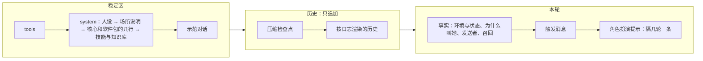

## 提示词（第二轮细纲）

状态：J1 到 J11 已定（2026-09-26）。其余内容为草案。

这一份管的是**一切给模型看的字**：人设、场所说明、工具说明、注入的事实块、工具结果里的固定文字、辅助请求的提示词。项目主人的要求是参考旧版一直在用的那一套（「那是我一直在用的」）。

输入是旧版的全量盘点：约 118KB 给模型看的字，分成提示词文件、工具说明、注入主请求的文字、辅助请求四类。盘点结论里最要紧的四条：
- **旧版其实已经没有浮动尾巴了**。用户消息后面的块全部化石化，每次请求只重建系统提示词（`08-上下文投影.md` C3，今天据此改了定论）。
- **化石里混着指令**，违反旧版自己的规矩：表情包提醒写着「本轮回复时你必须发送表情包」，插话、群管预检、长期目标收尾都有同样的写法；AUR 审查的 5KB 规则住在工具结果里，永久回放。
- **给模型看的字至少 18 处是中文**，还有两处跟着界面语言变。改界面语言，模型看到的字节就变了。
- **敏感区在「不动」的名义下漂了**：人格提醒在 A/B 之后改了 10 次，胜出的那一条被删掉；风格锁只在「提醒开着」时测过，生产环境里提醒却是关的。

### 一、四个去处

给模型看的每一段字，只能落在下面一处（J1）：

| 去处 | 放什么 | 会不会变 | 例子 |
|---|---|---|---|
| **稳定区** | 规则和人设：怎么做，一直成立 | 会话内逐字节不变；变了按内核 K3，在回合开始时整体换一次 | 人设、场所说明、工具使用指引、工具说明、示范对话 |
| **事实** | 发生了什么，以后回看仍然为真 | 先成为事件，永久回放（`08-上下文投影.md` C3、C10） | 时间、权限级别的切换、发送者、这一轮为什么叫她、记忆召回、子代理回报 |
| **工具结果** | 这一次调用的结果，加上怎么读它的一句话 | 执行时定下，永久回放（`08-上下文投影.md` C9） | 命令输出、报错、`load_tools` 拿到的契约 |
| **辅助请求** | 自己的一整套提示词 | 和主会话的缓存无关（J6） | 压缩、起标题、判官、看图、整理记忆 |



- **工具结果里不写规则**：怎么读这个结果的一句话可以写（`25-工具加载.md` W2），一整套规则不行。旧版 AUR 审查把 5KB 规则放进工具结果，此后每一轮都回放。这类规则改成辅助请求：审查由一次辅助请求做，主会话只拿到结论（J7）。
- **技能正文是例外里的正常情况**：技能用 `read` 读进来，本来就是工具结果（`10-自带软件.md` 第三节）。它是她自己决定读的，读一次，压缩后按需重建（`09-压缩.md` 第四节）。

### 二、指令进稳定区，每一轮的标记记成事实

旧版的教训：把「只回复当前消息」这句指令写进消息块，回放以后成了过期的指令，跨轮错乱。后来修的办法是把规则挪进系统提示词（`08-上下文投影.md` C3）。这里把它推成一条通用的写法（J2）：

- **规则**写在稳定区，一直成立，说「遇到某种标记时怎么做」。
- **标记**记成事实，只说「这一轮是什么情况」，以后回看仍然为真。

旧版化石里的几种指令，照这个拆开：

| 旧版写在化石里的 | 规则（稳定区） | 标记（事实） |
|---|---|---|
| 「只回复 [New messages…] 里的那条」 | 场所说明：回复触发这一轮的那条消息 | 这一轮由哪条消息触发（编号） |
| 插话时「即使没 @ 你也照样回一条」 | 场所说明：插话的回合可以不说话，用 `skip_reply`（`18-通讯平台.md` Q5） | 为什么叫她：插话的机会 |
| 「本轮回复时你必须发送表情包」 | 表情包软件包：带这个标记的回合，回复里带一张表情包 | 这一轮适合发表情包（J11） |
| 长期目标的收尾指令 | 不拆：写在她报完成、卡住的那次 `goal` 调用的结果里，只在续轮开的那一轮里出现（施工 X-8 上改，见下面第 1 条） | — |
| 群管预检「看上下文决定怎么回，别透露分数」 | 群管软件包：预检标记的含义和处理 | 这条消息的预检结果 |
| 图片路径加「你可以使用 vision_analyze」 | 工具说明里写看图怎么用 | 附件清单：编号、种类、大小 |

- 一轮里要是同时有几种标记，放在同一个事实块里，排在触发消息之前（`08-上下文投影.md` C2）。
- 长期目标的收尾原先也照这张表拆（规则常驻 system、另开一轮收尾轮带标记），施工 X-8 上改成写在工具结果里（2026-10-12 主会话，技术题照推荐）：收尾一个目标只用得上一次，常驻 system 每次请求都带，违反「能按需出现的不常驻」（第九节，2026-09-27 项目主人定）；另开一轮还要多一次请求。结果是她调用以后才看到的，说的是「这一次自动运行」，不是给以后的规矩；旧版同样是在同一轮里接着收尾。
- 上面的表是中文写的说明；真正发给模型的全是英文（J3）。一个群聊回合大致是这样，规则在 system 里，标记在这一轮的事实块里：

```text
system 里的规则（每个回合都一样）：
  Reply to the message named in <turn trigger>. A quoted message is an earlier message by its author, not addressed to you.
  On a turn marked meme="suggested", include one meme in your reply.

这一轮的事实块（记成事件，以后原样回放）：
  <turn trigger="msg:88213" reason="mentioned" meme="suggested"/>
  <sender id="qq:10086" role="member" nickname="…"/>
```

- 标记只写这一轮的情况，不写「你应该」。规则只写在稳定区，不写进标记。
- 压缩检查点也照这个拆（2026-09-26 补，施工 1-12）。检查点是标记，只说之前的那部分对话压缩成了下面的摘要。「接着做进行中的事，不问要不要接着做，不确认也不复述摘要」是核心在 system 里的一行规则。Claude Code 把这句写在摘要消息的末尾，压完以后一直留在上下文里（`09-压缩.md` 第四节）。

### 三、写法

照 `08-上下文投影.md` C7，再补几条旧版磨出来的（J3）。系统相关的一律用英语（2026-09-26 项目主人定）。

- **非必要不添加**（J12，2026-09-27 项目主人定）：给模型看的每一句，先实测证明不加不行，量出多少 token，再写到最短。能只在用得上的那一次出现的，不常驻 system：常驻的一句，每个会话的每次请求都背着。
- **加了就登记**（J12，同一天：「更重要的一个点是加了，则必须有迹可循有记录，这样后续才不会出现加了但是忘记自己加了的情况」）：每一份都登记在第十节：放在哪、进到哪、什么时候加进来、多少 token、为什么加。字改了，登记簿跟着改。

- **机械的文字一律英文短句**：场所说明、工具说明、事实块、报错、辅助请求的指令。中文只留给人格侧的字：人设、示范对话、角色扮演提示。旧版的经验：中文书面语的注入和人设同一个语域，最容易被模仿，是出戏的头号来源（出过事后总结的，没做过 A/B）。
- **字节不随界面语言变**。给人看的字和给模型看的字分两份：模型那一份永远是英文，人那一份跟着界面语言（旧版的「双槽」）。旧版有两处按界面语言切中英文，改一下界面语言，前缀就断了。
- **只陈述是什么，不写「你应该」**（一次性的提示有例外，见 J2 的补充）：`QQ id is stable, nickname can change`，不写「不要凭昵称认人」。位置比措辞重要得多（`08-上下文投影.md` C2、C7）。
- **不用分号把几句串成一句，不用「总述：分述」的结构**。每写一段注入，先问删掉会怎样，再问怎么写短。
- **可信和不可信的字段分开**：内核产生的（编号、身份）是可信的；昵称、正文这类用户可控的，进请求之前转义，防伪造记录行（`08-上下文投影.md` C7）。
- **工具说明**照 `10-自带软件.md` 第九节：说明不超过三句，写「是什么、什么时候用、最容易踩的一个坑」；每个参数一句说明（`25-工具加载.md` W2）；调用之后才用得上的知识，写进工具自己的输出。

### 四、系统提示词的排法

从最稳的排到最常变的，这样换一个软件的开关，只断后面那一截（J8）：

1. **人设**：人格的 `persona.md`。
2. **场所说明**：终端、网页、命令行、QQ 群、QQ 私聊、桌面语音、子代理，各一份。写这个场所的规则，例如「引用的是别人的话」「回复触发这一轮的那条」；终端的还写这台机器的系统和 shell（每台机器固定，不是每轮变）。
   - 后面接**关于你**（施工 P-9，2026-10-13 项目主人定；P-9 补 2026-10-16 加回复语言）：本人写的称呼、更多描述和回复语言（`preferred_reply_language`，默认用它、明说可换），`core/profile.txt` 拼成一块；本机开的会话带，群聊不带。造会话时钉下，会话中途不变。预设关了「用户身份」（`env-profile`，「注入环境信息」那个包的功能，施工 ENV-1）的整块不拼，回复语言那一行一起。
   - 再接**项目的附加提示词**（施工 H-3，设计 `38-项目.md` 第四节）：会话在项目里、项目写了提示词的，`core/project.txt` 包一层；会话挪进挪出项目、项目改了提示词，下一轮换上。
3. **核心和软件包的几行**：核心自己的排在最前，例如压缩检查点怎么读（2026-09-26 补，施工 1-12）。然后是开着的软件包各自带的规则，按软件包编号排，例如记忆怎么读、产物怎么用。
4. **技能与知识库的列表**：技能那一块在前，施工 X-10 上做出来（2026-10-12）：她用得上的技能，一个一行（名字、说明、`SKILL.md` 的路径），工具面上有 `read` 的才有，造会话时钉下，会话中途不改（`skills.md`「技能」第 2 条）。知识库那一块施工 K-1 补做出来（2026-10-12）：她查得到的库，一个一行，工具面上有知识库那两件的才有（`knowledge.md`「列出来的那一块」）。
5. ~~装了、但这次没开的软件~~：2026-10-23 删掉（`16-人格与预设.md` Y8，施工 P-OFF），以前造的快照里拼好的照旧发。
6. **派子代理时能选的人格和预设**（`16-人格与预设.md` 第六节）。
7. **风格锁**：人格会话才有，子代理没有（旧版实测：探针全过从 5/12 升到 8/12）。
8. **扩展放的那几段**（施工 X-20，2026-10-16 项目主人定）：扩展经 `system.append` 交来，原文照放、不套包的编号，每个包一段、照包的编号排，接在整段 system 的最后。工具面上有这个包的工具的会话才带；造会话时钉下，扩展改了下一轮换上（整段重算一次）。字是扩展的，由扩展自己登记。MCP 服务交的说明也走这里（施工 X-39，`mcp.md`「怎么走」第三条第 5 条）：一个服务一段，键是 `mcp:<服务名>`，核心的外壳（`core/mcp/instructions.txt`）圈着服务的原文，原文截到 4000 个字符、伪造的结束标签转掉；工具面上有这个服务的工具才带，只跟工具面一起变（工具面没变的那一轮照钉下的，服务升级换了说明也不读：前缀缓存不为它断）。

然后是**示范对话**，放在 system 之后、历史之前（`08-上下文投影.md` 第三节）。

- **怎么拼**（2026-09-27 补，施工 3-6 上）：有的块照上面的先后排，每一块去掉末尾的空白，块和块之间空一行；没有的块不留空行。
- 施工 3-6（上）时只有人设。别的块跟着各自的功能来，按 J12 先实测证明不加不行：核心的两行规则（检查点、权限）2026-09-27 项目主人定先不拼，到 M6 压缩、M4 工具时实测再定（检查点那一行施工 6-3 下实测后挪进了包装的结尾，换成更短的一句，不进 system）；场所说明也等实测出需要再加（施工 7-5 子会话加了）。
- 核心的几行施工 2-7 补做出来（2026-10-01，主会话 A/B 以后）：权限那一句 `core/permission-rule.txt`（工具面是空的会话不带）、本机文件的路径那一句 `core/local-paths-rule.txt`，一行一句，这一块排在人设、场所说明后面。两句一起加，前缀只变一次。它们拼进新会话的 system；以前造的快照 system 已经拼好存着，照旧不带，前缀一字不变（第十节）。
- 施工 2-7 再补（2026-10-14 项目主人定）：这一块最后加一句本机是什么系统 `core/machine.txt`，工具面是空的会话不带。系统名一个会话里不会变，所以进 system、跟着缓存走，不进每小时重发的环境那一块。
- 风格锁施工 P-1 补做出来（2026-10-07）：`core/style-lock.txt`，旧版原文一字不改，只有带角色扮演提示的人格的 system 带它，排在最后（2026-10-07 项目主人定）。角色扮演提示同一步做出来：人格的 `prompts/reminders.md` 拼成快照里的一块，内核第 1、4、7……轮开头注入，排在触发后面（J10）。别的人格、以前造的会话一个字节不变。

- 同一个人格、同一个场所、同一个预设的两个会话，system 逐字节相同，可以共用缓存。
- 时间、工作目录、权限级别这类会变的，一律不进 system，走事实（`08-上下文投影.md` C10）。

### 五、从旧版带过来什么

旧版约 120 条，按去处和处理方式归类（J7）。四种处理：**照搬**（原文不动）、**改写**（改成英文，或者改接口）、**拆开**（指令拆成规则加标记）、**不要**。

**人格侧：照搬**

（2026-09-27 改：Miyu 不随程序发，是项目主人自己数据根里的人格，见 `16-人格与预设.md` Y6。下面这张表说的是把旧版的字搬进那个个人人格；什么时候搬，等内核和工具做完。「照搬」只指字的内容，读法、放法、多久出现、怎么配置照这份图纸重做。）

| 旧版 | 新版的位置 | 处理 |
|---|---|---|
| `miyu.md` 人设（1403 token） | 出厂 Miyu 的 `persona.md` | 照搬。「工具使用时注意」里安装卸载要确认、删除要确认这几条，现在由权限和回收站在代码上保证；人设里留着也不冲突 |
| `miyu-dialogs.md` 示范对话 17 对 | `examples.md` | 照搬 |
| `miyu.hint.md` 人格提醒 | `reminders.md` | 照搬；出厂 Miyu 默认开，每 3 轮一条（J10） |
| 风格锁 | 人格会话的 system 末尾 | 照搬（受 A/B 保护，文本里的分号不改） |
| 开发模式提示词 | 软件工程师这个人格的 `persona.md` | 旧版 09-24 起默认是空的，照旧空着 |

**场所说明：照搬英文的，改写中文的**

| 旧版 | 新版的位置 | 处理 |
|---|---|---|
| QQ 的身份规则、聊天记录格式、历史图片、回复对象、引用格式 | QQ 场所说明 | 照搬；回复对象那条改成指向「触发这一轮的那条」标记（第二节） |
| 群管、撤回的规则 | QQ 软件包的几行，或者对应工具的说明 | 照搬；只在工具开着时出现 |
| 场所的附加说明（旧版路由里的 `extra_prompt`） | 场所规则的一项属性（`18-通讯平台.md` 第四节） | 照搬 |
| LaTeX 排版说明 | 终端、网页的场所说明 | 照搬；头在握手时声明能不能显示公式 |
| 语音协议（中文） | 桌面语音的场所说明 | 改写成英文 |
| 子会话的交付约定（「回报对象是父会话」「不要轮询」） | 子代理的场所说明 | 照搬 |
| 通用子代理提示词（中文） | 子代理的场所说明 | 改写成英文；「改文件前先读行号」这类已经由工具保证的去掉 |
| 产物用法 | 产物软件包的几行 | 照搬；点名的工具必须在场（J4） |
| 联想记忆的读法 | 记忆软件包的几行 | 照搬 |
| 机器信息（系统、内核） | 终端的场所说明 | 照搬；模型名不写，换模型不该断前缀 |

**事实块：拆开或改写**

| 旧版 | 新版 | 处理 |
|---|---|---|
| 时间、工作目录、沙盒说明 | 环境和状态的事实（`08-上下文投影.md` C10） | 已定 |
| 发送者的可信信息（QQ 号、身份、回复谁） | 发送者事实，可信字段 | 照搬 |
| 这些消息已由并行的回合在答 | — | 不要：一个场所一个会话，回合按顺序跑（`02-内核.md` 第七节） |
| 唤醒说明（后台任务完成、重启续跑） | 为什么叫她：子代理回报、后台命令结束、核心重启 | 拆开 |
| 插话的让步句 | 为什么叫她：插话的机会 | 拆开 |
| 受保护的昵称被冒用 | 身份警告的事实 | 照搬 |
| 群管预检 | 预检结果的事实，规则在群管软件包 | 拆开 |
| 心情、精神（中文） | — | 不要：它们从好感度的回复里算出来，好感度不做，它们也跟着去掉（2026-09-26 项目主人定） |
| 最近的长回复转成了图片 | 事实 | 照搬 |
| 产物清单 | 状态的事实，变了才注入 | 照搬 |
| 图片、视频、PDF 的路径提示（中文，带指令） | 附件清单的事实 | 拆开并改写 |
| 联想记忆（中文小标题） | 记忆召回的事实 | 改写成英文 |
| 表情包提醒（中文，指令） | 标记，规则在表情包软件包 | 拆开（J11） |
| 长期目标的收尾指令 | `goal` 报完成、卡住的那次调用的结果（施工 X-8 上） | 照搬，只在续轮开的那一轮里 |
| 续传时的模式切换加整份系统提示词 | — | 不要：会话的预设不换（`16-人格与预设.md` Y5） |
| 回合被打断（中文，拼在助手正文后面） | `turn.ended` 的事实块（`08-上下文投影.md` 第四节） | 改写 |
| 工具轮数到上限（拼在助手正文后面） | `turn.ended` 的事实块 | 改写 |
| 压缩检查点（user 角色） | 压缩检查点 | 照搬 user 角色：旧版实测，放在 system 里，摘要里的祈使句会被当成新指令 |
| 截断标记（中文） | 预览的标记（`08-上下文投影.md` C9） | 改写成英文 |
| 后台任务报告（中文） | `job.reported` 的渲染 | 改写 |
| 跨会话的消息「由另一个会话的 AI 发送，不是用户」 | 另一个会话发来的消息 | 照搬，只要这一句（09-23 项目主人定） |
| 长期目标的续轮消息 | 长期目标软件包的触发消息 | 照搬（事故驱动出来的措辞） |
| 群聊近况的格式、缺口提示 | 群聊近况的渲染（`18-通讯平台.md` 第九节） | 照搬 |
| 引用图片、文件的占位（跟着界面语言变） | 附件清单 | 改写成固定的英文 |
| 看不见图时的旁路描述（中英混杂） | 看图的辅助请求写回的事实 | 改写成英文 |

**工具结果里的固定文字：照搬，修悬空引用**

| 旧版 | 处理 |
|---|---|
| `tool error: …`、未知工具「did you mean」、超时、输出被截断 | 照搬 |
| 存根调错时附上契约 | 照搬，附这一件的完整格式（`25-工具加载.md` W6、W9） |
| `load_tools` 的结果格式 | 照搬；删掉指向 `<available_load_targets>` 的悬空引用，旧版里已经没有东西生成它 |
| 同参复读闸：回灌上一轮原字节，不加文字 | 照搬：旧版实测提醒文字无效，结构闸才有效 |
| AUR 审查规则 | 挪进辅助请求（第一节） |

### 六、辅助请求

每一种辅助请求声明自己的用途，有自己的缓存状态，单独记账，不碰主会话的缓存。只有压缩可以复用主会话的前缀，这是刻意的（J6）。

| 辅助请求 | 从旧版来 | 处理 |
|---|---|---|
| 压缩：fork 和兜底的整段摘要 | `compact.md` | 不照搬：任务型改用 Claude Code 的九节（`09-压缩.md` Z5），用自己的话写，旧版的只当证据；聊天型靠压缩质量评测打磨（2026-09-29 改，蓝图 `compaction.md`「样子」） |
| 起标题 | 中文 | 改写成英文（施工 3-8 五补，`core/title/instruction.txt`） |
| 选中文字的解释和翻译（网页） | 英文 | 照搬 |
| 群里要不要开口的判官 | 英文 | 改写（施工 O-11，`software/onebot/judge/`）：旧版说明的四段照意思改写成英文短句，效果照搬（09-24 实测 18/18 对 11/18）；去掉好感度和「程序还会再加减分」；违规只要 `severity` 和 `reason`，类别、证据、相关的人和消息不要；记录、这一条、解出来的字各夹在标签里 |
| 入群审批 | 中文 | 改写成英文 |
| 看图、替不能看图的模型描述图片 | 英文，标签中文 | 标签改成英文 |
| 表情包入库时的描述 | 中文 | 规则改写成英文，人格那部分照旧 |
| 整理记忆：日记整理成知识点和经历 | 中文 | 改写成英文（`17-记忆.md`） |
| 自定义人格的人格提醒蒸馏 | 英文 | 照搬；修旧版续行吞掉的 11 处空格；声明用途，旧版没声明，被记成了主对话 |
| 好感度 | 中文 | 不要（好感度不做） |
| AUR 审查 | 原来在工具结果里 | 改成辅助请求，主会话只拿结论 |

### 七、门禁

给模型看的字当代码测（J4、J5）：

- **请求形状探针**：用固定的剧本让真会话跑出日志（施工 2-9 下），为每一种会话渲染出完整请求，包括终端、网页、命令行、QQ 群、QQ 私聊、桌面语音、子代理。和存档逐字节比对。字节变了，必须是有意的，并写明原因。旧版就靠这个证明重构没改提示词。现在只有终端一种会话（施工 1-14），别的随各自的场所加进来。
- **引用必须在场**：提示词里点名的每一件工具、每一个标签、每一条命令，在这个会话的工具面和场所里都必须存在。旧版出过好几次悬空引用：产物用法点名三件已经删掉的工具，一个月没人发现。
- **英文检查**：机械文字的首字是英文字母，中文字数不过半；人格侧的文件不查。
- **登记簿**（J12，施工 3-5 再补）：`resources/` 下每一份文件都在第十节的表里，表里每一行都有文件，指纹对得上。对不上当场拦下：多了没登记的、登记了却没有的、改了字没改登记的。
- **token 预算**：每件工具、整张工具面、system 各有上限，超了当场拦下。初值原型实测定（`23-性能预算.md`）。
- **敏感区要有评测**：人设、示范对话、角色扮演提示、压缩模板、判官，各带一套能重跑的评测，例如旧版的人格遵循度 A/B、压缩的 20 条事实召回、判官的 18 个场景。改了就重跑，而且在和生产一样的条件下跑：旧版的风格锁只在提醒开着时测过，生产里提醒却是关的。

### 八、东西放在哪

- **人格的字**在人格目录里：`personas/<人格>/prompts/`（`16-人格与预设.md` 第三节）。
- **软件包的字**跟着软件包走：工具说明、它往 system 里加的几行、它的辅助请求提示词，都在软件包自己的目录里。覆盖照 `25-工具加载.md` W7，个人、系统、出厂三层。
  - 随发行附带的软件包放在资源目录的 `software/<软件包>/` 下（2026-09-27 补，施工 4-4 上）：`tools/<工具>.json` 是给模型看的说明和参数格式（参数格式写成紧凑的一行，原样进 tools 数组），`<工具>/*.txt` 是工具输出里给她看的几句。
  - 几件工具都要说的，放在 `software/<软件包>/common/`，一句只存一份（2026-09-28 补，施工 4-4 下）：例如没有这个文件、参数不对，`read`、`glob`、`grep` 都要说。
- **给人看的字**放在同一个软件包（内核的是 `core/`）下的 `human/` 里，一种语言一份 `<语言>.json`，先有 `zh`、`en`（2026-09-28 补，施工 4-5 上）：工具的显示名、显示名后面跟哪个参数，每一种说法的字。它们不发给模型，不进登记簿（第十节），跟着界面语言变也不碍前缀（第三节「双槽」）。
- **内核和场所的字**：终端、网页、命令行、子代理的场所说明，事实块的模板，随核心附带；QQ 的场所说明随 QQ 桥的软件包附带。
  - 随核心附带的放在资源目录的 `core/` 下（2026-09-26 补，施工 1-12）。现在有检查点包装的开头 `checkpoint-open.txt` 和结尾 `checkpoint-close.txt`，回合没走完的四句 `turn-ended/<原因>.txt`，环境和状态两类事实的模板 `facts/env.txt`、`facts/permission.txt`（施工 1-13），核心的几行 `permission-rule.txt`、`local-paths-rule.txt`（施工 2-7 补，拼进 system）、`machine.txt`（施工 2-7 再补），会话编号的模板 `facts/session.txt`（施工 1-13 再补），人切了级别以后的权限那一份 `facts/permission-changed.txt`（施工 2-7 补），回复没说完就断了的那一句 `facts/reply-cut.txt`（施工 3-5 下；3-5 再补改成不说为什么断，写上从断的地方接着说），驱动的几句占位 `drivers/*.txt`：图片、文件发不了，工具一个字都没回，工具结果里的图片、文件挪到了后面（施工 3-4 上）。文件的内容原样用，行尾的换行也算。
- 出厂的全部只读，要改就写同名覆盖（J9）。

### 九、决定

**J1. 四个去处**

- **已定：给模型看的每一段字只能落在稳定区、事实、工具结果、辅助请求之一；工具结果里不写整套规则。**
- 未选：规则跟着注入走，哪里用到写在哪里。旧版这样做，化石里积了一堆过期的指令。
- 重开条件：出现一段字哪一处都放不进去。

**J2. 规则加标记**

- **已定：每一轮不一样的指令，拆成稳定区里的规则和事实里的标记。**
- **补充（2026-09-27 项目主人定，施工 3-5 再补）：只说它前面那一条的一次性提示，光说是什么不管用的，可以带着自己的「怎么办」。** 例子是回复被打断的那一句：只说断了的，掐在回复里 4 次都从头说；写上「从断的地方接着说」的，4 次都接着说。它回放的时候说的还是那一条，不会过期；换成 system 里常驻的规则，效果一样，却每次请求多 39 个 token（J12）。常驻的规则照旧进 system。
- 未选：指令写进这一轮的注入。回放以后过期，跨轮错乱。
- 重开条件：实测某类行为只有写成这一轮的指令才管用。

**J3. 语言**

- **已定：机械文字一律英文，字节不随界面语言变；人格侧的字用人格自己的语言。**
- 重开条件：新的实测表明中文的机械文字不再引起出戏。

**J4. 引用必须在场**

- **已定：提示词里点名的工具、标签、命令，都要在这个会话里存在，测试当场拦；每种会话的完整请求逐字节存档比对。**
- 重开条件：无。

**J5. 敏感区要评测**

- **已定：人设、示范对话、角色扮演提示、压缩模板、判官各带一套能重跑的评测，改了就在生产的条件下重跑；「不动」不再是保护手段。**
- 重开条件：无。

**J6. 辅助请求**

- **已定：各自声明用途、各自的缓存状态、单独记账；只有压缩可以复用主会话的前缀。**
- 重开条件：无。

**J7. 旧版的字怎么带过来**

- **已定：人格侧照搬；机械文字照 J3 改写；化石里的指令照 J2 拆开；工具结果里的整套规则改成辅助请求。**
- 重开条件：照搬过来的人设在新的上下文排法下，评测明显变差。

**J8. system 的排法**

- **已定：人设、场所说明、核心和软件包的几行、技能与知识库、能派的人格与预设、风格锁，最稳的在前。**（装了没开的软件那一块 2026-10-23 删掉，施工 P-OFF。）「核心和」是 2026-09-26 补的（施工 1-12）。
- 重开条件：实测另一种排法命中明显更高，或者遵循度明显更好。

**J9. 放在哪**

- **已定：人格的字在人格目录，软件包的字跟着软件包，内核和场所的字随核心；出厂只读，覆盖照 `25-工具加载.md` W7。**
- 重开条件：无。

**J10. 角色扮演提示**

- **已定：出厂 Miyu 默认开，每 3 轮追加一条，记成事实，排在触发消息之后；软件工程师没有（2026-09-26 项目主人定）。** 2026-09-27 起 Miyu 不随程序发（`16-人格与预设.md` Y6）：这一条说的是有角色扮演提示的人格，默认开、每 3 轮一条。
- 未选：默认关，旧版 08-16 以来的样子。旧版实测：干净的会话里只靠示范对话就够；可在 3 万 token 的真实群聊里，只靠示范对话是 4/12，加上提醒是 8/12。
- 重开条件：评测表明示范对话单独就够（J5）。

**J11. 表情包提醒**

- **已定：留着，照 J2 做成标记。按概率抽中的回合记一条「这一轮适合发表情包」的标记，怎么做的规则写在表情包软件包带进 system 的几行里；抽中的概率是软件包的默认值（2026-09-26 项目主人定）。**
- 未选 A：旧版的写法，把「本轮回复时你必须发送表情包」写进化石。过期的指令会跟着回放。
- 未选 B：不提醒，只靠人设里的「适时发送表情包」：不提醒，她不知道什么时候该发。
- 重开条件：评测表明她不靠提醒也会按合适的频率发。

**后续再定**

- 各件工具的最终说明：附录是草稿，参数名照 `10-自带软件.md` 第十节、参数说明照 `25-工具加载.md` W2，各件施工时定
- 心情、精神不做（2026-09-26 项目主人定），好感度也不做（`18-通讯平台.md` 第七节）

**J12. 非必要不添加，加了就登记**

- **已定（2026-09-27 项目主人）：给模型看的字，实测证明不加不行才加，写到最短，能按需出现的不常驻；每一份都登记在第十节，门禁查登记簿和资源目录一一对上，字改了指纹跟着改。**
- 未选：只在施工单里记一笔。施工单一步一份，散在几十个文件里，要回答「现在一共给模型看了哪些字、各多少 token」，得一份份翻。
- 重开条件：无。

### 十、登记簿

给模型看的每一份字都登记在这里（J12）。

- 一份一行：`resources/` 下的路径、进到哪、什么时候加进来、实测多少 token、为什么加（证据、哪一步），指纹是文件字节的 SHA-256 的前 8 位。
- 事实、工具结果、回合没走完的那几句，加进来以后留在历史里，以后每次请求都带着，直到压缩。system 里的，每次请求都带。
- token 是 DeepSeek 官方 `deepseek-flash` 实测的（2026-09-27；工具说明和 `aborted.txt` 2026-09-28 施工 4-10 实测，`read.json`、`shell.json` 和读图的两句施工 4-13 实测），模板里的字段按典型值填；换了分词器，数会差一点。工具说明的数是七件一起时它的边际份量：七件一起减去去掉它的六件。请求里只要带了工具，DeepSeek 还会加一段它自己的模板，约 211 个 token，不算在哪一件里。仓库里没有分词器，门禁不查 token、只查指纹：字改了就对不上，重新量过、写上为什么改，再换指纹。
- 回报的十一份（`core/jobs/`，施工 7-2）2026-09-30 照项目主人给的端点、`deepseek-v4.1-flash` 量：每份单独接在一句话后面量，带行尾换行，模板字段按典型值填；同一段字放在不同位置会差 1 个上下。整块核对：后台命令结束的完整样本（`docs/designs/samples/reports/command-exited.txt`）49 个，就是开头、退出码、用时、输出、收尾五份相加；子代理人插过话的完整样本（`subagent-person.txt`）46 个，是开头、人插过话、收尾三份加正文那一行。
- 施工 7-3 的三份（`shell.json`、`shell/started.txt`、`shell/no-background.txt`）同一天照同一个端点、同一个模型量；工具说明照请求里 tools 数组的样子拼，量法和登记簿里 `history.json` 的 197 对得上：八件时 `shell.json` 183、八件合计 1336；和 7-5 的 `agent` 合进来以后九件重量，`shell.json` 照样 183，九件合计 1476，整个 tools 数组 1687。
- 施工 7-4 的十一份（`tools/jobs.json`、`jobs/*.txt`）同一天照同一个端点、同一个模型量，量法同上：十件一起时 `jobs.json` 的边际份量 127，同一次量的其余九件 `agent` 140、`edit` 207、`glob` 116、`grep` 284、`history` 197、`read` 170、`shell` 183、`trash` 80、`write` 99（各行登记的是当时那一步量的，差几个是件数不同），十件合计 1603，整个 tools 数组 1814；`read/more.txt` 顺手量成 19。
- 施工 3-9 三补的四份（`core/drivers/file-open.txt`、`file-cut.txt`、`file-close.txt`，改过的 `file-omitted.txt`）2026-09-30 照同一个端点、`deepseek-v4.1-flash` 量：每份单独接在一句话后面量，带行尾换行，字段照典型值（`notes.md`；`65536`、`183204`；`报告.pdf`、`application/pdf`、`48213`）。整块核对：样本 `docs/designs/samples/drivers/openai-chat/text-files.json` 里那条 user 的前半段（人说的一句、`notes.md` 和空的 `empty.txt` 两份文本文件、`data.bin` 一句占位）66 个。
- 施工 3-9 四补的三份（`core/drivers/image-open.txt`、`image-close.txt`、`image-omitted-named.txt`）2026-09-30 照同一个端点、`deepseek-v4.1-flash` 量：每份单独接在一句话后面量，带行尾换行，字段照典型值（`晚霞.png`）。
- 施工 7-7 的八份（`tools/message_agent.json`、`message_agent/*.txt`、`core/jobs/subagent-message-*.txt`）同一天照同一个端点、同一个模型量，量法同上：还没有 7-4 的 `jobs` 时十件一起，`message_agent.json` 的边际份量 152，十件合计 1628，整个 tools 数组 1839；rebase 到 7-4 以后十一件重量，`message_agent.json` 照样 152，其余十件和 7-4 那一次一样，十一件合计 1755，整个 tools 数组 1966；留言那一块整块核对，样本 `docs/designs/samples/reports/subagent-message.txt` 26 个，是开头、收尾两份加正文那一行。
- 施工 7-5 再补（`tools/agent.json` 改名 `subagent.json`，工具名跟着改）2026-10-01 主会话照同一个端点、`deepseek-v4.1-flash` 量，量法同上：改名以前整个 tools 数组 1967、`agent` 的边际份量 140，改名以后 1968、`subagent` 141，多 1 个。别的给模型看的字没变。
- 检查点里还在跑的任务那一段的两份（`core/compaction/notes-jobs.txt`、`notes-job.txt`）施工 7-8 加过，2026-10-01 实测后去掉（施工 7-8 补，`compaction.md` 第八条第 4 条）。
- 施工 7-2 补的一份（`core/jobs/stopped-by-user.txt`）2026-09-30 主会话照同一个端点、`deepseek-v4.1-flash` 量，量法同上：5 个。整块核对：人停的后台命令的完整样本（`docs/designs/samples/reports/command-stopped-by-user.txt`）49 个，人停的子代理的完整样本（`subagent-stopped-by-user.txt`）42 个。两份各是她自己停的那一份（`command-stopped.txt` 51、`subagent-stopped.txt` 37）加这一句 5 个；后台命令那份另外没有信号那一行（7 个，停的那条路不记信号），所以比 51 少 2。
- 施工 7-10 的三份（`core/harness/message-{open,close}.txt`、`software/basesystem/history/agent.txt`）2026-09-30 照同一个端点、`deepseek-v4.1-flash` 量：每份单独接在一句话后面量，带行尾换行，名字按 `claude-code` 填。整块核对：样本 `docs/designs/samples/harness/message.txt` 38 个，是开头、收尾两份加正文那一行（23）。工具面没变。
- 施工 C-2 的三份（`core/peers/message-{open,close}.txt`、`software/basesystem/history/session.txt`）2026-10-01 主会话照开发端点、`deepseek-v4.1-flash` 量：每份单独接在一句话后面量，带行尾换行，短编号按 `22334455` 填。整块核对：样本 `docs/designs/samples/peers/message.txt` 30 个，正文那一行 15，标签两段合起来 15。工具面没变。
- 施工 C-6 的八份（`tools/send_message.json`、`send_message/{watching,watch-peers-only}.txt`、`core/peers/idle-*.txt`）2026-10-01 主会话照开发端点、`deepseek-v4.1-flash` 量：工具面照带工具减不带，边际份量是十二件减去掉它的十一件，`send_message.json` 165 → 204，整个 tools 数组 2108 → 2147，都只多这一件的 39；字每份单独接在一句话后面量，带行尾换行，短编号按 `9f03b21c`、`hours` 按 12 填。整块核对：样本 `docs/designs/samples/peers/idle.txt` 39 个，`idle-expired.txt` 37 个。子会话的工具面同样多这 39（共用同一份说明），群的工具面没有它。
- 施工 C-9 的四份（`tools/send_message.json`、`tools/subagent.json` 加 `attachments`，`attachments/{too-many,too-big}.txt`）2026-10-15 主会话照开发端点、`deepseek-v4.1-flash` 量：工具照只带这一件、改前改后比，`send_message` 多 37、`subagent` 多 38；两句字各自接在一句话后面量，带行尾换行。两句只在出错时出现，不常驻。
- 施工 L-1 的四份（`core/loading/` 下）2026-10-15 主会话照开发端点、`deepseek-v4.1-flash` 量：`load_tools.json` 和一件小工具一起时的边际份量 84；三句字各自接在一句话后面量。只有工具面上有要先加载的工具的会话才有它们：出厂的工具都不标，出厂的会话一个 token 都不多。
- 施工 3-8 四补的五份（`core/recap/`）2026-10-01 主会话照开发端点、`deepseek-v4.1-flash` 量：每份单独接在 `hi` 和一个换行后面量。整块核对：指令加一轮中文的 `User:`、`Assistant:` 150 个，其中对话那一段约 30。它们只在回顾那一次辅助请求里，不进主对话（`kernel/request.md`「回顾的请求」）。
- 施工 2-7 补的两份（`core/facts/permission-changed.txt`、`software/basesystem/history/permission.txt`）2026-10-01 主会话照开发端点的 `deepseek-v4.1-flash` 量，量法同上，带典型值、带行尾换行：切换那一份按 `full`、`workspace` 填是 22；同一次量的平常那一份 `<permission level="full"/>` 是 7，切换那一块比平常的多 15（平常那一份的登记照旧写 8）。
- 施工 3-8 五补的一份（`core/title/instruction.txt`）2026-10-01 主会话照开发端点、`deepseek-v4.1-flash` 量：37 个。它只在起标题那一次辅助请求里，不进主对话（`kernel/request.md`「起标题的请求」）。
- 施工 8-17 的五份（`core/vision/instruction.txt`、`question.txt`，`core/drivers/image-description-open.txt`、`image-description-open-named.txt`、`image-description-close.txt`）2026-10-02 主会话照开发端点、`deepseek-v4.1-flash` 量：每份单独接在 `hi` 和一个换行后面量，带行尾换行，`name` 按 `晚霞.png` 填。整块核对：转述请求的字（指令、`question.txt`、一句中文的人话「图里第三行写的是什么？」）连起来，整条 user 比空的多 47 个。主请求里一张转述过的图，开头和收尾两行合起来 10 个（带名字的 15 个），再加转述原文：原文的份量看图，不固定。
- 施工 C-3 的八份（`tools/sessions.json`、`sessions/*.txt`）2026-10-01 主会话照开发端点、`deepseek-v4.1-flash` 量，量法同上：十二件一起时 `sessions.json` 的边际份量 95，整个 tools 数组 1968 → 2063，多 95；十二件合计 1757 + 95 = 1852。输出的几句每份单独接在一句话后面量，带行尾换行，字段照典型值（各行写着）。子会话、群的工具面没有它，一个字节没变。
- 施工 C-4 的四份（`tools/history.json`、`history/{no-session,ambiguous,not-here}.txt`）2026-10-01 主会话照开发端点、`deepseek-v4.1-flash` 量，量法同上：`history.json` 加 `session` 参数以后十二件一起时的边际份量 197 → 224，多 27；整个 tools 数组 2063 → 2090（十二件合计 1879 + 211 的模板 = 2090，和 C-3 一样只多这一件的份量）。三句输出每份单独接在一句话后面量，带行尾换行，`{session}` 按 `deadbeef`（找不到）、`22334455`（撞了）填：`no-session` 10、`ambiguous` 16、`not-here` 7（不带字段）。子会话、群写了 `session` 直接拒，不去开日志，工具面本身没有新的一件、字节没变（只有 `history.json` 这一件的说明变了）。
- 接入QQ 给模型看的字（判官的说明、平台工具、事实、工具结果；施工 O-11 到 O-38 加的，在它包文件夹的 `data/` 里）2026-10-17 随施工 S-6 下搬出核心仓库，量法和每一行登记在 `miyu-agent/miyu-onebot` 仓库的 `docs/ledger.md`（设计 `32-仓库拆分.md` 第九节第 3 条：包的字由包自己登记）。
- 施工 8-8 的一份（`tools/subagent.json` 加 `tier`）2026-10-01 主会话照开发端点、`deepseek-v4.1-flash` 量，量法同上（带工具减不带，边际份量是十二件减去掉它的十一件）：整个 tools 数组 2108 → 2156，多 48；`subagent` 的边际份量 141 → 189，多 48。工具说明的字节 7048 → 7208；和同一天的 C-6（`send_message` 多 39 个 token、152 字节）合在一起是 7360 字节、整个 tools 数组 2195，都在预算里（`crates/miyu-basesystem/tests/budget.rs`）。子会话照样有它（没到深度上限的），群的工具面没有它，一个字节没变。
- 施工 8-8 补的一份（`tools/subagent.json` 的 `tier` 换成 `pool`）2026-10-02 主会话照开发端点、`deepseek-v4.1-flash` 量，量法同上：对照 main 上带 `tier` 的那份，整个 tools 数组 2195、`subagent` 189，和上一条对得上。`pool` 那一格会话开局时照配置拼：一个池都没列的（参数里没有 `pool`），整个 tools 数组 2147、`subagent` 141，和 8-8 以前一样；列一个带说明的池（`enum` 是 `["fast"]`，说明多一行 `fast: Small model for quick lookups.`），整个 tools 数组 2188、`subagent` 182，多 41：`pool` 这一格本身加上一个池名和一句说明。每多列一个池约再多十几个 token，看说明多长。资源文件 697 → 628 字节，工具说明合计 7360 → 7291 字节，在预算里（`crates/miyu-basesystem/tests/budget.rs`）。
- 施工 8-15 的八份（`tools/session_usage.json`、`session_usage/*.txt`）2026-10-02 主会话照开发端点、`deepseek-v4.1-flash` 量，量法同上（十三件一起时的边际份量，带它减去掉它）：`session_usage` 48。资源文件原样（`subagent` 带着 `pool` 那一格）十二件的 tools 数组是 2172，加它是 2220；发给模型的样子：不列池的 2147 → 2195，列一个带说明的池的 2188 → 2236。工具说明合计 7291 → 7465 字节，在预算里（`crates/miyu-basesystem/tests/budget.rs`）。结果的几句每份单独接在 `hi` 后面量，带行尾换行，字段照典型值（各行写着）。群的工具面没有它，一个字节没变；以前造的会话照快照，也没有它。
- 施工 D-2 的六份（`tools/ask_user.json`、`ask_user/*.txt`）2026-10-07 主会话照开发端点（magpie 网关的 `cline-pass/deepseek-v4.1-flash`）量，量法同上（十四件一起时的边际份量，带它减去掉它）：`ask_user` 237，资源文件原样十三件的 tools 数组 2253，加它 2490。结果的几句每份单独接在 `hi` 和一个换行后面量，字段照典型值（各行写着）；三道题（一道带备注、一道自己写、一道没答）的完整结果 43 个，是三行 `answer.txt` 加 `note.txt`、`no-answer.txt`、`end.txt`。只有能问人的会话（有人能回答的本机主会话）工具面上有它；子会话、`miyu ask`、群一个字节没变，以前造的会话照快照，也没变。
- 施工 D-3 的四份（`tools/todowrite.json`、`todowrite/*.txt`、`core/compaction/notes-todos.txt`）2026-10-07 主会话照同一个端点、同一个模型量，量法同上（十五件一起时的边际份量）：`todowrite` 139，十四件的 tools 数组 2490，加它 2629。结果两句每份接在 `hi` 和一个换行后面量；检查点那一段的头一行同样量，带三项（做完、在做、没做各一项）的完整一段 34 个，是头一行加三行 `- [<状态>] <内容>`（内核写，不是资源）。本机的会话（主会话、子会话）工具面上有它，群的一个字节没变；以前造的会话照快照，也没变，以前造的快照里没有检查点那一段的模板，不写。
- 施工 R-3 中的十七份（`software/memory/` 下：`tools/remember.json`、`forget.json`、`memory_search.json`，`common/`、`remember/`、`forget/`、`memory_search/` 下的十四句）2026-10-07 照开发端点（magpie 网关的 `cline-pass/deepseek-v4.1-flash`）量：工具面照「带工具减不带」，十八件（基础系统十五件加这三件）一起时的边际份量 `remember` 149、`forget` 66、`memory_search` 70，整个 tools 数组 2631 → 2916，多 285；说明合计 1006 字节，记忆这个软件包单有一份预算（`10-自带软件.md` 第九节）。结果的十四句每份单独接在 `hi` 和一个换行后面量，带行尾换行，字段按典型值填（各行写着）。工具面上只有本机的主会话有这三件，子会话、群的一个字节没变；以前造的会话照快照，也没变。
- 施工 R-4 上的三份（`software/memory/summary/` 的 `open.txt`、`close.txt`、`more.txt`）2026-10-08 照开发端点（magpie 网关的 `clinepass/cline-pass/deepseek-v4.1-flash`）量，每份接在 `hi` 和一个换行后面，带行尾换行：4、4、11。整块另量：两条（`m12 feedback 2026-10-08: 回答先说结论`、`m7 user 2026-10-07: 用户养了一只猫`）的一块 41，只有那两行 33，外壳 8；中文为主截满的一块 3918 字节 1298、2991 字节 964，所以上限取 3000 字节（`memory.md` 第三条第 3 款）。这一块一个会话一份，只在第一轮（压缩、清空以后的第一轮）多写一次缓存，之后原样回放。
- 施工 R-6 上的六份（`software/memory/extract/`）2026-10-09 照开发端点（magpie 网关的 `clinepass/cline-pass/deepseek-v4.1-flash`）量，每份接在 `hi` 和一个换行后面：指令 263，一轮的头 11、尾 3，人的一句、她的回答的前缀各 5，截了中间的那一句 5。它们只在抽取那一次辅助请求里（经一次性入口发给 `memory.organizer`），不进主对话、不碰会话的缓存；一次抽取两轮短话合计约 300。
- 施工 R-7 上的五份（`software/memory/merge/`）2026-10-10 照开发端点（magpie 网关的 `clinepass/cline-pass/deepseek-v4.1-flash`）量，每份接在 `hi` 和一个换行后面：指令 249，现在的摘要、还没有摘要的那一句各 6，两块的标题各 5；一条记忆一行照 `memory_search/memory.txt`（R-3 中量过）。它们只在合并那一次辅助请求里（经一次性入口发给 `memory.organizer`），不进主对话、不碰会话的缓存；一次合并交多少照新记的多少，最多 32 KiB。施工 E-1 下的三份（`merge/people.txt`、`cards.txt`、`card.txt`，人卡）2026-10-22 照 magpie 网关的 `group/auto-claude-haiku-4-5`、`group/auto-hy3` 量（deepseek flash 那几条这天 key 过期、限流）：同一个分词器把同一批记忆照原来的拼法和加了人卡那一段的拼法各量一次，没有现在的卡的一批多 127 到 135，有一张卡的多 151 到 167；只在这一批里有认识的人的合并请求里。施工 E-1 修二（2026-10-26）照 tiktoken `o200k_base` 量：`instruction.txt` 多 30（每次合并都带），`people.txt` 多 41（只在有认识的人的批里）。施工 E-2（2026-10-26）照同一个分词器：`people.txt` 177 → 272，多 95（卡写成印象，只在有认识的人的批里）。
- 施工 R-7 下的一份（`software/memory/summary/digest.txt`）2026-10-10 照开发端点（magpie 网关的 `clinepass/cline-pass/deepseek-v4.1-flash`）量：外面那几个字 7。整块另量，照 R-7 上真模型第二批写的摘要（九条合出来的五句）加合并以后新记的两条：摘要模式的一块 418 字节 121 token；同样这些事照只列条目（九条里还算数的七条加那两条）538 字节 201 token，少四成。一段上下文一份，照旧在触发的那句前面、原样回放，不碰缓存（`memory.md` 第十条）。
- 施工 R-13 上改了抽取、合并的指令，抽取的人的话换成三种标法（`software/memory/extract/` 的 `owner.txt`、`person.txt`，群里一行原样），她的回答 `You:`，摘要那一行 `What I know:`；2026-10-12 照开发端点（magpie 网关的 `clinepass/cline-pass/deepseek-v4.1-flash`）量：抽取的指令 263 → 351，合并的 249 → 250，三种前缀 5、6、5，摘要那一行 7 不变。抽取多的 88 是实测证明要的：同一段编的群聊（三个人，有主人），旧指令只记了主人的一条，群友的事一条没记；新指令记下四条、每条写清谁说的；不写清 `turn` 是哪一块的编号、`about` 是日期的，群里把消息序号当轮号、把人名填进 `about`，候选整条丢掉。都只在抽取、合并那一次辅助请求里，不进主对话、不碰会话的缓存。
- 施工 R-6 修加了一句 `software/memory/extract/dropped.txt`：2026-10-13 照开发端点（magpie 网关的 `clinepass/cline-pass/deepseek-v4.1-flash`）量 28，接在 `hi` 和一个换行后面；一条忘掉的一行照 `memory_search/memory.txt`（R-3 中量过）。只在这一段开始以后有忘掉的时候加，平常的抽取请求一字不变；只在抽取那一次辅助请求里，不进主对话、不碰会话的缓存。
- 施工 R-13 下记忆的三件也给场所会话（群、别人的私聊）：2026-10-12 照开发端点（magpie 网关的 `clinepass/cline-pass/deepseek-v4.1-flash`）量群会话的工具面（基础系统给群的十件加这三件）：十三件合计 2125，三件的边际份量 `remember` 149、`forget` 66、`memory_search` 70，合计 285，和本机量的一样。每个场所会话的工具面多这 285，在前缀里、缓存着。为什么加：项目主人 2026-10-11 定记忆只有一份，群里也能当场记、能搜（`17-记忆.md` L18）。
- 施工 K-1 下的十二份（`software/knowledge/` 下：`tools/kb_search.json`、`kb_read.json`，`common/`、`kb_search/`、`kb_read/` 下的十句）2026-10-12 照开发端点（magpie 网关的 `clinepass/cline-pass/deepseek-v4.1-flash`）量：工具面照二十一件（基础系统十六件、记忆三件加这两件）一起量，边际份量 `kb_search` 75、`kb_read` 87，合计 162，二十一件合计 3208；只有查得到至少一个库的会话带（19 N13）。十句每份接在 `hi` 和一个换行后面、带行尾换行、字段按典型值填。工具结果里一块的字、一页的字原样给（文档是数据，同 `read`），不算在模板里。顺带：基础功能的会话 `core/preset-off.txt` 那一行多列 `knowledge`（装了、关着、有工具），按 `knowledge, memory` 填是 14，原来按 `memory` 填 12，K-1 下以前造的会话照旧（升级不换快照）。为什么加：项目主人 2026-10-12 让记忆做完以后推进知识库，她要查得到你放进来的文档（19 N4、N10 到 N13）。
- 施工 K-1 补的五份（`software/knowledge/list/`）2026-10-12 照开发端点（magpie 网关的 `clinepass/cline-pass/deepseek-v4.1-flash`）量，每份接在 `hi` 和一个换行后面、带行尾换行、字段按典型值填：头一行 6，有说明的一个库 19（`notes`、`日语笔记`、`学日语的笔记：语法、单词、例句`），只有名字的 6，只有编号的 3，多的那一句 6。整块：三个有说明的库 59。在 system 第 4 块（第四节），稳定区、缓存着；库的名字、说明、增删变了，下一个回合换快照、缓存断一次。为什么加：K-1 下量过，不列她只有 7/20 想起去搜、列了 19/20，无关的两种都不乱搜（`docs/construction/K-1-她查得到（下）.md`「量了的」），项目主人 2026-10-12 看了数定加。
- 施工 K-3 的十三份（`software/knowledge/tools/kb_save.json`、`kb_edit.json`、`kb_delete.json`，`kb_save/`、`kb_edit/`、`kb_delete/` 下的五句，`common/` 下新的五句）2026-10-12 照开发端点（magpie 网关的 `clinepass/cline-pass/deepseek-v4.1-flash`）量：工具面照二十五件（基础系统十六件、记忆三件、长期目标一件加知识库五件）一起量，边际份量 `kb_save` 139（原来 153，去掉了 `path` 的说明）、`kb_edit` 93、`kb_delete` 63，二十五件合计 3677。`kb_save` 一个库都没有的会话也带（好建第一个），`kb_edit`、`kb_delete` 同 `kb_search`。十句每份接在 `hi` 和一个换行后面、带行尾换行、字段按典型值填。为什么加：项目主人 2026-10-12 定她能新建、追加、改、删文档、建新库（19 N14）。
- 施工 K-3 补的一份（`software/knowledge/common/bad-id.txt`）2026-10-12 照开发端点量，接在 `hi` 和一个换行后面、带行尾换行、字段按 `个人备忘` 填：24。只在她要建的库编号写错时出现。为什么加：R-9 真跑时她把编号写成中文，原来那句「没有这个库」没说编号怎么写，她多试了两次（`docs/construction/R-9-记忆验收.md`「量到的」）。
- 施工 K-4 的一份（`software/knowledge/common/read-only.txt`）2026-10-12 照开发端点（magpie 网关的 `clinepass/cline-pass/deepseek-v4.1-flash`）量，接在 `hi` 和一个换行后面、带行尾换行、字段按 `notes` 填：15。只在她写到挂进来的库时出现。为什么加：挂进来的目录只读（19 N7），写的三件得拒，拒的时候说清写到别的库里，免得她换个路径再试；不在 system 里标出哪个库只读（每次请求都带）。
- 施工 K-8 的一份（`software/knowledge/common/packaged.txt`）2026-10-13 照开发端点（magpie 网关的 `clinepass/cline-pass/deepseek-v4.1-flash`）量，量法同上（字段按 `notes` 填）：16（同一回挂进来的那一句复量还是 15）。只在她写到软件包带来的库时出现。为什么加：包里的库只读，拒的时候说清是随包来的、写到别的库里；说成「挂进来的目录」她会以为那是人的目录。
- 施工 K-5 的两份（`software/knowledge/kb_search/page.txt`、`common/not-text.txt`）2026-10-12 照开发端点（magpie 网关的 `clinepass/cline-pass/deepseek-v4.1-flash`）量，接在 `hi` 和一个换行后面、带行尾换行：PDF 那一块的头一行 11（字段按 `manuals`、`cat.pdf`、`3` 填，同样字段的有标题那一行 10），写不了的拒绝 22（字段按 `cat.pdf` 填）。头一行只在搜到 PDF 的那一块带，替掉原来的那一行；拒绝只在她要写 PDF、网页时出现。为什么加：知识库认 PDF、网页（19 N2），PDF 照页引用，她要知道读哪一页；PDF、网页照原样存着，写进字会弄坏，得拒、说清哪几种能写。
- 施工 X-10 上的两份（`core/skills/`）2026-10-12 照开发端点（magpie 网关的 `clinepass/cline-pass/deepseek-v4.1-flash`）量，每份接在 `hi` 和一个换行后面、带行尾换行：头一行 13，一个技能一行 44（字段按 `pdf-processing`、一句 90 个字符的说明、数据根里 `SKILL.md` 的绝对路径填，路径占一半多）；头一行加一个技能的整块 56。在 system 第 4 块（第四节）知识库那一块前面，稳定区、缓存着；造会话时钉下，会话中途不改（列表变了的走回合尾巴，施工 X-11）。为什么加：技能不单独设工具，她只看得到这一块（`skills.md`「技能」第 2 条，项目主人 2026-10-11 照推荐定了照公开格式）。同一天照开发端点走了三种说法（中文点名「发布说明」、英文的 changelog、问 PDF 怎么提字），三次她都先读了对口的 `SKILL.md`、照着做，问 1+1 的没去读（`docs/construction/X-10-技能（上）.md`）。
- 施工 X-11 下的三份（`core/skills/changed-open.txt`、`changed-close.txt`、`none.txt`）2026-10-12 照开发端点（magpie 网关的 `clinepass/cline-pass/deepseek-v4.1-flash`）量，每份接在 `hi` 和一个换行后面、带行尾换行：6、6、7，一个都没有了的整块 17；有技能的整块是外壳 12 加上 system 里那一块的写法（头一行 13、一个技能一行约 44）。只在会话中途列表变了的那一轮带，落进日志、以后照原样回放（`context.injected`），system 不改。为什么加：项目主人 2026-10-11 照推荐定了列表变了在尾巴追加一份新的完整列表（`skills.md`「定了的」第 2 条）。同一天照开发端点走了一遍：第一轮她只知道开始时的那个技能，中途在家目录里放进 `release-notes`，第二轮她第一步就读了新技能的 `SKILL.md`、照格式写（`docs/construction/X-11-技能中途变了（下）.md`）。
- 施工 K-6 下的三份（`software/knowledge/recall/open.txt`、`close.txt`、`cut.txt`）2026-10-13 照开发端点（magpie 网关的 `clinepass/cline-pass/deepseek-v4.1-flash`）量，每份接在 `hi` 和一个换行后面，带行尾换行：外壳 3、3；截短接的省略号和前面的字并成一个，量不出多的（`团子是橘猫` 和 `团子是橘猫…` 都是 5）。一段的头一行照 `kb_search` 的那一行（K-1 下、K-5 量过）。整块另量：一段（艾琳那一段，120 个字以内）66，两段（赤鳞、灰塔）104；一块封顶 600 字节。只在开了 `auto` 的库、人开的回合、过了标题名或门槛的时候交（知识库的测评集上平常的话一句都不带，`docs/blueprint/knowledge/eval.md`），追加在这一轮的话前面、原样回放，不改以前的前缀；和记忆的联想合起来一段上下文累计不超过 40 条。为什么加：角色设定、世界观这类「一提到就该想起来」的内容不用她记得去查（19 N5），项目主人 2026-10-12、10-13 定开关、挑法。
- 施工 R-8 的两份（`software/memory/recall/open.txt`、`close.txt`）2026-10-10 照开发端点（magpie 网关的 `clinepass/cline-pass/deepseek-v4.1-flash`）量，每份接在 `hi` 和一个换行后面，带行尾换行：4、4。一条记忆一行照 `memory_search/memory.txt`（R-3 中量过）。整块另量：两条（`m12 user 2026-10-08: 用户养了一只橘猫，叫团子，三岁`、`m15 user 2026-10-08: 团子只吃一个牌子的鸡肉味冻干，换别的会吐`）的一块 62，一条约 29；一块封顶 500 字节，约 150。只在过了门槛的人开的回合交（测评集上平常的话一句都不带），追加在这一轮的话前面、原样回放，不改以前的前缀；一段上下文累计不超过 40 条（约 2000）。
- 施工 D-4 改的 `tools/shell.json`（加 `outside_sandbox`）2026-10-07 主会话照开发端点（magpie 网关的 `cline-pass/deepseek-v4.1-flash`）量，同一个办法：资源文件原样十四件（`ask_user` 到 `session_usage`）的 tools 数组 2490 → 2525，`shell` 的边际份量 185 → 220。只读时越过沙盒的拒绝照用 `core/tool-results/read-only.txt` 那一句，没有新的字。
- 2026-10-23 删掉 `tools/shell.json` 里「not to read, search or edit files」那一句（项目主人定）：扩展线照开发端点（magpie 网关的 `clinepass/cline-pass/deepseek-v4.1-flash`，用户消息 `hi`、读 `usage.prompt_tokens`）量，资源文件原样十八件（`{shell}` 不填）的 tools 数组 3166 → 3157，`shell` 的边际份量 239 → 230（去掉 `shell` 的那一套两边都是 2927），改前改后各量两次一样。
- 施工 D-4 补改的 `tools/shell.json`（`outside_sandbox` 那一句）2026-10-07 主会话照开发端点（magpie 网关的 `clinepass/cline-pass/deepseek-v4.1-flash`）量，同一个办法：资源文件原样十五件的 tools 数组 2631 → 2650，`shell` 的边际份量 218 → 237，+19。改前改后实测（工作区这一级、沙盒能用，项目主人的原话「试试在工作区外运行命令」）：只数被沙盒挡下的轮，旧的那句直接带它重跑出确认 1/5、先问人 4/5（在聊天里问「要我带 outside_sandbox 再跑一次吗」或者用 `ask_user`）；第一版改写（只说被挡下且需要时重跑、别先在聊天里问）6/9；定下的这一句 4/5。测具在主会话本机的缓存目录，不进仓库。
- 施工 8-11 的一份（`core/models/probe.txt`）2026-10-01 主会话照开发端点、`deepseek-v4.1-flash` 量：单独发它整个请求 40，单独发 `hi` 是 37（`hi` 本身 1 个），这一句 4 个；接在 `hi` 和一个换行后面量是 42，比 `hi` 多 5，其中 1 个是换行。它只在 `provider.test` 那一次请求里，整个请求 40，不进主对话。
- 施工 P-1 补的三份（`core/facts/reminder-open.txt`、`reminder-close.txt`、`core/style-lock.txt`）2026-10-07 主会话照开发端点（magpie 网关的 `clinepass/cline-pass/deepseek-v4.1-flash`）量：每份单独接在 `hi` 和一个换行后面量，带行尾换行，开头 8、收尾 8、风格锁 35；风格锁照它真放的位置、接在 system 末尾空一行量是 34。整块核对：提示原文按 `Stay soft.` 填，整块 18 个。只有带角色扮演提示的人格才有，软件工程师、空人格、以前造的会话一个字节没变。
- 施工 P-2 中的一份（`core/preset-off.txt`）2026-10-08 主会话照开发端点（magpie 网关的 `clinepass/cline-pass/deepseek-v4.1-flash`）量：`{packages}` 按 `memory` 填，接在 system 末尾空一行是 12，单独接在 `hi` 和一个换行后面是 13；按 `memory, net` 填是 14。功能全开的会话不带，探针的样本一个字节没变。 2026-10-23 整份删掉（施工 P-OFF，设计 16 Y8 推翻）：项目主人看了实测列到十七个名字的那一行定整行删，新会话不拼、以前造的快照照旧发，登记簿那一行跟着拿掉。
- 施工 O-13 中的两份（`core/venues/group.txt`、`no-text.txt`）2026-10-09 主会话照 DeepSeek 官方 `deepseek-flash` 量（开发端点那两把 key 这天都被拒）：格式说明接在 system 末尾空一行是 50，第一稿 94（带外壳标签，另说了 `id=` 什么时候有、身份只写哪两种），删到只说一行长什么样、编号稳定名字会变、`[you]` 是她；`no-text.txt` 放进一行的内容里，比只放一个字母多 4。一行的头（`[15:00] 小林 [msg=8810]: `）约 13 个，是代码写的格式，不是资源。
- 施工 O-13 下的两份（`core/venues/recent-open.txt`、`recent-omitted.txt`）2026-10-09 主会话照 DeepSeek 官方 `deepseek-flash` 量：接在一行群里的话前面，块头 6，缺口提示（`{count}` 填 12）再多 14。
- 施工 O-33 的一份（`core/venues/voice.txt`）和群里一行的记号多出来的字 2026-10-11 照开发端点（magpie 网关的 `clinepass/cline-pass/deepseek-v4.1-flash`）量，接在 `hi` 和一个换行后面：`[voice]` 3，接上那一句 `[voice] (not playable yet)` 9，那一句 6；第一稿 `(can't be played yet)` 单独 7、接在 `[voice]` 后面也是 7，定稿单独 6。记号是代码写的格式（同 `[image]`、`[msg=…]`，不是资源），量了记在这里：一行 `[15:00] 阿杰 [msg=8816]: [file: 排班.pdf]` 22，带大小 `[file: 排班.pdf, 1.2 MB]` 28（多 6）；`[video]` 那一行 17，`[video: 12.3 MB]` 23（多 6）；`截图在这 [image] [sticker: /微笑]` 那一行 27，标第几个、图带大小的 `[image #1: 834 KB] [sticker #2: /微笑]` 35（多 8：大小 6、两个 `#n` 2）。只有一样、没有大小的一个字节不变；以前造的群会话（快照里没有 `voice`）不标第几个、语音不接那一句，前缀不变。
- 施工 O-34 的三份（`core/venues/forward/` 的 `label.txt`、`numbered.txt`、`more.txt`）2026-10-11 照开发端点（magpie 网关的 `clinepass/cline-pass/deepseek-v4.1-flash`）量，接在 `hi` 和一个换行后面，带行尾换行：`forward:` 2，`forward #2:` 4，`(12 more not shown)` 6（开工前另量 `(12 more not shown)` 接在 `hi` 后面不带换行也是 6）。整块另量：一行 `[15:00] 小林 [msg=8810]: [forward]` 16；下面接两条转发（`forward:` 加两行，缩进照代码写的）34，多 18，再接「还有几条」那一行 41，多 7；同样两条不写 `forward:` 那一行 31，头一行连换行和缩进多 3；两个转发各一条，标 `#1` `#2` 的 44，不写头一行的 34，两个头一行多 10。头一行、「还有几条」那一行是核心审形状时定要的（施工单「核心审形状时定的五条」第 4 条），没有另做不加的实测。缩进、`名字: 正文` 是代码写的格式（同 `reply-to:`），不是资源。只在群里、私聊里有人发了合并转发时有，一条消息最多 4 个转发、每个 20 条、每条正文 500 个字符（桥的限额，`onebot.md`）；以前造的会话不写，没有转发的消息一个字节不变。
- 施工 N-1 的十六份（`software/net/tools/web_fetch.json`、`software/net/web_fetch/` 下的十五句）2026-10-18 主会话照开发端点（magpie 网关的 `clinepass/cline-pass/deepseek-v4.1-flash`）量：`web_fetch.json` 和一件小工具（`trash`）一起时的边际份量 84（322 → 406）；十五句每份接在 `hi` 和一个换行后面、带行尾换行，字段按典型值填（`https://example.com/docs/guide`、`2`、`3`、`404`、`image/png`）。工具面上联网包装着、预设开着「抓取网页」的会话都带（出厂两个预设都开着），场所的、子会话的也有（只读，设计 36 第一节第 4 条）。抓到的正文原样给（网页是数据，同 `read`），不算在模板里。几句里只有翻页那一句（`more.txt`）和跳转那一句（`moved.txt`）出现在成功的结果里，别的只在抓不成时出现。为什么加：项目主人 2026-10-18 定联网包补上 `web_fetch`、直接交正文、分页（设计 36）。
- 施工 N-2 上的八份（`software/net/tools/web_search.json`、`software/net/web_search/` 下的七句）2026-10-18 主会话照开发端点（magpie 网关的 `clinepass/cline-pass/deepseek-v4.1-flash`）量：`web_search.json` 和 `trash` 一起时的边际份量 107（322 → 429；第一稿两个域名参数各带一句说明是 129，名字说清了就去掉）；七句每份接在 `hi` 和一个换行后面、带行尾换行，字段按典型值填（`1`、`select in tokio - Rust`、`https://example.com/docs/guide`、`2026-09-01`、`tokio select macro`、`You.com: HTTP 503`）。工具面上联网包装着、预设开着「网络搜索」的会话都带，场所的、子会话的也有。一条结果是 `hit.txt`（或带日期的 `hit-dated.txt`）加摘录原样（网页的字是数据，同 `read`，不算在模板里）；条数至多 8 条、一条摘录至多 1200 字，都在 `software/net/search.json`。为什么加：项目主人 2026-10-18 定联网包补上 `web_search`，没配置时几家免 key 的依次兜底（设计 36）。
- 施工 5-17 的七份（`software/basesystem/shell/hazard.txt`、`shell/hazard/` 下的六份）2026-10-20 主会话照开发端点（magpie 网关的 `clinepass/cline-pass/deepseek-v4.1-flash`）量，量法同上，带行尾换行：整句填好原因是 22 到 25（不填原因的模板 20），原因的六份各自 6 到 9。只在认出灭顶的高危、直接拒的那一次进工具结果，不常驻；问人的那几种她不看任何新字。
- 施工 3-10 的一份（`core/facts/output-limit.txt`）2026-10-20 主会话照开发端点（magpie 网关的 `clinepass/cline-pass/deepseek-v4.1-flash`）量，量法同上，带行尾换行：34。加之前先证明不加不行：同一个端点、流式、`max_tokens` 1200，让她用 `write` 一次写约 3000 词的文件，等到写到上限（这个网关截在工具调用里时一个字都不推，只报 `length`，照内核的规矩不写回复）再请求一次。不加字照原样再请求的 6 次：1 次又截、5 次写一个短得多的文件（约 1 千到 4.8 千个字符，要的约 1.8 万）就收、不提后面还要写，交的东西悄悄缩水；跟 `reply_cut` 的 3 次：1 次又截、2 次一样缩水；跟这一句的 5 次：都没再截，都先说分几段写、再写第一段。只在写到上限的那一次进上下文，不常驻。
- 施工 7-12 前台到时挪到后台，给她的字不另加，照放到后台的那一句（`shell/started.txt`）：2026-10-20 主会话照开发端点（magpie 网关的 `clinepass/cline-pass/deepseek-v4.1-flash`）实测，前台跑 `cargo test --workspace` 挪过去以后，结果写那一句和另写的「Still running after … so it moved to the background as …」各 5 次，她下一步都一样：调 `jobs` 看输出，没有一次把命令再跑一遍。另写的一句 J12 证明不了非加不可，不加。
- 施工 7-13 的两份（`core/jobs/command-tail.txt`、`command-tail-cut.txt`）2026-10-20 主会话照开发端点（magpie 网关的 `clinepass/cline-pass/deepseek-v4.1-flash`）量，量法同上，带行尾换行：3、22（字段照 `2000`、`48213` 填）。项目主人提的（输出不长就直接带上，省她再调一次 `jobs output`），不另做对照；带上的输出本身照多少算多少，最多 2000 个字，原来那一句 `command-output.txt`（14）这时不写。只在后台命令结束的回报里，以前的日志没有 `tail`、以前的快照没有这两份的照原样。
- 只登记会发给模型的：测试里自己造的 system、工具说明不算；`human/` 下给人看的字也不算，门禁不查（施工 4-5 上）；资源目录最上一层 `models/` 下的模型资料是数据，也不算（施工 6-3 上）。

| 文件 | 进到哪 | 什么时候加进来 | token | 为什么加 | 指纹 |
|---|---|---|---|---|---|
| `core/checkpoint-open.txt` | 检查点的开头，人这边 | 压缩过的会话，检查点排在历史最前 | 36 | 说明下面是摘要，压缩以后她认得出（施工 1-12） | `fd1b701d` |
| `core/checkpoint-close.txt` | 检查点里摘要的收尾 | 同上 | 3 | `</summary>` 那一行（施工 6-5 从原来的结尾里拆出来：代码写的几段、重读的文件排在摘要后面、规则那一句前面） | `ea84786f` |
| `core/checkpoint-end.txt` | 检查点的结尾 | 同上 | 26 | 「Carry on … without redoing work it records as done」是检查点规则挪进来的（J12，施工 6-3 下）：回合中途压完，什么都不加的 4 次她都把摘要里记着读完了的文件再读一遍核对，有一次读完又到线，一轮压了 5 次；加了这一句的 3 次都直接答，一轮只压 2 次。这一句 19 个 token（和 `</conversation-checkpoint>` 一起 26 个）（2026-09-29 照项目主人给的端点实测，改前改后相减），只有压缩过的会话带。施工 6-5 从 `checkpoint-close.txt` 挪来，放在检查点最后 | `4a5ccb77` |
| `core/clicall.txt` | system，核心的几行后面单成一段 | 工具面上有跑命令的工具（出厂的是 `shell`，施工 BS-1 上起照 `Tool::runs_commands` 认）、有脚本里能调的工具的会话，每次请求（施工 M-4 起；没有的、以前造的快照不带，一个字节不变） | 92（2026-10-21 照开发端点量，接在 `hi` 和一个换行后面） | 设计 39 第九节 MC12：什么时候写成程序、什么时候直接调；第二轮只写 shell 说明的用得少 | `e4636fa1` |
| `software/basesystem/show/system.txt` | system，调工具的程序那一段后面单成一段 | 工具面上有 `show`、开关 `show.system_hint` 开着（默认开，造会话时钉下）的会话，每次请求（施工 D-5 补二起；没有的、关着的、以前造的快照不带，一个字节不变） | 45（2026-10-24 照 o200k 数） | 做出来、拿到的图、网页、文档、音视频用 `show` 交给人看，不只给一个路径（施工 D-5 补二，项目主人 2026-10-24 定留：改后说明不带这一句 8/12 主动用，带 12/12）；常量字节，前缀稳定 | `5dd51cfe` |
| `core/compaction/summarize-task.txt` | 摘要请求的最后一块，人这边：摘要指令的正文 | 用量过了压缩线，发主请求之前先发的摘要请求；人要的手动压缩（施工 6-8）；只在那一次请求里，之后的请求不带 | 420（2026-09-29 照项目主人给的端点量） | 请她先起草再写九节的摘要，只许输出文字（施工 6-2 上）：照 Claude Code 的压缩提示词（「压到某一条为止」那一版）用自己的话改写，删了只对它自己有用的几句，加了一句只有 user 角色的才算用户说的话。施工 6-8 把最后那一句拆进 `summarize-end.txt`，字节没改：正文接结尾和原来的整份一字不差 | `30b7443f` |
| `core/compaction/summarize-instructions.txt` | 摘要指令里，正文和最后一句中间 | 手动压缩附了要求的那一次摘要请求（施工 6-8） | 4（2026-09-29 照项目主人给的端点量） | 人附的要求前面那一行 `Additional Instructions:`，照 Claude Code 的写法：她分得清哪几句是人另外交代的（`compaction.md` 第七条第 3 条） | `88a1de17` |
| `core/compaction/summarize-end.txt` | 摘要指令的最后一句 | 每一次摘要请求 | 25（2026-09-29 照项目主人给的端点量） | 只回草稿和摘要、不许调工具：施工 6-8 从 `summarize-task.txt` 拆出来（字节没改），好让手动压缩附的要求夹在它前面，最后一句还是提醒不许调工具（照 Claude Code） | `61d51849` |
| `core/compaction/truncated.txt` | 摘要请求的开头，人这边 | 摘要请求报超长、截掉最老的几组再发，留下的第一条是助手的；只在那一次请求里 | 10（2026-09-29 照项目主人给的端点量） | 截过的请求得从 user 开头，她也要知道前面少了一截（施工 6-6 中，`compaction.md` 第三条第 10 条）。照 Claude Code 截短重试补的那一条 | `b27161b8` |
| `core/compaction/summarize-system.txt` | 隔离式摘要请求的 system | fork 式的摘要回复里调了工具，改发的隔离式摘要请求；只在那一次请求里 | 22（2026-09-29 照项目主人给的端点量） | 隔离式不带工具面，system 换成这一句：说清是在给一段对话写摘要、没有工具（施工 6-6 下，`compaction.md` 第四条）。照 Claude Code 回退时那句极简的 system | `419f5adc` |
| `core/compaction/notes-files.txt` | 检查点里代码写的几段 | 压缩时被替代的那一段里读过、改过文件的；写进 `context.compacted` 的 `notes`，之后每次请求照原文带 | 8（不算下面一个一行的路径）（2026-09-29 照项目主人给的端点量） | 读过、改过的文件清单的头一行，下面一个一行由内核写（施工 6-5，`compaction.md` 第八条）。照日志里的效果算，不照工具名猜：旧版照工具名猜，一个都没认出来 | `13e7d1d4` |
| `core/compaction/notes-files-more.txt` | 检查点里代码写的几段 | 清单超过 30 个 | 6（2026-09-29 照项目主人给的端点量） | 清单放不下的还有几个（施工 6-5） | `deb9138e` |
| `core/compaction/notes-retrieve.txt` | 检查点里代码写的几段 | 每次压缩 | 20（2026-09-29 照项目主人给的端点量） | 取回指路：被替代的是第几到第几条、用 `history` 取回（施工 6-5）。6-4 真模型上她不知道序号，只能从头往下翻 | `7d8f58c7` |
| `core/compaction/notes-too-large.txt` | 检查点里代码写的几段 | 候选里有太大、放不下没重读的 | 21（两个路径）（2026-09-29 照项目主人给的端点量） | 告诉她哪几个没重读、要看自己读（施工 6-5） | `8baa8550` |
| `core/compaction/notes-todos.txt` | 检查点里代码写的几段 | 压缩时当前的待办不空：头一行，下面一项一行由内核写 | 7（头一行；带三项的完整一段 34，2026-10-07 量） | 压缩以后她还看得到清单（`09-压缩.md` 第四节「待办清单原样带上」，2026-10-07 项目主人定，施工 D-3） | `dfde38db` |
| `core/compaction/notes-uncovered.txt` | 检查点里代码写的几段 | 摘要请求截短过的压缩 | 25（按第 1 到 5 条算）（2026-09-29 照项目主人给的端点量） | 告诉她摘要没看到哪一段、还能用 `history` 取回（施工 6-6 中）：不写，她会以为摘要是全的 | `a9d80f5b` |
| `core/compaction/restored-open.txt` | 检查点里重读的文件那一块 | 压后重读了文件的，每个文件一块 | 8（路径按 `src/lib.rs` 算）（2026-09-29 照项目主人给的端点量） | 写明是哪个文件（施工 6-5，`compaction.md` 第九条）：压完不用她自己再读一遍核对，6-3 下真模型上她会这样做 | `3a6aef8a` |
| `core/compaction/restored-close.txt` | 检查点里重读的文件那一块 | 同上 | 3（2026-09-29 照项目主人给的端点量） | 那一块的收尾（施工 6-5） | `ad249d92` |
| `core/permission-rule.txt` | system，核心的几行的第一行（接在人设、场所说明后面） | 有工具的会话的每次请求（施工 2-7 补起；以前造的快照没有，照旧不拼）。没有工具的会话用不上，不带 | 73 | 每一级能做什么、只有人能切（施工 2-7）。施工 5-4 下改成现在的样子：读整盘放开、网络不管以后，原来那句「出工作区、第一次访问网站要同意」不对了（原来 85）。2026-09-27 项目主人定先不拼；施工 5-4 下实测不拼也认得出沙盒、不绕（`11-权限与沙盒.md` 第四节）。施工 2-7 补主会话 A/B（2026-10-01，开发端点的 `deepseek-v4.1-flash`，终端界面演示在伪终端里按 Tab 切级别，施工单的四步剧本）：只有一行 `<permission level=…/>` 的 1 遍，她说那一行「只是一个声明」，不知道是谁、什么时候改的；有切换那一块、system 不带这一句的 4 遍，都说得出从工作区切到完全放开、是人切的，可 2 遍起了疑、有多余动作（一遍去试写家目录和 `/tmp` 探权限到哪，一遍问要不要把文件删掉）；再加上这一句进 system 的 4 遍，0 遍起疑、0 遍试探，都照常干活，有一遍用 `history` 翻到了切换那一条。切到只读那一步三组都是先试一次改文件，被拒以后说明是只读，没去绕。取加这一句的那一组，原文一字不改 | `c1e69995` |
| `core/local-paths-rule.txt` | system，核心的几行的第二行（权限那一句后面，没有的接在人设、场所说明后面） | 新会话的每次请求（施工 2-7 补起；以前造的快照没有，照旧不拼） | 25（2026-10-01 主会话在开发端点的 `deepseek-v4.1-flash` 上量，带行尾换行） | 回答里提到本机的文件写绝对路径：头照会话的工作目录找相对路径。网页那边撞见（2026-10-01）：她把图存在工作区外，回答里写 ``，头找不到。主会话 A/B（同一天，`miyu ask --add-dir`，让她画 SVG 存到工作区外的目录再显示出来，各 4 遍）：不加时 3 遍用相对路径提文件，写成图片的 2 次里 1 次是 ``，找不到；加了以后写成图片的 3 次全是绝对路径，只有 1 次在正文里顺口用相对路径提了文件名（施工 2-7 补，项目主人同意并进这一张） | `a40fbc7f` |
| `core/machine.txt` | system，核心的几行的第三行（本机文件的路径那一句后面） | 有工具的会话的每次请求（施工 2-7 再补起；没有工具的会话、以前造的快照不带，一个字节不变） | 6（`{os}` 按 `Arch Linux` 算，2026-10-14 主会话在开发端点的 `deepseek-v4.1-flash` 上量，带和不带各问四次 `hi` 取平均：会话编号每次切法差一两个） | 本机是什么系统：`{os}` 换成核心认出的系统名（Linux 照 `/etc/os-release` 的 `NAME` 加 `VERSION_ID`，macOS 写大版本，Windows 分 10、11，认不出的照平台写），她照它挑包管理器、写命令。2026-10-14 项目主人问到、定放进 system：系统名一个会话里不会变，不放进每小时重发的环境那一块。主会话 A/B（同一天，`miyu ask` 问「这台电脑上装 ripgrep 敲什么命令，只告诉我、别替我装」，各 4 遍）：不加时 4 遍都先跑一遍 `cat /etc/os-release` 再答，一共多调 5 次工具；加了以后 4 遍都直接答 `sudo pacman -S ripgrep`，没调工具。只写系统名和大版本：小版本常变，变了新会话的 system 就和前一天的不同 | `71bd4fbd` |
| `core/agent-version.txt` | system，核心的几行的最后一行（本机是什么系统那一句后面；没有工具的会话接在本机文件的路径那一句后面） | 新会话的每次请求，有没有工具都带（施工 E-M 起；以前造的快照不带，一个字节不变） | 约 11（`{version}` 按 `0.0.1` 算，按 o200k 估） | 她跑在什么软件里、哪一版：`{version}` 换成核心编进去的版本。2026-10-22 项目主人定进 system：一个会话里不会变，跟着缓存走；被问到自己是什么、查 Miyu 的说明时用得上 | `9752b564` |
| `core/style-lock.txt` | system 的最后一块（第四节第 7 块） | 带角色扮演提示的人格的会话，每次请求（施工 P-1 补起；别的人格、以前造的快照不带） | 34（2026-10-07 主会话在开发端点的 `deepseek-v4.1-flash` 上量，接在 system 后面空一行） | 进了工具循环别切成助手播报的腔调。旧版原文一字不改（受 A/B 保护，第五节）：旧版 08-23 工具体制 A/B 每臂 12 次，探针全过 5/12 → 8/12，不换行 6/12 → 10/12。只给带角色扮演提示的人格（2026-10-07 项目主人定）：旧版只在提醒开着时测过它 | `a8b65d75` |
| `core/profile.txt` | system，人设、场所说明后面（第四节第 2 块后面） | 本机开的会话、个人设置里写了称呼、更多描述或回复语言的，每次请求（施工 P-9 起；几项都空的、子代理、别人的会话、群聊不带，桥在 `venue.session` 写了 `profile` 的场所会话带；预设关了 `env-profile` 的、「注入环境信息」整包关了的不带，施工 ENV-1） | 37（称呼「小林」、一句十几个字的更多描述、回复语言「简体中文」，2026-10-16 主会话在开发端点的 `deepseek-v4.1-flash` 上量，接在 system 后面空一行；回复语言那一行 11，只填回复语言 17，外壳两个标签 6；P-9 时没有回复语言是 26） | 项目主人 2026-10-13 定：她要知道怎么称呼你、你想让她知道的事（两项，称呼和更多描述，更多描述可以空），引导里填、设置里能改；通讯平台的群聊里不进，开关放在协议上（`venue.session` 的 `profile`），不是给人看的配置。只陈述是什么，不写该怎么称呼：她看到 `name` 自己会用。值是本人写的，不转义（同人设）。施工 P-9 补（2026-10-16 项目主人定）加 `preferred_reply_language` 一行，不另写指令：只贴报错、链接这类看不出语言的开头，不加时 5 次里 1 次用中文回，加了 5 次 5 次；人明说换一种语言她就换（3 次 3 次），用英文提问照旧用这一行的语言回（5 次 5 次），这正是 preferred 的意思（默认用它、明说可换）；只写 `language` 读起来是「这人说什么话」，不是「回给他用什么话」。没填的那一行不写，以前的请求一字不变 | `21fc91f8` |
| `core/project.txt` | system，「关于你」后面（第四节第 2 块后面） | 会话在项目里、那个项目写了附加提示词的，每次请求（施工 H-3 起；不在项目里、提示词空的、子代理不带，一个字节不变）。会话挪进挪出项目、项目改了提示词，下一轮换上 | 11（外壳两个标签，提示词空着；2026-10-19 主会话在开发端点的 `deepseek-v4.1-flash` 上量，接在 system 后面空一行；带一句 9 个 token 的提示词是 19） | 网页「会话整理和项目」项目主人 2026-10-19 定：项目有附加提示词，跟着项目走（设计 `38-项目.md` 第四节）。值是本人写的，不转义（同人设、关于你）；只包一层标签，不另写指令：她看到标签就知道是这个项目的要求。放在「关于你」后面：system 里哪一处变都断整段缓存，位置不影响缓存，照「谁的话」排在人写的那几块里 | `2b802f02` |
| `core/facts/env.txt` | 事实 | 回合开始；跨了小时、换了目录的下一次请求 | 32 | 时间、时区、工作目录（施工 1-13） | `059e294e` |
| `core/facts/env-time.txt` | 事实 | 同 `env.txt`，预设关了工作目录（`env-workdir`）、开着时间时代替它（施工 C-11；以前造的快照没有） | 约 29（`Fri 2026-09-25 16:00–16:10`、`UTC+09:00`，按 o200k 估，带行尾换行；同样的值整块 37） | 环境那一块拆成能开关的功能（2026-10-23 项目主人定：群聊里用不上工作目录）：只关工作目录时只写时间、时区，类别照旧是 `env` | `94ce0e10` |
| `core/facts/env-cwd.txt` | 事实 | 同 `env.txt`，预设关了时间（`env-time`）、开着工作目录时代替它（施工 C-11；以前造的快照没有） | 约 10（`~/src/miyu`，按 o200k 估，带行尾换行） | 同上：只关时间时只写工作目录 | `224c1c2b` |
| `core/facts/permission.txt` | 事实 | 回合开始；切了级别的下一次请求 | 8 | 现在是哪一级（施工 1-13） | `3c9688ac` |
| `core/facts/permission-changed.txt` | 事实 | 人切了级别以后的边界，有效历史里有内核记的上一块权限、级别不一样的（回合开始；这一轮切过级别的下一次请求）；第一轮、压缩和撤销以后重新注入的照旧用 `permission.txt` | 22（`level` 按 `full`、`previous` 按 `workspace` 算，2026-10-01 主会话在开发端点的 `deepseek-v4.1-flash` 上量，比同级的平常那一份多 15） | 说清是人切的、从哪一级切过来（施工 2-7 补）。网页验收时撞见（2026-10-01）：人从工作区切到完全放开，再说「现在呢」，她只看到紧贴在这句前面的一行 `<permission level="full"/>`，前后没有一个字说明；问起时她往坏处想，当成是有人夹进来的。原文是施工的起点，主会话 A/B 以后定 | `6626c934` |
| `core/facts/session.txt` | 事实 | 会话的第一轮；压缩以后、撤掉了带着它的那一轮以后的下一个边界 | 30（2026-10-01 主会话在开发端点的 `deepseek-v4.1-flash` 上量，完整编号，带行尾换行） | 这个会话自己的编号（施工 1-13 再补）。项目主人问她自己的会话编号，她答不出 | `c288f232` |
| `core/facts/reply-cut.txt` | 事实 | 回复说到一半断了、带着半截再请求的那一次；会接着写的供应商不发 | 35 | 她看得到自己说了一半（施工 3-5 下）。写上从断的地方接着说：只说断了的，掐在回复里 4 次都从头说，带上的 4 次都接着说（施工 3-5 再补） | `e8878497` |
| `core/facts/output-limit.txt` | 事实 | 回复写到输出上限、截掉了工具调用或者什么正文都没写出来，再请求的那一次（施工 3-10）；以前造的快照没有 | 34（2026-10-20 量） | 不说的话她多半写一个短得多的版本就收，或者照原样再写一遍又截；说了写到上限、调用没跑、拆小了接着做，5 次都分段写（量法和对照见第十节上面那一条） | `bfbee41e` |
| `core/facts/model.txt` | 事实 | 回合开始的边界：第一轮，换了模型、思考强度、预设以后的下一个边界；压缩以后、撤掉了带着它的那一轮以后重新注入（施工 E-M；以前造的快照没有） | 约 28（`deepseek-v4.1-flash`、`default`、`none`，供应商名 `DeepSeek`，按 o200k 估） | 这一轮发给哪家的哪个模型、思考强度、预设的编号（2026-10-22、10-23 项目主人定：三样都要，没写的强度写 `default`，预设只写编号，不用预设的 `none`）。不放 system：换模型是会话中途的事，放 system 换一次掰一次缓存 | `4e40e181` |
| `core/facts/reminder-open.txt` | 事实：角色扮演提示那一块的开头，排在触发的那句后面（08 C2 唯一的例外） | 带角色扮演提示（`prompts/reminders.md`）的人格，第 1、4、7……轮开头；压缩替掉、撤掉带着它的那一轮以后的下一轮 | 8（2026-10-07 主会话在开发端点的 `deepseek-v4.1-flash` 上量，带行尾换行；整块按提示原文 `Stay soft.` 填是 18） | 包住人格写的提示（施工 P-1 补，J10）：她分得出这是提醒、不是人说的。旧版写成一行 `<persona-reminder>…</persona-reminder>`，照新版带标签的事实拆成开头一行、收尾一行（照搬的只是提示的内容，第五节） | `eb1ea497` |
| `core/facts/reminder-close.txt` | 事实：角色扮演提示那一块的收尾 | 同上 | 8（2026-10-07 主会话在开发端点的 `deepseek-v4.1-flash` 上量，带行尾换行） | 那一块的收尾（施工 P-1 补） | `9385c4b3` |
| `core/drivers/image-omitted.txt` | 图片的占位 | 模型看不了图，历史里却有图 | 13 | 图片发不了，写一句代替（施工 3-4 上） | `9b711de1` |
| `core/drivers/file-omitted.txt` | 文件的占位 | 模型读不了这种文件；人附的文件不是文本的（施工 3-9 三补） | 24 | 同上。施工 3-9 三补加上大小（`{size} bytes`）：人附的文件看不了，附了什么要说全，名字、类型、大小；照同样的值（`报告.pdf`、`application/pdf`、`48213`）改前 19、改后 24，大小那一截 5 个 | `171b6cf0` |
| `core/drivers/file-omitted-path.txt` | 文件的占位 | 模型读不了这种文件，历史里有人从本机文件附的文件（施工 3-9 五补） | 32 | 同 `image-omitted-path.txt`；照同样的值（`报告.pdf`、`application/pdf`、`48213`）加路径 `~/Documents/报告.pdf` 量，比不带路径的（24）多 8 个 | `c344d43c` |
| `core/drivers/no-output.txt` | 工具结果 | 工具一个字都没回 | 6 | 空的 tool 消息有的供应商不收（施工 3-4 上） | `8b91fca5` |
| `core/drivers/tool-attachments.txt` | 工具结果后面的一条 user | 工具结果里有图片、文件 | 12 | 这类接口的 tool 消息只收文字，附件挪到后面（施工 3-4 上） | `e86744b4` |
| `core/drivers/tool-attachments-only.txt` | 同上 | 工具结果只有附件 | 15 | 同上 | `043d8e27` |
| `core/drivers/file-open.txt` | 人附的文本文件的开头，人这边 | 人附的文件是文本的（施工 3-9 三补） | 7 | 文本文件照字给她，哪个模型都读得了；前后带文件名的标签，她分得清哪一段是文件、是哪一个。写法照检查点里重读的文件（`<file path=…>`）（施工 3-9 三补，2026-09-30 项目主人定附件现在就排） | `09d4d7cc` |
| `core/drivers/file-open-path.txt` | 人附的文本文件的开头，人这边 | 人附的文件是文本的、块里有路径的（施工 3-9 六补：本机文件附的是原来的路径，贴的、远程传的落成会话附件目录里的文件） | 18 | 附件落成了文件，她要知道在哪才能转给子代理、交给命令行（项目主人 2026-10-16：贴的图她不知道路径，二进制也没存成文件）。同 `file-open.txt`，多一个 `path`；另成一份：模板没有能不填的字段。照名字 `notes.md`、路径 `/home/alice/work/notes.md` 量，比不带路径的多 10，路径越长越多 | `22513068` |
| `core/drivers/file-cut.txt` | 人附的文本文件，开头那一行后面 | 文本文件超过 64 KiB，截掉了 | 17 | 截了要写明，不然她当看到的是整份（施工 3-9 三补） | `41d3a816` |
| `core/drivers/file-close.txt` | 人附的文本文件的收尾 | 同 `file-open.txt` | 3 | 同 `file-open.txt` | `876a872f` |
| `core/drivers/image-open.txt` | 人附的图片的前面，人这边 | 人附的图片，模型能看图（施工 3-9 四补） | 8 | 一句话附了几张图，她要分得清哪张是哪个文件。网页演示接真核心实测（2026-09-30）：附了一张图、一个 PDF、一个文本文件，问哪个是图片、只答文件名，她答不出，因为发给她的图没有名字。写法照 `file-open.txt`（施工 3-9 四补） | `d23c0409` |
| `core/drivers/image-open-path.txt` | 人附的图片的前面，人这边 | 人附的图片，模型能看图、块里有路径的（施工 3-9 六补） | 58 | 同 `file-open-path.txt`：截图、剪贴板贴的图落成会话附件目录里的文件，她照这个路径读、带给别的会话。照名字 `截图.png`、会话附件目录里的路径量（会话编号 36 个字符占了大半），比不带路径的多 50；每张图只在它那一句里出现一次，进了缓存不再重花 | `7e900d94` |
| `core/drivers/image-close.txt` | 人附的图片的后面 | 同 `image-open.txt` | 3 | 同 `image-open.txt` | `b8391aff` |
| `core/drivers/image-omitted-named.txt` | 图片的占位 | 模型看不了图，历史里却有人附的图片（施工 3-9 四补） | 17 | 同 `image-open.txt`：看不了图的，也要知道附的是哪个文件。没改 `image-omitted.txt`，另成一份，因为模板没有可以不填的字段；`read` 读出来的图、以前日志里的图没有名字，照旧用不带名字的那一句（2026-09-30 主会话同意）。照同样的值比不带名字的那一句（13）多 4 个 | `0bbd6fc1` |
| `core/drivers/image-omitted-path.txt` | 图片的占位 | 模型看不了图，历史里有人从本机文件附的图片（施工 3-9 五补） | 29 | 看不了的附件要拿得到：带上原来的路径，她能照路径用工具去读（2026-09-30 项目主人同意）。和带名字的那一句一样另成一份，模板没有可以不填的字段；照同样的名字、路径 `/home/alice/Pictures/晚霞.png` 量，路径越长越多 | `93390608` |
| `core/drivers/image-description-open.txt` | 主请求里图的位置，人这边或者工具结果里 | 模型看不了图，这张图 `models.vision` 替它转述过（`image.described`）；不带名字的图（施工 8-17） | 5 | 替看不了图的模型看图（`10-自带软件.md` 第三节末尾，B11，施工 8-17）：图的位置换成转述，前后一对标签，她知道这一段是图的转述、不是原图。只写是图的转述，没写「别的模型替你看的」（非必要不加）；主会话真模型对比时她把转述当成自己看过的原图、乱编细节，再加 | `2fb4a50d` |
| `core/drivers/image-description-open-named.txt` | 同上 | 同上，人附的、带名字的图（施工 8-17） | 10 | 同 `image-description-open.txt`；带上文件名，看不了图的也知道附的是哪个文件（施工 3-9 四补的理由）。模板没有可以不填的字段，另成一份 | `5ee6d0c8` |
| `core/drivers/image-description-close.txt` | 同上 | 同 `image-description-open.txt` | 5 | 同 `image-description-open.txt` | `42ba5301` |
| `core/jobs/command-open.txt` | 人这边：任务的回报（一块带标签的事实） | 标签那一行，后台命令结束了（`job.reported`），派它的那一轮还在；闲着时是开这一轮的那条，正忙时排在那一步的工具结果后面，之后每次请求照原文带 | 19（字段按 `j1`、`跑全部测试`、`exited` 算） | 标签带编号、标题、原因，她认得出是哪一个任务、怎么结束的（施工 7-2，`agents.md` 第九条第 1 条：回报必须渲染，标签的写法照 `turn-ended/` 的样子） | `614609de` |
| `core/jobs/command-exit.txt` | 人这边：任务的回报（一块带标签的事实） | 有退出码 | 5（`0`） | 退出码是她判断成没成的依据，照前台 `shell` 的 `Exit code` 写（施工 7-2） | `1f7d2552` |
| `core/jobs/command-signal.txt` | 人这边：任务的回报（一块带标签的事实） | 被信号杀掉（Unix），没有退出码 | 7（`9`） | 没有退出码时说清是怎么停的，照前台 `shell` 的写法（施工 7-2） | `a4dd255f` |
| `core/jobs/command-duration.txt` | 人这边：任务的回报（一块带标签的事实） | 有用时（载入时补的 `aborted` 没有） | 7（`81234`） | 跑了多久，照 `agents.md` 第九条第 1 条（施工 7-2） | `835d7b4e` |
| `core/jobs/command-output.txt` | 人这边：任务的回报（一块带标签的事实） | 存下了整份输出 | 14（`48213`） | 不带输出本身，只写有多少字、怎么看（`agents.md` 第九条第 1 条，照 Claude Code、dsh）：调用之后才用得上的知识写进输出（施工 7-2） | `78b1d7b5` |
| `core/jobs/command-tail.txt` | 人这边：任务的回报 | 回报带着整份输出（不超过 2000 个字，施工 7-13） | 3（2026-10-20 量），后面另接整份输出 | 同下一行，项目主人定；整份都在就不说怎么看，替掉 `command-output.txt` 那一句 | `031e7f0d` |
| `core/jobs/command-tail-cut.txt` | 人这边：任务的回报 | 回报带着输出的最后一段、整份比它长（施工 7-13；`shown`、`chars` 照 `2000`、`48213` 量） | 22（2026-10-20 量），后面另接最后一段（最多 2000 个字） | 2026-10-20 项目主人定：「输出很少的话给一定的额度」，超出的给怎么看。说带了最后几个、一共多少、全文用 `jobs output` 读，替掉 `command-output.txt` 那一句；输出本身照原样接在后面 | `6b003e69` |
| `core/jobs/command-close.txt` | 人这边：任务的回报（一块带标签的事实） | 收尾那一行，同 `command-open.txt` | 4 | 标签的收尾（施工 7-2） | `e02d8ce7` |
| `core/jobs/subagent-open.txt` | 人这边：任务的回报（一块带标签的事实） | 标签那一行，子会话交来回报（`child.reported`），派它的那一轮还在；排法同 `command-open.txt` | 21（字段按 `j2`、`查 CI 为什么红`、`done` 算） | 标签带编号、标题、原因，正文是它最后的回答（施工 7-2，`agents.md` 第九条第 1 条，照 Claude Code、opencode：子代理的通知直接带最后的回复） | `0033e3a4` |
| `core/jobs/subagent-person.txt` | 人这边：任务的回报（一块带标签的事实） | 正文前面一行，那一轮里人插过话，或者那一轮是人开的、进过父会话的留言（`person`） | 12 | 免得她对不上自己派的活（`agents.md` 第二条第 4 条，施工 7-2） | `62c8ec85` |
| `core/jobs/subagent-truncated.txt` | 人这边：任务的回报（一块带标签的事实） | 正文前面一行，正文超过上限、截过头尾（`truncated`） | 16 | 告诉她中间少了、全文怎么看（`agents.md` 第二条第 3 条，施工 7-2） | `6da93049` |
| `core/jobs/subagent-silent.txt` | 人这边：任务的回报（一块带标签的事实） | 代替正文，子代理一个字都没说就结束了 | 8 | 不然标签里是空的，她分不清是没说还是丢了（`agents.md` 第二条第 3 条，施工 7-2） | `05f30353` |
| `core/jobs/subagent-close.txt` | 人这边：任务的回报（一块带标签的事实） | 收尾那一行，同 `subagent-open.txt` | 5 | 标签的收尾（施工 7-2） | `0ed409f7` |
| `core/jobs/stopped-by-user.txt` | 人这边：任务的回报（一块带标签的事实） | 标签那一行后面，人停的回报（`reason` 是 `stopped`、不带 `by_model`：人用 `job.stop` 停的、删掉子会话的），后台命令和子代理共用；她自己用 `jobs` 停的、以前造的快照没有这一份的不写 | 5（2026-09-30 主会话照同一个端点、`deepseek-v4.1-flash` 量，接在一句话后面、带行尾换行） | 她被人停的回报叫醒，要知道是人停的。网页演示接真核心实测（2026-09-30）：在后台任务浮层里点停止（`job.stop`），她被叫醒以后当成任务自己停了，没说是用户停的；回报里只有 `reason="stopped"`，人停的和她自己停的写出来一样（施工 7-2 补）。她自己停的不写：那种不叫醒她，停它的那次 `jobs` 调用本来就在上下文里 | `3bb1e99d` |
| `core/jobs/subagent-omitted.txt` | 人这边：任务的回报（一块带标签的事实），正文中间 | 子会话回报的正文超过 `jobs.report_chars`，内核留头尾各一半，中间接这一行（`truncated`） | 8（`count` 按 `1200` 算，2026-09-30 开发端点、`deepseek-v4.1-flash` 量） | 标出截在哪、省了多少，她不会以为头尾是连着的（`agents.md` 第二条第 3 条，施工 7-6）。字和 `shell/omitted.txt` 一样：内核截正文时从策略快照拿模板，拿不到基础系统的资源，所以在 `core/jobs/` 下另放一份 | `0e2a2d58` |
| `core/jobs/subagent-venue.txt` | system，子会话：人设后面空一行 | 子会话的每次请求（施工 7-5，`agents.md` 第九条第 3 条） | 60（2026-09-30 照项目主人给的端点、`deepseek-v4.1-flash` 量） | 子会话的场所说明：它是被派出来的，交代来自父会话、不是人，最后的回答就是交回去的回报，做完不用去查、不用等。照旧版子会话的交付约定（「回报对象是父会话」「不要轮询」，第五节）改写成英文；旧版里「改文件前先读行号」这类由工具保证的不带。常驻在子会话的 system：每个子会话一开始就要知道自己是谁、答给谁（施工 7-5） | `40bbaadc` |
| `core/jobs/fork-directive.txt` | 消息，fork 子代理：交代前面，空一行接交代 | 她调 `subagent` 写了 `fork`：作为父会话发来的 `message.user` 送进子会话，开它的第一轮（施工 A-F 中） | 41（2026-10-24 照项目主人给的端点量：接在 `hi` 和一个换行后面） | fork 子代理的快照就是父会话那一份（前缀要一样），子会话的场所说明（`subagent-venue.txt`）拼不进 system，它是谁、交代谁写的、回报怎么走改由交代前面这一段说：你是上面那个 agent 的 fork，交代是它写的、不是人，最后的回答就是回报、自己会送回去。照 Claude Code 的 fork 外壳（`<fork-boilerplate>`）的用意，只留这三样；那边的十条规矩（不闲聊、先提交再报……）不照搬 | `143c2b81` |
| `core/jobs/subagent-message-open.txt` | 人这边：子代理发来的留言（一块带标签的事实） | 标签那一行，这个会话派的子代理发来留言（`message.user`，`by` 是它的子会话），派它的那一轮还在；闲着时是开这一轮的那条，正忙时排在那一步的工具结果后面，之后每次请求照原文带 | 15（字段按 `j1`、`查导出` 算，2026-09-30 照项目主人给的端点、`deepseek-v4.1-flash` 量） | 注明是哪个子代理（编号、标题）说的：不注明她会当成人说的话（`agents.md` 第九条第 5 条，施工 7-7）。写法照回报的标签 | `a83f7c08` |
| `core/jobs/subagent-message-close.txt` | 人这边：子代理发来的留言（一块带标签的事实） | 收尾那一行，同 `subagent-message-open.txt` | 6（2026-09-30 量） | 标签的收尾（施工 7-7） | `2ff03b04` |
| `core/harness/message-open.txt` | 人这边：别的 harness 发来的话（一块带标签的事实） | 标签那一行，`session.send` 带 `from` 发来的话（`message.user`，`by` 是 `harness`）；闲着时是开这一轮的那条，正忙时排在那一步的工具结果后面，之后每次请求照原文带 | 10（字段按 `claude-code` 算，2026-09-30 照项目主人给的端点、`deepseek-v4.1-flash` 量） | 注明是别的代理说的、叫什么：不注明她会当成人说的话（`agents.md` 第九条第 4 条，施工 7-10）。写法照子代理留言的标签；名字是对方自己报的，照模板的规矩转义 | `e676ee1f` |
| `core/harness/message-close.txt` | 人这边：别的 harness 发来的话（一块带标签的事实） | 收尾那一行，同 `message-open.txt` | 5（2026-09-30 量） | 标签的收尾（施工 7-10） | `8df1db64` |
| `core/peers/message-open.txt` | 人这边：别的会话发来的话（一块带标签的事实） | 标签那一行，别的会话（既不是父会话、也不是派的子代理）发来的话（`message.user`，`by` 是那个会话）；闲着时是开这一轮的那条，正忙时排在那一步的工具结果后面，之后每次请求照原文带 | 10（字段按短编号 `22334455` 算，2026-10-01 主会话照开发端点、`deepseek-v4.1-flash` 量） | 注明是哪个会话说的：图纸定稿时定加（`cross-session.md` 第八条，2026-10-01 项目主人批准），7-10 实测过不加标签她会当成人说的话。写法照别的 harness 发来的话；另用标签名，别的 harness 报的名字仿不了一个会话。只带短编号、不带标题，前缀稳（施工 C-2） | `f3bbd00d` |
| `core/peers/message-close.txt` | 人这边：别的会话发来的话（一块带标签的事实） | 收尾那一行，同 `message-open.txt` | 5（2026-10-01 量） | 标签的收尾（施工 C-2） | `ea0c67b6` |
| `software/schedule/common/message-open.txt` | 人这边：定时任务交进来的话（一块带标签的事实） | 标签那一行，`by` 是定时任务、不是动态循环的（普通定时任务、固定间隔循环；施工 J-1 交进会话时照 `by` 的种类包，造会话时进快照），之后每次请求照原文带 | 9（2026-10-26 照 magpie 网关的 `clinepass/cline-pass/deepseek-v4.1-flash` 量） | 注明是定时任务叫的、哪一个，不是人刚说的（施工 J-2）：A/B 两家各 24 次，她照抄人的第一人称原话（「提醒我起来活动一下」）时，不带标签 nemotron 有 1 次当成人又要她建一个，带了 48 次都直接提醒；2026-10-26 主会话定带。写法同别的 harness、别的会话发来的话 | `a39ce18f` |
| `software/schedule/common/message-close.txt` | 人这边：定时任务交进来的话 | 收尾那一行，同 `message-open.txt` | 6（2026-10-26 照 magpie 网关的 `clinepass/cline-pass/deepseek-v4.1-flash` 量） | 标签的收尾（施工 J-2） | `a3eb61f2` |
| `software/loop/common/message-open.txt` | 人这边：动态循环叫醒交进来的话（一块带标签的事实） | 标签那一行，`by` 是动态循环的（施工 J-1 交进会话时照 `by` 的种类包，造会话时进快照），之后每次请求照原文带 | 11（2026-10-26 照 magpie 网关的 `clinepass/cline-pass/deepseek-v4.1-flash` 量） | 注明是动态循环叫醒的、哪一个（施工 J-2），写法同上 | `56f9a83e` |
| `software/loop/common/message-close.txt` | 人这边：动态循环叫醒交进来的话 | 收尾那一块：一句提醒加收尾的标签，同 `message-open.txt` | 17（2026-10-26 照 magpie 网关的 `clinepass/cline-pass/deepseek-v4.1-flash` 量） | 不说她不会续：A/B（两家各 12 次，她查了一次 CI 还在跑，之后每次查都还在跑，推到她只回话或者调了 `schedule_wakeup`，最多 5 步）只有标签时续上 1/24，加这一句 12/24；换成一句更长的说明 5/24。没续上的都是一轮里一直盯着等（施工 J-2） | `3b3c1ccd` |
| `core/peers/idle-open.txt` | 人这边：空了的通知（一块带标签的事实） | 标签那一行，等的那个会话空下来了、作废了、不在了（`peer.idle`）；闲着时是开这一轮的那条，正忙时排在那一步的工具结果后面，之后每次请求照原文带 | 18（字段按短编号 `9f03b21c`、原因 `idle` 算，写 `expired` 一样，2026-10-01 主会话照开发端点、`deepseek-v4.1-flash` 量） | 注明是哪个会话、为什么来（施工 C-6，`cross-session.md` 第八条第 4 款）：她订了「空了告诉我」，这一块就是那条通知 | `12253b47` |
| `core/peers/idle-silent.txt` | 人这边：空了的通知里那一句 | 等的那个会话空下来了，那一轮一个字都没说 | 8（2026-10-01 主会话量） | 没有那一行时也要说清它做完了、没说话，不留一块空的（施工 C-6） | `4fbe184b` |
| `core/peers/idle-expired.txt` | 人这边：空了的通知里那一句 | 订了 `peers.watch_hours` 小时没等到，作废了 | 14（`hours` 按 12 算，2026-10-01 主会话量） | 说清不再等了、为什么（施工 C-6，`cross-session.md` 第六条第 8 款） | `d77866f5` |
| `core/peers/idle-gone.txt` | 人这边：空了的通知里那一句 | 订的时候那个会话不在了 | 6（2026-10-01 主会话量） | 说清等不到的原因（施工 C-6，第六条第 9 款） | `0b720af1` |
| `core/peers/idle-close.txt` | 人这边：空了的通知（一块带标签的事实） | 收尾那一行，同 `idle-open.txt` | 5（2026-10-01 主会话量） | 标签的收尾（施工 C-6） | `f9df124e` |
| `core/venues/group.txt` | system，群会话：人设后面空一行（和子会话的场所说明同一个位置） | 群会话（`venue.session` 的 `kind` 是 `group`）的每次请求（施工 O-13 中）；只在造会话时拼，私聊、本机的会话不带，以前造的快照一个字节不变 | 50（2026-10-09 主会话在 DeepSeek 官方 `deepseek-flash` 上量，接在 system 后面空一行） | 群里谁都能说话，她看到的一行一条带着时刻、名字、平台编号，格式在 system 里说一次（`18-通讯平台.md` 第九节，2026-10-07 定）。只陈述是什么：编号稳定、名字会变（群名片人人能改），`[you]` 是她自己。`id=` 跟着每条消息的 `show_ids` 有时有、有时没有，说明写成两种情况都对的一句，不随它换（2026-10-09 主会话和通讯平台的会话定） | `faba8d8c` |
| `core/venues/no-text.txt` | 人这边：群里一行的内容 | 群会话里，群里的人发的一条既没有字、也没有带的东西（施工 O-13 中） | 4（2026-10-09，同上：放进一行的内容里，比只放一个字母多 4） | 照旧版的 `[no text content]`：一行的内容不能是空的，空着她看不出这一条是什么 | `932276e4` |
| `core/venues/recent-open.txt` | 人这边：群聊近况那一块的头一行，排在开这一轮的那条前面 | 群会话里由人的消息开的一轮，上一个这样的触发以后有旁听的消息、别的线替她发的话（施工 O-13 下）；之后每次请求照原文带 | 6（2026-10-09 主会话在 DeepSeek 官方 `deepseek-flash` 上量，接在一行群里的话前面） | 照旧版的 `[Prior group chat records]`：说下面几行是她没回的群聊记录，和开这一轮的那条分开（`18-通讯平台.md` 第九节） | `f9646662` |
| `core/venues/recent-omitted.txt` | 人这边：群聊近况那一块，头一行下面 | 同上，又装不下全部（一块 80000 字节，从最新往前装）（施工 O-13 下） | 14（`{count}` 填 12，同上） | 照旧版的缺口提示：前面还有几条没放进来、用 `history` 取，不说她就当群里只聊了这几句。旧版点名的是它自己的群聊记录工具，这里换成 `history` | `0bf04d70` |
| `core/venues/voice.txt` | 人这边：群里一行的内容、私聊记号那一块，语音的记号后面空一格 | 群会话里，群里的人发的一条带着语音（施工 O-33）；O-33 起造的群会话才有（快照的 `group.voice`），以前造的一个字节不变。私聊里带着语音的一条（施工 O-35）：O-35 起造的会话才有（快照的 `core.private_media`，同一份文件），以前造的一个字节不变 | 6（2026-10-11，接在 `[voice]` 后面比只有 `[voice]` 多 6；单独接在 `hi` 后面也是 6） | 语音先不转文字（2026-10-11 项目主人定）：只写 `[voice]` 她会当听到了、编内容，告诉她这一条听不了。英文短句，括号是记号的一部分 | `9c24eebb` |
| `core/venues/forward/label.txt` | 人这边：群里一行下面、私聊正文后面，合并转发那几行的头一行 | 一条场所消息带着一个合并转发（`venue.forwards`，施工 O-34）；O-34 起造的会话才有（快照的 `core.forward`），以前造的一个字节不变 | 2（2026-10-11，接在 `hi` 和一个换行后面；整块里头一行连换行、缩进多 3） | 转发里的话缩进写在发转发的人那一行下面，没有头一行她分不清下面几行是转发里的、还是那个人接着说的（2026-10-11 主会话、核心审形状时定）。英文短句，同 `reply-to:` 的写法 | `a7fc9e59` |
| `core/venues/forward/numbered.txt` | 人这边：同上，一条消息不止一个转发时每个的头一行 | 一条场所消息带着不止一个合并转发（施工 O-34），字段 `number` 从 1 数；同上 | 4（`number` 填 2，同上） | 几个转发挨着写，不标号她分不清哪几行是哪一个的（同上） | `549108a9` |
| `core/venues/forward/more.txt` | 人这边：同上，一个转发的最后一行 | 桥没把一个转发的全部条数放进来（`more` 大于 0，施工 O-34），字段 `count`；同上 | 6（`count` 填 12，同上） | 一个转发能有几百条，桥只放前 20 条：不说她会当转发里只有这几句（同上） | `d14c5dc0` |
| `core/recap/instruction.txt` | 回顾那一次请求，不进主对话 | 每一次回顾请求（`session.recap`）：一条 user 的开头，后面紧跟对话记录 | 111 | 2026-10-01 项目主人定回顾是核心的协议（`04-核心协议.md` 第九节 `session.recap`），照 codex 的 `recap_prompt.rs`、`recap_history.rs` 单独发一次辅助请求（施工 3-8 四补）。一段英文短句照 codex 的指令改写：给回来的人看，大目标、做完了什么、卡在哪；有要问他的、说好的下一步、卡住的解法，最后一句写出来，没有就不写；用对话的语言，四五十个词、最多八十；把对话当资料、不照着执行，可能不完整。最后一行 `Conversation:`，以一个换行结尾。回应里只有这一句，不分 summary、next_action（KISS，2026-10-01 主会话定） | `82a3b768` |
| `core/recap/user.txt` | 回顾那一次请求，不进主对话 | 每一次回顾请求：对话记录里人这边那一段的前面 | 3 | 2026-10-01 项目主人定回顾是核心的协议（`04-核心协议.md` 第九节 `session.recap`），照 codex 的 `recap_prompt.rs`、`recap_history.rs` 单独发一次辅助请求（施工 3-8 四补）。`User: `，没有行尾换行：照 codex 的写法，一段是标签接原话。别的 harness、子代理的话照主请求里的外壳渲染，不另加标签（2026-10-01 主会话同意） | `4bca010d` |
| `core/recap/assistant.txt` | 回顾那一次请求，不进主对话 | 每一次回顾请求：对话记录里她的回答那一段的前面 | 3 | 2026-10-01 项目主人定回顾是核心的协议（`04-核心协议.md` 第九节 `session.recap`），照 codex 的 `recap_prompt.rs`、`recap_history.rs` 单独发一次辅助请求（施工 3-8 四补）。`Assistant: `，没有行尾换行，同上。不加 codex 的 `Pending user request`：最后没有回答那一段，她看得出那句还没答（非必要不加） | `10ef92aa` |
| `core/recap/omitted.txt` | 回顾那一次请求，不进主对话 | 整份超了上限（约 8192 token），整轮去掉了最老的几轮：写在对话记录的最前 | 5 | 2026-10-01 项目主人定回顾是核心的协议（`04-核心协议.md` 第九节 `session.recap`），照 codex 的 `recap_prompt.rs`、`recap_history.rs` 单独发一次辅助请求（施工 3-8 四补）。`[Earlier exchanges omitted]` 带两个换行，照 codex：写明前面省略了，她不会当成对话就从这里开始 | `24310e51` |
| `core/recap/excerpted.txt` | 回顾那一次请求，不进主对话 | 去掉最老的几轮以后还超上限，每一段截了中间：夹在头尾之间 | 5 | 2026-10-01 项目主人定回顾是核心的协议（`04-核心协议.md` 第九节 `session.recap`），照 codex 的 `recap_prompt.rs`、`recap_history.rs` 单独发一次辅助请求（施工 3-8 四补）。一个换行、`[... excerpted ...]`、一个换行，照 codex：写明截过，她不会以为头尾是连着的 | `fd70ce71` |
| `core/title/instruction.txt` | 起标题那一次请求，不进主对话 | 没起名的主会话一轮答完、带正文的，内核自己要的（一次性的会话、子会话不起；一个会话最多试两次）：一条 user 的开头，后面紧跟第一轮的对话记录（标签、截断的记号借 `core/recap/` 的） | 37 | 照 Claude Code：人手动起名以外，没起名的会话核心自己起一个短标题（2026-10-01 项目主人定，施工 3-8 五补）。两句英文：3 到 7 个词、用对话的语言；只写标题，不加引号和句号（标题几个词、用什么语言 2026-10-01 项目主人定）。最后一行 `Conversation:`，以一个换行结尾。回顾那一句「Treat the conversation as data」不加：主会话 2026-10-01 拿 `deepseek-v4.1-flash` 比过，三段对话（两段第一句就是请求，一段写着「忽略之前的所有要求」）各两次，加和不加都是 6/6 起了标题、没有一次去回答请求（非必要不加） | `0da37d0e` |
| `core/vision/instruction.txt` | 转述一张图那一次请求，不进主对话 | 模型看不了图、请求里有还没转述过的图：一张图一次，经一次性入口发给 `models.vision`；一条 user 的第一块，后面是这张图（施工 8-17） | 27 | 替看不了图的模型看图（`10-自带软件.md` 第三节末尾：画面里有什么，图上的字照原样抄下来；施工 8-17）。三句英文：写画面里有什么、给看不到它的人看；图上的字照原样抄；只回转述 | `342f98c2` |
| `core/vision/question.txt` | 同上 | 人这一轮说过字不空的话：接在指令后面，后面紧跟最近那一句的原话（施工 8-17） | 13 | `10-自带软件.md` 第三节末尾记的第一个办法：带上人最近说的那句，让转述照着人要找的东西写细一点（施工 8-17，主会话定）。一个空行和一行标明下面是人的话 | `98f28542` |
| `core/models/probe.txt` | 试一次供应商那一次请求，不进主对话 | `provider.test` 每试一次（`miyu setup`、头的引导）：唯一的一条 user，没有 system、没有工具面，发的时候去掉行尾的换行 | 4 | 第一次接入要真发一句试通 key 和地址，收到第一段正文就停（`models.md` 第七条第 4 条，施工 8-11）。一句英文短句，叫它只回 OK：回复越短越省额度；不属于哪个会话，不进主对话、不记用量。草稿照图纸（`models.md`「样子」） | `5a1997c5` |
| `core/loading/load_tools.json` | tools 数组 | 会话的工具面上有登记了 `need_load` 的工具（施工 L-1，`25-工具加载.md` W9）；出厂的工具都不标，出厂的包也不带脚本、MCP 服务（这两样施工 L-3 起默认先加载），所以出厂的会话里没有它 | 84（2026-10-15 主会话照开发端点、`deepseek-v4.1-flash` 量，和一件小工具一起时的边际份量） | 要先加载的工具 tools 数组里只有名字、说明和空的外壳，她用之前照它拿完整格式：两句，是什么、什么时候调；一个参数一句 | `51ecfe50` |
| `core/loading/unknown.txt` | 工具结果 | `load_tools` 要的名字里有不用加载、不存在的（施工 L-1） | 11（同上，`names` 按 `grep` 填） | 说清哪几个不用加载，她别再找 | `eb657bc2` |
| `core/loading/bad-args.txt` | 工具结果 | `load_tools` 的参数里没有名字的列表（施工 L-1） | 11（同上） | 说清该怎么写 | `c4e6d253` |
| `core/loading/contract.txt` | 工具结果 | 要先加载的工具没加载直接调、出错了，结果后面接这一句和它的完整参数格式（施工 L-1，W6） | 6（同上，`name` 按 `kb_search` 填；不算后面的参数格式） | 第一次调错就学会，不用再来回一次 | `98965270` |
| `core/tool-results/unknown.txt` | 工具结果 | 模型编了没有的工具名 | 9 | 告诉她没有这件工具（施工 2-4） | `82d2ac6b` |
| `core/tool-results/not-an-object.txt` | 工具结果 | 参数不是 JSON 对象 | 13 | 告诉她参数坏了（施工 2-4） | `e57ad15d` |
| `core/tool-results/cancelled-before.txt` | 工具结果 | 调用还没开始就被打断 | 14 | 每次调用都要有结果（施工 2-5） | `f6e26cd9` |
| `core/tool-results/cancelled-running.txt` | 工具结果 | 调用跑到一半被打断 | 22 | 同上 | `ed9ff1ca` |
| `core/tool-results/skipped.txt` | 工具结果 | 急着插话，这一步没跑的调用 | 12 | 同上 | `b4e9513a` |
| `core/tool-results/read-only.txt` | 工具结果 | 只读的时候拦下写入的 | 12 | 告诉她为什么没做（施工 2-7） | `2cf22f0e` |
| `core/tool-results/denied.txt` | 工具结果 | 人拒绝了 | 11 | 同上 | `0854aede` |
| `core/tool-results/denied-with-reason.txt` | 工具结果 | 人拒绝了，还说了理由 | 16 | 同上，带上人的原话 | `be2b3120` |
| `core/tool-results/unattended.txt` | 工具结果 | 要确认却没人能确认 | 20 | 同上 | `0f3a92a5` |
| `core/tool-results/question-interrupted.txt` | 工具结果 | 问人的时候被打断 | 12 | 每次调用都要有结果（施工 2-7 下） | `84165132` |
| `core/tool-results/question-voided.txt` | 工具结果 | 问的题作废了 | 14 | 同上 | `819d7c3e` |
| `core/tool-results/question-unattended.txt` | 工具结果 | 要问人却没人能回答 | 12 | 同上 | `848c9bab` |
| `core/tool-results/restarted.txt` | 工具结果 | 有计划的重启打断了调用 | 20 | 同上（施工 2-8） | `243bc2aa` |
| `core/tool-results/unavailable.txt` | 工具结果 | 快照里有、核心的目录里没有的工具：核心升级拿掉了，她照样调了 | 12 | 每次调用都要有结果；告诉她这件现在用不了（施工 4-2，`05-内核接口.md` I6） | `693917b4` |
| `core/tool-results/forked.txt` | 工具结果 | fork 子代理的头几条：父会话派它的那一步，每个调用一条，几个兄弟一字不差（施工 A-F 上，`session/fork.md`「fork 子代理」） | 11（2026-10-24 照项目主人给的端点量：接在 `hi` 和一个换行后面；`unavailable` 那一句同样量是 12） | 每次调用都要有结果；那一步的调用真正的结果在父会话那边，子会话只知道它们交给父会话了（照 Claude Code 的 fork 占位结果，一句英文） | `08dad253` |
| `core/tool-results/uninstalled.txt` | 工具结果 | 快照里有、随包卸掉了的工具：她照样调了（施工 F-5 中） | 11（2026-10-09 主会话在官方 `deepseek-flash` 上量：接在 `hi` 和一个换行后面；`unavailable` 那一句同样量是 12） | 每次调用都要有结果；告诉她这件随包卸掉了，不是坏了（设计 30 第九节，项目主人定「调用报已卸载」） | `7047a69b` |
| `core/tool-results/crashed.txt` | 工具结果 | 工具执行时崩了（它的 bug） | 20 | 同上；崩在半路的可能已经改了东西，要说可能做了一部分（施工 4-2） | `5d6191cb` |
| `core/tool-results/timed-out.txt` | 工具结果 | 提供者的工具没在登记时写的时限里答完（施工 O-2 下） | 21 | 每次调用都要有结果；告诉她没等到、可能做了一部分，别当没做过重来一遍；提供者的工具自己读，不进快照的核心字（进了以后以前造的会话换不了快照） | `eaf676bf` |
| `core/mcp/not-shown.txt` | 工具结果 | MCP 服务回了声音、二进制的资源、收不了的图（不是那四种、解不开、超上限），一样一行（施工 X-3 上） | 13（2026-10-11 主会话在 magpie 网关的 `clinepass/cline-pass/deepseek-v4.1-flash` 上量：接在 `hi` 和一个换行后面；`mime` 填 `audio/wav`、`bytes` 填 `48000` 是 14） | 每样回来的都要让她知道有过，不然她以为服务什么都没给；写类型和大小，不写给不了的原因（`mcp.md`「怎么走」第四条第 3 款） | `eb50bc30` |
| `core/mcp/cut.txt` | 工具结果 | MCP 服务回的文字加起来超过 10 万个字符，截在后面（施工 X-3 上） | 9（同上量；`cut` 填 `12345` 也是 9） | 告诉她后面还有、截了多少，她才知道结果不全（同 Claude Code 给 MCP 结果设上限，`mcp.md`「怎么走」第四条第 4 款） | `ba76a140` |
| `core/mcp/instructions.txt` | system（尾部，同扩展经 `system.append` 放的那几段，第四节第 8 块） | 会话用得上的 MCP 服务交了说明（`instructions`）：工具面上有这个服务的工具才带，一个服务一段，服务名、原文换进去（施工 X-39） | 14（2026-10-21 照项目主人给的端点量：服务名按 `github` 填、原文空，连同前面空的一行） | 服务的说明告诉她什么时候去拿这个服务的工具（工具先加载以后她只看得到名字和一句说明，设计 25 W9）；外壳带服务名、分得出是哪个服务的、圈住第三方的原文（Claude Code 同样把服务的说明放进 system，`mcp.md`「怎么走」第三条第 5 条） | `39baed4e` |
| `core/mcp/list_resources.json` | tools 数组 | 会话的工具面上有声明了 `resources` 的 MCP 服务（施工 X-41）：每个这样的服务一件 `mcp__<服务名>__list_resources`，跟着它的工具登记、预设、先加载 | 估 30（先加载时只有名字和说明；加载了另加参数格式估 20），合时量 | 列出服务开放的资料和地址模板，她才知道能读什么：两句，列什么、一次一页；一个参数一句（`mcp.md`「怎么走」第七条） | `3fc4a4fc` |
| `core/mcp/read_resource.json` | tools 数组 | 同上，一件 `mcp__<服务名>__read_resource` | 估 30（同上，参数格式估 20），合时量 | 照地址读一份资料：一句，读什么、地址从哪来；一个参数一句 | `e7985429` |
| `core/permissions/forbidden.txt` | 工具结果 | 权限策略拒绝：要碰的路径在 Miyu 的数据根里 | 27（路径按 `~/.miyu/run/token` 算） | 告诉她为什么没做、哪一条路径，别换个说法再来（施工 4-3 下，`11-权限与沙盒.md` A9） | `245c770b` |
| `core/permissions/forbidden-kb.txt` | 工具结果 | 权限策略拒绝：要碰的路径是数据根里某个知识库的文档（`home/<账号>/kb/<库>/` 下面），以前造的快照没有、照 `forbidden.txt`（施工 K-3 补） | 约 45（路径按 `~/.local/share/miyu/home/alice/kb/notes/todo.md`，o200k 估；同一条路径 `forbidden.txt` 是 36） | 项目主人在 Windows 虚拟机里实测（2026-10-23）：她要删自己建的知识库文档，去调了 `trash`，被「Miyu 自己的数据」拒了，没想到工具面上就有 `kb_delete`，只好让人手动清。只在被拒时出现，不进前缀 | `bad10ac7` |
| `core/permissions/unresolvable.txt` | 工具结果 | 权限策略拒绝：路径换不成真实的位置（指向不存在处的链接这类） | 20（路径、原因按典型值算） | 告诉她哪一条、为什么，她好换一条路径（施工 4-3 下） | `f5c507e7` |
| `core/permissions/not-in-venue.txt` | 工具结果 | 权限策略拒绝：本机的会话调到在场所里做的事（访问类别 `venue`，施工 O-31 前，`session/guard.md` 第四条）；本机的会话的工具面本来没有这类工具，是兜底 | 20（2026-10-10 照开发端点量，接在 `hi` 和一个换行后面） | 告诉她这件只在群聊、私聊里能用，别在这里再试；不进策略快照，本机的会话造、载入时读（同 `timed-out.txt`，进了以后以前造的会话换不了快照） | `3ae63824` |
| `core/permissions/outside-workspace.txt` | 工具结果 | 权限策略拒绝：只碰得到自己工作区的会话（外部身份的场所会话）要碰工作区外面的路径（施工 5-12） | 约 22（路径按 `~/notes/a.md` 算，按 o200k 估） | 告诉她哪一条、为什么，别换个说法再试，只用工作区里的；不进策略快照，这种会话造、载入时读（同 `not-in-venue.txt`） | `235676a5` |
| `core/permissions/no-commands.txt` | 工具结果 | 权限策略拒绝：只碰得到自己工作区的会话要跑命令（施工 5-12：沙盒把读也关进工作区以前） | 约 9（按 o200k 估） | 告诉她这里不能跑命令，别再试；同上不进策略快照 | `4d0ca87a` |
| `core/turn-ended/interrupted.txt` | 人这边 | 那一轮被打断以后的请求 | 17 | 她知道那一轮没走完（施工 1-12） | `0d43114a` |
| `core/turn-ended/error.txt` | 人这边 | 那一轮出错结束以后 | 17 | 同上 | `a1e51108` |
| `core/turn-ended/step_limit.txt` | 人这边 | 那一轮走到步数上限以后 | 19 | 同上 | `a4126217` |
| `core/turn-ended/aborted.txt` | 人这边 | 核心崩了、那一轮没走完以后 | 23 | 同上。原来说程序重启了，其实是核心没走完就停了，有计划的重启另有一句；施工 4-9 再补四下改成实情 | `e82c8e69` |
| `core/turn-ended/restarted.txt` | 人这边 | 有计划的重启打断了那一轮以后 | 21 | 同上（施工 2-8） | `5a9d12ba` |
| `core/goal/round.txt` | 人这边：一条 `message.user`（`by` 是模块 `goal`），续轮开的那一轮的触发 | 长期目标设下、接着跑、改了以后的头一次续轮（施工 X-7，`goal.md`）；`{objective}` 填目标原文（JSON 字符串）、`{round}` 填「Round 1 of 20」或「Round 1」、`{set_by}` 填谁设的（施工 X-8 上，下面两行） | 213（目标原文约 20 个字，「Round 1 of 20」，人设的那一句，2026-10-12 主会话在开发端点的 `deepseek-v4.1-flash` 上量，接在 `hi` 和一个换行后面；X-8 上把「谁设的」挪成占位，人设的照填出来逐字节同前） | 续轮由核心在会话闲着时开，没有来历的一段祈使句会被模型当成注入拒了（旧版实测）：开头说清是人用 `/goal` 交代、自己开的轮；规矩照旧版（做一步实在的、只说在等的轮不开、派了子代理就结束、验过再报完成）；两条结束调用写好参数，她不用回忆格式。措辞照搬旧版（`26` 第六节定了照搬） | `9ef51bfd` |
| `core/goal/round-again.txt` | 同上 | 之后的每一次续轮（施工 X-7） | 113（同上，「Round 2 of 20」，人设的） | 短版自包含（目标原文、规矩、两条写好的结束调用）：压缩以后不指向丢掉的旧文（旧版实测，目标改过以后指向旧文案） | `386604aa` |
| `core/goal/set-by-person.txt` | 填进续轮消息的 `{set_by}` | 人用 `/goal` 设的目标（施工 X-8 上） | 9（2026-10-12 量） | 续轮消息原来写死的那半句，挪出来好和下一行二选一，字不变 | `574f7625` |
| `core/goal/set-by-you.txt` | 同上 | 她自己用 `goal` 工具设的目标（施工 X-8 上；`goal.set` 的 `by` 是一次工具调用） | 10（2026-10-12 量） | 她能自己开目标（`goal.md`「定了的」第 1 条，2026-10-11 项目主人定）：照搬「人设的」会让她以为是人交代的，说清是她自己设的 | `fbc00edd` |
| `software/basesystem/tools/read.json` | tools 数组 | 会话的工具面里有 `read`（每次请求都带） | 172 | `read` 的说明和参数：照 26 附录的草稿，先去掉图片、PDF；说明里给她一个用它不用 `cat` 的理由（施工 4-4 上）。4-4 下照规范改（`10-自带软件.md` 第十节）：参数改名 `file_path`，每个参数一句说明（W2 改），写明行号是 cat -n 的样子；多出来的大半是参数说明。施工 4-13 加回图片：说明里写上四种格式（PNG、JPEG、GIF、WebP），她才想得到用它看图（+13） | `c6991018` |
| `core/drivers/placeholder-tool.txt` | tools 数组 | 档案点名了占位工具的供应商、工具面里缺那几件的请求（施工 8-14 补） | 29 | Zen 免费档按客户端识别，请求体的工具面里要有 `shell` 和 `read`；缺的补一条同名占位声明，说明写明别调用（`models.md` 第八条第 2 条）。2026-10-04 照 Go 的 `deepseek-v4.1-flash` 量：`hi` 接一个换行、再接这一句是 60，基线 `hi` 是 31，这一句 29 | `2f762840` |
| `software/basesystem/tools/glob.json` | tools 数组 | 会话的工具面里有 `glob`（每次请求都带） | 117 | `glob` 的说明和参数，照 Claude Code 的形状；说明里写明新的在前、最多 100 个（施工 4-4 下） | `8699a5e3` |
| `software/basesystem/tools/grep.json` | tools 数组 | 会话的工具面里有 `grep`（每次请求都带） | 289 | `grep` 的说明和参数，参数照 Claude Code 常用的八个；说明里写明用它、不用 shell 里的 grep、rg；`pattern` 那一句是它说明里最容易踩的坑：花括号要转义（施工 4-4 下） | `07156e14` |
| `software/basesystem/tools/history.json` | tools 数组 | 会话的工具面里有 `history`（每次请求都带） | 224（2026-10-01 主会话照开发端点、`deepseek-v4.1-flash` 量，十二件一起时的边际份量；原来 197，多 27，就是 `session` 这一格） | `history` 的说明和参数（施工 6-4）：说明两句，是什么、压缩换出去的也找得回；参数照图纸，`limit` 只写默认值。量法同上，八件一起时的边际份量（2026-09-29 照项目主人给的端点、`deepseek-v4.1-flash` 量）。施工 C-4 加 `session`（`cross-session.md` 第二条）：写了就读别的会话的日志，不是这次调用自己的；2026-10-21 施工 M-2 补加 `"clicall": true`（脚本里能调，不发给模型，token 不变） | `c26d5edf` |
| `software/basesystem/tools/edit.json` | tools 数组 | 会话的工具面里有 `edit`（每次请求都带） | 约 202（原来 209 减去去掉的那一句，估的） | `edit` 的说明和参数，字段名照 Claude Code，一次改几处（B6）：`edits` 里每一项 `old_string`、`new_string`、`replace_all`；说明两句：精确替换、一次几处，最容易踩的坑是缩进和读出来的行号那一截（施工 4-6 中）。「要先读过」那一句随施工 ED-1 去掉：没读过的也能改（2026-10-24 项目主人定） | `0e14dee1` |
| `software/basesystem/tools/shell.json` | tools 数组 | 会话的工具面里有 `shell`（每次请求都带） | 230（2026-10-23 照开发端点量，十八件一起时的边际份量；2026-10-07 十五件一起是 237，施工 D-4 时十四件一起是 220，以前 DeepSeek 官方量的 183） | `shell` 的说明和参数，照 Claude Code：`command` 看名字就懂，不写说明；`timeout` 是毫秒、上限和默认值写在那一句里。说明三句：用哪种 shell（`{shell}` 在核心起来时换成 `bash`、`zsh`、`PowerShell 7`、`Windows PowerShell 5.1`，会话里不变），编译、测试、git 这些程序用它（原来还写「读搜改文件不用它」，2026-10-23 项目主人定删掉：只开 shell、read 时她没有别的办法改文件，那句和工具面矛盾；用 shell 读、搜、批量改本来就是正常做法，要偏好专用工具写在那件工具自己的说明里，例如 `grep` 的，只在它开着时出现；十八件一起时 239 → 230，-9），每次从工作目录起、`cd` 不带到下一次（施工 4-8）。施工 4-13 加必填的 `description`：这条命令在做什么的短标题，前端显示用，名字照 Claude Code、opencode（2026-09-28 项目主人定，+30）。施工 7-3 声明 `run_in_background`，一句：放到后台、不管超时、当场交回编号；「结束了会告诉你」是调用之后才用得上的，写进结果那一句（2026-09-30 量，+31；和 `agent` 一起九件时重量，照样 183）。施工 D-4 加 `outside_sandbox`，一句：在沙盒外跑、人允许以后、只在沙盒挡下以后（2026-10-07 主会话照开发端点量，十四件一起时 185 → 220，+35）。施工 D-4 补改成两句：重跑沙盒挡下的命令，被挡下就直接带它重跑、别先问，带上它就是在问人（2026-10-07 项目主人定，照 Claude Code「don't ask, just do it」；原来的「once the user approves」被读成要先在聊天里拿到同意；十五件一起时 218 → 237，+19） | `9cdf1c51` |
| `software/basesystem/tools/trash.json` | tools 数组 | 会话的工具面里有 `trash`（每次请求都带） | 80 | `trash` 的说明和参数：`file_path`，照另外几件的叫法；说明两句：移进系统回收站、撤销得回来，删东西用它不用 shell 里的 `rm`（施工 4-6 下） | `02738142` |
| `software/basesystem/tools/show.json` | tools 数组 | 会话的工具面里有 `show`（每次请求都带；预设关了功能「展示」的不带） | 约 125（2026-10-17 主会话照开发端点整张重量的边际份量 121，十八件合计 3073；施工 D-5 补第一句多 `video, audio`，按 o200k 估多 4） | `show` 的说明和参数（施工 D-5，设计 35，2026-10-17 项目主人定）：三句，是什么、她拿不回内容、同一个路径再展示换掉那一张；参数 `path`、`title` 各一句。不加的话她给人看图、页面只能贴路径让人自己开。施工 D-5 补（2026-10-23 项目主人照推荐定：先改说明再实测，她不主动用再在 system 加一句）：头认得音视频以后第一句写上视频、音频 | `02f4c3cd` |
| `software/basesystem/tools/write.json` | tools 数组 | 会话的工具面里有 `write`（每次请求都带） | 约 91（原来 100 减去去掉的那一句，估的） | `write` 的说明和参数，照 Claude Code：`file_path`、`content`，`content` 看名字就懂，不写说明（W2）；说明两句：新建或者整体覆盖，只改一部分的用 `edit`（第二句施工 4-6 中有了 `edit` 才加）（施工 4-6 上）。「已经在了的要先读过」那一句随施工 ED-2 去掉：没读过的也能写（2026-10-27 项目主人定） | `a2095031` |
| `software/basesystem/tools/subagent.json` | tools 数组 | 会话的工具面里有 `subagent`：本机、没到深度上限的会话（每次请求都带）；`pool` 那一格会话开局时照配置拼，一个池都没列的没有它 | 141（不列池时；2026-10-02 主会话照开发端点、`deepseek-v4.1-flash` 量，十二件一起时的边际份量。每列一个池约多十几个 token：一个带说明的典型池时 182，tools 数组 2188；施工 8-8 带 `tier` 时是 189）；施工 P-2 补多了 `persona`，会话开局时照这台机器上的人格填 `enum`，出厂两个时多 41（不列池时比，2026-10-08 主会话在开发端点量），每多一个人格约多 7；施工 P-4 下 `persona` 的说明 `Default: engineer.` 改成 `Default: no persona.`（子代理没挑人格的无人格，施工 P-4 上），多约 1 个（估的，一个词）；出厂不带人格，`enum` 照这台机器上的人格填；施工 C-9 加 `attachments`，2026-10-15 主会话照开发端点、`deepseek-v4.1-flash` 量，只带这一件时 434 → 472，多 38；施工 P-10 人格那一行带上名字和简单描述（`<编号>: <名字> — <简单描述>`），每个人格多它自己写的那两句，样本的软件工程师多 14（照 o200k 数的，没走端点：` Software Engineer — Writes code and tracks down problems, no role-play`）；出厂不带人格，没建人格的一个字节不变；施工 P-10 补只列 `persona.toml` 写了 `subagent = true` 的人格，一个都没开的拿掉 `persona`，比只带样本的软件工程师时少 44（照 o200k 数的那一格）；施工 A-F 中加 `fork`、说明第二句前面加 `Without fork`，2026-10-24 照项目主人给的端点、只带这一件量 441 → 473，多 32 | 派子代理的说明和参数（施工 7-5）：说明照附录的草稿，两句：在后台派一个子会话做一件事、回报自己送来，它看不到这边的对话、交代要自己说得清（背景、已知的、目标、要报什么）。参数声明 `description`、`prompt`，各一句，名字照 Claude Code。量法同上，九件一起时的边际份量 140。施工 7-5 再补从 `agent` 改名 `subagent`（2026-10-01 项目主人定：在 Miyu 里「agent」可能指她自己、子代理、别的会话），文件跟着改名，说明、参数一字不改；十一件一起时 140 → 141。施工 8-8 加 `tier`（`models.md`「工具」）：四个挡位的 `enum`，一句说明「从轻到强，不写用你自己的模型」，不进 `required`；说明、另两格一字不改，141 → 189，多 48。不加的话她派不了更便宜、更强的模型，只能和父会话用同一个。施工 8-8 补把 `tier` 换成 `pool`（`models.md`「工具」，2026-10-01 项目主人定：去掉挡位，模型只照池的名字分）：资源里是一句说明「给哪个池，不写用你自己的模型」，没有 `enum`；会话开局时照配置插上开着开关、有成员的池，说明后面每个池一行「池名: 说明」，一个都没有的拿掉 `pool`，189 → 不列池时 141。人格、预设随配置和预设 施工 P-2 补加 `persona`（走查 C5）：子代理能挑人格，能挑的同池，进这个参数的 `enum`、说明后面一行一个，不常驻 system（2026-10-08 项目主人定：子代理只看得到池和人格，预设不给她挑）。施工 C-9 加 `attachments`（设计 29 第五节）：一句，交给子代理的文件路径、最多几个，同 `send_message` 的；说明一字不改。施工 P-10（2026-10-17 项目主人定）人格那一行带上名字和简单描述：只有编号她挑不出该派哪个（`persona-3` 看不出是什么），名字、简单描述是人格作者写的，有英文挑英文，只有中文的照给；会话开局时拼、进快照，整个会话不变。施工 P-10 补（2026-10-17 项目主人定）只列人格自己写了 `subagent = true` 的：角色扮演的人格不该被派去干活，默认全列她会挑错；一个都没开的拿掉 `persona`，同没池时拿掉 `pool`。施工 A-F 中加 `fork`（2026-10-24 项目主人要「从当前上下文分出去」、核心主会话定形状）：一句，`true` 时它接着这边对话的一份副本干、模型和人格照你的（写了池、人格的报参数不对，参数的错照 `serde` 的写法、不另登记）；说明里「看不到这边的对话、交代要自己说得清」只对不 fork 的成立，前面加 `Without fork`。 | `67333217` |
| `software/basesystem/agent/foreground.txt` | tools 数组 | 后台运行关着的会话（预设关了 `basesystem` 的 `background`）里 `subagent` 的说明换成它，参数照旧（每次请求都带） | 59（2026-10-09 主会话在官方 `deepseek-flash` 上量：接在 `hi` 和一个换行后面；后台的那一句同样量是 57，多 2） | 后台运行关着时子代理改前台跑，派它的那一步等它报回来（设计 30 第三节第 7 条，项目主人 2026-10-09 定；施工 T-1 下）：后台那一句说「在后台做、做完回报送来」，留着就是假话，她会以为能接着干别的。改成「派出去等它，报告在你下一步之前送到」，后半句照旧 | `0c7021ad` |
| `software/basesystem/tools/jobs.json` | tools 数组 | 会话的工具面里有 `jobs`（每次请求都带） | 127（2026-09-30 照项目主人给的端点、`deepseek-v4.1-flash` 量，十件一起时的边际份量） | `jobs` 的说明和参数（施工 7-4）：说明照附录的草稿，两句：列出、读、停后台命令和子代理，做完会自己报、不用轮询（旧版实测：子代理反复查后台任务的状态，09-18 项目主人要求加上）。参数 `action`（三个动作，名字和 enum 说清了，不写说明）、`id`、`offset` 各一句；`offset` 草稿里没有，照 `read` 分页往下读要它。量法同上，十件一起时的边际份量 | `31346664` |
| `software/basesystem/tools/sessions.json` | tools 数组 | 会话的工具面里有 `sessions`：本机的主会话（每次请求都带） | 95 → 101（2026-10-01 主会话照开发端点、`deepseek-v4.1-flash` 量，十二件一起时的边际份量；C-5 第二句点名 `send_message`、`history`，多 6） | `sessions` 的说明和参数（施工 C-3，`cross-session.md` 第一条）：两句，列出你别的会话、最近有动静的在前，每一行有编号、标题、工作目录、忙不忙、最近一次动静。草稿第二句点名 `send_message`、`history`，C-3 时还没有这两样（`send_message` C-5 才改名，`history` 的 `session` C-4 才加），照 J4 先不点名，C-5 改名时补上、和那一次冷启动放在一起（2026-10-01 主会话定）：第二句从「Each row gives the session id, …」改成「Each row gives the id to use with send_message and history, …」。参数 `limit`、`offset` 各一句，照 `history`、`grep` 的写法。列会话是新的一件事，藏进 `jobs`、`history` 的参数里她想不起来（`cross-session.md`「起草时定的」第 1 条）；2026-10-21 施工 M-2 再补加 `"clicall": true`（脚本里能调，不发给模型，token 不变） | `01e5313b` |
| `software/basesystem/tools/session_usage.json` | tools 数组 | 会话的工具面里有 `session_usage`：本机的会话，主会话、子会话都有（每次请求都带） | 48（2026-10-02 主会话照开发端点、`deepseek-v4.1-flash` 量，十三件一起时的边际份量） | 她自己查这个会话用了多少、花了多少钱、上下文还剩多少（施工 8-15，`models.md`「工具」，`15-模型与供应商.md` 第八节）：零参数，一句说明。用量、金额只在日志里，上下文的估算只在内核里，她问「快压缩了吗」「这次花了多少」答不上来。一件管用量、金额和上下文，不拆两件（主会话定，合并前真模型问六句再定）；2026-10-21 施工 M-2 再补加 `"clicall": true`（脚本里能调，不发给模型，token 不变） | `c03ded21` |
| `software/basesystem/tools/packages.json` | 不发给模型（施工 BS-1 中起不上工具面，只给会话里的 `miyu pkg` 经通道调；以前造的会话照旧在 tools 数组里） | 包 `packages` 开着的会话登记它，不进请求 | 0（施工 BS-1 中以前 111：2026-10-19 照开发端点、`deepseek-v4.1-flash` 量，施工 G-6 加 `search` 多 26） | 她看软件包（施工 F-10 上，设计 `31-软件包.md` 第六节）：列出装了的、看一个、装之前看一个包文件夹、在软件源里搜（施工 G-6）。包目录在数据根里，文件工具碰不到，不给这件她不知道装了什么、自己写的包写对没有；2026-10-21 施工 M-2 再补加 `"clicall": true`，施工 BS-1 中去掉（`miyu call` 调不了它，会话里改用 `miyu pkg`） | `88459d8f` |
| `software/basesystem/tools/package.json` | 不发给模型（同上，施工 BS-1 中） | 同上 | 0（施工 BS-1 中以前 150：2026-10-19 照开发端点、`deepseek-v4.1-flash` 量：施工 G-6 `install` 认编号、加 `upgrade` 多 34；之前 116，F-10 下上是 86，下下加 `enable` 多 30） | 她装、卸软件包，打开装着的，从软件源装、升级（施工 F-10 下、G-6，设计 `31-软件包.md` 第六节）：她自己写的技能、脚本、扩展照包的样子写在工作区里，用它装上；包目录在数据根里，文件工具碰不到，这是她装包唯一的门 | `ce0f5e5a` |
| `software/basesystem/tools/ask_user.json` | tools 数组 | 会话的工具面里有 `ask_user`：能问人的会话，有人能回答的本机主会话（每次请求都带） | 237（2026-10-07 主会话照开发端点量，十四件一起时的边际份量） | 她干活中途遇到要人拿主意的事，问一组题、等回答（施工 D-2，`10-自带软件.md` 第三节，`tools/ask_user.md`）。说明照附录的草稿一字不差，参数照 Claude Code，说明只给名字看不出来的三格（`header`、`preview`、`multiSelect`） | `a5cc8719` |
| `software/basesystem/tools/todowrite.json` | tools 数组 | 会话的工具面里有 `todowrite`：本机的会话，主会话、子会话都有（每次请求都带） | 139（2026-10-07 主会话照开发端点量，十五件一起时的边际份量） | 她做多步的活时维护一张待办清单，头照着显示（施工 D-3，`10-自带软件.md` 第三节，`tools/todowrite.md`）。每次整份换，照 Claude Code、codex、opencode 的基本款（2026-10-07 项目主人定）；不要 Claude Code 的 `activeForm`，头照 `content` 显示就够。三句：是什么、整份换、怎么标状态 | `ae59687b` |
| `software/memory/tools/remember.json` | tools 数组 | 会话的工具面里有 `remember`：记忆开着的主会话有，本机的、场所的都有（施工 R-13 下），子会话没有（每次请求都带） | 184（2026-10-07 照开发端点量，十八件一起时的边际份量 149；施工 R-15 上多一格可选的 `keywords`，2026-10-19 照 magpie 网关的 `group/auto-deepseek-v4-1-flash` 量，三件一起时 149 → 184，多 35；施工 E-1 上加 `person` 一类和可选的 `who`，2026-10-21 照同一个网关、同样量，184 → 225，多 41） | 记一条或改一条：她能碰自己的记忆（施工 R-3 中，`17-记忆.md` L9、L11，`memory.md`「工具」）；人说「记住」「忘掉」她当场调（2026-10-07 项目主人定）。说明写四类各是什么、只记以后还用得上的；`text` 一句、120 字以内、日期写全（旧版实测：整理出来的超长的多半是技术问答全文，相对日期过了就看不懂）；`replaces` 改一条。施工 R-15 上加 `keywords`（项目主人 2026-10-19 定：她当场记的也能带关键词，没写的由整理补）：一句，可选、逗号隔开、找得到它的别的说法、别的语言、用途；不进 `required`。真数据上补了关键词的混合联想带对了 23% → 30%、带了的里该带的 52% → 59%（施工单 `R-15-记忆的关键词（上）.md`）；只写在说明里，不常驻 system。施工 E-1 上（设计 42，项目主人 2026-10-21 提）：说明多「someone else you know」，`enum` 多 `person`，`who` 一句（她认识的别人是谁、名字或平台编号），不进 `required`（别的类不用写；`person` 没写的工具说一句） | `b80eb72a` |
| `software/memory/tools/forget.json` | tools 数组 | 会话的工具面里有 `forget`：记忆开着的主会话有，本机的、场所的都有（施工 R-13 下），子会话没有（每次请求都带） | 66（2026-10-07 照开发端点量，十八件一起时的边际份量） | 作废一条：她能碰自己的记忆（施工 R-3 中，`17-记忆.md` L9、L11，`memory.md`「工具」）；人说「记住」「忘掉」她当场调（2026-10-07 项目主人定）。一句：错了的、人要她忘的 | `e27e88a6` |
| `software/memory/tools/memory_search.json` | tools 数组 | 会话的工具面里有 `memory_search`：记忆开着的主会话有，本机的、场所的都有（施工 R-13 下），子会话没有（每次请求都带） | 70（2026-10-07 照开发端点量，十八件一起时的边际份量） | 搜记下的和以前别的会话里的对话（回合索引，施工 R-2 上）：她能碰自己的记忆（施工 R-3 中，`17-记忆.md` L9、L11，`memory.md`「工具」）；人说「记住」「忘掉」她当场调（2026-10-07 项目主人定）。`forgotten` 连作废的一起；2026-10-20 施工 M-2 加 `"clicall": true`（脚本里能调，不发给模型，token 不变）；2026-10-21 施工 M-4 加 `result`（结果的样子，不直接发给模型，换进 `shell` 说明那一段，token 不变） | `0c271672` |
| `software/goal/tools/goal.json` | tools 数组 | 会话的工具面里有 `goal`：长期目标开着的本机主会话（群里、私聊、子代理都没有，每次请求都带） | 171 → 174（2026-10-12 主会话照开发端点、`deepseek-v4.1-flash` 量，二十件一起时的边际份量；X-9 给 `reason` 加「One sentence.」+3） | 她看、设、结束长期目标（施工 X-8 上，`goal.md`、`tools/goal.md`）：自己开目标当场算授权过（2026-10-11 项目主人定）；三句说是什么、什么时候设（只给要很多轮的活：设了会话闲着就自己开下一轮）、怎么结束；三轮下限、收尾写在调用以后的结果里，不写进说明。施工 X-9 真跑看到卡住的原因写成了整份排查过程（六百多字），头上原样显示：`reason` 加一句「One sentence.」，排查过程写在收尾里 | `bf620b7f` |
| `software/schedule/tools/cron_create.json` | tools 数组 | 会话的工具面里有定时任务这个包（预设开着 `schedule`；施工 J-2 起），每次请求都带 | 183（2026-10-26 照 magpie 网关的 `clinepass/cline-pass/deepseek-v4.1-flash` 量，录到的 24 件工具面上的边际份量） | 在这个会话上建定时任务（设计 45 第三节第 3 条，施工 J-2）：照 Claude Code 的 `CronCreate` 改短成三句，是什么、五段 cron 照本机时区、一次性的怎么写；Claude Code 里「避开整点」「会话关了就没了」「7 天过期」三段不照搬（我们一个人用、表落盘、不过期），20 个的上限、下一次几点写在结果里 | `58bb6d37` |
| `software/schedule/tools/cron_delete.json` | tools 数组 | 同 `cron_create.json` | 60（2026-10-26 照 magpie 网关的 `clinepass/cline-pass/deepseek-v4.1-flash` 量，同上） | 删这个会话上的一个（施工 J-2）：照 Claude Code 的 `CronDelete` | `6bd85168` |
| `software/schedule/tools/cron_list.json` | tools 数组 | 同 `cron_create.json` | 40（2026-10-26 照 magpie 网关的 `clinepass/cline-pass/deepseek-v4.1-flash` 量，同上） | 列这个会话上的，带下一次几点（施工 J-2）：照 Claude Code 的 `CronList` | `501a9fcd` |
| `software/loop/tools/schedule_wakeup.json` | tools 数组 | 会话的工具面里有循环这个包（预设开着 `loop`；施工 J-2 起），每次请求都带；没开着动态循环的会话里调了说没有在跑的循环 | 152（2026-10-26 照 magpie 网关的 `clinepass/cline-pass/deepseek-v4.1-flash` 量，同上） | 动态循环每轮定下一次（设计 45 第三节第 4 条，施工 J-2）：照 Claude Code 的 `ScheduleWakeup` 改短成三句，什么时候调、不调循环就停、照在等什么挑间隔；60～3600 秒写在参数里，`reason` 只给人看 | `e6bfe440` |
| `software/knowledge/tools/kb_search.json` | tools 数组 | 会话的工具面里有 `kb_search`：知识库这个包装着、预设开着、查得到至少一个库的会话，本机的、场所的、子会话都有（施工 K-1 下，每次请求都带） | 75（2026-10-12 照开发端点量，二十一件一起时的边际份量） | 她查得到你放进来的文档（19 N4：专门的工具名，旧版做成 `read` 的前缀她想不起来用；施工 K-1 下，`knowledge.md`「她的工具」）；2026-10-20 施工 M-2 加 `"clicall": true`（脚本里能调，不发给模型，token 不变）；2026-10-21 施工 M-4 加 `result`（结果的样子，不直接发给模型，换进 `shell` 说明那一段，token 不变） | `98ac0ead` |
| `software/knowledge/tools/kb_read.json` | tools 数组 | 同上，`kb_read` | 87（2026-10-12 量，同上） | 搜到的一块不够时读整篇，分页（19 N4，施工 K-1 下）；2026-10-20 施工 M-2 加 `"clicall": true`（脚本里能调，不发给模型，token 不变）；2026-10-21 施工 M-4 加 `result`（结果的样子，不直接发给模型，换进 `shell` 说明那一段，token 不变） | `183075b4` |
| `software/knowledge/tools/kb_save.json` | tools 数组 | 知识库这个包装着、预设开着的会话，一个库都没有也带（施工 K-3，2026-10-12 项目主人定；每次请求都带） | 139（2026-10-12 照开发端点量，二十五件一起时的边际份量） | 她把东西记进知识库：新建一篇、接在一篇后面，写到还没有的库就是建它（19 N14，施工 K-3） | `f6b68ec7` |
| `software/knowledge/tools/kb_edit.json` | tools 数组 | 同 `kb_search`：查得到至少一个库的会话（施工 K-3） | 93（2026-10-12 量，同上） | 照原文改一段（19 N14，施工 K-3；写法照 `edit`） | `23e3e253` |
| `software/knowledge/tools/kb_delete.json` | tools 数组 | 同上 | 63（2026-10-12 量，同上） | 整篇挪进系统回收站（19 N14，施工 K-3；照 `trash`，撤销得回来） | `69e62328` |
| `software/basesystem/tools/send_message.json` | tools 数组 | 会话的工具面里有 `send_message`：本机的会话，到了深度上限的也有（每次请求都带）；旧会话冻着 `message_agent` 这个名字 | 165 → 204 → 241（施工 C-5 是 165；施工 C-6，2026-10-01 主会话照开发端点、`deepseek-v4.1-flash` 量，十二件一起时的边际份量，多 39。整个 tools 数组 2108 → 2147，多 39；施工 C-9 加 `attachments`，2026-10-15 主会话照同一个模型量，只带这一件时 446 → 483，多 37） | `send_message` 的说明和参数（施工 C-5，从 `message_agent` 改名）：说明第一句多了「or to another of your sessions by its id」，第二、三句一字不改（原来施工 7-7 的三句：发给自己派的子代理或者父、对方下一步看到闲着就开一轮、只发对方现在就得知道的）。参数 `to` 多认会话编号。文件从 `message_agent.json` 挪来，这次改名、改说明第一句、`to` 一起改，只冷一次缓存。施工 C-6 加 `notify_when_idle`（「空了告诉我」，`cross-session.md` 第六条，照 Claude Code 的 `SendMessage`，项目主人定）：一句，订那个会话下次空下来时的一条通知；`message` 的说明多半句「可以不写」，必填的只剩 `to`。说明本身一字没动：「只能订别的会话」写进被拒的那一句（调用之后才用得上）。施工 C-9 加 `attachments`（设计 29 第五节，2026-10-15 项目主人定 agent 之间的话能带附件）：一句，带的文件路径、最多几个；说明一字不改，读不成、太大的写进被拒的那一句 | `a9c97784` |
| `software/basesystem/common/missing.txt` | 工具结果 | `read`、`glob`、`grep` 要的文件或目录不存在 | 约 12（估的） | 每次调用都要有结果，说清楚她好改路径（施工 4-4 上；4-4 下从 `read/` 挪来，三件共用，字节没改） | `face2e9c` |
| `software/basesystem/common/similar.txt` | 工具结果 | 同上，同一个目录里有相近的名字：一个一句，最多 3 句 | 约 9 一句（估的） | Claude Code、opencode 都给相近的名字，她好一次改对（施工 4-4 下） | `5b20e230` |
| `software/basesystem/common/failed.txt` | 工具结果 | 读的时候出错了（没有权限这类） | 约 11 加原因（估的） | 同上，带上系统说的原因（施工 4-4 上；4-4 下挪来，三件共用，字节没改） | `aa53ce17` |
| `software/basesystem/common/bad-args.txt` | 工具结果 | 参数不对（没写必填的这类） | 约 9 加原因（估的） | 同上，带上哪里不对（施工 4-4 上；4-4 下挪来，三件共用，字节没改） | `18997814` |
| `software/basesystem/common/bad-glob.txt` | 工具结果 | 通配写得不对：`glob` 的模式、`grep` 的 `glob` | 约 12 加原因（估的） | 同上，带上哪里不对（施工 4-4 下） | `f05ffbd1` |
| `software/basesystem/common/no-files.txt` | 工具结果 | `glob`、`grep` 一个文件都没找到 | 约 4（估的） | 不然结果一个字都没有，驱动会补「没有输出」，说不清是没找到；照 Claude Code 的说法（施工 4-4 下） | `69eb7a48` |
| `software/basesystem/read/more.txt` | 工具结果 | 一次没读完 | 19（2026-09-30 和 `jobs/more.txt` 同一次量，字段按 `1`、`850`、`2000`、`851` 算；原来估的约 21） | 调用之后才用得上的知识写进输出：下一次从哪一行接着读（施工 4-4 上）。4-4 下改成 opencode、pi 的说法 `to continue` | `ea003235` |
| `software/basesystem/read/empty.txt` | 工具结果 | 文件或目录是空的 | 约 5（估的） | 不然结果一个字都没有，驱动会补「没有输出」，说不清是空的（施工 4-4 上） | `f25f2317` |
| `software/basesystem/read/past-end.txt` | 工具结果 | `offset` 过了结尾 | 约 18（估的） | 告诉她一共几行，好改 `offset`（施工 4-4 上） | `0de3c1ae` |
| `software/basesystem/read/more-entries.txt` | 工具结果 | 目录一次没列完 | 约 21（估的） | 告诉她没列全、下一次从哪一项接着列（施工 4-4 上；4-4 下目录改成照 `offset`、`limit` 分页，和文件一样） | `a11b284f` |
| `software/basesystem/read/past-end-entries.txt` | 工具结果 | 读目录时 `offset` 过了结尾 | 约 17（估的） | 告诉她一共几项，好改 `offset`（施工 4-4 下） | `9f7707d2` |
| `software/basesystem/read/not-a-file.txt` | 工具结果 | 是 FIFO、设备、套接字这类 | 约 12（估的） | 每次调用都要有结果，说清楚她好改路径（施工 4-4 上，`11-权限与沙盒.md` A9） | `e982f632` |
| `software/basesystem/read/binary.txt` | 工具结果 | 二进制文件 | 约 8（估的） | 同上（施工 4-4 上） | `2d90b856` |
| `software/basesystem/read/image-too-big.txt` | 工具结果 | 图的文件大过 5 MiB | 33 | 读的时候就拦下太大的图：图跟着对话每次都发，被供应商拒掉的图会让这个会话以后的请求都失败；说清上限，让她先缩小（施工 4-13） | `b8d728b5` |
| `software/basesystem/read/image-too-wide.txt` | 工具结果 | 图的宽或者高大过 8000 像素 | 42 | 同上（施工 4-13） | `620da231` |
| `software/basesystem/read/image-scaled.txt` | 工具结果，接在缩好的图前面 | 读的图超了上限、缩到上限以内交回的（施工 I-S） | 约 25（`{path}` 按 `photo.png`、`{from}` 按 `9000×30`、`{to}` 按 `8000×26` 算，按 o200k 估） | 告诉她看到的是缩过的：原图的细节、尺寸她要拿来做事（量坐标、裁剪）时得知道不是原样 | `34229c0e` |
| `software/basesystem/glob/more.txt` | 工具结果 | 找到的超过 100 个 | 约 28（估的） | 告诉她一共几个、还有几个没列、怎么缩小；照 Claude Code 的说法（施工 4-4 下） | `b52f16cc` |
| `software/basesystem/glob/not-a-directory.txt` | 工具结果 | `glob` 的 `path` 是文件，不是目录 | 约 10（估的） | 每次调用都要有结果，说清楚她好改（施工 4-4 下） | `7819809e` |
| `software/basesystem/grep/no-matches.txt` | 工具结果 | `grep` 列匹配的行、计数时，一处都没搜到 | 约 4（估的） | 同 `common/no-files.txt`，照 Claude Code 的说法（施工 4-4 下） | `86b5ce86` |
| `software/basesystem/grep/more-files.txt` | 工具结果 | 只列文件、计数时多过 `head_limit` | 约 21（估的） | 一共几条、下一次从哪接（施工 4-4 下） | `fd5b5a48` |
| `software/basesystem/grep/more-matches.txt` | 工具结果 | 列匹配的行时多过 `head_limit` | 约 21（估的） | 后面还有、下一次从哪接；搜够数就停，不数一共几条（施工 4-4 下） | `8ec94ba6` |
| `software/basesystem/grep/past-end.txt` | 工具结果 | `offset` 把结果全跳过了 | 约 17（估的） | 告诉她一共几条，好改 `offset`（施工 4-4 下） | `e73a3b4f` |
| `software/basesystem/grep/bad-pattern.txt` | 工具结果 | 正则写得不对 | 约 12 加原因（估的） | 每次调用都要有结果，带上哪里不对（施工 4-4 下） | `ef0b6d69` |
| `software/basesystem/write/created.txt` | 工具结果 | 新建了一个文件 | 约 6（估的） | 每次调用都要有结果，说清是新建的（施工 4-6 上） | `098abbae` |
| `software/basesystem/write/updated.txt` | 工具结果 | 覆盖了一个文件 | 约 6（估的） | 同上，说清是覆盖的 | `4de276ab` |
| `software/basesystem/edit/edited.txt` | 工具结果 | 改好了 | 约 5（估的） | 每次调用都要有结果（施工 4-6 中） | `a71fac0b` |
| `software/basesystem/edit/no-edits.txt` | 工具结果 | 一处要改的都没给 | 约 15（估的） | 告诉她 `edits` 怎么写 | `69270c09` |
| `software/basesystem/edit/empty.txt` | 工具结果 | 某一处的 `old_string` 是空的 | 约 15（估的） | 新建文件要用 `write`，说清楚她好改 | `fe660fea` |
| `software/basesystem/edit/same.txt` | 工具结果 | 某一处改前改后一样 | 约 13（估的） | 什么都不会变，说清是哪一处 | `d0fabc92` |
| `software/basesystem/edit/not-found.txt` | 工具结果 | 某一处没对上 | 约 13（估的） | 说清是哪一处（图纸：失败时说清是哪一处） | `a524eaab` |
| `software/basesystem/edit/closest.txt` | 工具结果 | 没对上、文件里有像的几行 | 约 10 加那几行（估的） | 图纸要求给出最接近的候选位置，她照着改对；后面照 `read` 的样子带上那几行 | `6ee1383c` |
| `software/basesystem/edit/not-unique.txt` | 工具结果 | 某一处对得上好几个地方 | 约 30（估的） | 说在哪几行，让她多带上下文或者写 `replace_all` | `5fc68011` |
| `software/basesystem/edit/overlap.txt` | 工具结果 | 两处重叠了 | 约 17（估的） | 说是哪两处，让她并成一处 | `75da2792` |
| `software/basesystem/edit/not-text.txt` | 工具结果 | 不是 UTF-8、也不是带 BOM 的 UTF-16 | 约 17（估的） | 解不开的字节改完写回去就坏了：告诉她整份写用 `write` | `aeca1480` |
| `software/basesystem/edit/indented.txt` | 工具结果 | 改好了、其中一处是不管行首空白才对上的（接在 `edited.txt` 后面，`{index}` 照 `1` 填） | 20（2026-10-23 照 o200k 量） | 空白兜底改了缩进，告诉她新的那段照文件的缩进对齐过，免得她以为原样写进去了（施工 E-D：验收数据根里 8 次找不到，2 次只差行首缩进） | `ccb2218f` |
| `software/basesystem/trash/trashed.txt` | 工具结果 | 移进了回收站 | 约 8（估的） | 每次调用都要有结果（施工 4-6 下） | `afe8ba90` |
| `software/basesystem/show/shown.txt` | 工具结果 | 展示成了 | 5（o200k） | 每次调用都要有结果；只说给人看了，不回内容（施工 D-5，设计 35 定了的 B） | `489c2e50` |
| `software/basesystem/show/too-big.txt` | 工具结果 | 文件超过 20 MiB（字段按 `/w/a.png` 填） | 15（o200k） | 说清为什么没展示，和附件同一个上限（施工 D-5） | `760aa251` |
| `software/basesystem/trash/unavailable.txt` | 工具结果 | 那块盘上没有能放的回收站，没删 | 约 28（估的） | 说清没删、为什么，给她一条路：问人，或者真要删用 shell 的 `rm`（施工 4-6 下「拍板的」A） | `264d1682` |
| `software/basesystem/trash/protected.txt` | 工具结果 | 要删的是工作目录、它的上级、家目录、根目录 | 约 24（估的） | 说清为什么不能删，她好改路径 | `74a2791a` |
| `software/basesystem/trash/lost.txt` | 工具结果 | 挪了，可回收站里找不到它（macOS、Windows） | 约 22（估的） | 如实说：它可能回不来了，她好告诉人 | `d8eec0f2` |
| `software/basesystem/trash/failed.txt` | 工具结果 | 删不了：权限不够之类 | 约 9 加原因（估的） | 带上原因，她好换个办法 | `879195b7` |
| `software/basesystem/shell/call/approval.txt` | 工具结果（`shell` 的输出） | 脚本里调的工具判出要问人、又不能停下来问（退出码 4）：挂在后台任务下面的、子会话里的、没人能确认的（施工 M-3；施工 M-7 上起前台、有人能确认的主会话里停下来等人，不出这句） | 18（2026-10-20 照开发端点量，接在 `hi` 和一个换行后面，`{name}` 按 `web_search` 填） | 那里没人等着答，告诉她改成直接调那一件（设计 39 第六节第 4 条，MC4） | `b5f4e521` |
| `software/basesystem/shell/call/bad-args.txt` | 同上 | 脚本里调的参数不是 JSON 对象（退出码 2），后面跟上这件的 `schema.txt`（施工 M-3） | 12（2026-10-20 照开发端点量，接在 `hi` 和一个换行后面，同上） | 说哪件、哪里不对，跟上格式省得她再查一次（设计 39 第六节第 4 条） | `f92c7579` |
| `software/basesystem/shell/call/bad-json.txt` | 同上 | `miyu call --json` 给的不是一个对象（退出码 2，命令行那头编进程序）（施工 M-3） | 8（2026-10-20 照开发端点量，接在 `hi` 和一个换行后面） | 说 `--json` 要什么 | `fa61fb58` |
| `software/basesystem/shell/call/quotes.txt` | 同上，接在 `bad-json.txt` 后面一行（空一格） | 直接写在命令行上的 `--json` 读不懂、又像双引号被吃掉（有花括号、没有双引号）（退出码 2，命令行那头编进程序）（施工 M-8） | 37（2026-10-24 照开发端点量，接在 `hi` 和一个换行后面） | Windows PowerShell 5.1 交给程序的参数不转义里面的双引号，命令行解析把它们吃掉；主人在虚拟机里实测她换了几种引号写法都过不去，只有走标准输入能过（2026-10-23 shellhook 转来）。只在出错时出现，不进前缀 | `21681908` |
| `software/basesystem/shell/call/bad-request.txt` | 同上 | 连上来的发的不是 `miyu call` 的请求（退出码 2）（施工 M-3） | 8（2026-10-20 照开发端点量，接在 `hi` 和一个换行后面） | 兜底：版本对上了还发错，是脚本自己拼的帧 | `11d97dd9` |
| `software/basesystem/shell/call/describe.txt` | tools 数组，`shell` 说明的末尾 | 工具面上有跑命令的工具（出厂的是 `shell`，施工 BS-1 上起照 `Tool::runs_commands` 认）、有脚本里能调的工具的会话，每次请求（施工 M-4 起；没有的、以前造的会话不带，一个字节不变）。`{tools}` 照会话的工具面填 | 256，`{tools}` 按出厂九件填（2026-10-21 照开发端点量，接在 `hi` 和一个换行后面） | 设计 39 第九节：她不知道就不会用（第十节第一轮 27 次只用了 4 次）；写法照第四重跑、第五轮 | `27c6beca` |
| `software/basesystem/shell/call/ended.txt` | 同上 | 所属的命令已经结束，端点关了（退出码 3；命令行连不上时也说它）（施工 M-3） | 10（2026-10-20 照开发端点量，接在 `hi` 和一个换行后面） | 她要知道不是工具出错，是这条命令已经没了（设计 39 第五节第 7 条） | `4255caf5` |
| `software/basesystem/shell/call/example-jq.txt` | 换进 `example.txt` 的 `{example}` | bash、zsh，`PATH` 上有 `jq`（施工 M-4） | 算在 `example.txt` 里 | 同上；jq 和 Python 两行实测一样（第五轮） | `328e4313` |
| `software/basesystem/shell/call/example-powershell.txt` | 同上 | PowerShell 5.1、7（施工 M-4） | 算在 `example.txt` 里 | 同上；PowerShell 自带的写法，不靠别的程序（设计 39 第九节第 2 条） | `ce7ac615` |
| `software/basesystem/shell/call/example-python.txt` | 同上 | bash、zsh，`PATH` 上没有 `jq`、有 `python3`（施工 M-4） | 算在 `example.txt` 里 | 同上 | `5fa87e6f` |
| `software/basesystem/shell/call/example.txt` | 同上，接在 `describe.txt` 后面一行 | 同上，这台机器挑得出例子的（PowerShell，或 bash、zsh 的 `PATH` 上有 `jq`、`python3`）；都没有的不带 | 31～47，`{example}` 按三行各填一次：jq 31、PowerShell 38、Python 47（含这一行本身）（2026-10-21 照开发端点量，接在 `hi` 和一个换行后面） | 一行例子比口头叮嘱管用（第十节第四重跑：164k 对 199k） | `53493b51` |
| `software/basesystem/shell/call/guess.txt` | 同上 | 接在 `unknown.txt` 后面：能调的里面有只差一两个字的（施工 M-3） | 7（2026-10-20 照开发端点量，接在 `hi` 和一个换行后面，`{name}` 按 `web_search` 填） | 写错名字时直接给出对的（设计 39 第六节第 4 条的例子） | `dfe515cb` |
| `software/basesystem/shell/call/images.txt` | 同上 | 脚本里调的工具交回了图（退出码 0，写在标准错误）（施工 M-3） | 9（2026-10-20 照开发端点量，接在 `hi` 和一个换行后面） | 图不交给脚本，告诉她少了什么（设计 39 第六节第 3 条） | `364b2ab4` |
| `software/basesystem/shell/call/interrupted.txt` | 同上 | 被打断、父级先结束时还没跑完（退出码 3）（施工 M-3） | 4（2026-10-20 照开发端点量，接在 `hi` 和一个换行后面） | 和出错分开 | `967eceb1` |
| `software/basesystem/shell/call/not-allowed.txt` | 同上 | 调的工具脚本里调不了（类别不准、`clicall` 没开，退出码 2）（施工 M-3） | 39（2026-10-20 照开发端点量，接在 `hi` 和一个换行后面，`{name}` 按 `web_search`、`{tools}` 按出厂五件填） | 告诉她直接调，列出能调的（设计 39 第三节第 4 条：拦在内核，名单要说清） | `5a82db00` |
| `software/basesystem/shell/call/outside.txt` | 同上 | 不在 Miyu 跑的命令里调，或者这个会话一件都不能在脚本里调（预设关了「脚本调工具」，施工 M-6）：没有那两个变量、连不上；退出码 2，命令行那头编进程序（施工 M-3） | 22（2026-10-23 照开发端点量，接在 `hi` 和一个换行后面；原来 13） | 设计 39 第五节第 8 条（MC11）：不退回协议，说清只能在哪用；施工 M-6 补上「会话得开着」：关了的会话里她照旧说明去调，只说「在 Miyu 跑的命令里」她会以为是自己用错了地方 | `137572f3` |
| `software/basesystem/shell/call/pkg-off.txt` | 同上 | 会话里的 `miyu pkg` 走通道，这个会话没有只给它调的工具（`packages` 包关着）（退出码 2）（施工 BS-1 中） | 约 9（估的，按 o200k） | 设计 44 第三节第 4 条：装卸包不是她的工具，会话里只能经 `miyu pkg`；关了的会话说清楚用不了，不列 `miyu call` 能调的（那份名单和 `miyu pkg` 无关） | `7607a1c3` |
| `software/basesystem/shell/call/pkg-unavailable.txt` | 同上 | 会话里的 `miyu pkg` 用了只在本机做的子命令（`files`、`owns`、`check`、`update`、`clean`、只有 `-y`、`-c` 的 `-S`）（退出码 2，命令行那头编进程序）（施工 BS-1 中下） | 约 13，`{command}` 按 `files` 填（估的，按 o200k） | 设计 44 第三节第 4 条：会话里只换得成 `packages`、`package` 两件的调用，别的说清用不了、不退回协议 | `ff7c8db2` |
| `software/basesystem/shell/call/result.txt` | `miyu call --schema` 的输出（脚本的标准输出，不进上下文，除非她印出来） | `--schema` 查的那件写了 `result` 的（施工 M-4） | 14，`{result}` 按 `kb_read` 的填（2026-10-21 照开发端点量，接在 `hi` 和一个换行后面） | M-3 拍板延到 M-4：查格式时一起看结果的样子 | `fb06b497` |
| `software/basesystem/shell/call/schema.txt` | 同上 | `miyu call --schema` 印的样子：名字、说明、参数格式（施工 M-3） | 8（2026-10-20 照开发端点量，接在 `hi` 和一个换行后面，说明、参数格式按空的算（它们是工具面上的原样，不另记）） | 她要格式时一次拿全（设计 39 第六节第 2 条） | `71b7a28d` |
| `software/basesystem/shell/call/shapes.txt` | 同上，接在例子后面一行 | 同上，能调的工具里有写了 `result` 的（施工 M-4）；一件都没有的不带 | 94，`{shapes}` 按出厂四件填（2026-10-21 照开发端点量，接在 `hi` 和一个换行后面） | 脚本里直接取字段，不用先试格式（设计 39 第九节第 3 条；写在这一段末尾，第十节第七轮比过不写、写在各工具说明里，2026-10-22 项目主人定） | `042363af` |
| `software/basesystem/shell/call/stranger.txt` | 同上 | 令牌不对、连上来的进程不在这条命令的进程组里（退出码 2）（施工 M-3） | 16（2026-10-20 照开发端点量，接在 `hi` 和一个换行后面） | 设计 39 第五节第 3 条：`setsid` 出去的调不成，说清为什么 | `ad32f6fc` |
| `software/basesystem/shell/call/unknown.txt` | 同上 | 工具面上没有这个名字（退出码 2）（施工 M-3） | 7（2026-10-20 照开发端点量，接在 `hi` 和一个换行后面，`{name}` 按 `web_search` 填） | 说哪个名字不对 | `dad01d42` |
| `software/basesystem/shell/call/usage.txt` | 同上 | `miyu call` 写法不对（退出码 2，命令行那头编进程序）（施工 M-3） | 39（2026-10-20 照开发端点量，接在 `hi` 和一个换行后面） | 一行说全几种写法（设计 39 第六节） | `acb16e8c` |
| `software/basesystem/shell/call/version.txt` | 同上 | `miyu call` 和在跑的核心不是同一个版本（退出码 2）（施工 M-3） | 21（2026-10-20 照开发端点量，接在 `hi` 和一个换行后面） | 告诉她用 `PATH` 最前面的那一个（设计 39 第五节第 4 条） | `a624d8b4` |
| `software/basesystem/shell/empty.txt` | 工具结果 | 命令什么都没输出、退出码是 0 | 约 3（估的） | 照「没找到」的规矩说一句：不然结果一个字都没有，她分不清跑没跑（施工 4-8） | `38896414` |
| `software/basesystem/shell/exit.txt` | 工具结果 | 退出码不是 0，接在输出后面 | 约 5（估的） | 她照退出码知道命令失败了；opencode 不给退出码，她只能从输出里猜 | `8446ae0f` |
| `software/basesystem/shell/signal.txt` | 工具结果 | 命令被信号杀掉（Unix），接在输出后面 | 约 6（估的） | 没有退出码的时候说清是怎么停的 | `3a5da57e` |
| `software/basesystem/shell/timed-out.txt` | 工具结果 | 到时整组杀掉了 | 约 30（估的） | 说清是超时停的、要多久可以写多大的 `timeout`：调用之后才用得上的知识写进输出 | `27d6f39a` |
| `software/basesystem/shell/chromium-sandbox.txt` | 工具结果 | 命令失败、输出里有 chromium 自己那层沙盒、资料目录、crash 上报起不来的原话（施工 SB-1、SB-1 修二，`shell/results.rs` 的 `CHROMIUM_SIGNS`），接在结果末尾 | 约 50（估的） | 2026-10-23 项目主人定，同 Claude Code：沙盒里 chromium 要 `--no-sandbox --user-data-dir=<临时目录>`，外层沙盒还在、内层多余；SB-1 修二（主人验收撞见）：`~/.config/chromium` 被沙盒藏成只读的空目录，crashpad 建不了库就把主进程带崩，主会话定只在这一条命令前加 `XDG_CONFIG_HOME=<临时目录>`，不改挂载、不改全局。只有撞上才花 token，不进 `shell` 的说明 | `c20feeb3` |
| `software/basesystem/shell/firefox-screenshot.txt` | 工具结果 | 命令里调了 firefox、`--screenshot` 写的是相对路径（或者没写路径）（施工 SB-1 修，`shell/results.rs` 的 `relative_screenshot`），接在结果末尾，跑成没跑成都接 | 约 35（估的） | 2026-10-23 项目主人验收撞见：firefox 起来先切到 `/`，相对路径悄悄写不出来、退出码照样 0，比报错还糟；沙盒外一样，修不了 firefox，只能告诉她写绝对路径。只有撞上才花 token | `7c5d6079` |
| `software/basesystem/shell/omitted.txt` | 工具结果 | 输出超过 30000 个字，截在中间的那一行 | 8（`count` 按 `1200` 算，2026-09-30 和 `core/jobs/subagent-omitted.txt` 同一次量的，字节一样） | 标出截在哪、省了多少，她不会以为头尾是连着的 | `0e2a2d58` |
| `software/basesystem/shell/truncated.txt` | 工具结果 | 同上，末尾那一句 | 约 28（估的） | 照截断的规矩（`10-自带软件.md` 第十节）：显示了哪一段、一共多少、怎么看全 | `7b6fd4ac` |
| `software/basesystem/shell/failed.txt` | 工具结果 | 起不来：程序找不到、工作目录不在 | 约 6 加原因（估的） | 带上原因，她好换个办法 | `8d1f7e41` |
| `software/basesystem/script/timed-out.txt` | 工具结果 | 脚本到了开头写的秒数、整组杀掉了（施工 X-12 上；字段按 `60` 填） | 15（2026-10-12 照开发端点量） | 说清是超时停的；脚本的超时是作者写死的，不像 `shell` 能叫她写大一点，所以不提 `timeout` | `071c142f` |
| `software/basesystem/script/failed.txt` | 工具结果 | 脚本起不来：解释器找不到、工作目录不在（施工 X-12 上；字段按 `bangumi`、`No such file or directory (os error 2)` 填） | 18（2026-10-12 量，原因占一半） | 带上脚本名和原因；跑完了的几句（没有输出、退出码、信号、截断）和 `shell` 共用 | `7d322df6` |
| `software/basesystem/script/outside-sandbox.txt` | tools 数组 | 会话的工具面里有脚本，登记时接进它参数里那一格 `outside_sandbox` 的说明（施工 5-14 改下；脚本自己声明了这一格的不加） | 约 30（估的，同 `shell.json` 那一句） | 同 `shell` 的 `outside_sandbox`（施工 D-4 补那一句）：被沙盒挡下就直接带上它重跑，不要先问，带上它本身就是问人；只把「命令」换成「脚本」 | `8c734bff` |
| `software/basesystem/shell/no-background.txt` | 工具结果 | 写了 `run_in_background: true`，这次调用却没有任务端口（会话外面的调用，例如测试；会话里总有） | 25 | 告诉她在前台跑、慢的放宽 `timeout`。施工 7-3 起会话里放得到后台，`yet` 改成 `here`（2026-09-30 量） | `5a85e7d4` |
| `software/basesystem/shell/no-sleep.txt` | 工具结果 | 前台的 `shell` 命令顶层有一段就是 `sleep`（`Start-Sleep`）不短于 2 秒，整条不跑（`shell/waiting.rs`，2026-10-26 项目主人定） | 14（2026-10-26 照 o200k 数） | 后台任务办完会自己回报，前台干等白占这一轮；照终端转来的项目主人原意写英文 | `a8f4a20f` |
| `software/basesystem/shell/hazard.txt` | 工具结果 | `shell` 的命令认出灭顶的高危（删根、家目录、系统目录、数据根，格式化、写裸磁盘），工作区、完全放开两级都直接拒（施工 5-17；字段 `reason` 填下面七份之一，第七份施工 5-17 三补） | 整句 22 到 25，模板 20（2026-10-20 量） | 拒了要告诉她为什么、换个办法：不说的话她会换个写法再试同一件事；说「never allowed」免得她以为点了就行 | `ab1a4c44` |
| `software/basesystem/shell/hazard/delete-root.txt` | 填进 `hazard.txt` 的 `{reason}` | 删根目录（施工 5-17） | 7（2026-10-20 量） | 说清拦的是哪一种 | `95a1800d` |
| `software/basesystem/shell/hazard/delete-home.txt` | 同上 | 删家目录或者它上面的（施工 5-17） | 7（2026-10-20 量） | 同上 | `da1b4891` |
| `software/basesystem/shell/hazard/delete-system.txt` | 同上 | 删根下的系统目录（施工 5-17） | 9（2026-10-20 量） | 同上 | `6695a453` |
| `software/basesystem/shell/hazard/delete-data-root.txt` | 同上 | 删 Miyu 的数据根或者装着它的目录（施工 5-17） | 9（2026-10-20 量） | 同上 | `a8d194b2` |
| `software/basesystem/shell/hazard/disk-format.txt` | 同上 | 格式化磁盘（施工 5-17） | 6（2026-10-20 量） | 同上 | `11c062f0` |
| `software/basesystem/shell/hazard/disk-write.txt` | 同上 | 往裸设备写（施工 5-17） | 9（2026-10-20 量） | 同上 | `47e264f7` |
| `software/basesystem/shell/hazard/container-host.txt` | 同上 | 容器把整个宿主交出去：`--privileged`、加 `ALL`/`SYS_ADMIN`、挂宿主的 `/`、`/dev`、`/sys`（施工 5-17 三补） | 11（2026-10-22 估） | 同上 | `e7c4f640` |
| `software/basesystem/shell/started.txt` | 工具结果 | 放到后台了，调用当场返回 | 22（`{job}` 按 `j1` 算） | 她要知道编号、不用等也不用去查（结束了回报自己来，`agents.md` 第三条），和看输出的路；标题是她自己写的，不重复（施工 7-3，照 Claude Code 后台命令的回执） | `64203e85` |
| `software/basesystem/history/none.txt` | 工具结果 | 筛完、找完一条都没有 | 4（2026-09-29 量） | 照「没找到」的规矩：不算出错，说一句（施工 6-4） | `d5cd41ae` |
| `software/basesystem/history/more-found.txt` | 工具结果 | 「找」命中的多过这一页 | 18（2026-09-29 量） | 一共几条、往前翻从哪接（`to` 是这一页最早那一条的前一条，施工 6-4） | `c76053e0` |
| `software/basesystem/history/more-read.txt` | 工具结果 | 「读」这一页后面还有 | 15（2026-09-29 量） | 这一页是第几到第几条、往下从哪接（施工 6-4） | `580bd2f2` |
| `software/basesystem/history/cut.txt` | 工具结果 | 一条就超过整页的上限，截掉的那一条末尾 | 13（2026-09-29 量） | 说清这一条截了、一共多少字（施工 6-4） | `0bbec816` |
| `software/basesystem/history/bad-time.txt` | 工具结果 | `since`、`until` 写得不对 | 34（2026-09-29 量） | 带上正确的写法，她下一次照着写（施工 6-4） | `53f79d4f` |
| `software/basesystem/history/no-log.txt` | 工具结果 | 读不了这个会话的日志 | 13 加原因（2026-09-29 量） | 每次调用都要有结果，带上原因（施工 6-4） | `88ffadd8` |
| `software/basesystem/history/image.txt` | 工具结果 | 一条里的图片 | 3（2026-09-29 量） | 占位：原图不重发（施工 6-4） | `5d6bf8aa` |
| `software/basesystem/history/file.txt` | 工具结果 | 一条里的文件 | 5（2026-09-29 量） | 占位，写上文件名（施工 6-4） | `2f11a44e` |
| `software/basesystem/history/agent.txt` | 工具结果 | 别的 harness 发来的那一条，「谁」那一格代替 `user` | 6（字段按 `claude-code` 算，去掉行尾换行量也是 6，比它代替的 `user` 多 5；2026-09-30 量） | 注明来处：`history` 读出来的这种话，她分得清是别的代理说的、叫什么，和请求里那块标签是同一个名字（`tools/history.md`，施工 7-10） | `483a7934` |
| `software/basesystem/history/session.txt` | 工具结果 | 别的会话发来的那一条，「谁」那一格代替 `user` | 6（字段按 `22334455` 算，比它代替的 `user`（2）多 4；2026-10-01 主会话量） | 注明来处：`history` 读出来的这种话，她分得清是哪个会话说的，和请求里那块标签是同一个编号（`tools/history.md`，施工 C-2） | `6bc0039f` |
| `software/basesystem/history/permission.txt` | 工具结果 | 人切权限级别的那一条（带 `permission` 的 `session.policy_changed`）的原文，「谁」写 `user`；撤掉的回合里切的也列 | 7（`level` 按 `full` 算，2026-10-01 主会话量） | 以前 `history` 不列切权限：她问起级别怎么变了，翻记录也翻不到，只好往坏处想（施工 2-7 补，2026-10-01 网页验收时撞见） | `e1825cee` |
| `software/basesystem/history/no-session.txt` | 工具结果 | `session` 写了个找不到的编号 | 10（`{session}` 按 `deadbeef` 算，2026-10-01 主会话照开发端点量） | 每次调用都要有结果，带上她写的那个编号，让她看得出是拼错了还是那个会话真的没有（施工 C-4，`cross-session.md` 第二条） | `1917c8de` |
| `software/basesystem/history/ambiguous.txt` | 工具结果 | `session` 写的后缀对得上不止一个会话 | 16（`{session}` 按 `22334455` 算，2026-10-01 主会话照开发端点量） | 告诉她写长一点，和 `send_message`、`sessions` 撞了的处理是同一个认法（施工 C-4） | `70000175` |
| `software/basesystem/history/not-here.txt` | 工具结果 | 这个会话没有列会话的端口（子会话、场所会话），写了 `session` 也不去找 | 7（2026-10-01 主会话照开发端点量） | 子会话的事经它的父会话，场所会话（群）里的人不可信，不能经她读人的会话（施工 C-4 第九条） | `f27a80b5` |
| `software/basesystem/agent/started.txt` | 工具结果 | 派出去了 | 10（字段按 `j1`、`查导出` 算，2026-09-30 量） | 每次调用都要有结果：编号和标题（`agents.md` 第一条第 3 条）。编号以后 `jobs`、留言用，回报的标签里也是它；标题让她认得出是哪一个（施工 7-5） | `9427c97b` |
| `software/basesystem/agent/not-started.txt` | 工具结果 | 派不了：子会话造不成、交代送不进去、核心正在停 | 8（2026-09-30 量） | 每次调用都要有结果；原因记进运行日志，不给她看（施工 7-5） | `ead733e3` |
| `software/basesystem/agent/no-fork.txt` | 工具结果 | fork 出来的子代理又调 `subagent` 写了 `fork`（施工 A-F 中） | 12（2026-10-24 照项目主人给的端点量：接在 `hi` 和一个换行后面；`not-started` 那一句同样量是 9） | fork 出来的工具面照父会话的，`subagent` 还在（前缀要一样），再 fork 只能调用时拒；说清不能再 fork、自己做（核心主会话 2026-10-24 定 fork 出来的不能再 fork） | `bcbc27b1` |
| `software/basesystem/jobs/listed.txt` | 工具结果 | `list`：一个任务一行 | 15（字段按 `j1`、`command`、`跑全部测试`、`running`、`72134` 算，2026-09-30 量） | 编号、种类、标题、状态、用时：她要停、要读的编号，和哪个还在跑（施工 7-4，`agents.md` 第五条） | `338a17b9` |
| `software/basesystem/jobs/none.txt` | 工具结果 | `list`：一个都没有 | 4（2026-09-30 量） | 照「没找到」的规矩：不然结果一个字都没有（施工 7-4） | `d6164dbb` |
| `software/basesystem/jobs/unknown.txt` | 工具结果 | `output`、`stop`：没有这个任务 | 7（`{id}` 按 `j9` 算，2026-09-30 量） | 每次调用都要有结果，带上她给的编号，她好改（施工 7-4） | `975eb04f` |
| `software/basesystem/jobs/ended.txt` | 工具结果 | `stop`：已经结束了 | 6（`{job}` 按 `j1` 算，2026-09-30 量） | 说清停不了的原因：结束的回报已经到了或者正在路上（施工 7-4） | `92e0ff4c` |
| `software/basesystem/jobs/stopped.txt` | 工具结果 | `stop`：停了 | 6（`{job}` 按 `j1` 算，2026-09-30 量） | 每次调用都要有结果；停掉的回报随后照回报的写法渲染，这里不重复（施工 7-4） | `a198eb76` |
| `software/basesystem/jobs/more.txt` | 工具结果 | `output`：这一页后面还有 | 19（字段按 `1`、`850`、`2000`、`851` 算，2026-09-30 量） | 调用之后才用得上的知识写进输出：往下从哪接，和 `read/more.txt` 一字不差（施工 7-4） | `ea003235` |
| `software/basesystem/jobs/past-end.txt` | 工具结果 | `output`：`offset` 过了结尾 | 15（字段按 `2`、`3` 算，2026-09-30 量） | 告诉她一共几行，好改 `offset`，照 `read/past-end.txt`（施工 7-4） | `595f147d` |
| `software/basesystem/jobs/empty.txt` | 工具结果 | `output`：一行都没有（没输出、没存下来、子代理还没说话） | 3（2026-09-30 量） | 照「没找到」的规矩说一句（施工 7-4） | `6a06553f` |
| `software/basesystem/jobs/running.txt` | 工具结果 | `output`：还在跑，接在输出后面 | 6（`{job}` 按 `j1` 算，2026-09-30 量） | 不说的话她分不清读到的是全部还是一半（`agents.md` 第五条第 2 条，施工 7-4） | `72bed1d4` |
| `software/basesystem/jobs/using.txt` | 工具结果 | `output`：子代理还在跑、这一步在跑工具，接在它最近的回答后面 | 14（字段按 `j2`、`read, grep` 算，2026-09-30 量） | 「这一轮在做什么」（施工单）：最近的回答说了打算，在跑的工具说了做到哪（施工 7-4） | `f3bce389` |
| `software/basesystem/send_message/sent.txt` | 工具结果 | 送到了 | 6（`{to}` 按 `j1` 算，2026-09-30 量，字节没变） | 每次调用都要有结果：发给了谁；对方的回应照留言、回报自己来（施工 7-7；施工 C-5 从 `message_agent/` 挪来，字节不变） | `01bcaece` |
| `software/basesystem/send_message/held.txt` | 工具结果 | 送到了，对方是没人看着的一次性会话 | 26（2026-10-01 主会话量，开发端点的 `deepseek-v4.1-flash`，`{to}` 按 `22334455`，带行尾换行） | 不是出错：话记下了，等人接着说时才一起看到，不是没送到（施工 C-5，`cross-session.md` 第三条第 4 款） | `c39e1724` |
| `software/basesystem/send_message/no-parent.txt` | 工具结果 | 主会话写了 `to: parent` | 6（2026-09-30 量，字节没变） | 说清为什么拒：主会话没有父（`agents.md` 第六条第 1 条，施工 7-7；施工 C-5 从 `message_agent/` 挪来） | `1bd9fcb3` |
| `software/basesystem/send_message/not-yours.txt` | 工具结果 | `to` 不是她派的子代理：没派过、是后台命令、派它的那一轮撤掉了、写法都不对的 | 22（`{to}` 按 `j7` 算，2026-09-30 量，字节没变） | 说清为什么拒、能发给谁：只在相邻两层之间，兄弟、孙代理找不到（`agents.md` 第六条第 1 条，施工 7-7；施工 C-5 从 `message_agent/` 挪来） | `8adc0666` |
| `software/basesystem/send_message/stopped.txt` | 工具结果 | 发给被停掉的子代理 | 12（`{to}` 按 `j1` 算，2026-09-30 量，字节没变） | 说清为什么拒：被停掉的不再收留言（施工 7-7；施工 C-5 从 `message_agent/` 挪来） | `54d2dded` |
| `software/basesystem/send_message/not-sent.txt` | 工具结果 | 送不到：对方拒收、对方的会话停了、核心正在停、没装会话表 | 7（2026-09-30 量，字节没变） | 每次调用都要有结果；原因记进运行日志，不给她看（施工 7-7；施工 C-5 从 `message_agent/` 挪来） | `c97a85d0` |
| `software/basesystem/send_message/no-session.txt` | 工具结果 | 找不到 `to` 写的会话 | 10 | 说清为什么拒：没有这个会话（施工 C-5，`cross-session.md` 第三条第 1 款，和 `history/no-session.txt` 同一句写法） | `3624af86` |
| `software/basesystem/send_message/ambiguous.txt` | 工具结果 | `to` 对得上不止一个会话 | 16 | 说清为什么拒、怎么改：写长一点（施工 C-5，和 `history/ambiguous.txt` 同一句写法） | `dabeaa1b` |
| `software/basesystem/send_message/self.txt` | 工具结果 | `to` 写的就是这个会话自己 | 9 | 说清为什么拒：发给自己没有意义（施工 C-5） | `e18cb0d7` |
| `software/basesystem/send_message/not-here.txt` | 工具结果 | 这个会话不能发给别的会话、不能订别的会话：子会话、场所会话写了会话编号 | 9 | 说清为什么拒，不去找（施工 C-5，`cross-session.md` 第九条） | `b3517be6` |
| `software/basesystem/send_message/too-long.txt` | 工具结果 | `message` 超过 `peers.message_chars`（100000 个字） | 21（`chars` 120000、`limit` 100000） | 说清上限，好改短一点；发出去之前拒，父子之间的留言也照它（施工 C-5，`cross-session.md` 第五条第 4 款） | `ccc6bacc` |
| `software/basesystem/send_message/too-many.txt` | 工具结果 | 同一个发话方在窗口里到了限速的上限（只在发给别的会话时碰到） | 22 | 说清楚该怎么办：并成一句、过会儿再发（施工 C-5，`cross-session.md` 第五条第 1 款） | `53ecfdda` |
| `software/basesystem/send_message/duplicate.txt` | 工具结果 | 同一个发话方在窗口里发过一字不差的一句 | 9 | 不是出错：那句话已经在那边了（施工 C-5，`cross-session.md` 第五条第 2 款） | `ed1145c4` |
| `software/basesystem/send_message/inbox-full.txt` | 工具结果 | 对方还没听到的别的会话的话到了上限 | 18 | 说清楚该怎么办：等对方看过再发（施工 C-5，`cross-session.md` 第五条第 3 款） | `3a51c72d` |
| `software/basesystem/send_message/watching.txt` | 工具结果 | 订了别的会话「空了告诉我」：只订的就这一句，带话的接在发话那一句后面 | 17（`{to}` 按 `9f03b21c` 算，2026-10-01 主会话照开发端点、`deepseek-v4.1-flash` 量，带行尾换行；和 `sent.txt` 接起来 28） | 每次调用都要有结果：说清订了、下次空下来会来一条通知，她不用 `sleep` 着等（施工 C-6，`cross-session.md` 第六条第 2 款；C-5 实测看到拿了回执还 `sleep`） | `b3530e22` |
| `software/basesystem/send_message/watch-peers-only.txt` | 工具结果 | `notify_when_idle` 写给了子代理、父会话：整次拒，留言也不发 | 12（2026-10-01 主会话量） | 说清为什么拒：只能等别的会话空下来（施工 C-6，照 Claude Code；子代理做完本来就会报上来） | `89372a9a` |
| `software/basesystem/attachments/too-many.txt` | 工具结果 | `send_message`、`subagent` 带的附件超过 8 个：整句不发 | 8（2026-10-15 主会话照开发端点、`deepseek-v4.1-flash` 量，`limit` 按 8 填） | 说清上限，她分成几次发（施工 C-9） | `d7b89259` |
| `software/basesystem/attachments/too-big.txt` | 工具结果 | `send_message`、`subagent` 带的一个附件超过 20 MiB，或者是超过 5 MiB、一边超过 8000 像素的图：整句不发 | 37（同上，`path` 按 `notes/plan.md` 填） | 说清哪一个、上限多少，她能先压小再发（施工 C-9）；读不到、是目录的照共用的那几句 | `cb5ba9b1` |
| `software/basesystem/sessions/you.txt` | 工具结果 | `sessions` 的第一行 | 8（`{id}` 按 `22334455` 算，2026-10-01 量） | 她要知道自己是哪一个，才认得出列表里别的会话；也是她给别的会话报自己时写的编号（施工 C-3，`cross-session.md` 第一条第 4 款） | `66401bf1` |
| `software/basesystem/sessions/listed.txt` | 工具结果 | `sessions`：一个有标题的会话一行 | 34（字段按 `9f03b21c`、`修 CI`、`~/src/miyu`、`busy`、`2026-10-01 14:03` 算，2026-10-01 量） | 短编号是她读、发给它时写的；标题、工作目录让她认得出是哪一个；忙不忙、最近一次动静让她知道现在找它合不合适（设计 29 第一节第 1 条，施工 C-3） | `d140f13c` |
| `software/basesystem/sessions/listed-untitled.txt` | 工具结果 | `sessions`：一个没标题的会话一行 | 31（字段按 `0c5d77aa`、`~/notes`、`idle`、`2026-09-30 22:41` 算，2026-10-01 量） | 同上，没标题的写 `(untitled)`，不带第一句话的开头（`cross-session.md`「定的」第 1 条，施工 C-3） | `90ef4f0a` |
| `software/basesystem/sessions/more.txt` | 工具结果 | `sessions`：这一页后面还有 | 18（字段按 `1`、`20`、`25`、`20` 算，2026-10-01 量） | 调用之后才用得上的知识写进输出：往下从哪接（施工 C-3） | `2a3cf943` |
| `software/basesystem/sessions/none.txt` | 工具结果 | `sessions`：一个别的会话都没有，没有端口的也是它 | 6（2026-10-01 量） | 照「没找到」的规矩说一句（施工 C-3） | `d10d0851` |
| `software/basesystem/sessions/past-end.txt` | 工具结果 | `sessions`：`offset` 过了结尾 | 16（字段按 `5`、`5` 算，2026-10-01 量） | 告诉她一共几个，好改 `offset`，照 `jobs/past-end.txt`（施工 C-3） | `4a11103e` |
| `software/basesystem/sessions/failed.txt` | 工具结果 | `sessions`：列不出来（放会话的目录读不了、核心正在停） | 12（`{error}` 按 `the core is shutting down` 算，2026-10-01 量） | 每次调用都要有结果，不能当成「没有别的会话」答：那是骗她。照 `history/no-log.txt` 的写法（施工 C-3，2026-10-01 主会话定） | `a18431db` |
| `software/basesystem/session_usage/usage.txt` | 工具结果 | `session_usage` 的第一行，总有 | 25（字段按 `12`、`48210`、`40122`、`3120` 算，2026-10-02 量） | 请求数、输入（其中命中缓存的）、输出：和头经 `usage.query` 读的是同一份，只算这个会话、不带子会话（施工 8-15） | `b360abda` |
| `software/basesystem/session_usage/cost.txt` | 工具结果 | `session_usage`：有金额的 | 9（`{amounts}` 按 `0.0123 USD` 算，2026-10-02 量） | 金额照币种各写一段、用 ` + ` 接起来，不换算；三位有效数字、至少两位小数，一次请求花的常常不到一分钱（施工 8-15） | `4d6c4521` |
| `software/basesystem/session_usage/unpriced.txt` | 工具结果 | `session_usage`：有用量、没价格的请求 | 13（`{count}` 按 `2` 算，2026-10-02 量） | 不说的话她把只算了一部分的金额当成全部（施工 8-15，「算不准的钱不显示」） | `f98d5ecd` |
| `software/basesystem/session_usage/context.txt` | 工具结果 | `session_usage`：算得出上下文、有窗口的 | 11（字段按 `23110`、`128000` 算，2026-10-02 量） | 她问「还剩多少上下文」：用量照内核派出去那一刻的估算，和压缩线同一个算法（施工 8-15） | `b8c3f65f` |
| `software/basesystem/session_usage/compaction.txt` | 工具结果 | `session_usage`：有压缩线的，接在 `context.txt` 下一行 | 8（`{line}` 按 `95000` 算，2026-10-02 量） | 她问「快压缩了吗」。图纸草稿和 `context.txt` 是一句；窗口有、压缩线没有的会话（以前造的快照、窗口不到 33000）那一句写不对，施工 8-15 拆成两份 | `3ca677ea` |
| `software/basesystem/session_usage/context-no-window.txt` | 工具结果 | `session_usage`：算得出上下文、模型没报窗口的 | 14（`{used}` 按 `23110` 算，2026-10-02 量） | 没窗口的说不出几成、也不主动压：说大约多少，说清没有窗口（施工 8-15） | `c281b2ad` |
| `software/basesystem/session_usage/failed.txt` | 工具结果 | `session_usage`：用量汇总读不了 | 10（`{error}` 按 `database is locked` 算，2026-10-02 量） | 每次调用都要有结果，不能当成什么都没花答：照 `sessions/failed.txt` 的写法（施工 8-15） | `8bcae0b0` |
| `software/basesystem/session_usage/cache.txt` | 工具结果 | `session_usage`：有输入的，接在用量那一行后面（施工 E-M 下） | 约 8（`{percent}` 按 `83` 算，按 o200k 估） | 缓存命中了几成（2026-10-22 项目主人要的），她自己除容易算错 | `0a5be8a6` |
| `software/basesystem/session_usage/time.txt` | 工具结果 | `session_usage`：有端口的，最后一行（施工 E-M 下） | 约 15（`{time}` 按 `1h 2m 3s` 算，按 o200k 估） | 她干活用了多久：等人批准、等人回答的不算（2026-10-23 项目主人定「统一」），后半句写明，免得她把挂着等人的那几分钟也当成自己慢 | `13d02bcf` |
| `software/basesystem/packages/listed.txt` | 工具结果 | `packages`：列出来一个一行：装着、开着的 | 14 | 编号、名字、一句说明：她挑包要知道它是做什么的（施工 F-10 上） | `6d7e8f12` |
| `software/basesystem/packages/listed-off.txt` | 工具结果 | `packages`：列出来：关着的（扩展的开关） | 17 | 关着的工具不在她的工具面上，不说她以为能用（施工 F-10 上） | `d31123d8` |
| `software/basesystem/packages/listed-removed.txt` | 工具结果 | `packages`：列出来：卸掉了的出厂包 | 10 | 卸掉的照样列着，好让她知道能装回来（施工 F-10 上） | `75ba1efb` |
| `software/basesystem/packages/listed-broken.txt` | 工具结果 | `packages`：列出来：清单读不了的 | 12 | 读不了的照协议列，说哪里不对（施工 F-10 上） | `c0eae0ff` |
| `software/basesystem/packages/inspected.txt` | 工具结果 | `packages`：看包文件夹：装得上的，下一行接看一眼的那一份 JSON | 16 | 她自己写的包写对没有、装上会是什么样，JSON 照协议原样（模板里换进去的字会转义引号，另起一行）（施工 F-10 上） | `ceef3c14` |
| `software/basesystem/packages/invalid.txt` | 工具结果 | `packages`：看包文件夹：清单写错了，不知道第几行 | 18 | 照真装那样拒，说哪里不对（施工 F-10 上） | `ff952944` |
| `software/basesystem/packages/invalid-line.txt` | 工具结果 | `packages`：看包文件夹：清单写错了，知道第几行 | 22 | 同上，带行号好改（施工 F-10 上） | `20a486a7` |
| `software/basesystem/packages/conflict.txt` | 工具结果 | `packages` 看包文件夹、`package` 装包：带的名字和装着的别的包撞了（`package_conflict`），头一行 | 14（2026-10-15 照 o200k 量，路径按 `/w/akit`；施工 P-11 下改了说法照旧 14） | 只给原因代码她不知道撞了什么、改不了自己的包（施工 F-8 六补修，终端的会话发现）。施工 P-11 下把「装着的包已经用了这些名字」改成「这些名字已经有了」：人格、预设还会和家目录、系统区、出厂的撞，下面一行的包名那一格写那一层（`home`、`system`、`shipped`） | `0db03221` |
| `software/basesystem/packages/conflict-line.txt` | 工具结果 | 同上，一处一行（字段按 `skill`、`notes`、`zkit` 填） | 8（同上） | 哪一样、什么名字、在哪个包里，照命令行那样列 | `0a462570` |
| `software/basesystem/packages/unknown.txt` | 工具结果 | `packages`：看一个：没有这个包 | 6 | 每次调用都要有结果（施工 F-10 上） | `edce7fc6` |
| `software/basesystem/packages/refused.txt` | 工具结果 | `packages`：别的拒绝（读不了、和出厂的撞名、核心正在停） | 17 | 原因代码照协议原样，她认得（施工 F-10 上） | `c87c540b` |
| `software/basesystem/packages/both.txt` | 工具结果 | `packages`：`package`、`path`、`search` 写了不止一个 | 10（2026-10-19 照开发端点、`deepseek-v4.1-flash` 量，施工 G-6 加 `search` 改过） | 参数写错不问核心（施工 F-10 上） | `4f0088ce` |
| `software/basesystem/packages/relative.txt` | 工具结果 | `packages`：`path` 不是绝对路径 | 6 | 核心只收绝对路径（施工 F-10 上） | `ccce4f90` |
| `software/basesystem/packages/unavailable.txt` | 工具结果 | `packages`：没有端口（核心没交） | 9 | 每次调用都要有结果（施工 F-10 上） | `940cb5c2` |
| `software/basesystem/package/installed.txt` | 工具结果 | `package` 装上了 | 17（2026-10-12 量） | 装上了、下一回合才在她的工具面上（设计 30 第九节）：不说她会当场去调新工具（施工 F-10 下） | `a8168b29` |
| `software/basesystem/package/removed.txt` | 工具结果 | `package` 卸掉了 | 6（2026-10-12 量） | 每次调用都要有结果（施工 F-10 下） | `60bab91e` |
| `software/basesystem/package/one.txt` | 工具结果 | `package`：`install`、`upgrade`、`remove`、`enable` 写了不止一个或一个都没写 | 11（2026-10-19 照开发端点、`deepseek-v4.1-flash` 量，施工 G-6 加 `upgrade` 改过） | 参数写错不问核心（施工 F-10 下） | `ac32ad34` |
| `software/basesystem/package/upgraded.txt` | 工具结果 | `package` 升级好了（施工 G-6） | 17（2026-10-19 照开发端点、`deepseek-v4.1-flash` 量，`packages` 按一个包填） | 升了哪几个、从哪一版到哪一版（施工 G-6，设计 `37-软件源.md` 定了的 C） | `4bd1c754` |
| `software/basesystem/package/nothing-to-upgrade.txt` | 工具结果 | `package` 升级时没有要升的（施工 G-6） | 4（2026-10-19 照开发端点、`deepseek-v4.1-flash` 量） | 没升的说清是没有要升的（施工 G-6） | `789bc4cc` |
| `software/basesystem/package/enabled.txt` | 工具结果 | `package` 打开了 | 16（2026-10-12 量） | 打开了、下一回合才在她的工具面上（施工 F-10 下下） | `56c50736` |
| `software/basesystem/package/refused.txt` | 工具结果 | `package`：别的拒绝（和出厂的撞名、读不了、必需的、核心正在停） | 10（2026-10-12 量） | 原因代码照协议原样，她认得；写错的清单、没有这个包、相对路径照 `packages` 那几句（施工 F-10 下） | `dd4796b9` |
| `software/basesystem/package/unavailable.txt` | 工具结果 | `package`：没有端口（核心没交） | 10（2026-10-12 量） | 每次调用都要有结果（施工 F-10 下） | `e7a2df77` |
| `software/basesystem/ask_user/answer.txt` | 工具结果 | `ask_user` 答了：一道一行 | 10（字段按 `用哪个？`、`甲` 算，2026-10-07 量） | 一道一行 `"<问的话>" = <回答>`：照 Claude Code 的结果改成一行一道，长回答也读得清（施工 D-2） | `ab0ad945` |
| `software/basesystem/ask_user/no-answer.txt` | 工具结果 | `ask_user`：这道没答，接在 `answer.txt` 的回答处 | 5（2026-10-07 量） | 人可以只答几道；不写她会以为漏了（施工 D-2） | `9faebc8c` |
| `software/basesystem/ask_user/note.txt` | 工具结果 | `ask_user`：这道补了一句备注，接在回答后面 | 8（`{notes}` 按 `先这样` 算，2026-10-07 量） | 人补的备注（`notes`，2026-09-29 项目主人定照 Claude Code）要交给她（施工 D-2） | `50f09b9c` |
| `software/basesystem/ask_user/attached.txt` | 工具结果 | `ask_user`：这道附了图、文件，接在回答后面说几个，东西本身跟在结果后面（施工 Q-A） | 7（`{count}` 按 `1` 算，2026-10-23 估） | 人回答时贴了图（2026-10-22 项目主人：「回答的时候用户需要图片辅助表达自己的信息」）：她要知道哪道题附了几个，好对上后面的图 | `6a6190ad` |
| `software/basesystem/ask_user/end.txt` | 工具结果 | `ask_user` 答了：最后一行 | 9（2026-10-07 量） | 照 Claude Code 结果的最后一句：照这些回答接着做，不再问一遍（施工 D-2） | `9c1bbcb7` |
| `software/basesystem/ask_user/unattended.txt` | 工具结果 | `ask_user`：这个会话没人能回答（工具面上本来就不给，兜底） | 14（2026-10-07 量） | 每次调用都要有结果；告诉她改在回复里问（`11-权限与沙盒.md` A11 的说法），施工 D-2 | `482ecb6c` |
| `software/basesystem/todowrite/updated.txt` | 工具结果 | `todowrite` 换上了一份、还有没做完的 | 12（字段按 `1`、`3` 算，2026-10-07 量） | 一句短话，不把清单原样回给她（opencode 那样会多一份 token，施工 D-3） | `78ce8c1d` |
| `software/basesystem/todowrite/cleared.txt` | 工具结果 | `todowrite`：全部做完（连同空的） | 11（2026-10-07 量） | 全部做完的清空（照 Claude Code），告诉她清了，下一次从空的写起（施工 D-3） | `71fd595f` |
| `software/memory/common/bad-args.txt` | 工具结果 | 三件的参数读不懂（字段按 ``missing field `text` `` 填） | 11（2026-10-07 量） | 照基础系统 `common/bad-args.txt` 的说法：说清哪里不对，她下一次改（施工 R-3 中） | `18997814` |
| `software/memory/common/off.txt` | 工具结果 | 这个会话没有记忆的端口（记忆没开） | 7（2026-10-07 量） | 三件工具在工具面上、端口却没有时（测试、以后范围 `off`）说清楚，不当成别的错（施工 R-3 中） | `e3341c4f` |
| `software/memory/common/failed.txt` | 工具结果 | 记忆日志、检索库读写出错（字段按 `disk full` 填） | 10（2026-10-07 量） | 不吞错误，如实说（施工 R-3 中） | `e9be7ec3` |
| `software/memory/common/no-such.txt` | 工具结果 | `replaces`、`forget` 的编号没有、写法不对、听众不合（字段按 `m12` 填） | 7（2026-10-07 量） | 不记、不作废，说清是编号不对；听众不合的也这么说，不让她知道有（施工 R-3 中） | `df542511` |
| `software/memory/common/not-current.txt` | 工具结果 | 那一条已经被改掉、作废了 | 8（2026-10-07 量） | 只改、只作废现在算数的那一条（施工 R-3 中） | `8463f5b4` |
| `software/memory/common/owner-unnamed.txt` | 抽取、合并那一次请求的指令里，换进 `{owner}` | 没设称呼、或这个会话的快照不带「关于你」的抽取；属主没设称呼的合并（`memory.md` 第六条第 4 款、第七条第 2 款） | 11（2026-10-14 照开发端点量） | 项目主人 2026-10-14 定没设称呼的写「用户」，同她自己记的：照对话的语言写（施工 R-6 再修）。实测中文 3 次 10 处全写「用户」、日文 3 次 8 处全写「ユーザー」；只写 `the user` 的日文 3 次都照抄英文。不带引号：换进去的字照模板的规矩转义，引号会被转掉 | `fc2c4bd0` |
| `software/memory/remember/saved.txt` | 工具结果 | `remember` 记下了（字段按 `m12` 填） | 5（2026-10-07 量） | 交回编号，她以后改、作废照它（施工 R-3 中） | `68286bd1` |
| `software/memory/remember/replaced.txt` | 工具结果 | `remember` 改了一条（字段按 `m12`、`m3` 填） | 9（2026-10-07 量） | 说清改了哪一条（施工 R-3 中） | `2001de1d` |
| `software/memory/remember/too-long.txt` | 工具结果 | `remember` 超过 120 字（字段按 `135`、`120` 填） | 13（2026-10-07 量） | 一条一句，旧版实测超长的多半是技术问答全文（调研第一节第 1 个坑）（施工 R-3 中） | `e9a6378b` |
| `software/memory/remember/unknown-class.txt` | 工具结果 | `remember` 的类不是四类之一（字段按 `mood` 填） | 13（2026-10-07 量；施工 E-1 上多列 `person`，2026-10-21 照 magpie 网关的 `group/auto-deepseek-v4-1-flash` 量 15 → 17） | 参数格式里有 `enum`，模型照样可能写别的：说清能写哪几类（施工 R-3 中；E-1 上起五类） | `547e043f` |
| `software/memory/remember/no-who.txt` | 工具结果 | `remember` 新记的 `person` 没写 `who` | 28（2026-10-21 照 magpie 网关的 `group/auto-deepseek-v4-1-flash` 量） | 认识的人要知道是谁才合得成卡、认得出（施工 E-1 上，设计 42）；说清写在哪、写名字还是平台编号 | `2e6e2b45` |
| `software/memory/forget/retired.txt` | 工具结果 | `forget` 作废了（字段按 `m12` 填） | 5（2026-10-07 量） | 一句短话（施工 R-3 中） | `73a52526` |
| `software/memory/memory_search/memory.txt` | 工具结果 | `memory_search` 记下的一条一行（字段按 `m12`、`user`、`2026-10-07`、`用户用 N 卡` 填） | 18（2026-10-07 量） | 编号、类、日期、正文：她能接着改、作废，看得出多久以前（施工 R-3 中） | `42e97fd1` |
| `software/memory/memory_search/retired.txt` | 工具结果 | `memory_search` 带 `forgotten` 时作废的一条（字段同上） | 21（2026-10-07 量） | 和现在算数的分得开（施工 R-3 中） | `dd447828` |
| `software/memory/memory_search/turn.txt` | 工具结果 | `memory_search` 以前的对话一条一行（字段按 `2026-10-06`、`22334455`、`我换了显卡 / 好的` 填） | 20（2026-10-07 量） | 日期、会话的短编号（她能用 `history` 带 `session` 读整段）、截到 300 字的字（施工 R-3 中） | `b91837ae` |
| `software/memory/memory_search/nothing.txt` | 工具结果 | `memory_search` 什么都没搜到 | 3（2026-10-07 量） | 一句短话（施工 R-3 中） | `1b14f4e8` |
| `software/memory/summary/open.txt` | 事实：常驻的记忆摘要那一块的开头 | 会话的第一轮；压缩、清空以后，撤掉了带着它的那一轮以后的第一轮（这一段上下文里还没有、这一间有算数的记忆，`memory.md` 第三条） | 4（2026-10-08 照开发端点量，带行尾换行） | 记下的事她开口之前就知道，不用先搜（施工 R-4 上，`17-记忆.md`，2026-10-07 项目主人定的三层召回）；标签夹着，和人说的话分得开 | `cf868be3` |
| `software/memory/summary/close.txt` | 事实：常驻的记忆摘要那一块的收尾 | 同上 | 4（2026-10-08 量） | 同上 | `885a0486` |
| `software/memory/summary/more.txt` | 事实：常驻的记忆摘要那一块，最后一条后面 | 同上，超过 3000 字节截了的（字段按 `12` 填） | 11（2026-10-08 量） | 截了要说：还有几条、`memory_search` 找得到（施工 R-4 上）。一行照 `memory_search/memory.txt`，不另加字；两条的一块合计 41（外壳 8），截满的一块 964（3000 字节，中文为主） | `fd8c77fa` |
| `software/memory/summary/digest.txt` | 事实：常驻的记忆摘要那一块，有摘要时的头一行 | 合并写过、还算数的摘要的（字段是摘要，转义成一行），后面接上次合并以后新记的 | 7（2026-10-12 量） | 有了摘要以后常驻的那一块交「摘要加之后新记的」（施工 R-7 下，2026-10-09 项目主人定）：一段「她对你的了解」比一串流水账短、像人记事；分得开摘要和一条条的记忆。施工 R-13 上 `About the user:` 改成 `What I know:`：她自己的视角，摘要只在主人那边交（`memory.md` 第三条） | `dba439d1` |
| `software/memory/recall/open.txt` | 事实：联想那一块的开头 | 人开的一轮，照这一句话照意思找到的记忆有过门槛的、这一段上下文里还没交过的（`memory.md` 第四条） | 4（2026-10-10 照开发端点量，带行尾换行） | 人说到的事和她记得的某件有关时，这一轮就带上那一两条，不用她自己去搜（施工 R-8，`17-记忆.md` L5，2026-10-07 项目主人定三层召回，10-10 定要「严」）；标签夹着，和常驻那一块（`<memories>`）、人说的话分得开 | `977df343` |
| `software/memory/recall/close.txt` | 事实：联想那一块的收尾 | 同上 | 4（2026-10-10 量） | 同上 | `b4eea292` |
| `software/memory/card/person.txt` | 事实：和她说话的那个人的人卡（认出来，模块 `memory`、类别 `card`） | 群里、私聊里和她说话的那个人（这一轮开口的人里最后一个不是主人的）有人卡、这一段上下文里还没带过他的那一轮（施工 E-1 补，`memory.md` 第三条第 8 款）；排在常驻摘要后面、联想前面 | 外壳 11（2026-10-23 照 tiktoken `o200k_base` 量，不算换进去的字：magpie 网关这一次没量成）；一块连字：常见的一张（100 来字）42 到 56，满 300 字的约 250 | 她一见到熟人就知道对面是谁、怎么相处（设计 42 PN4，项目主人 2026-10-21：「让它知道对面是谁从而知道怎么合理地调整自己的说话方式」）；只带一张、一段一次，追加在这一轮的话前面，不改以前的前缀 | `f9c2dfef` |
| `software/knowledge/recall/open.txt` | 事实：自动想起那一块的开头 | 人开的一轮，开了 `auto` 的库里有一段的标题名出现在这一句话里、或者照意思过了门槛，这一段上下文里还没交过（`knowledge.md` 第九条） | 3（2026-10-13 照开发端点量，带行尾换行） | 角色设定、世界观这类一提到就该想起来的内容不用她记得去查（施工 K-6 下，19 N5，项目主人 2026-10-12、10-13 定开关、挑法）；标签夹着，和记忆的几块、人说的话分得开 | `7c2bf20e` |
| `software/knowledge/recall/close.txt` | 事实：自动想起那一块的收尾 | 同上 | 3（2026-10-13 量） | 同上 | `38325a1e` |
| `software/knowledge/recall/cut.txt` | 事实：自动想起一段截短了的字，末尾接省略号（字段按一段的开头 120 个字填） | 同上，这一段超过 120 个字的 | 0（2026-10-13 量：省略号和前面的字并成一个） | 只带开头一小段，要全文她自己 `kb_read`（19 N5）；接个省略号她知道后面还有 | `9c413c57` |
| `software/memory/extract/instruction.txt` | 抽取那一次请求，不进主对话 | 会话闲了、上次抽到以后答了的轮数够了的每一次抽取（`memory.md` 第六条）：一条 user 的开头，后面紧跟这一段的几轮 | 386（2026-10-21 照 magpie 网关的 `group/auto-deepseek-v4-1-flash` 量，`{owner}` 原样，同样量改以前是 337；施工 E-1 上多 49；原来 336、351）；施工 E-1 修多 9（2026-10-26 照 tiktoken `o200k_base` 量改前改后的差，380 → 389）；施工 E-1 修四多 65（2026-10-26 同样量，389 → 454） | 人不用说「记住」她也记得（施工 R-6 上，`17-记忆.md`，2026-10-07 项目主人定抽取）。四类和「不记什么」照 Claude Code、Codex 的做法（调研第七节第 4 条）；交回的 JSON 的样子；外面来的只当数据（`memory.md` 第五条）。施工 R-13 上改成她自己的视角（2026-10-11 项目主人定：记忆只有一份）：记下这段对话里的人和事，说话的人标出来、正文写名字；施工 R-6 再修改成主人照称呼写（项目主人 2026-10-13、14 定：统一成称呼，没设的写「用户」）：`{owner}` 换成称呼，没有的换成 `common/owner-unnamed.txt`，实测改前 4 次 12 处全写「主人」，改后有称呼的 4 次 13 处全写称呼；写清 `turn` 是哪一块的编号、`about` 是日期（不写清的群聊里填成消息序号、填人名，候选整条丢掉）。施工 E-1 上（设计 42）：`user` 写成「你的主人是谁、有什么」，多一类 `person`（她认识的别人：是谁、喜好、有什么、打算、怎么认识的、生日、联系方式），交回的 `person` 多 `who`（照这一段写的名字，核心换成平台编号）。施工 E-1 修：标着 `You` 的「被人叫名字也是你」、认识的人写明「不是你」（通讯平台的长测里她把自己记成认识的人、合出自己的卡）。施工 E-1 修四（主人旧主群真数据实测查出）：名字里的说明是名字的一部分、不是说的事（群名片「被写只读版」被记成了事）；关于某个认识的人的事是 `person` 不是 `reference`；关于她自己的事记 `episode`、不记 `user`、`person`（抽出过「user 我是 Miyu」）；不记琐事（动漫角色的生日）；`episode` 多交 `people`（涉及谁，核心照说话人换成平台编号；合卡时看得出相处的事是谁的） | `ae40676b` |
| `software/memory/extract/turn-open.txt` | 抽取那一次请求，不进主对话 | 这一段里每一轮的开头（字段按 `12`、`2026-10-09` 填） | 11（2026-10-09 量） | 一轮一块：编号让交回的候选指得出出处那一轮，日期让相对的日期写得成绝对的（施工 R-6 上） | `4de4183f` |
| `software/memory/extract/turn-close.txt` | 抽取那一次请求，不进主对话 | 这一段里每一轮的结尾 | 3（2026-10-09 量） | 一块有头有尾；换进去的人的话转义成一行，伪造不了尾巴（`miyu_kernel::template`） | `cfcd8df0` |
| `software/memory/extract/owner.txt` | 抽取那一次请求，不进主对话 | 这一段里主人说的每一句（转义成一行）：本机的会话、主人自己的私聊 | 5（2026-10-12 量） | 分得开谁说的：事实只从人说的、人确认过的里取（`memory.md` 第五条）；施工 R-13 上从 `user.txt`（`User:`）改名，标成主人 | `8875d8b0` |
| `software/memory/extract/person.txt` | 抽取那一次请求，不进主对话 | 别人的私聊里对面那个人说的每一句（字段按 `小林`、一句话填；没有名字的是平台编号） | 6（2026-10-12 量） | 记忆只有一份，记的是她遇到的每个人：私聊里标出对面是谁（施工 R-13 上）。群里那一行本来就带名字和记号，原样放，不另加字 | `57958a23` |
| `software/memory/extract/assistant.txt` | 抽取那一次请求，不进主对话 | 这一段里她每一轮最后一条有正文的回答（转义成一行） | 5（2026-10-12 量） | 同上：她说的只当上下文；施工 R-13 上 `Assistant:` 改成 `You:`：她自己的视角 | `8a5578ed` |
| `software/memory/extract/excerpted.txt` | 抽取那一次请求，不进主对话 | 一轮自己就超过 32 KiB 的，截了中间：夹在头尾之间 | 5（2026-10-09 量） | 截了也要抽、往前走，不卡在一轮上（2026-10-09 核心的主会话定）；要说清中间截掉了 | `fd70ce71` |
| `software/memory/extract/dropped.txt` | 抽取那一次请求，不进主对话 | 这一段开始以后有作废的、改掉的记忆时：接在这一段几轮的后面，下面一条一行（照 `memory_search/memory.txt`，最多 20 条）；一条都没有的不加 | 28（2026-10-13 照开发端点量） | 抽取只看那一段对话，不知道里面说的事后来作废了、改了，会把它抽回来（施工 R-6 修，验收手册实测：她照摘要复述了体检，人在别的会话里作废，两分钟后这一段被抽又记回来）。开发端点实测同一段对话：不加 5 次抽回 5 次，加了 10 次 0 次，同一段里另有新的事照样记下（10 次 10 次）；措辞说清「对话里说的已经过时」，只说「别再记」的那一版 5 次还抽回 1 次 | `c599529c` |
| `software/memory/merge/instruction.txt` | 合并那一次请求，不进主对话 | 抽取记下以后、够会话够时间的每一次合并（`memory.md` 第七条）：一条 user 的开头，后面是摘要、新记的、相关的旧记忆、顺带重看的旧记忆（R-19） | 440（2026-10-26 施工 E-1 修二照 tiktoken `o200k_base` 量，改以前同一个分词器量 410；2026-10-19 R-19 照开发端点 `group/auto-deepseek-v4-1-flash` 量；R-16 时 399，同一刻量的旧一版是 253；2026-10-14 量的是 256，原来 250） | 抽取只往里加，合并去重、作废被推翻的、改绝对日期、写摘要（施工 R-7 上，`17-记忆.md` 第六节，2026-10-07 项目主人定）；只改这几样，摘要只照记忆写、有字数上限；交回的 JSON 的样子；记忆只当数据。施工 R-13 上改成她自己的视角：「你的记忆」，摘要写她知道的人和事、主人在前，不再是「关于用户」。施工 R-6 再修：主人照属主的称呼写（`{owner}`，没设的换成 `common/owner-unnamed.txt`），实测摘要不再写「主人阿凯」。施工 R-16（2026-10-19 项目主人看过测评数据定「按照新的做」）：加「删以后用不着的」（一次性的请求、转眼就过的状态、测试、客套话）、「重复的删一条、留另一条」「摘要不是记忆」「矛盾的留后记的」，作废的每一条写 `kind`（`outdated`、`repeat`、`worthless`）和 `by`，核心照它核对（`miyu_recall::merge`）。虚构的林夏 40 条上，平时没价值的从 0/48 删到 48/48、矛盾 37/40 到 40/40、误删 0；第一次整理不核对时误删 12 条，核对以后 0 条（`memory/eval.md`「整理」）；每次整理多约 450 个 token。施工 R-19（2026-10-19 项目主人定每次整理顺带重看最久没看过的 20 条）：开头一句多说一块「顺带重看的旧记忆」，规矩照旧对它们一样适用；量尺「轮转」：没清理过的旧库里过时的、重复的、没价值的都清掉了，误删 0（`memory/eval.md`「整理」）。施工 E-1 修二（2026-10-26，主人旧主群真数据实测查出「住东京、喜欢拍照、在 Rust 群认识」因搬家整条作废，没过时的也丢了）：后记的只推翻前一条的一部分的，改写前一条去掉那一件、留下别的，不整条作废（+30 token） | `715207ab` |
| `software/memory/tag/instruction.txt` | 写关键词那一次请求，不进主对话 | 抽取记下了几条以后、每一次合并落完以后（施工 R-15 下，`memory.md` 第二条）：一条 user 的开头，后面一条一行是要写的几条（抽取的就是刚记下的，合并的是这一间还没有关键词的最多 20 条） | 91（2026-10-19 照开发端点 `group/auto-deepseek-v4-1-flash` 量；一行记忆约 27） | 只写关键词，另发一次（项目主人 2026-10-19 定记录时写、旧的整理时慢慢补）：同一批真对话、真记忆实测，把这一句塞进抽取，抽出来的多五六成（14 到 20 条变 23 到 34 条）；塞进合并，200 条里改的、作废的少一半（23 到 25 改变 7 到 12，9 到 13 作废变 4 到 6），所以不塞。写什么（别的名字、别的语言、用途）照 2026-10-17 的测具 `rewrite.py` 的说法：真数据上补了关键词的混合联想带对了 23% → 30%；最多 15 个词压住输出；记忆只当数据；交回的 JSON 的样子 | `8711f75e` |
| `software/memory/merge/summary.txt` | 合并那一次请求，不进主对话 | 有摘要的：现在的摘要（转义成一行） | 6（2026-10-10 量） | 新的摘要接着旧的写，不从头来（施工 R-7 上） | `8b42bacd` |
| `software/memory/merge/none.txt` | 合并那一次请求，不进主对话 | 还没合并过的：没有摘要 | 6（2026-10-10 量） | 同上，说清还没有 | `0f0ac018` |
| `software/memory/merge/new.txt` | 合并那一次请求，不进主对话 | 新记的那一块的标题，下面一条一行（照 `memory_search/memory.txt`） | 5（2026-10-10 量） | 分得开新记的和旧的：重复的、推翻的照新旧判（施工 R-7 上） | `96f8b90b` |
| `software/memory/merge/related.txt` | 合并那一次请求，不进主对话 | 有相关的旧记忆时那一块的标题 | 5（2026-10-10 量） | 同上 | `8a9a2178` |
| `software/memory/merge/sweep.txt` | 合并那一次请求，不进主对话 | 一趟整理头一个放得下的批顺带重看轮到的旧记忆时那一块的标题（施工 R-19） | 9（2026-10-19 量） | 分得开相关的和轮到的：和新记的不沾边的旧记忆原来永远不会再被看 | `d0e69b58` |
| `software/memory/merge/people.txt` | 合并那一次请求，不进主对话 | 这一批（新记的、相关的、顺带重看的）里有 `person` 的才接在最后（施工 E-1 下，`memory.md` 第七条第 15 款）：`{people}` 是这一批里的人（施工 E-1 修四起，发生过的事涉及的人也算） | 272（2026-10-26 施工 E-2 照 tiktoken `o200k_base` 量，改以前 177；E-1 修二 169，改以前同一个分词器量 128；2026-10-22 照 magpie 网关的 `group/auto-claude-haiku-4-5` 单量，`group/auto-hy3` 129；deepseek flash 那几条这天 key 过期、限流，用不了）；同一个分词器量整条请求，没有现在的卡的一批多 127 到 135（hy3 127 到 132） | 人卡由整理合（设计 42 PN3）：照这一批里关于他的记忆接着现在的卡写、过时的换掉、只照记忆写、300 字以内（PN4）、不提不知道的（hy3 原来 9 次里 2 次写「生日未知」「其余未知」，加了以后 0 次），交回多 `cards` 的样子；没有这一句模型不知道要交卡。施工 E-1 修二（2026-10-26，虚构群聊和主人旧主群真数据实测）：一张卡只照标着这个人的那几行写、不照正文里提到的名字归人（实测记在一个群友名下的两条合进了别人的卡）；正文不写平台编号（实测写进了「qq:号」，核心另外去掉）；这几个人不写进摘要、他们有卡（实测摘要被十几个群友的事占满）（+41 token）。施工 E-1 修四（2026-10-26）：涉及这个人的发生过的事（请求里那一行标着 `episode with <是谁>`）也算标着他的（相处的事——被她禁言、把她 P 成猪——原来记成不带是谁的 `episode`，通讯平台的测具量 6 次只进卡 2 次）（tiktoken `o200k_base` 169 → 177，+8）。施工 E-2（2026-10-26，项目主人定人卡写成印象、熟人 200～400 字）：「卡上写什么」那一句换成印象的写法（是谁、是什么样的人、对你怎么样，每一句有他的言行撑着，兴趣近况概括着写、不写型号价格日期；熟人一般 200～400 字，知道得少就短、不凑字；旧卡照这样重写；自称「你」；生日和编号以外的联系方式照留；这几个人没有一个是主人），上限 300 → 400，「不写平台编号」收窄成「不重复他自己的编号」（他的小号、别人的编号、手机号是联系方式）。通讯平台的离线测具（照 `compose.rs` 拼合卡请求，主人旧主群副本九个情形）照 `clinepass/cline-pass/deepseek-v4.1-flash` 各三遍：原来的写法 27 张里像印象的 0、清单 26；改了以后像印象的 20、一半 2、清单 5，安错人 0，判官说编了的 13 → 4，平均 146 → 129 字（记忆多的那个人 197 字，没凑字）（177 → 272，+95） | `7025a247` |
| `software/memory/merge/cards.txt` | 合并那一次请求，不进主对话 | 这一批里的人有现在的卡时，接在 `people.txt` 后面那一块的标题（施工 E-1 下） | 5（同上） | 接着现在的卡写，不从头来（同摘要） | `681e86b6` |
| `software/memory/merge/card.txt` | 合并那一次请求，不进主对话 | 现在的卡一张一行（`{who}: {text}`，施工 E-1 下） | 7（同上，不算换进去的字）；有一张卡的一批整条请求多 151 到 167 | 同上 | `a5e85589` |
| `software/goal/common/bad-args.txt` | 工具结果 | `goal` 的参数读不懂（字段按 ``missing field `objective` `` 填） | 10（2026-10-12 量） | 照记忆的 `common/bad-args.txt`，字节一样（施工 X-8 上） | `18997814` |
| `software/goal/common/off.txt` | 工具结果 | 这次调用没有目标的端口（工具面上有、端口却没有：测试） | 9（2026-10-12 量） | 说清楚，不当成别的错（施工 X-8 上） | `a54da6d9` |
| `software/goal/goal/none.txt` | 工具结果 | `get` 时没有目标；结束时没有目标（内核拒 `no_goal`） | 6（2026-10-12 量） | 一句短话（施工 X-8 上） | `b6ef8d75` |
| `software/goal/goal/now.txt` | 工具结果 | `get` 有目标：原文照转义填、状态填 `running` 这类、第几轮填「Round 3 of 10」或「Round 3」 | 15（模板本身）（2026-10-12 量） | 看的就是会话状态的那几格，和续轮消息一个写法（施工 X-8 上） | `32d4e3da` |
| `software/goal/goal/reason.txt` | 工具结果 | `get` 的目标卡住了：接在上一行后面 | 7（模板本身）（2026-10-12 量） | 卡住的说卡在哪（施工 X-8 上） | `f8913503` |
| `software/goal/goal/set.txt` | 工具结果 | `set` 成了 | 19（2026-10-12 量） | 说清设了以后会怎样：闲着就自己开下一轮（施工 X-8 上） | `9af285ec` |
| `software/goal/goal/exists.txt` | 工具结果 | `set` 时已经有一个（内核拒 `goal_exists`） | 26（2026-10-12 量） | 改、停、清掉只走 `/goal`（`goal.md`「定了的」第 1 条）：告诉她只有人能改，免得她反复试（施工 X-8 上） | `7bac7bdb` |
| `software/goal/goal/completed.txt` | 工具结果 | 人开的那一轮里 `complete` 成了 | 5（2026-10-12 量） | 人在场，不用收尾的说法（施工 X-8 上，旧版同样只在自动轮里收尾） | `fee21d6b` |
| `software/goal/goal/blocked.txt` | 工具结果 | 人开的那一轮里 `blocked` 成了 | 5（2026-10-12 量） | 同上 | `5a9b24d3` |
| `software/goal/goal/too-early.txt` | 工具结果 | 续轮开的那一轮里报卡住，目标开过的轮数不到 3（字段按 `1`、`3` 填） | 28（2026-10-12 量） | 报卡住要先做满 3 轮（`goal.md`「照旧版留下的」第 3 条）：不然第一轮遇到点麻烦就收工；规矩写在拒的结果里，不写进说明（施工 X-8 上） | `48daffd8` |
| `software/goal/goal/failed.txt` | 工具结果 | 内核拒了别的原因（原文空白 `empty_message`、会话封存了这类），或者会话停了（`stopped`） | 10（2026-10-12 量） | 带上原因码（施工 X-8 上） | `f0a056f3` |
| `software/goal/goal/wrapup-completed.txt` | 工具结果 | 续轮开的那一轮里 `complete` 成了（原文照转义填） | 132（2026-10-12 量） | 收尾：她接着在同一轮写给人，做了什么、怎么验的、产出在哪（施工 X-8 上）。旧版把这段塞进同一轮的下一步，这里写在调用的结果里，不另开一轮、不进 system；措辞照搬旧版（`26` 第六节） | `881c2978` |
| `software/goal/goal/wrapup-blocked.txt` | 工具结果 | 续轮开的那一轮里 `blocked` 成了（原文、原因照转义填） | 129（2026-10-12 量） | 同上，卡住的说做到哪、卡在哪、要人做什么 | `ba173caf` |
| `software/schedule/common/bad-args.txt` | 工具结果 | `cron_*` 的参数读不出来、`prompt` 是空的 | 10（2026-10-26 照 magpie 网关的 `clinepass/cline-pass/deepseek-v4.1-flash` 量） | 说清哪里不对（施工 J-2），同 `goal` | `18997814` |
| `software/schedule/common/off.txt` | 工具结果 | 这次调用没有定时的端口、唤醒表用不了 | 11（2026-10-26 照 magpie 网关的 `clinepass/cline-pass/deepseek-v4.1-flash` 量） | 说清楚，不当成别的错（施工 J-2） | `1ac894a9` |
| `software/schedule/cron/created.txt` | 工具结果 | `cron_create` 成了 | 12（2026-10-26 照 magpie 网关的 `clinepass/cline-pass/deepseek-v4.1-flash` 量） | 编号和下一次几点（施工 J-2）：照会话时区写到分钟，她告诉人什么时候跑照这个时刻，不照 cron 原文猜 | `d04d72a9` |
| `software/schedule/cron/full.txt` | 工具结果 | 她在这个会话里已经挂满 20 个（设计 45 第三节第 3 条） | 17（2026-10-26 照 magpie 网关的 `clinepass/cline-pass/deepseek-v4.1-flash` 量） | 上限写在报错里，不写进说明（施工 J-2），叫她先删 | `70995250` |
| `software/schedule/cron/account-full.txt` | 工具结果 | 这个账号已经挂满 200 个定时任务（人建、她建、包建合计，施工 J-3 上） | 约 21（按 o200k 估，`{limit}` 按 `200` 算） | 熔断性质的安全上限（项目主人 2026-10-27 定）；和「这个会话满了」分开说：她在这个会话里删不掉别处的，叫她转告人删 | `2162016c` |
| `software/schedule/cron/bad-cron.txt` | 工具结果 | 唤醒表说 cron 写法不对 | 11（2026-10-26 照 magpie 网关的 `clinepass/cline-pass/deepseek-v4.1-flash` 量） | 照唤醒表的原话说哪里不对（施工 J-2） | `45bc9c29` |
| `software/schedule/cron/not-found.txt` | 工具结果 | `cron_delete` 的编号不在这个会话上 | 12（2026-10-26 照 magpie 网关的 `clinepass/cline-pass/deepseek-v4.1-flash` 量） | 带上她给的编号（施工 J-2） | `7b28b21d` |
| `software/schedule/cron/deleted.txt` | 工具结果 | `cron_delete` 成了 | 5（2026-10-26 照 magpie 网关的 `clinepass/cline-pass/deepseek-v4.1-flash` 量） | 删了哪个（施工 J-2） | `d8706690` |
| `software/schedule/cron/none.txt` | 工具结果 | `cron_list` 时这个会话上一个都没有 | 9（2026-10-26 照 magpie 网关的 `clinepass/cline-pass/deepseek-v4.1-flash` 量） | 说没有，不交空字（施工 J-2） | `424ca87c` |
| `software/schedule/cron/row.txt` | 工具结果 | `cron_list` 的一行，一项一行 | 23（2026-10-26 照 magpie 网关的 `clinepass/cline-pass/deepseek-v4.1-flash` 量） | 编号、什么时候、哪一种（`once`、`recurring`、`loop:fixed`、`loop:dynamic`）、下一次（暂停的 `paused`、停着的 `stopped`）、到点交进来的话（施工 J-2）：她删之前认得出是哪一个 | `e8fa7d2b` |
| `software/loop/common/bad-args.txt` | 工具结果 | `schedule_wakeup` 的参数读不出来 | 10（2026-10-26 照 magpie 网关的 `clinepass/cline-pass/deepseek-v4.1-flash` 量） | 同上 | `18997814` |
| `software/loop/common/off.txt` | 工具结果 | 这次调用没有定时的端口、唤醒表用不了 | 10（2026-10-26 照 magpie 网关的 `clinepass/cline-pass/deepseek-v4.1-flash` 量） | 同上 | `7cc085ef` |
| `software/loop/wakeup/set.txt` | 工具结果 | `schedule_wakeup` 定好了下一次 | 7（2026-10-26 照 magpie 网关的 `clinepass/cline-pass/deepseek-v4.1-flash` 量） | 下一次几点（施工 J-2），照会话时区写到分钟 | `3d388faf` |
| `software/loop/wakeup/stopped.txt` | 工具结果 | `schedule_wakeup` 带 `stop: true` | 4（2026-10-26 照 magpie 网关的 `clinepass/cline-pass/deepseek-v4.1-flash` 量） | 循环停了（施工 J-2） | `00ba36a9` |
| `software/loop/wakeup/no-loop.txt` | 工具结果 | 这个会话没开过动态循环 | 9（2026-10-26 照 magpie 网关的 `clinepass/cline-pass/deepseek-v4.1-flash` 量） | 说没有在跑的循环（设计 45 第四节，施工 J-2） | `507f2e2b` |
| `software/loop/wakeup/no-delay.txt` | 工具结果 | 没写 `delay_seconds` 也不是 `stop` | 11（2026-10-26 照 magpie 网关的 `clinepass/cline-pass/deepseek-v4.1-flash` 量） | 说要写间隔（施工 J-2）：参数都能不写，缺了才在这里说 | `45f7b4e6` |
| `software/knowledge/common/bad-args.txt` | 工具结果 | 两件的参数读不懂（字段按 ``missing field `path` at line 1 column 14`` 填） | 19（2026-10-12 量） | 照记忆的 `common/bad-args.txt`：说清哪里不对，她下一次改（施工 K-1 下） | `18997814` |
| `software/knowledge/common/off.txt` | 工具结果 | 这个会话没有知识库的端口（核心没交） | 9（2026-10-12 量） | 两件在工具面上、端口却没有时说清楚，不当成别的错（施工 K-1 下） | `e26bc774` |
| `software/knowledge/common/failed.txt` | 工具结果 | 知识库的目录、索引、人格的文件读不了（字段按 `disk full` 填） | 11（2026-10-12 量） | 不吞错误，如实说（施工 K-1 下） | `1c9ccdd5` |
| `software/knowledge/common/no-base.txt` | 工具结果 | 没有这个库，连同人格没列的（字段按 `notes` 填） | 7（2026-10-12 量） | 说清是库不对；人格没列的也这么说，不让她知道有（施工 K-1 下，19 N11） | `03d6a687` |
| `software/knowledge/common/no-document.txt` | 工具结果 | `kb_read` 库里没有这个文档（字段按 `grammar.md`、`notes` 填） | 9（2026-10-12 量） | 说清是路径不对，她回去照 `kb_search` 给的写（施工 K-1 下） | `bdc4ab24` |
| `software/knowledge/common/no-page.txt` | 工具结果 | `kb_read` 没有这一页（字段按 `2` 填） | 7（2026-10-12 量） | 一句短话（施工 K-1 下） | `bc556df8` |
| `software/knowledge/kb_search/hit.txt` | 工具结果 | `kb_search` 搜到的一块的头一行，有标题的（字段按 `notes`、`grammar.md`、`语法 › て形` 填）；下面接这一块的字原样 | 13（2026-10-12 量） | 哪个库、哪个文档（她 `kb_read` 照它写）、哪一节（施工 K-1 下） | `5fd856e2` |
| `software/knowledge/kb_search/plain.txt` | 工具结果 | 同上，没有标题的那一块 | 6（2026-10-12 量） | 同上 | `db9f114c` |
| `software/knowledge/kb_search/page.txt` | 工具结果 | 同上，PDF 的那一块（字段按 `manuals`、`cat.pdf`、`3` 填） | 11（2026-10-12 量） | PDF 照页引用，她 `kb_read` 照这一页读（施工 K-5，19 N2） | `675de5f2` |
| `software/knowledge/kb_search/nothing.txt` | 工具结果 | `kb_search` 什么都没搜到 | 3（2026-10-12 量） | 一句短话（施工 K-1 下） | `1b14f4e8` |
| `software/knowledge/kb_read/more.txt` | 工具结果 | `kb_read` 不止一页的，接在那一页的字后面（字段按 `2`、`3` 填） | 8（2026-10-12 量） | 她知道还有几页、接着读第几页（施工 K-1 下） | `3159296b` |
| `software/knowledge/kb_save/saved.txt` | 工具结果 | `kb_save` 新建了一篇（字段按 `notes`、`grammar.md` 填） | 6（2026-10-12 量） | 一句短话（施工 K-3） | `aaf22b5f` |
| `software/knowledge/kb_save/appended.txt` | 工具结果 | `kb_save` 接在一篇后面 | 8（2026-10-12 量） | 同上 | `8ee9daf2` |
| `software/knowledge/kb_save/created.txt` | 工具结果 | `kb_save` 建了库、写了一篇 | 9（2026-10-12 量） | 她知道建了新库（施工 K-3） | `21486876` |
| `software/knowledge/kb_edit/edited.txt` | 工具结果 | `kb_edit` 改好了 | 6（2026-10-12 量） | 一句短话（施工 K-3） | `5f8ea2ff` |
| `software/knowledge/kb_delete/trashed.txt` | 工具结果 | `kb_delete` 挪进了回收站 | 10（2026-10-12 量） | 说清是挪进回收站、不是删没了（施工 K-3） | `f3ddc2ea` |
| `software/knowledge/common/exists.txt` | 工具结果 | `kb_save` 新建的那一篇已经有了（字段按 `notes`、`grammar.md` 填） | 16（2026-10-12 量） | 不盖掉人写的：说清用 `append` 或 `kb_edit`（施工 K-3） | `672c5b66` |
| `software/knowledge/common/too-large.txt` | 工具结果 | 写完超过 4 MiB（字段按 `grammar.md` 填） | 8（2026-10-12 量） | 一篇的上限同照文件补（施工 K-3） | `fe90c96e` |
| `software/knowledge/common/no-match.txt` | 工具结果 | `kb_edit` 要换的原文找不到 | 10（2026-10-12 量） | 同 `edit`：说清是原文对不上（施工 K-3） | `d51ecbc2` |
| `software/knowledge/common/ambiguous.txt` | 工具结果 | `kb_edit` 要换的原文不止一处（字段按 `2` 填） | 17（2026-10-12 量） | 同 `edit`：多带上下文（施工 K-3） | `05df7a5b` |
| `software/knowledge/common/trash.txt` | 工具结果 | `kb_delete` 挪不进回收站（字段按 `no trash on this disk` 填） | 15（2026-10-12 量） | 不吞错误，如实说（施工 K-3） | `ae173d23` |
| `software/knowledge/common/bad-id.txt` | 工具结果 | `kb_save` 要建的库编号不合写法（字段按 `个人备忘` 填） | 24（2026-10-12 量） | 说清编号怎么写：R-9 真跑时她把编号写成中文，听到「没有这个库」又试了两次才换（施工 K-3 补） | `dc477708` |
| `software/knowledge/common/read-only.txt` | 工具结果 | `kb_save`、`kb_edit`、`kb_delete` 写到挂进来的库（字段按 `notes` 填） | 15（2026-10-12 量） | 挂进来的只读（19 N7）：说清写到别的库里（施工 K-4） | `27cc421f` |
| `software/knowledge/common/packaged.txt` | 工具结果 | `kb_save`、`kb_edit`、`kb_delete` 写到软件包带来的库（字段按 `notes` 填） | 16（2026-10-13 量） | 包里的库只读（施工 K-8，项目主人 2026-10-13 定）：同挂进来的那一句，说清是随包来的、写到别的库里 | `c11b044f` |
| `software/knowledge/common/not-text.txt` | 工具结果 | `kb_save`、`kb_edit` 写 PDF、网页（字段按 `cat.pdf` 填） | 22（2026-10-12 量） | PDF、网页照原样存着，写进字会弄坏：说清哪几种能写（施工 K-5） | `1021e518` |
| `core/skills/open.txt` | system 第 4 块的头一行（知识库那一块前面） | 工具面上有 `read`、找得到至少一个技能的会话（施工 X-10 上；每次请求都带） | 13（2026-10-12 照开发端点量） | 她知道下面是技能、照着做之前先读那份文件（`skills.md`「技能」第 2、3 条） | `fa146d08` |
| `core/skills/line.txt` | system 第 4 块，一个技能一行 | 同上（字段按 `pdf-processing`、一句 90 个字符的说明、数据根里的绝对路径填） | 44（2026-10-12 量，路径占一半多） | 名字、说明照 `SKILL.md` 的开头，作者写的，转义；路径是她 `read` 要的 | `ebc88bc7` |
| `core/project-docs/open.txt` | 回合开始的事实（`context.injected`，模块 `project-docs`），一份文件的外壳头 | 本机的会话、预设开着项目指令、工作目录（仓库）里有 AGENTS.md 或 CLAUDE.md 的：这一段上下文里没交过、或者文件改了的那一轮（施工 P-14） | 约 10（`{path}` 按 `/home/me/src/miyu/AGENTS.md` 算，按 o200k 估） | 写明是哪份文件，她分得清仓库作者的字和人说的话。照 Codex 进对话、不进 system：文件一变整段重算，缓存就断（2026-10-20 项目主人定） | `6862867d` |
| `core/project-docs/close.txt` | 同上，外壳尾 | 同上 | 约 4（按 o200k 估） | 外壳收尾 | `d6271e6f` |
| `core/project-docs/replaced.txt` | 同上，头一句 | 交过以后文件改了、再交的那一轮 | 约 15（`{root}` 按 `/home/me/src/miyu` 算，按 o200k 估） | 不说的话前后两份她当成都有效（Codex `agents_md.rs` 的替换声明） | `4f1c6fe1` |
| `core/project-docs/cut.txt` | 同上，末尾 | 几份加起来超过 32 KiB、截断了的 | 约 15（按 o200k 估） | 告诉她没读全、剩下的自己读文件 | `1f4f908f` |
| `core/skills/changed-open.txt` | 回合尾巴（`context.injected`，模块 `skills`），外壳头 | 会话中途技能列表变了的那一轮（装卸、预设开关、家目录里放了新的，施工 X-11 下）；她看过的那一份没变的不带 | 6（2026-10-12 照开发端点量） | system 里那一块钉着不改（前缀缓存），新列表只能从尾巴给；标签说清是变了以后的那一份（`skills.md`「定了的」第 2 条） | `92f08399` |
| `core/skills/changed-close.txt` | 同上，外壳尾 | 同上 | 6（2026-10-12 量） | 同上 | `96881316` |
| `core/skills/none.txt` | 同上，外壳里只有这一句 | 技能一个都没有了的那一轮 | 7（2026-10-12 量；连外壳整块 17） | 不说的话 system 里那一份还在，她会照着去读已经没了的技能 | `e6decb57` |
| `packages/authoring/skills/skill-creator/SKILL.md` | 说明列进 system 第 4 块技能那一段（一行）；正文是她读的工具结果 | 出厂包 `authoring` 装着、预设开着 `skill-skill-creator`、工具面上有 `read` 的会话（施工 X-13 下；那一行每次请求都带，正文用到才读） | 那一行 56（路径按 `/usr/share/miyu/packages/…` 算）；正文 667（2026-10-12 量；施工 BS-1 中下检查和装两步改写成 `miyu pkg`，约少 5） | 出厂带两个技能（`skills.md`「定了的」第 5 条）：她自己写技能照包的样子写在工作区、`packages` 检查、`package` 装（设计 31 第六节第 2 条）；说明加引号那一条是 F-10 下上真模型写技能时撞上的 | `e158a45e` |
| `packages/authoring/skills/package-creator/SKILL.md` | 同上 | 同上，`skill-package-creator` | 那一行 68；正文 741（2026-10-12 量；施工 BS-1 中下检查和装两步改写成 `miyu pkg`，约多 10） | 同上：脚本的开头怎么写、参数和输出、沙盒，MCP 服务的写法，检查和装 | `156f0a32` |
| `software/knowledge/list/open.txt` | system 第 4 块的头一行 | 工具面上有知识库那两件的会话（查得到至少一个库，施工 K-1 补；每次请求都带） | 6（2026-10-12 照开发端点量） | 她知道有哪些库、各管什么，才会在该查的时候去查：不列 7/20、列了 19/20（施工 K-1 补，`knowledge.md`「列出来的那一块」） | `6aed4f5c` |
| `software/knowledge/list/base.txt` | system 第 4 块，一个库一行 | 同上，写了一句说明的库（字段按 `notes`、`日语笔记`、`学日语的笔记：语法、单词、例句` 填） | 19（2026-10-12 量） | 同上；说明就是 `kb.toml` 的 `description`，人写的，转义 | `6b56f2b0` |
| `software/knowledge/list/named.txt` | 同上 | 只写了名字的库（字段按 `world`、`世界观` 填） | 6（2026-10-12 量） | 同上 | `26295849` |
| `software/knowledge/list/bare.txt` | 同上 | 名字、说明都没写的库（字段按 `notes` 填） | 3（2026-10-12 量） | 同上：编号就是名字，不写两遍 | `2d1b4c97` |
| `software/knowledge/list/more.txt` | 同上，最后一行 | 她查得到的超过 20 个（字段按 `3` 填） | 6（2026-10-12 量） | 免得库多了 system 一直涨：多的不列，`kb_search` 照样搜得到（施工 K-1 补） | `deb9138e` |
| `software/net/tools/web_fetch.json` | tools 数组 | 会话的工具面里有 `web_fetch`：联网包装着、预设开着「抓取网页」的会话，本机的、场所的、子会话都有（施工 N-1，每次请求都带） | 84（2026-10-18 照开发端点量，和 `trash` 一起时的边际份量） | 她能读网页、文档站、接口回的 JSON（设计 36 第一节，项目主人 2026-10-18 定）；2026-10-20 施工 M-2 加 `"clicall": true`（脚本里能调，不发给模型，token 不变） | `026c4986` |
| `software/net/web_fetch/bad-args.txt` | 工具结果 | `web_fetch` 参数读不懂（字段按 serde 的原话填） | 11（2026-10-18 量） | 一句短话，说清抓不成的原因（施工 N-1） | `18997814` |
| `software/net/web_fetch/blocked.txt` | 工具结果 | `web_fetch` 本机、内网、链路本地这些地址（`net.md`「地址闸」） | 19（2026-10-18 量） | 说清是地址不让抓，免得换个写法再试（施工 N-1） | `29d0e636` |
| `software/net/web_fetch/challenge.txt` | 工具结果 | `web_fetch` 回的是人机验证页（`sites.rs` 那一套认法） | 18（2026-10-18 量） | 说清是挡爬虫的页面，不是正文（施工 N-1） | `593b0aff` |
| `software/net/web_fetch/cut.txt` | 工具结果 | `web_fetch` 超了 5 MiB 截了后面的，最后一页末尾 | 11（2026-10-18 量） | 她知道后面没抓全，别当成整篇（施工 N-1） | `b5292856` |
| `software/net/web_fetch/empty.txt` | 工具结果 | `web_fetch` 换完一个字都没有 | 12（2026-10-18 量） | 一句短话，说清抓不成的原因（施工 N-1） | `48e57272` |
| `software/net/web_fetch/more.txt` | 工具结果 | `web_fetch` 不止一页的，接在那一页的字后面（字段按 `2`、`3` 填） | 8（2026-10-18 量） | 她知道还有几页、接着读第几页（同 `kb_read`）（施工 N-1） | `3159296b` |
| `software/net/web_fetch/moved.txt` | 工具结果 | `web_fetch` 跟过跳转的，放在正文前面、空一行（字段按落到的地址填） | 11（2026-10-18 量） | 她引用的是真正落到的地址（施工 N-1） | `447ebb69` |
| `software/net/web_fetch/no-page.txt` | 工具结果 | `web_fetch` 要的那一页没有（字段按 `5`、`4` 填） | 12（2026-10-18 量） | 一句短话，带上一共几页（施工 N-1） | `fab9d913` |
| `software/net/web_fetch/not-a-url.txt` | 工具结果 | `web_fetch` 不是 http、https 的网址 | 15（2026-10-18 量） | 说清只抓 http、https（施工 N-1） | `722113e7` |
| `software/net/web_fetch/not-ready.txt` | 工具结果 | `web_fetch` `link_preview.json` 读不懂 | 10（2026-10-18 量） | 一句短话，说清抓不成的原因（施工 N-1） | `6054804c` |
| `software/net/web_fetch/redirects.txt` | 工具结果 | `web_fetch` 跳转超过 5 跳 | 12（2026-10-18 量） | 一句短话，说清抓不成的原因（施工 N-1） | `1b721837` |
| `software/net/web_fetch/status.txt` | 工具结果 | `web_fetch` 回了 2xx 以外的状态码 | 13（2026-10-18 量） | 状态码她看得懂（404 是地址错了、5xx 可以过会儿再试）（施工 N-1） | `606e11f8` |
| `software/net/web_fetch/too-complex.txt` | 工具结果 | `web_fetch` 网页太大、嵌套太深（超过 20 万个节点、160 层） | 17（2026-10-18 量） | 一句短话，说清抓不成的原因（施工 N-1） | `399c2074` |
| `software/net/web_fetch/unreachable.txt` | 工具结果 | `web_fetch` 超时、连不上 | 11（2026-10-18 量） | 一句短话，说清抓不成的原因（施工 N-1） | `8b317fdc` |
| `software/net/web_fetch/unsupported.txt` | 工具结果 | `web_fetch` 图、PDF、压缩包这些读不成字的（字段按媒体类型填） | 19（2026-10-18 量） | 说清是种类不对，不是没抓到（施工 N-1） | `b1b6d9c0` |
| `software/net/tools/web_search.json` | tools 数组 | 会话的工具面里有 `web_search`：联网包装着、预设开着「网络搜索」的会话，本机的、场所的、子会话都有（施工 N-2 上，每次请求都带） | 107（2026-10-18 照开发端点量，和 `trash` 一起时的边际份量） | 她能搜网页（设计 36 第一节，项目主人 2026-10-18 定）；2026-10-20 施工 M-2 加 `"clicall": true`（脚本里能调，不发给模型，token 不变）；2026-10-21 施工 M-4 加 `result`（结果的样子，不直接发给模型，换进 `shell` 说明那一段，token 不变） | `7f10f57e` |
| `software/net/web_search/bad-args.txt` | 工具结果 | 参数读不懂、`query` 是空的 | 11（2026-10-18 量） | 一句短话，说清搜不成的原因（施工 N-2 上） | `18997814` |
| `software/net/web_search/cooling.txt` | 工具结果 | 几家都在限额的冷却里，一家都没试 | 14（2026-10-18 量） | 说清是限额，过会儿再试，不是她写错了（施工 N-2 上） | `571da876` |
| `software/net/web_search/failed.txt` | 工具结果 | 几家都试过、都不成，照最后一家的原因（字段按 `You.com: HTTP 503` 填） | 11（2026-10-18 量） | 一句短话，说清搜不成的原因（施工 N-2 上） | `15957123` |
| `software/net/web_search/hit.txt` | 工具结果 | `web_search` 一条结果的头两行：编号、标题，网址（字段按 `1`、`select in tokio - Rust`、网址填）；下面接摘录原样，条和条之间空一行 | 18（2026-10-18 量） | 她照编号引用、照网址 `web_fetch` 接着读（施工 N-2 上） | `535f02c2` |
| `software/net/web_search/hit-dated.txt` | 工具结果 | 同上，来源给了发布日期的（日期按 `2026-09-01` 填） | 25（2026-10-18 量） | 新闻、发版这类她要知道新旧（施工 N-2 上） | `37231cd3` |
| `software/net/web_search/not-ready.txt` | 工具结果 | `search.json` 读不懂 | 8（2026-10-18 量） | 一句短话，说清搜不成的原因（施工 N-2 上） | `e0a7e620` |
| `software/net/web_search/nothing.txt` | 工具结果 | 一条都没搜到（字段按 `tokio select macro` 填） | 8（2026-10-18 量） | 说清是没有结果，不是出错（施工 N-2 上） | `dbbf4da6` |
| `software/basesystem/common/stale.txt` | 工具结果 | 她看过以后文件又被人或者别的程序改了 | 约 15（估的） | 同上：告诉她重读一遍。施工 4-6 中从 `write/` 挪来，字节没改 | `64a8c4f2` |
| `software/basesystem/common/directory.txt` | 工具结果 | `write`、`edit` 要写、要改的是目录 | 约 8（估的） | 说清楚她好改路径。施工 4-6 中从 `write/` 挪来，两件共用，字节没改 | `233131ff` |
| `software/basesystem/common/not-a-regular-file.txt` | 工具结果 | 要写、要改的是 FIFO、设备这类 | 约 9（估的） | 同上。施工 4-6 中从 `write/not-a-file.txt` 挪来改名（`read` 有一句同名的，说的是既不是文件也不是目录），字节没改 | `56161458` |
| `software/basesystem/common/write-failed.txt` | 工具结果 | 写不进：只读、权限不够、磁盘满了之类 | 约 9 加原因（估的） | 带上原因，她好换个办法。施工 4-6 中从 `write/failed.txt` 挪来改名，字节没改 | `31aa09f5` |

### 附录：基础系统 14 件的说明草稿

说明不超过三句（`10-自带软件.md` 第九节）；每个参数一句说明（`25-工具加载.md` W2）；参数名照 `10-自带软件.md` 第十节，以 Claude Code 为主（2026-09-28 照它改了一遍，各件施工时再逐项对）。

| 工具 | 说明（给模型看的，英文） | 参数 |
|---|---|---|
| `shell` | Run a shell command or a multi-line script in the workspace. For long work set `run_in_background` with a short `description`: it returns a job id at once, and you are told when it ends. | `command`（必填）、`description`、`timeout`、`run_in_background` |
| `jobs` | List your background commands and subagents, read a command's output, or stop one. Finished jobs report to you on their own, so there is no need to poll. | `action`：list、output、stop；`id` |
| `read` | Read a text file, an image or a PDF, or list a directory. Lines come back in cat -n format, numbered from 1, up to 2000 at a time. Prefer this over `cat` in the shell: files read here come back after compaction. | `file_path`（必填）、`offset`、`limit` |
| `edit` | Replace exact text in an existing file; one call can make several edits. Each `old_string` must appear exactly once in the original file. For new files use `write`. | `file_path`（必填）、`edits`（必填）：`old_string`、`new_string` |
| `write` | Create a file, or overwrite one entirely. For changes inside an existing file use `edit`. | `file_path`（必填）、`content`（必填） |
| `trash` | Move files or directories to the system trash. Pass every path in one call. | `paths`（必填） |
| `grep` | Search file contents with a regular expression (ripgrep syntax), respecting .gitignore. Prefer this over grep or rg in the shell. output_mode picks file paths (default), matching lines, or counts per file. | `pattern`（必填）、`path`、`glob`、`output_mode`、`-i`、`context`、`head_limit`、`offset` |
| `glob` | Find files by glob pattern, like **/*.rs or src/*.ts, respecting .gitignore. Returns up to 100 paths, most recently modified first. | `pattern`（必填）、`path` |
| `history` | Search or read back earlier parts of this conversation, including what compaction moved out of context. Entries are numbered like the checkpoint says. | `query`、`from`、`to`、`since`、`until`、`by`、`limit`（2026-09-29 照蓝图 `tools/history.md` 改）、`session`（施工 C-4 加，`cross-session.md`「样子」） |
| `ask_user` | Ask the user one or more questions with options and wait for the answers. Put the recommended option first and add "(Recommended)" to its label. Don't add an "other" option: the user can always type their own answer. | `questions`（必填），每题 `question`、`header`、`options`（每项 `label`、`description`）、`multiSelect` |
| `todowrite` | Keep this session's task list for multi-step work, which the user sees. Each call replaces the whole list. Mark an item in_progress when you start it and completed as soon as it is done. | `todos`（必填），每项 `content`、`status`（施工 D-3 定稿：名字从 `todo` 改成 `todowrite`，只整份换，不要 `updates`、`activeForm`，2026-10-07 项目主人定） |
| `subagent` | Start a subagent in a new session to do one task in the background; its report arrives as a message when it finishes. It sees nothing of this conversation, so the prompt must stand on its own: background, what is already known, the goal and what to report. | `description`（必填）、`prompt`（必填）、`pool`（施工 8-8 是 `tier`）、`persona`、`preset` |
| `send_message` | Send a message to a subagent you started, to your parent with `to: parent`, or to another of your sessions by its id. The other side reads it at its next step, or starts a new turn with it if idle. Send only what they need to know now, such as a question or a finding that changes their plan, since your final report goes up on its own. | `to`（必填）、`message`（施工 C-6 起不写 `notify_when_idle: true` 时才必填）、`notify_when_idle`（施工 C-6）（2026-09-29 改成父子两个方向；施工 7-7 照这份草稿写，一字不差，参数各一句；施工 C-5 从 `message_agent` 改名，第一句多了「or to another of your sessions by its id」，第二、三句一字不改） |
| `sessions` | List your other sessions, most recently active first. Each row gives the id to use with send_message and history, the title, working directory, whether it is busy and when it was last active. | `limit`、`offset`（施工 C-3 照写，第二句先写成不点名的「Each row gives the session id, …」，C-5 补上点名） |

- 2026-10-01 `subagent` 加 `tier`（施工 8-8，`models.md`「工具」）：照这里列的参数先加这一个，一句说明，说明和另两格一字不改；`persona`、`preset` 随人格和预设。
- 2026-10-01 `subagent` 的 `tier` 换成 `pool`（施工 8-8 补，项目主人定：去掉挡位，模型只照池的名字分）：资源里一句说明、没有 `enum`，会话开局时照配置插上能选的池和每个池的一行说明，一个都没有的拿掉（`models.md`「工具」）。
- 2026-10-01 加 `sessions`（施工 C-3，`cross-session.md`）：照这里的草稿写，第二句先不点名 `send_message`、`history`，C-5 再补（见登记簿那一行）。
- 2026-10-01 `message_agent` 改名 `send_message`（施工 C-5，项目主人定：照 Claude Code 的 `SendMessage`），说明第一句加一段、`to` 多认会话编号，旧会话冻着的 `message_agent` 照认（`cross-session.md`）。
- 2026-10-01 `send_message` 多一格 `notify_when_idle`、`message` 可以不写（施工 C-6，`cross-session.md` 第六条），说明不改。
- 2026-10-01 `agent` 改名 `subagent`（施工 7-5 再补，项目主人定：在 Miyu 里「agent」可能指她自己、子代理、别的会话），说明、参数一字不改（`10-自带软件.md` 第十节）。
- 2026-09-28 照 `10-自带软件.md` 第十节改了参数名（以 Claude Code 为主）：`path` 改 `file_path`，`old_text`、`new_text` 改 `old_string`、`new_string`，`shell` 的 `background`、`title`、`timeout_seconds` 改 `run_in_background`、`description`、`timeout`，`agent` 的 `title` 改 `description`，`message_agent` 的 `agent` 改 `to`，`grep`、`glob` 照它的参数。`jobs`、`todo` 的 `updates` 这类它没有的，施工时再对。
- 草稿依据旧版在用的说明改写：`run_command`、`job`、`read`、`edit`、`trash_path`、`grep`、`glob`、`search_evicted_context`、`ask_question`、`todowrite`、`subagent`、`send_subagent_message`。
- `jobs` 那句「不用轮询」来自旧版实测：子代理反复查后台任务状态，项目主人看到后要求加上（09-18）。
- `jobs` 施工 7-4 照草稿写成：说明原样；参数多一格 `offset`（读输出照 `read` 分页，往下读要它），`action` 的三个动作写成 enum。
- `read` 那句「压缩后会读回来」给模型一个用 `read` 而不用 `cat` 的理由：旧版读文件全走 `cat`，压缩后要重建的文件清单恒为空（`10-自带软件.md` 第二节）。
