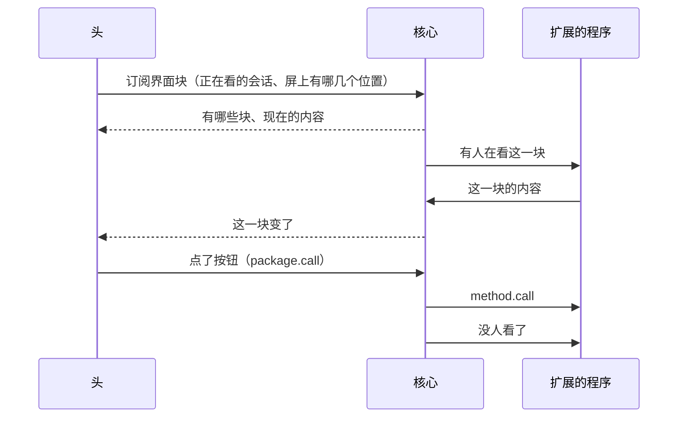

## 界面扩展

软件包往终端、网页上放自己的东西：首页一段、侧边栏一块、底栏一小段、一整页。包只说放什么，界面自己画；两个界面认同一套。

状态：方向已定（2026-10-15 项目主人定第二节；别的交给主会话，下面是主会话照推荐定的技术形状）。第三节的位置等两个头对过；协议的形状见蓝图 `widgets.md`。

### 一、为什么要有

- 起因（2026-10-15）：项目主人问别人做扩展，能不能注册 `miyu` 命令、斜杠命令、AI 工具、网页的仪表盘、终端的列表和元素。查下来，往核心里加的（命令、斜杠命令、工具、MCP、技能、后台页）都有；两个界面是封闭的：终端只认吉祥物包、信息页上的设置项、斜杠命令，网页另有后台页。设计 13、21 没把「界面能被扩展」当目标，30 第十三节第 6 条又定了终端只画信息页。这是设计的缺口，不是施工漏了。
- 对照 opencode（本机源码 2026-10-09 那一版核过）：
  - 终端插件是加载进终端进程的 JS 模块，往 12 个固定位置放组件：整个应用的顶层和底部、首页的标志、首页和会话的输入框及其右边、首页底下两处、侧边栏的标题、内容、底部。还能注册整屏的页面、弹窗和选择列表、按键、主题、提示音。
  - 它自带的侧边栏块（MCP、LSP、待办、改过的文件、上下文）就是用这套接口写的。
  - 插件和终端同一个权限，装上不用批；正文时间线不在能换的位置里。
  - 它的网页没有界面插件。
- 我们照抄不了：
  - 终端是编好的 Rust 程序，加载第三方代码只有两条路：动态库（要 unsafe，三个平台各一套）、内嵌脚本运行时（体积和内存会顶破 `23-性能预算.md`：现在终端到首屏 18 毫秒、19 MiB 左右）。
  - 网页本身是 JS，加载容易；可第三方脚本和网页同源跑，就拿得到登录令牌，等于管理员。

### 二、定了的（2026-10-15 项目主人）

1. **声明式**：包只说「这个位置放什么」，界面自己画。不加载第三方代码：终端不内嵌脚本运行时，网页不让第三方脚本和自己同源跑。
2. **软件自己的页面在网页里是独立整页**，不在设置里（`30-插件框架.md` 第十三节第 5 条）。
3. 别的交给主会话定，下面几节。

### 三、位置

| 位置 | 终端 | 网页 | 范围 |
|---|---|---|---|
| `home` 首页 | 空会话的首页，工作目录那一行下面 | 新会话的首页 | 全局 |
| `sidebar` 侧边栏 | 宽屏的侧边栏，自带的几块下面；窄屏没有侧边栏，不画 | 右栏，自带的几块下面 | 全局，或跟着会话 |
| `status` 底栏 | 底栏右边、用量前面，一小段字 | 头定，输入框附近一小段 | 全局 |
| `page` 整页 | 全屏的一页，`Esc` 回去 | 独立整页，和后台页同一种 | 全局 |

1. **只加，不换**：包放的东西排在界面自带的后面，换不掉界面自己的块。能换的只有吉祥物（吉祥物包，已有）。理由同 30 第十三节的起因：包不能冒充核心和界面自己的东西。
2. **认得出是谁放的**：首页、侧边栏、整页带软件的名字或图标；底栏那一段，悬停或点开看得到是哪个软件。
3. **不开放的地方**：时间线、输入框、抽屉、设置页。她说的话、要人确认的事，不能被包盖住或者仿冒。
4. 一个位置最多放几块、每块画几行，由头定，画进各自的版式图；放不下的截掉、收起。
5. 整页怎么打开：信息页上的「打开」；包可以给整页起一个斜杠命令名，打了就打开；网页的主界面列出所有整页，和后台页列在一起。

### 四、内容

一块的内容是几段，只有这六种：

| 种类 | 是什么 |
|---|---|
| `text` | 一行或几行字，可以带语气：普通、暗、强调、好、警告、坏 |
| `pairs` | 一行一对：名字、值 |
| `progress` | 一根进度条，加一句话 |
| `list` | 一条一行：标题、说明、右边的字、状态（待办、进行中、完成、失败、关着）；能点的带一个动作 |
| `buttons` | 一排按钮，每个带一个动作 |
| `heading` | 小标题，整页里分段用 |

1. **只有字**：不认 Markdown、HTML、颜色码、控制字符，链接、图片先不做（第七节）。字可以按语言给几份，核心照连接的语言挑。
2. **动作两种**：调这个包的程序登记的方法（`package.call`，30 第十三节第 8 条已有）；打开同一个包的一个整页。
3. 写法不对的整块不收，核心不替它改，告诉程序错在哪。

### 五、数据怎么走

1. **清单声明有哪些块**：编号、位置、标题、全局还是跟着会话，整页可以带一个斜杠命令名。只有扩展（带 `[process]` 的包）能写：内容要它的程序来推。要扩展能力 `widgets`，开的时候人批（`05-内核接口.md` 第三节）。
2. **内容由程序推给核心**：核心记最新的一份，转给在看的头。程序停了，它的块清空；关掉、卸掉，块就没了。
3. **有人看才叫程序干活**：头订阅时说清屏上有哪几个位置、开着哪一整页；有人开始看一块，核心告诉程序，最后一个人不看了也说一声。程序只在有人看时取数据、算内容，不轮询（基本原则「避免轮询」）。
4. **推给头有上限**：同一块最快每秒 4 次，中间的只留最新的。空闲时没有推送，头不重画（23 的空闲预算）。
5. **不进模型**：界面块只给人看，不进她的上下文、不进请求，不记进会话日志（前缀稳定第一）。

### 六、界面自己也用这一套

两个头自己的侧边栏块（上下文、用量、待办……）照同一套内容来画：数据照旧从视图流来，头在内部转成这几种内容，走同一个画法。学 opencode：自己用得着，接口才够用；自带的块缺什么，这套内容就缺什么，照第九节 W4 补。

### 七、不做的

- 加载第三方代码（第二节第 1 条）。
- 换掉界面自己的块（第三节第 1 条）。
- 时间线、输入框、抽屉、设置页里的位置；按键、主题、提示音（主题、吉祥物另有）。
- 链接、图片：先不做。链接要打开外面的地址，图片要取文件，各有各的安全问题，要了再加。
- 没有程序的包放固定的块：先不做。不变的东西放进后台页就行。
- 成员的头：现在只有管理员的头看得到，随多用户那一段（`06-多用户与身份.md`）。

### 八、施工

| 步 | 谁 | 做什么 |
|---|---|---|
| X-15 上 | 核心 | 清单 `[[widget]]`、扩展能力 `widgets`、`package.list` 列出来；整页的命令名算进斜杠命令的名字空间，装包查冲突；`miyu check` |
| X-15 中 | 核心 | 程序推内容，核心查、记、转给头；有人看、没人看告诉程序；头订阅、推送限速；程序停了、关了、卸了清掉 |
| X-15 下 | 核心 | 整页的命令（菜单里列、打了回「打开它」）；测试用的扩展、给作者的说明加一节、示例包 |
| 终端 | 终端 | 四个位置的版式图；画法；自带的侧边栏块挪到同一套画法上；整页；按钮调方法 |
| 网页 | 网页 | 同上；整页和后台页的独立整页一起做 |

核心先做，头照协议接；三步的协议形状一次写进蓝图 `widgets.md`，两个头可以先照它画版式图。

### 九、决定

| 编号 | 决定 | 谁定 | 重开条件 |
|---|---|---|---|
| W1 | 声明式，不加载第三方代码 | 项目主人 2026-10-15 | 声明式表达不了的需求攒够了，又有不破预算、不破安全的跑代码的办法 |
| W2 | 只加不换（吉祥物除外）；时间线、输入框、抽屉、设置页不开放 | 主会话 2026-10-15 | 无 |
| W3 | 四个位置：首页、侧边栏、底栏、整页 | 主会话 2026-10-15，等两个头对过 | 两个头对位置的意见 |
| W4 | 六种内容，只有字 | 主会话 2026-10-15 | 自带的块挪过来时缺的；链接、图片有人要 |
| W5 | 有人看才叫程序干活 | 主会话 2026-10-15 | 无 |
| W6 | 协议里叫 `widget`，中文叫「界面块」：`view` 已经是会话的视图流（`view.md`） | 主会话 2026-10-15 | 无 |
