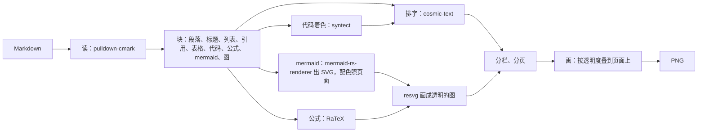

## 渲染

一个第三方写法的软件包 `miyu-render`（仓库 `miyu-agent/miyu-render`）：把 Markdown 画成图。她能用工具 `render_image` 把复杂的内容画给人看；别的软件（接入QQ）经它留的方法把太长的回复画成长图。

状态：方向已定（2026-10-17 项目主人定第二节、第五节「只生成文件」）；第三节起是 O 线会话照推荐写的技术形状，施工前各出施工单。

### 一、为什么要有

- 旧版（`Miyu` 仓库 `crates/miyu-hosts/src/platforms/plugins/renderer/`，约 4500 行，另有 `render/mermaid.rs` 1044 行）：
  - 全是 Rust，不开浏览器。pulldown-cmark 读，cosmic-text 排字，mermaid-rs-renderer 出 SVG，resvg 画。
  - QQ 里超过 300 个字的回复自动转成长图（`reply_processor`），工具 `render_image` 把 Markdown 或 `.md` 文件画成图。
  - 分栏：一栏 960 像素，挑最后最接近正方形的栏数；页高 360 到 5000，像素、字节都有上限。
- 旧版的毛病（代码、`docs/releases/0.7.0/changelog.md` 第 68 行）：
  1. mermaid 的底：往页面上贴图时直接盖像素、不算透明度，只能靠「找 SVG 里第一个整幅的方块，改成页面色」伪装；浮点误差、导图没有那个方块时就露白底（09-22、09-24 两次）。
  2. mermaid 的配色：节点、线、字一直是 mermaid 自带的浅色（节点 `#F8FAFC`、边框 `#94A3B8`、线 `#64748B`、字 `#0F172A`），深色主题下是一块深底上的浅灰节点；网页那条路有换色，长图那条路没有。
  3. 粗体靠颜色假装（只带了 Regular 字体），没有斜体；代码块不着色；长图里的公式照原文。
  4. 字体全部自带：中文黑体 19 MB、表情 10 MB。
  5. 一个 `mermaid.rs` 1044 行，渲染器另起一个子进程。

### 二、定了的（2026-10-17 项目主人）

1. **照旧版的 render image 做**，做成独立仓库的软件包；接入QQ 依赖它做长文转图。
2. **mermaid 和背景无缝**：和终端里一样，看不出图的边。
3. **字体先用系统的**：正文用系统的无衬线（`sans-serif`），代码用系统的等宽（`monospace`）；能在配置里指定用哪个字体。
4. **长图默认纸色**（旧版的 `paper`），场所卡片里以后能改。
5. **补三样**：粗体、斜体用真的字形；长图里画公式；代码块按语言着色。
6. **`render_image` 是可选的工具**：预设管开不开。

### 三、包里有什么

| 东西 | 写法 | 说明 |
|---|---|---|
| 清单 | `package.toml` | 编号 `miyu-render`，名字「渲染」，图标 `image` |
| 程序 | `bin/miyu-render`（Rust，三个平台各一份） | 扩展：`[process] args = ["serve"]`、`start = "always"`；渲染就在这个进程里做，不另起子进程（包本来就是独立进程，崩了不带倒核心） |
| 工具 | `provide` | `render_image`（第五节），功能「渲染」 |
| 方法 | `[export] methods = ["markdown"]` | 给别的软件调（第六节） |
| 配置项 | `[settings]` | 第七节 |
| 能力 | `capabilities` | `tools`；画好的图经 `blob.put` 交核心 |

### 四、怎么画

1. **配色**：一套主题只定六个颜色（底、字、淡字、强调、线、代码底），别的都从这六个调出来：粗体、标题、链接、表格的线、引用的竖条、mermaid、代码着色、公式。出厂三套：`paper`（默认，旧版的纸色）、`light`、`dark`。链接和粗体、标题、正文分得开（旧版有测试守着，照留）。
2. **mermaid 和背景无缝**：
   - 画成透明的图（不铺底），贴的时候按透明度叠到页面上：图的底就是页面本身，不再找方块、不再改 SVG 的底。
   - 节点、线、字的颜色从配色里来：节点底是页面底往字的颜色挪一点（同卡片），边框是线的颜色，线和箭头是淡字，字是正文的字，线上标签的底是页面底。
   - 字号照旧版定的 24 像素、字体照正文，导图照旧版的树状，一张图不拆、最高 2200 像素。
3. **字体**（2026-10-17 项目主人定第 3 条）：
   - 正文、代码各一个字体族：配置里写了的照写的；没写的照系统的通用名。Linux 问 fontconfig（`fc-match sans-serif:lang=zh-cn`、`fc-match monospace`）；macOS、Windows 没有这类别名，照系统默认的（macOS 苹方、Menlo，Windows 微软雅黑、Consolas）。
   - 挑到的字体不含中文的，在系统里另找一个含中文的补上；一个都没有的报错，说清楚该装什么（例如 `noto-fonts-cjk`），不下载。
   - 粗体、斜体照同一个字体族的粗体、斜体；族里没有的，粗体照字形加粗，斜体照字形倾斜。
   - 表情照系统的彩色表情字体（Noto Color Emoji、Apple Color Emoji、Segoe UI Emoji），没有的照单色画。
4. **公式**：`$…$`、`$$…$$` 用 RaTeX 画（纯 Rust，旧版终端在用），颜色照正文的字；画不出来的照原文。
5. **代码着色**：syntect（纯 Rust 的正则），认得出语言的才着色；颜色照配色调（关键字强调色、字符串、注释淡字……），不用 syntect 自带的主题。
6. **分栏、分页、上限**：照旧版（一栏 960 像素，挑最接近正方形的栏数，页高 360 到 5000，表格换栏重复表头，标题跟着下文走）。输入最多 20000 个字；一次最多画 30 秒，超了交回「太久」；画崩了（panic）接住，交回「画不出来」，进程照跑。
7. **文件不超 500 行**：读、排字、分栏、画、mermaid、公式、着色、字体各一个模块，mermaid 再拆成出 SVG、配色、画成图三块。

### 五、工具 `render_image`

- 参数：`markdown`（要画的字）或 `path`（工作区里的 `.md`、`.markdown` 文件），二选一。
- 只生成文件（2026-10-17 项目主人定）：画好的图存进这个会话的工作区（`rendered/render-<内容哈希前 12 位>-<页>.png`，同一份内容不重画），结果交回每一页的路径和长宽。发不发、怎么发是她的事：要给人看就调 `show`，QQ 里照 `show` 那条路发成图。
- 给模型看的字：英文，三句以内，登记、量 token（照表情包包的做法）。

### 六、给别的软件调的方法

`markdown {markdown, theme?}` → `{pages: [{blob, width, height}]}`：画好的每一页经 `blob.put` 交核心，交回编号。`theme` 不写的照配置。接入QQ 的长文转图、命令回执太长的时候都调它；调不到（没装、没开）的接入QQ 照拆段发。

### 七、配置项

| 键 | 类型 | 默认 | 说明 |
|---|---|---|---|
| `miyu-render.theme` | 选项 `paper`、`light`、`dark` | `paper` | 默认用哪一套 |
| `miyu-render.font` | 文字 | 空 | 正文的字体族名，空的照系统的无衬线 |
| `miyu-render.code_font` | 文字 | 空 | 代码的字体族名，空的照系统的等宽 |
| `miyu-render.font_size` | 整数 14 到 56 | 36 | 正文的字号（旧版同） |

### 八、接入QQ 那一侧

- 场所卡片里「长文」三种：拆成几条、转成图、合并转发（O-58 上的卡片，接入QQ 另一步）。超过阈值（出厂 300 个字，旧版同）的才转。
- 转成图：调 `miyu-render.markdown`，一页一条图片段走出站队列；渲染包不在、画不出来的照拆段发，运行日志记一行。
- 命令回执（管理员跑 `/<命令>` 的回话）也照这一条处理。

### 定了的

| | 问的 | 定的 |
|---|---|---|
| 1 | 怎么画 | 照旧版：纯 Rust，pulldown-cmark、cosmic-text、mermaid-rs-renderer、resvg（2026-10-17 项目主人） |
| 2 | mermaid 的底 | 画成透明、按透明度叠到页面上，配色从页面的六个颜色调（同上：要和背景无缝） |
| 3 | 字体 | 先用系统的通用名，能指定；缺中文另找一个补上，不下载（同上） |
| 4 | 长图默认底色 | 纸色（同上） |
| 5 | 补哪几样 | 粗体斜体真字形、公式、代码着色（同上） |
| 6 | 渲染放在哪个进程 | 包自己的进程里，不另起子进程：包本来就和核心隔开；每次限时、接住 panic（技术，照推荐定） |
| 7 | 代码着色用什么 | syntect 的纯 Rust 正则：三个平台不用编 C；颜色照配色调，不用它自带的主题（技术，照推荐定） |
| 8 | `render_image` 画好以后 | 只生成文件、交回路径，发不发、怎么发由她定（2026-10-17 项目主人；没选「工具自己交出去」） |
| 9 | 仓库检出在哪 | 统一放在 `~/Documents/github/miyu-agent/` 下面（2026-10-17 项目主人），`miyu-render` 从这里开始 |
