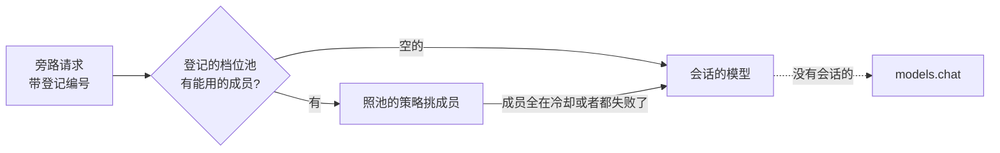

## 旁路请求和档位池

不在对话里的那些模型请求（起标题、通讯平台判要不要回、整理记忆、顾问扩展），各自声明要哪一档的模型，照声明的档位从三个固定的池里取；池是空的，用会话的模型。人管的只是三个池里放哪些模型。池里几个成员之间照规矩挑、出错冷却、换下一个。

状态：草案（2026-10-22 主会话写）。项目主人同一天过目，定了第六节四条。项目主人 2026-10-21 提：「lite、standard、flagship 这三个挡位的模型池改成 lite、normal、flagship，三个池，不可删除。然后做声明表单，允许扩展或者程序声明他们的请求是旁路模型……不配置时默认使用模型池，模型池为空时使用会话模型。模型池要带智能路由、冷却、切换机制（参考 magpie）」。同一天定了两条：池里全都在冷却或者都失败了，退到会话模型；参考 magpie 的源码（yetone/magpie，主会话克隆来读过）。排在 O-43、O-44 以后、F-17 以前。

### 一、现在缺什么

- **池不是固定的**：`miyu setup` 在配置里一个池都没有时预写 `lite`、`standard`、`flagship` 三个空池（`crates/miyu-cli/src/setup/flow.rs` 的 `PRESET_POOLS`），之后能删、能改名。别的地方没法指望「`lite` 一定在」。
- **旁路请求没有统一的去处**：
  - 起标题（`title`）、回顾（`recap`）、提前压好的摘要（`compaction`）都用会话的模型（会话入口）。会话是旗舰模型的，起一个标题也走旗舰。
  - 整理记忆用 `memory.organizer`，没写的用 `models.chat`。这是记忆自己的一个键，别的子系统没有。
  - 扩展的 `model.call` 只能写 `<供应商>/<模型>` 或 `@池`，不写的用 `models.chat`。通讯平台判要不要回、顾问扩展要不要旗舰，都得扩展自己有一个配置项，让人另配一遍。
  - `models.md`「还没有的」早就记着「辅助请求各自默认用哪个模型或池：随各子系统」。
- **池的路由偏简单**：只有钉住（`pin`）、轮换（`rotate`）两种。全在冷却就报 `cooling` 等着，不会退。窗口放不下的成员照发，等着被拒。供应商回的不是 API 应答（一页 HTML、空的），分类靠运气。

### 二、别家

- **magpie**（yetone/magpie，本地网关）。一个组是有序的成员表，策略只负责给出顺序：`smart` 按额度窗口、`ordered`、`rotate`、`least-used`、`pace`、`weighted`、`free-first`；策略写坏了照原序（fail-open）。
  - 冷却按失败的原因分：余额不足 30 分钟，额度用完照厂商说的重置时刻，429 按连续次数翻倍、上限 30 分钟，别的翻倍、上限 10 分钟，认证被撤销的不冷却、直接换。冷却按「账号 + 模型」记：同一个账号下总失败的模型自己涨，不连累兄弟模型。
  - 全在冷却时，每个请求只问最早恢复的那一个（半开探测）。
  - 回退只在还没给出一个字节以前。
  - 发之前先估长度，窗口放不下的成员直接剔掉。
  - 2xx 但不是 API 应答的（HTML、空体、非 JSON）当 502，照样回退。
  - 会话亲和：上一轮缓存够大（≥1024 token）、没凉（5 分钟内）的，粘住上次回答的成员。
- **OpenRouter**：`models` 是有序的回退表，`provider.sort` 选 price、throughput、latency。
- **LiteLLM**：router 的 `fallbacks`、`cooldown_time`、`allowed_fails`，每个部署按 RPM、TPM 挑。

取的是：
- magpie 的冷却分类、半开探测、窗口剔除、非 API 应答算出错、回退只在出字以前。
- 「策略只给顺序、执行一处」的分法。

不取的：
- 按额度窗口排（`smart`、`pace`）。我们拿不到订阅账号的额度窗口，借订阅以后再说。
- 加权轮询。三五个成员用不上。

### 三、样子

**1. 三个固定的池：`lite`、`normal`、`flagship`**

- 永远在，不能删、不能改名，可以是空的。人往里加成员、调先后、改策略、改说明。配置里没写的照空的算，`miyu setup` 不再预写。
- `standard` 改叫 `normal`。还没发版，不做迁移：照 8-8 补的写法，配置里出现 `[pools.standard]` 照「不认识的池」报。
- 三个池默认 `subagent = true`（派子代理时可选），人能关。
- 人自己建的池照旧能建、能删（见第七节第 1 条）。

**2. 旁路请求登记**

一条登记说清这几样：
- 是哪个请求（编号）；
- 默认要哪一档（`lite`、`normal`、`flagship` 之一）；
- 给人看的名字和一句说明。

核心自己的几条写在代码里，扩展的写在清单里：

```toml
# 扩展清单（miyu.toml）
[[side]]
id = "judge"                       # 包里唯一，小写字母开头，同斜杠命令名的写法
tier = "lite"                      # lite | normal | flagship
name = { en = "Reply judge", zh = "判断要不要回" }
summary = { en = "Decides whether to reply in a group.", zh = "群里有人说话时判断要不要回" }
```

出厂登记：

| 请求 | 编号 | 档位 | 为什么 |
|---|---|---|---|
| 起标题 | `core/title` | `lite` | 只看第一问一答，短；起错了人能改 |
| 整理记忆 | `memory/organize` | `normal` | 抽取、合并、整理会话（dream）都是它；要读懂一整段对话，太弱的会记错 |
| 判要不要回（通讯平台） | `im/judge` | `lite` | 每条群消息都问一次，量最大 |
| 顾问（扩展） | `advisor/advise` | `flagship` | 由扩展登记，这里只是例子 |

不进登记的（主会话定，理由是缓存。项目主人 2026-09-26 定「前缀稳定第一」）：
- 回顾（`recap`）：照整段对话说一句，复用会话前缀的缓存。换个模型，要整段原价重算，长会话反而更贵。
- 压缩摘要（`compaction`）：fork 式复用前缀，同上。
- 识图（`models.vision`）、向量（`models.embedding`）：这两个是「用途」，要的是能力，不是档次，照旧单配。

**3. 用哪个模型：一条链**



- 「会话的模型」：请求属于哪个会话，就用这个会话这一刻的引用。扩展的 `model.call` 带了 `session` 的，照那个会话。没有会话的，用 `models.chat`。
- 「全在冷却或者都失败了」：这一次请求里，池的每个成员都在冷却，或者试过都出了会换人的错（第 5 条）。这时退到会话的模型发一次（项目主人 2026-10-21 定）。会话的模型也是这个池的，就不再退，照池的规矩报。
- 退过的，`model.called` 记下真发给谁，多一格 `fell_back: true`，日志记一行 `INFO side fallback`。

**4. 配置和界面**

- 不另设每条请求的配置键，设置页不加组（项目主人 2026-10-22 定：声明了档位就够，人只管三个池里放什么）。真有人要单独改一条，以后再加。
- `memory.organizer` 去掉，整理记忆照声明走 `normal` 池。还没发版，旧键直接去掉，配置里出现照「不认识的键」报。
- 协议：
  - `model.list` 的回应多 `side`，每条登记带编号、档位、名字、说明、这一刻会落到哪（`resolved`：池名或者「会话模型」）。头可以不画，留着查。
  - 扩展的 `model.call` 多一个参数 `side`（只能写自己包里登记过的编号）。写了 `side` 就不能再写 `model`。
  - 包卸了，它的登记跟着没了。

**5. 池里怎么挑、出错怎么办**

照第二节取的那几条，补进现在的 `route/`（`models.md`「四」「五」）：

1. **策略只给顺序**：现有的 `pin`、`rotate`，加一个 `ordered`。`ordered` 是每次从第一个排起：主力加备用的写法，前面的恢复了就回到前面。挑的时候：
   - 跳过冷却着的；
   - 跳过窗口放不下的；
   - 剩下的照顺序试。
2. **窗口放不下的剔掉**：照目录里的窗口和这一次请求的估算（组装器已经有估算）。这个池全放不下的，照「全都失败」退（第 3 条）。
3. **冷却分类补齐**：
   - 现有的 `rate_limited`、`retryable`、`auth` 照旧；
   - `retryable` 里 5xx 照「别的」翻倍，不当额度用完；
   - 2xx 但读不出 API 应答的（HTML、空体、不是 JSON），驱动报 `retryable`，照样换；
   - 额度、余额用完的（402、供应商的余额码）单独一类 `quota`：冷却照供应商说的重置时刻，没说的 30 分钟（`[models.cooldown]` 多一项）。
4. **全在冷却时只探一个**：会话的主请求在池全冷却时不再等，照现在的规矩报 `cooling`。旁路请求退会话模型（第 3 条）。另外每隔一段（照最早恢复的那一刻），用下一个真请求先问最早恢复的那一个成员；成了，整个池就回来了。不另发探测请求。
5. **回退只在出字以前**：已经有了（`models.md`「五」第 4 条），不变。
6. **亲和**：钉住的池现在已经一个会话粘一个成员。旁路请求短、不靠缓存，不粘，照策略来。

**6. 图纸**

- 配置样本：`docs/designs/samples/config/` 照新键重生成。
- 清单表 `[[side]]` 的样本，进 `docs/blueprint/packages.md` 的清单一节。
- 界面：三个固定池在「模型」页的池那一组照旧画，不能删、不能改名的那三个由两个头去掉删除、改名的按钮，版式图交核心对过。

### 四、和别的规矩的关系

- **不碰会话的前缀**：旁路请求本来就是一次性入口（`OneShot`）或者辅助请求，不进会话的上下文。起标题换到 `lite` 池以后不再复用会话前缀。它本来只看第一问一答，量小，换了省钱。
- **用量记在会话的账上**：同现在的 `OneShot`。`model.called` 带 `purpose`。视图照 `aside()` 分（D-1 下补修的那一处），整理会话的主请求照主请求算。
- **扩展能力**：`model.call` 已经要「调模型」这一项扩展能力。`side` 不另加能力，只认自己包里的编号。
- **子代理**：派子代理的 `pool` 参数照旧，三个固定池默认可选。

### 五、施工拆分（草案）

1. **Q-1：三个固定池**。`lite`、`normal`、`flagship` 永远在、不能删和改名、可以是空的；`standard` 改名；`miyu setup` 不再预写；设置页、协议、文档、测试跟着改。
2. **Q-2：旁路请求登记（核心这一侧）**。登记表、出厂几条；第三节第 3 条那条链（只碰路由，冷却照现在的）；起标题、整理记忆接上；`memory.organizer` 去掉；`model.list` 带 `side`。
3. **Q-3：扩展登记**。清单的 `[[side]]`（解析、撞名、卸包）；`model.call` 的 `side` 参数；`miyu check` 提没有的编号。通讯平台、顾问接（各自的会话）。
4. **Q-4：池的路由补齐**。`ordered` 策略、窗口剔除、`quota` 一类、非 API 应答算出错、全冷却只探一个。碰驱动，先过三台 CI。
5. **两个头**：三个固定池去掉删除、改名的按钮，照第三节第 6 条。

Q-1、Q-2 先做。Q-3 等 Q-2。Q-4 和 Q-2、Q-3 不相干，可以交给 miyu-core2 并着做。

### 六、定的

1. 人自己建的池照旧能建、能删（项目主人 2026-10-22 照推荐定）。三个固定池是档位，人另建的池给子代理、`@池` 用。
2. 回顾不走档位，照会话的模型（项目主人 2026-10-22 照推荐定）：复用会话前缀的缓存。压缩摘要同理。
3. 不要每条请求单独改的表（项目主人 2026-10-22 定）：请求一律走声明的档位池，池空走会话模型，人只管三个池里放什么。没有 `models.side.*`，设置页不加组。
4. 池全在冷却或者都失败了，旁路请求退到会话模型（项目主人 2026-10-21 定）。
