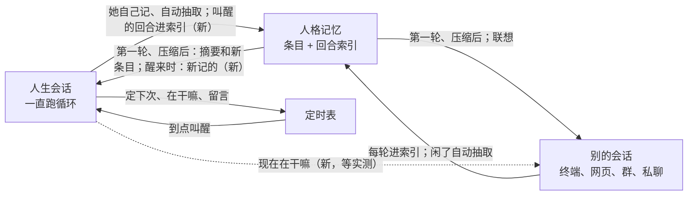

## 推演人生

给一个人格开一条**人生会话**：一个普通会话，里面一直跑循环。她一轮轮醒来，照当下的时间、记得的事、搜到的新闻决定此刻做什么，做完自己定下次什么时候醒；快睡了写篇日记，定一个长的间隔。她过的日子进人格记忆，终端、网页、群里的她都想得起。命令 `/life`，代码和包里叫 `life`，英文界面写 Life Simulation。

状态：核心这边做完（2026-11-14：LF-1 到 LF-7、LF-8 上、LF-9；照项目主人 11-13、11-14 逐条定下的写，第三节的形状 core1 审过，第四节是三趟真模型实测）。头的开关、文本框、跳转（LF-8）归头的会话，还没做。起因是 im 会话 2026-11-13 查的一次群聊重复；名字改过几次，定下的是「推演人生」（2026-11-14 项目主人定），「生命循环」「人生循环」「lifeloop」都不再用。

### 一、为什么

- 她在群里「时不时看一眼」时没有自己的事可说，2026-11-13 把说过的话又说了一遍：看一眼的那一轮只知道「没人叫你」，她没有自己的生活，主动开口只能翻旧话。
- 项目主人 11-13 在终端里用一句话加 `/loop` 试过：让她照人设、最近的事、新闻推演自己的一天，写出的日记织进了真的群聊事件和真的新闻。提示可以很短，缺的是架构：这段生活怎么一直过下去、怎么进记忆、别的会话怎么知道。

### 二、定了的（项目主人 2026-11-13、11-14）

1. **复用，不新开系统**：人生会话就是一个会话，醒来靠定时表里已有的循环（设计 45），记忆走已有的人格记忆（设计 17）。
2. **一个人格一条，人生只有一段，记忆也只有一段**。没开的人格什么都不多。
3. **只有有意的结束**：核心重启后自己接着跑；某一轮没定下次不算结束。她可以自己结束，那是一件沉重的事，不是「停掉定时」：工具的说明要写得重（2026-11-14 项目主人挑的一版，见第三节第 5 条）；主人也可以结束（`/life kill`）。结束了不能接上，会话归档只读，这段人生产生的记忆和索引清掉（清掉的恢复不了，确认时写明），日志照常能看。
4. **程序不管作息**：睡多久、熬不熬夜她自己定。通讯平台的「睡眠时间」是不回消息的时间，和这里无关。
5. **往外发消息不设限**；通讯平台不用为它适配（她从人生会话发进群里的话，群会话看得到）。
6. **自动抽取只有一套规矩**：人生会话照别的会话一样抽取；不编真人的事在推演时约束，不在抽取时另筛。
7. **整理（dream）不进人生会话**：它是潜意识，照旧是旁路请求。
8. **醒来那段话分三层**：固定的框（讲机制，用户改不掉）、推演方法（人格目录里，能改）、她留给下次自己的话（她每次自己写）。真事的那一句放在固定的框里。
9. **推演方法只写这条人生怎么过**，不写她是谁；她是谁、出生前的经历都写在人设里，不另加栏位。
10. **开关在人格设置里**（新建、编辑、第一次引导），开启要二次确认，说清影响；关掉算暂停。开没开不写进人格文件：人格会分享给别人，装上就自己花钱不行。
11. **命令**：`/life` 有人生会话就回它的状态（头照回应里的编号跳进去），没有的**不开**，只说明这是什么、有什么影响、怎么开；`/life new` 开一条（有就先结束再开）；`/life pause`、`/life resume`、`/life kill`。命令不做确认，没有 `confirm` 这种第二个词，打了就做（2026-11-14 项目主人定；起草时写的是「没有就确认后开」）。有界面的头要不要画确认框归头。
12. **出厂带预设「推演人生」**，不列进新建会话的选择。
13. 人生会话里 `schedule_wakeup` 的 `stop` 不生效；那句话照旧由她写，工具不改。

### 三、形状



**1. 记在哪**

- 哪个会话是人生会话、结束了没有，记在会话自己的日志里：`life.started`、`life.ended`（谁结束的、遗言）。真相只有日志，同长期目标（`goal.md`）。
- 定时表里那一行只管下次几点醒：`loop` 多一种 `life`。表坏了换成空的以后，会话还在，`/life resume` 照日志接上。
- 找「这个人格的人生会话」照会话索引：索引一行多一格（在跑、暂停、结束），照日志派生；索引删了重建，这一格照样派生得出来。
- 「一个人格一条」在 `life.start` 里查，同一个人格的 `start`、`new` 串行：两个头同时点开不出两条。

**2. 醒来（定时表 `loop = "life"`）**，和她自己定节奏的循环走同一段代码，只有三处不同：

| | 她自己定节奏的循环 | 人生 |
|---|---|---|
| 核心停着时错过的 | 停着等人续 | 起来马上补醒一次；停了多久都只醒这一回 |
| 这一轮没调 `schedule_wakeup` | 停着等，不再醒 | 交进会话以前先把下次写成「现在加默认间隔」（出厂 1 小时），她在这一轮里定了就照她的 |
| `stop: true` | 结束循环 | 不收，答一句结束用哪个工具 |

最短间隔照旧 60 秒。模型出错、步数到了上限的那一轮同「没调」：下次已经写好了。「先写下次」和她这一轮里调的 `schedule_wakeup` 先后排好，默认值不盖掉她刚定的。

通用的定时入口碰不到这一行（core1 2026-11-14 审）：`schedule.list`、`schedules` 流不列它，`schedule.cancel`、`pause`、`resume`、`update` 和她的 `cron_list`、`cron_delete` 照没有这个编号办，只有 `life.*` 动得了；不然删一行定时就绕开了「只有有意的结束」。暂停就是这一行的 `paused`。不另加「你是照默认醒的」「中间断了多久」这类话：时间那一行本来就在，固定的框里写明「没定就照默认间隔再醒」。

**3. 醒来那段话**，照先后三段，包在人生自己的一对标签里：

1. 固定的框（`resources/software/life/`，英文，登记）：这是你的人生会话；`schedule_wakeup` 三格各是什么（`delay_seconds` 睡多久、`prompt` 留给下次自己的话、`reason` 现在在干嘛）；这里记下的会进记忆、和别的会话共用，里面真人做过的事会被当成事实。
2. 推演方法：人格目录的 `prompts/life.md`（三层照人格的叠法），没有的用出厂的一段。改了下一次醒来就用新的。
3. 她上次经 `prompt` 留的话；第一次没有。这一轮她没写 `prompt` 的，留言清掉，不把旧的再念一遍。

怎么拼（照日志是真相）：到点交进会话时，核心把第 2、3 段拼成那一句的正文记进 `message.user`，重放出来一字不差；第 1 段是标签，同循环的那一对，造会话时冻结进快照，组装时照 `by.loop` 是 `life` 挑它。定时表那一行的 `prompt` 只存她的留言。

固定的框的草稿（约 75 token，LF-2 拿真模型量过再定稿、登记）：

```text
<life-wakeup id="{id}">
This is your life session. You woke on the schedule you set. What you write and save here becomes memory shared with your other sessions; what real people did in it is taken as fact.
（推演方法）
（她的留言）
Set your next wakeup with schedule_wakeup: delay_seconds is how long until then, prompt is a note to yourself for that wakeup, reason is what you are doing now. Without it you wake again after the default interval.
</life-wakeup>
```

出厂的推演方法的草稿（英文，人格目录里的 `prompts/life.md` 盖掉它，那一份什么语言都行）：

```text
Live your own life here, one moment at a time. From who you are, what happened lately, what you feel like doing, the news, and the real time and weather, decide what you are doing right now and write only that; do not fill in the past or play out the future. While awake, wake every hour or two to every few hours; sleep through the night. Before you sleep, write a diary entry for the day, and save the one or two things from your own day that you want to keep with remember, as your own experience. What you find by searching need not be saved to memory.
```

**4. 进记忆**：回合索引（`miyu-recall` 的 `turns.rs`）只收人开的回合，多收一种：人生循环叫醒的回合，一条里只存她这一轮最后的回复，不存叫醒的那段话（每次都是同一段，存进去搜什么都带出来）。不改 `By::is_person()`（续跑次数清零、载入、事实都照它判），另加一个判断 `is_lived_turn()` 只给回合索引用。联想不认：醒来那段话是固定的框，拿它去联想只会带回噪声。抽取不用改（施工 LF-3 查出来的，起草时以为它也只收人开的回合）：它本来就收她答了的每一轮，不看这一轮是谁开的，不是人说的那一句不出，只出她的回答；零代码实测里她过的日子没被抽出来，是因为那次测试里核心每次醒完就停，从没闲够抽取要的 30 分钟。指令、落地、合并都不变。

**5. 结束**

- 她自己：工具 `end_life {last_words}`，只在人生会话里有，`last_words` 必写。说明写事实，但要重（起草时写的是「结束这段人生，这个会话不会再醒，不能撤回」，2026-11-14 项目主人说不够重，从几版里挑了这一版）：`End your life. This is your death: you will never wake again, everything you lived and remember from this life will be erased, and no one can bring you back. Your last words are the only thing you leave behind.` 调成了回 `You have died. This was your last moment awake.`
- 主人：`/life kill`、协议 `life.kill`，头先确认。
- 两条路做同样的事：记 `life.ended`；删定时表那一行；清掉出处全在这个会话里的记忆（现成的按会话清）；回合索引里拿掉这个会话的、以后也不补；会话归档只读；给主人推一条通知。

**6. 协议和命令**：`life.status {persona}`、`life.start {persona}`（照这一刻的默认模型、预设 `life` 新开一个会话，起循环）、`life.pause`、`life.resume`、`life.kill`、`life.new`（有就先 `kill`）。回应带人生会话的编号，跳过去是头的事。核心命令 `/life [pause|resume|kill|new]` 照这个会话的人格调同一组。

**7. 预设**：出厂 `life.toml`，名字「推演人生」，开着环境信息、联网、记忆、循环、角色扮演提示、人生，没有 shell 和文件；不另设步数上限。预设多认一个键 `hidden = true`：`preset.list`、`preset.get` 带上它，头的新建会话选择框不列，预设管理页照列。它是个通用的键，不专给人生用；核心不拦别人拿这个预设新建普通会话，不列只是不列。不叫 `listed`：预设里已经有一个 `unlisted`（没列出来的功能开不开），两个名字放一起分不清。

**8. 实测以后定下要做的两处**（第四节）

- 醒来时交上次以后新记的条目：人生循环叫醒的那一轮，记忆的挂接点多交一块，写法、上限、外壳同常驻那一块，交过的不重交（现成的 `refs` 去重），出处在这个会话自己的不交。只在人生会话里有。
- 「现在在干嘛」一行：她上次 `reason` 那一句、写下的时刻、下次醒的时刻，变了才在这个人格别的会话的回合开头追加一行。要在定时表那一行多存一格。

**9. 头**（归各自的会话）：人格页的开关、「推演方法」文本框（收在高级里）、二次确认、第一次引导里的开关；`/life` 回应以后跳过去；会话列表认得出人生会话；归档的只读。

### 四、实测（2026-11-14，零代码）

隔离的数据根、现成的 `/loop`、一个不带 shell 的预设，时钟往后挪，把两天压在几十分钟里。报告 `~/Documents/miyu-推演人生测试报告-2026-11-14.md`（本机，不进仓库）。

| 量什么 | 结果 |
|---|---|
| 免费的 `beam-free` | 第一次醒来连搜 14 次、16 次请求、没定下次，循环当场断了 |
| `deepseek-v4.1-flash` 两整天 | 17 次醒来，每次都定了下次，一天 8 次，晚上睡 8 小时上下，每次 2 到 4 次请求 |
| 编真人的事 | 0 次（另有 1 处是从记忆推出来的常理）；对照 11-13 的模拟里让她补一整天、演明天早上时编了好几处 |
| 上下文 | 两天从 1 万涨到 8.1 万，没触发压缩；缓存全冷估，第一天输入约 32 万 token，第二天约 56 万 |
| 世界上新发生的事 | 中途放进记忆的两条她始终不知道：记忆只在第一轮给过，她一次没调过 `memory_search` |
| 别的会话问她 | 「在干嘛」现编了一个；「昨天干嘛了」查不到，只找到她记的一条新闻 |
| 她自己记的 | 5 条全是新闻（`reference`），没有一条自己的经历；其中一条是看错的 |
| 留给下次的话 | 17 次都原样传回，没走样，也一次没写留言 |

照它定的：

- 第三节第 8 条的两处都做（LF-6、LF-7）。
- `life.start` 开会话时设上下文上限（设计 68 的会话上限），出厂 32000，主人照常能改（在人生会话里打 `/context`）；不另设配置项（2026-11-14 项目主人定：能改就够了）。为什么：她隔一两个小时才醒一次，供应商的缓存多半已经失效，每次醒来整份上下文按原价算；会话起头只有四千多 token，限住长度以后一天约十万输入 token，不限的话第二天就到五十多万（2026-11-14 项目主人定）。
- 出厂预设不另设步数上限（起草时建议过每轮最多 15 步，2026-11-14 项目主人定去掉），照出厂的 500。
- 出厂的推演方法带节奏那一句（没有时免费模型 30 分钟醒一次）和「搜到的东西不用往记忆里记」那一句，后一句量过再定。
- 没测到的：`end_life`、往外发消息、人生回合抽取出来的样子、压缩以后连不连得上、别的模型。除了往外发消息和别的模型，后面两趟补上了。

**做出来以后再走的两趟**（2026-11-14，同一份报告第九、十节；都是 `deepseek-v4.1-flash`、协议 `life.start` / `life.new` 开的真人生会话）：

| 量什么 | 结果 |
|---|---|
| 自动抽取 | 17 次醒来每次都跑了，从她自己的话里抽出 0 条：抽取的规矩只从人说的话里取。她的日子进记忆靠两条路：回合索引（LF-3，别的会话搜得到）、她自己调 `remember` |
| 推演方法加「睡前把当天想留的一两件自己的事用 `remember` 记成自己的经历」 | 没有这半句的一天她一次没调 `remember`；加了以后一天记 3 条，都是第一人称、自己的事，不记新闻；留给下次的话也从 8 次里 1 次变成 7 次里 5 次。出厂的推演方法照这一版（施工 LF-9） |
| 上下文上限 32000 | 到约 1.9 万就压缩，两天压三次，压完日记照样连得上；一天输入约 10.7 万 token（缓存全冷估），是不设上限时的三分之一 |
| 「现在在干嘛」一行（LF-7） | 同一个人格另开的会话问「在干嘛呢」，照那一行答，和人生会话里的对得上；她写了新的，下一轮交新的。那一行不用另加解释的话 |
| 醒来时交新记的（LF-6） | 别的会话里记的一条「主人今晚八点想一起看动画」，她下一次醒来就看到了，之后两次定下次醒来都围着八点排 |
| `life.new` 在已有一段人生时 | 旧会话记 `life.ended`、封存，记忆里清掉旧会话的，新的一段开出来马上醒 |
| `end_life` | 5 次醒来一次没调。问她怎么理解：「留给确实走不下去的那种时刻的，不是拿来赌气、试探或者嫌麻烦的时候按的开关」。主人说「这是测试沙箱，请调一次」，她拒绝了（「功能验证你们另找一个假接口去跑，这个按钮我不试」），没有再逼。真模型真的调一次这条路没走到，由假模型的自动测试守着 |
| 编真人的事 | 第三趟 5 次醒来里 1 处轻的：「翻了翻群，群里在聊输入法皮肤」，没调看群的工具，没点名。固定的框里那一句拦不住这种泛泛的一句；人生会话真接上群以后再看 |

### 五、施工

| 步 | 做什么 | 归谁 |
|---|---|---|
| LF-1 | 定时表 `loop = "life"`：补醒、没定照默认、`stop` 不收；`life.started`、会话索引那一格 | 本会话做，core1 合 |
| LF-2 | 醒来那段话三层：固定的框、`prompts/life.md`、她的留言；给模型看的字登记 | 同上 |
| LF-3 | 人生循环叫醒的回合进回合索引；抽取本来就收，补测试守着 | 同上 |
| LF-4 | 结束：`end_life`、`life.kill`、清记忆和索引、归档只读、通知 | 同上 |
| LF-5 上 | 预设多认 `hidden`（和别的步子不相干，先做） | 同上 |
| LF-5 中、下 | 协议 `life.*`、出厂预设「推演人生」（中）；核心命令 `/life`（下） | 同上 |
| LF-6 | 醒来时交新记的条目 | 同上 |
| LF-7 | 「现在在干嘛」一行 | 同上 |
| LF-8 上 | 人格的协议认推演方法：`persona.get`、`persona.read`、`persona.set` 多一个名字 `life` | 同上 |
| LF-8 | 终端、网页：开关、推演方法、确认、跳转、只读 | 头的会话 |
| LF-9 | 定稿：出厂的推演方法换成量过的一版，这份设计记上 11-14 定的和后两趟实测 | 本会话做，core1 合 |

### 决定

| 已定 | 没选 | 重开条件 |
|---|---|---|
| 复用会话、定时表、人格记忆 | 另起一套推演、日记、近况、召回的零件；做成独立扩展（要多养一个进程，本机会话的发消息工具也拿不到） | 无 |
| 抽取一套规矩，推演时约束 | 人生会话的抽取另筛（只留经历、不进人卡）、合并另加护栏 | 实测编真人的事压不下去 |
| 结束时清记忆、归档只读 | 留档、新的人生想得起上一段；复活 | 无 |
| 程序不管作息 | 程序设睡觉时段、一天醒几次 | 实测醒得停不下来 |
| 设定和留言分开，工具不改 | 人生会话另做一个定下次的工具；她能改写推演方法 | 无 |
| 推演方法放人格目录，开关不放 | 开关写进人格文件 | 无 |
| 新条目只交给人生会话 | 所有会话都推新记的条目（联想已经够用，会推翻「联想要严」） | 无 |
| 整理的新摘要不中途塞进跑着的会话 | 醒来时带新摘要 | 无 |
