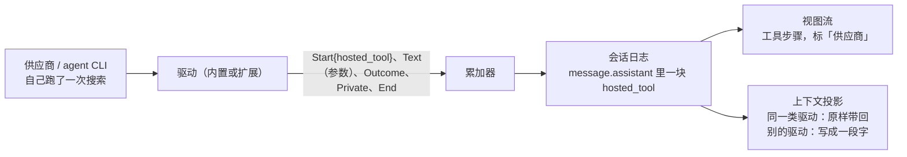

## 供应商侧工具

模型在供应商那边自己跑了一件工具（搜索、读网页这类），核心不执行它，只把它记进日志、照工具步骤画出来、算进上下文。内核多一种块
「供应商侧工具」，驱动多一种增量。Antigravity CLI、Claude Code 这类借 agent CLI 订阅的扩展驱动，Anthropic、OpenAI、DeepSeek
接口自带的服务端搜索，都走这一路。

状态：定稿（2026-11-14 core1 照项目主人当天定的方向写：「搜索、读网页留在 agy 里跑」，要通用，以后 Claude Code 也要适配；第六节
三个拍板点项目主人当天定「照推荐」）。施工 HT-1 起。

### 一、为什么

- 项目主人 2026-11-14 让做 Antigravity CLI（agy）当供应商的第三方包（`antigravity`）。定的做法是 agy 只当模型：Miyu 的工具经包自己
  的 MCP 服务挂给 agy，agy 要调时交回核心执行，权限、沙盒、工具卡片都和别的模型一样；agy 跑命令、改文件的原生工具全关。
- 舍不得的是 agy 自带的 `search_web`（Google 搜索，吃订阅额度不另花钱）和 `read_url_content`。它们只读、不碰主人的文件，留在 agy
  里跑没有权限上的风险，可核心现在记不下也画不出：内核的块只有正文、思考、要核心执行的工具调用三种（`miyu-kernel/src/accumulate.rs`
  的 `Kind`，`block.rs` 的 `Block`）。
- 同一个缺口别处早就有：DeepSeek 对话自带的联网搜索（`deepseek_web_search`）、Anthropic 的服务端工具（`web_search`、`web_fetch`）、
  OpenAI Responses 的 `web_search`，开了以后搜了什么、搜到什么，日志里没有，界面上看不见，换了别家模型也接不上。
- 以后适配 Claude Code（设计 66 第十一节「借 agent CLI 订阅」那一类）是同一个形状：CLI 自己跑的只读工具报成供应商侧工具，会改东西的
  关掉、走核心。

### 二、现在有什么

- 驱动交给内核的增量（`Delta`）：`Start {index, kind}`、`Text`、`Private`、`End`、`Truncated`；`kind` 是 `Text`、`Reasoning`、
  `ToolCall {name}`。工具调用收全以后内核派出去执行（权限、挂接点、`tool.called`/`tool.result`）。
- 驱动私有数据 `Private {driver, data}`（设计 03 第九节）：内核不解读，原样存、原样带回给同一类驱动，别的驱动不理它。思考块的签名、
  供应商自己的调用编号都放在这里。
- 扩展驱动的线上写法（设计 66 第四节第 2 条）：`driver.delta {"call", "deltas": [...]}`，和 `Delta` 一一对应。
- 视图流（`view.md`）把一轮画成一步步：正文、思考、工具步骤；工具步骤的标题、结果摘要照工具的 `presentation` 来。

### 三、形状

**1. 块**：`Block::HostedTool`，在 `message.assistant` 的块里，和正文、思考、工具调用排在一起，照模型说的先后。

| 格 | 是什么 |
|---|---|
| `call_id` | 内核分配的编号，写法同 `ToolCall`。只用来在视图、日志里认它，不派、不等结果。不和工具调用混着数：一条回复里工具调用照旧排 `_1` 到 `_k`，供应商侧工具照先后接着排 `_k+1` 起（旧版本把这种块当不认识的留着，混着数它就读不进后面的工具调用；2026-11-14 施工 HT-1 定） |
| `name` | 工具名，供应商自己的名字原样（`search_web`、`web_search`、`WebSearch`） |
| `args` | 参数原文，同 `ToolCall.args`，不解析后重写 |
| `outcome` | 结果：`{"text", "failed"?}`。`text` 是给模型、给人都看得懂的结果文字（搜到的标题、网址、摘录；读到的正文），截到 64 KiB，截了带 `cut: true`。供应商没给结果的（被打断）没有这一格 |
| `private` | 驱动私有数据：同一类驱动下一次请求要原样带回的原始块（Anthropic 的 `server_tool_use` 加 `web_search_tool_result`，里面有加密的内容；OpenAI 的 `web_search_call` 编号）。内核不解读 |

**2. 增量**：`Kind` 多一种 `HostedTool {name}`；`Text` 照旧写参数原文；多一种 `Outcome {index, text, failed}`，一块至多一次，在
`End` 以前。累加器照现有的规矩查（开了才有字、收了不再写）。推给头的 `model.delta` 跟着多两样：`start` 多一种
`"hosted_tool"`（带 `name`），多一格 `outcome`（截过的那一份），流式时就画得出结果（2026-11-14 施工 HT-1 定）。

**3. 内核**：收全的 `HostedTool` 块不派、不过权限和挂接点、不发 `tool.called`、`tool.result`，回合不因它停下等结果；这一次响应里
要是只有它和正文，照「没有工具调用」收尾。打断时开着没收的照收：有 `outcome` 的留着，没有的记成没结果。

**4. 视图**：画成一个工具步骤，和核心执行的工具同样的样子（标题、参数摘要、点开看结果），多一个「供应商」标记写是谁跑的（模型
那一格的供应商显示名，例如「搜索 · Antigravity」）。不弹确认，没有「允许 / 拒绝」。标题照工具名挑：认得的几种（搜索、读网页）用
核心现成的说法，不认得的写原名。

**5. 上下文投影**（设计 08）：
- 同一类驱动（`private.driver` 对得上）：照 `private` 原样带回，供应商那边接得上（Anthropic 要求原样带回服务端工具的块）。
- 别的驱动（中途换了池、换了供应商）：写成一段字放进那一轮的回复里，`<hosted-tool name="…">` 包着参数和结果（截到 4 KiB），让新
  的模型知道上一个模型搜过什么、看到了什么。这段外壳是给模型看的字，登记（设计 26）。
- agy、Claude Code 这类自己记着对话的：驱动不带它们（CLI 那边的对话里本来就有），照驱动自己的续传办法。
- 估算、压缩：`outcome.text` 算进上下文，压缩时同工具结果一样摘要。

**6. 扩展驱动的线上写法**（设计 66 第四节第 2 条加两种）：`start` 的 `kind` 多 `{"hosted_tool": {"name"}}`，多一种
`{"outcome": {"index", "text", "failed"?}}`。

**7. 透明**：扩展驱动会让供应商自己跑哪些工具，清单里写明：`[[driver]]` 多一格 `hosted = ["search_web", "read_url_content"]`。
装包确认屏照它列「这个驱动会让供应商自己跑：…」。没写在 `hosted` 里的名字交上来，核心照收、照画，记一行 `WARN`（核心挡不住
供应商那边跑什么，只能照实显示）。规矩写进扩展作者文档：会改东西的原生工具不许报成供应商侧工具，要关掉、走核心。

**8. 钱**：供应商侧工具有的另收钱（Anthropic 的搜索按次收）。核心不算：价格不全、算不准的不显示（项目主人定的规矩）；`usage` 里
供应商报了次数的照记次数。

### 四、各家怎么对上

| 来源 | 供应商那边是什么 | 驱动怎么报 |
|---|---|---|
| agy（`antigravity` 包） | stream-json 的 `step_update`，`step_type = tool`，`tool_info {name, parameters, output, error}` | 工具名在包的 `hosted` 里的，报成一块：参数是 `parameters`，结果是 `output` 或 `error` |
| Claude Code（以后的包） | stream-json 里它自己的 `tool_use` 加随后的 `tool_result` | 同上，只报包写进 `hosted` 的（`WebSearch`、`WebFetch`）；别的原生工具关掉 |
| Anthropic 接口 | `server_tool_use` 加 `web_search_tool_result`（或 `web_fetch_tool_result`） | 两块并成一块；`private` 存两块原样，同类驱动带回 |
| OpenAI Responses | 输出项 `web_search_call`（`action.query`、状态），结果揉在随后的正文和 `annotations` 里 | 参数是 `action`，结果写 `annotations` 里的标题和网址；`private` 存输出项 |
| DeepSeek 对话自带搜索 | 开 `deepseek_web_search` 以后供应商自己搜 | 照它回应里报的搜索步骤；它不报的，只能不画（施工时照官方回应实测） |

内置驱动接 Anthropic、OpenAI、DeepSeek 的服务端工具是另一件事：要不要开、怎么配，属于各自的「联网」设置（NF-1 那一类）。本设计
只管「报上来以后核心怎么接」。

### 五、不做的

- **核心执行供应商侧工具、替它弹确认**：供应商已经跑完了，核心拦不住，只照实记、照实画。
- **把供应商侧工具放进 Miyu 的工具清单**：它们不进 tools 数组，前缀不动。
- **一块里放多次调用**：一次调用一块。
- **替供应商算钱**：见第三节第 8 条。

### 六、拍板点（项目主人 2026-11-14 定：照推荐）

1. 块的名字叫 `hosted_tool`（和 OpenAI、Anthropic 说的 hosted/server tool 一个意思）。没选 `provider_tool`。
2. 换了别家驱动时写成一段字带过去。没选直接丢掉：丢掉更省 token，但新模型不知道刚才搜过什么，容易重搜、或者说出没来由的话。
3. 第一版只接扩展驱动（agy 包要用的）和 Anthropic（服务端工具要原样带回，不接的话开了搜索就断），OpenAI、DeepSeek 以后照实测补。
   没选四家一起做。

### 七、施工

| 步 | 做什么 |
|---|---|
| HT-1 | 内核：`Block::HostedTool`、`Kind::HostedTool`、`Delta::Outcome`；累加器、日志、样本（`docs/designs/samples/`）；收尾照「没有工具调用」 |
| HT-2 | 上下文投影：同类原样带回、别家写成一段字（登记）；估算、压缩 |
| HT-3 | 视图流：工具步骤多「供应商」那一格；协议参考、视图参考中英两份；头的会话跟着画 |
| HT-4 | 扩展驱动：`driver.delta` 两种新写法、清单 `hosted`、确认屏列出来、`driver-check` 认得 |
| HT-5 | Anthropic 驱动：服务端工具的两块并成一块、原样带回（照第六节第 3 条定的范围） |

之后 `antigravity` 包放开 `search_web`、`read_url_content`，报成供应商侧工具。

### 决定

| 已定 | 没选 | 重开条件 |
|---|---|---|
| 一种通用的块，各家驱动往里报 | 每家一种块；在正文里写一段字代替 | 无 |
| 核心不执行、不确认，照实记、照实画 | 核心替它确认 | 无 |
| 会改东西的原生工具关掉、走核心；`hosted` 清单透明 | 让 CLI 自己跑全部工具（旧 Miyu 的中转线） | 无 |
